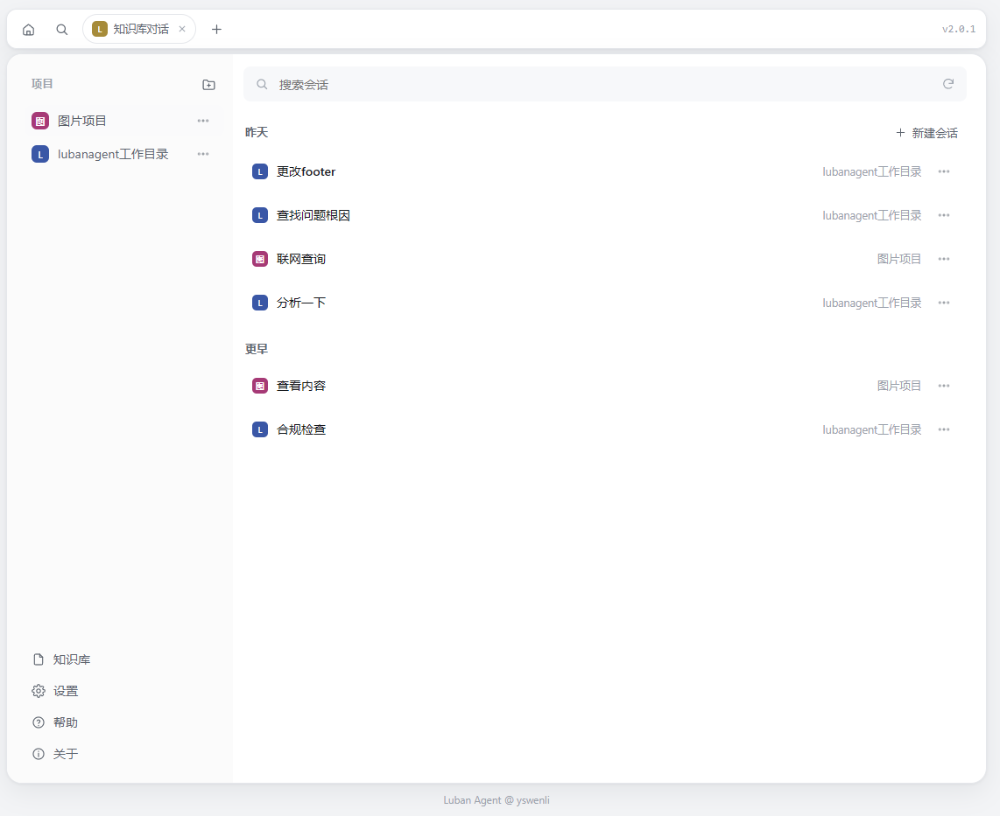
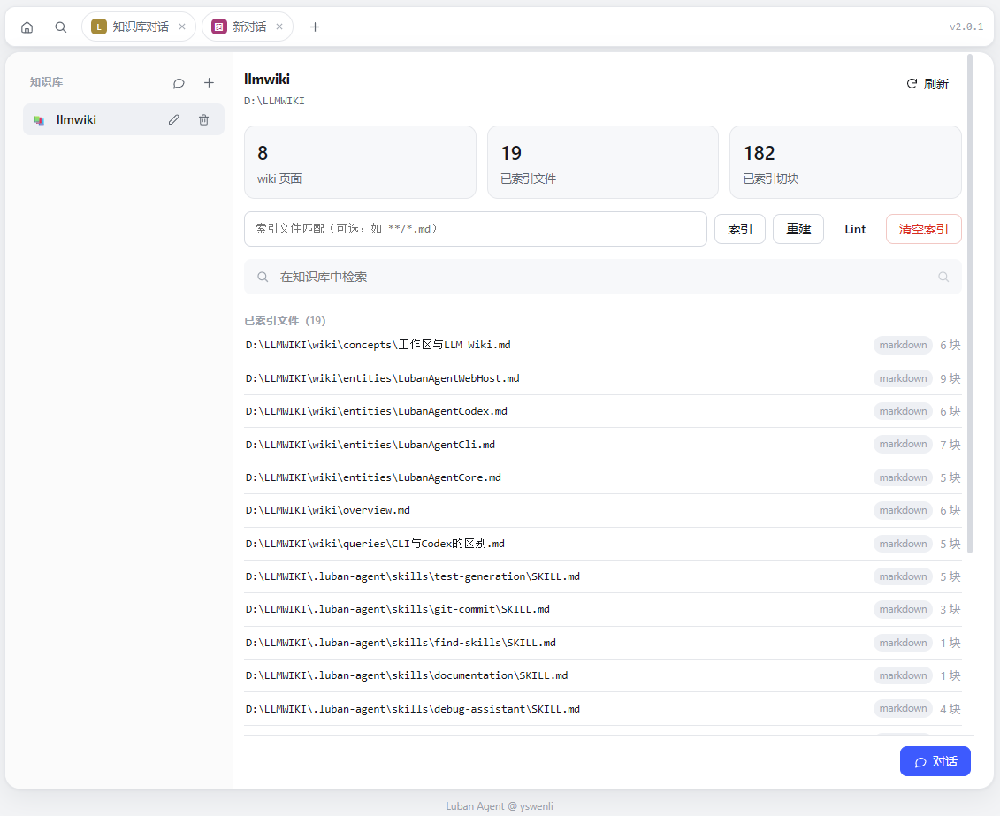
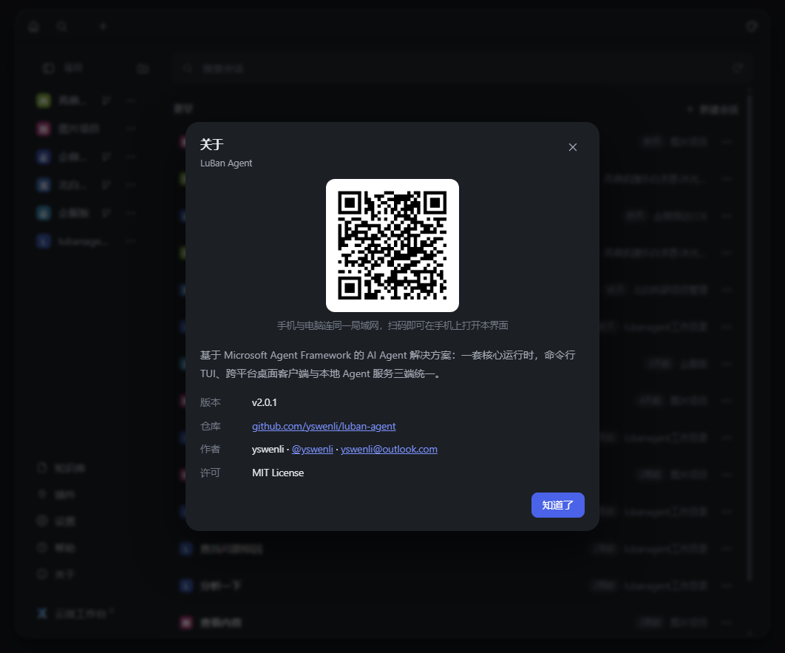

# LuBan Agent

**A Complete AI Agent Solution Based on Microsoft Agent Framework**

*One shared core runtime, three ways to use it: command-line TUI + cross-platform desktop client + local Agent service*

[](https://www.nuget.org/packages/LuBan.AIAgent/)
[](LICENSE)
[](https://dotnet.microsoft.com/)
[](https://gui-cs.github.io/Terminal.Gui/)
[](https://avaloniaui.net/)

English | [中文](README.md)

---

## 🌟 What is LuBan Agent?

Imagine this: you simply say "Show me what directories are on drive D", and the AI automatically invokes the filesystem tool to list all directories. Then you say "Open Baidu and search for LuBan Framework", and the AI launches a browser and completes the search.

This isn't science fiction—this is **LuBan Agent**.

This repository is the complete LuBan Agent solution, containing a shared core library (with its transport protocol, client SDK and A2A collaboration), two client forms, a unified local Agent service (WebHost), the new-project plugin, and an automated test project:

| Project | Form | Description |
|---------|------|-------------|
| **[LubanAgentCore](LubanAgentCore/)** | Core Library | Agent runtime, tool system, skill system, session storage, LLM Wiki retrieval, workspace management, connectors (including Aliyun DevOps), plugin hosting, transport protocol (DTOs/routes/SSE frames), client SDK (HTTP implementations + child-process launcher) and A2A collaboration |
| **[LubanAgentCli](LubanAgentCli/)** | Command-line TUI | Full-screen terminal UI based on Terminal.Gui v2 (Claude Code style), installable as a dotnet tool |
| **[LubanAgentCodex](LubanAgentCodex/)** | Desktop Client | Cross-platform GUI based on Avalonia UI, two-pane layout (sidebar + conversation) + dark theme |
| **[LubanAgentWebHost](LubanAgentWebHost/)** | Local Agent Service | Lightweight, high-performance HTTP/SSE host on SAEA.MVC: IOCP completion ports, self-hosted, no ASP.NET Core / Kestrel dependency; exposes chat, session and workspace capabilities as local endpoints |
| **[LubanAgent.Plugin.NewProject](LubanAgent.Plugin.NewProject/)** | Codex Plugin | The "new project" plugin with a pure-code UI, staged into the Codex `plugins/` directory on build |
| **[LubanAgent.Tests](LubanAgent.Tests/)** | Test Project | MSTest automated tests (connectors, NewProject plugin, Skill/Rule backends, transport protocol, etc.) |

> 📖 For detailed usage of each project, see: [LubanAgentCli README](LubanAgentCli/README.en.md) | [LubanAgentCodex README](LubanAgentCodex/README.en.md)

### Are You Facing These Challenges?

- 😫 Want LLMs to call tools and complete tasks, but struggling with MCP / Function Calling implementation details?
- 😤 Managing Skills, tool registration, and session persistence separately, leading to high maintenance costs?
- 😖 Difficulty switching model providers—rewriting tons of code just to go from Provider A to Provider B?
- 😩 Command line not intuitive enough—want a GUI without rebuilding an entire Agent infrastructure?

**LuBan Agent provides complete AI Agent infrastructure**—all core capabilities live in LubanAgentCore, shared by both CLI and Codex. Implement once, run everywhere.

---

## 📸 UI Preview



*Web UI overview: the top bar holds the home entry and session tabs; the left column holds projects plus the knowledge base / settings / help / about entries (collapsible into an icon-only rail); the right side groups sessions by date*

### Chat: empty state


*New session empty state: the "+" button adds images and files, the model and reasoning mode can be switched, Enter sends and Shift+Enter wraps*

### Chat: Markdown and tool calls


*Chat page: rendered Markdown with tables, history record and token count; the back button returns to the session list or the knowledge base*

### Knowledge base



*Knowledge base page: wiki page / indexed files / indexed chunks counters with index, rebuild, lint, clear and search; the "Chat" button opens the session bound to that library*

### Settings


*Settings page: eight tabs — Providers, Models, Skills, Rules, MCP servers, A2A collaboration, Workspace and Data & usage; on the Skills tab "New / Import ZIP" sit above the list and the body is edited on the right*

### Help


*Help: the repository README is rendered inside the dialog and stays in sync with the host build*

### About



*About: scan the QR code on a phone in the same LAN to open this UI; version, repository, author and license follow below*

---

## ✨ Core Features

### 🤖 Multi-Model Routing
- **20+ AI Provider Support**: OpenAI, Azure, DeepSeek, Kimi, GLM, Qwen, Doubao, Claude, Gemini, Ollama, MiniMax, Volcengine Ark, Alibaba Bailian, Tencent Hunyuan, Xiaomi MiMo, Baidu ERNIE, xAI Grok, Baidu Qianfan, Tencent TI Platform, Huawei Pangu, AWS Bedrock, OpenRouter, plus custom OpenAI-compatible APIs
- **Unified `provider:model` Format**: Switch models with one command, no code changes needed
- **Dynamic Routing**: LuBanChatClient automatically dispatches to the corresponding provider based on prefix

### 🛠️ 12 Built-in Tool Groups
| Tool Group | Capabilities |
|------------|--------------|
| 🌐 **Browser Tools** | Navigate, click, type, screenshot, get content (powered by Playwright) |
| 📁 **FileSystem Tools** | Read, write, edit (single/multi/replace-all), list, search, copy, move, delete; allowed directly inside the workspace, paths outside require confirmation |
| 🌿 **Git Tools** | Status, diff, log, branch, stage, commit, merge, rebase, push — 26 fine-grained tools in total |
| 🔧 **Script Execution Tools** | Execute Shell, Lua, Python scripts |
| 🌍 **Web Tools** | Send HTTP requests to fetch web content |
| 🔍 **Semantic Retrieval Tools** | Index local code/documents and search by semantic similarity |
| 🗜️ **Context Compaction Tools** | Compact the current session's conversation history to free token budget (LLM-invocable) |
| 🧠 **Local Memory Tools** | Store, query, and manage long-term memory |
| 🔌 **MCP External Tools** | Connect external MCP servers and merge their tools into the Agent toolset |
| 🧩 **Orchestration Tools** | Decompose composite tasks into a DAG and dispatch SubAgents in parallel/serial |
| 📚 **Wiki Knowledge Base Tools** | Read/write/delete wiki pages, vector search, health check (opt-in) |
| 📜 **Log Analysis Tools** | Aggregate overview, regex search, and line slicing for large log files with constant memory (enabled by default) |

> Counting note: the 12 rows above list user-facing capabilities; "MCP External Tools" means merging the tools of external MCP servers into the tool set rather than a standalone tool group. The framework actually registers 15 tool groups — 4 management-only groups are not listed separately: `SkillToolGroup` (list/load skills), `SkillManageToolGroup` (write/delete skills), `McpManageToolGroup` (write/delete MCP configs) and `ConnectorManageToolGroup` (connector management); see "Conversational Skill/MCP Management" and "Configuration" below.

### 🎯 Skill System
- Ten core built-in skills (Brainstorming, Code Review, Documentation, Refactoring, Test Generation, Code Explanation, Debug Assistant, Git Commit, Skill Discovery, AGENTS.md Generation), plug and play
- **File-based Skills**: Define custom Skills via SKILL.md files, compatible with OpenCode format, auto-loaded from project-level or user-level directories
- **Conversational Management**: Create, use, and manage Skills and MCP servers through natural language conversation without manual config editing

### 🗣️ Conversational Skill/MCP Management
Operate through natural language—zero learning curve:

| Feature | How to Use |
|---------|------------|
| List Skills | "List all available Skills" |
| Use Skill | "Use the code-review-v2 Skill" |
| Create Skill | "Create a Skill named my-helper, described as general-purpose assistant" |
| Create MCP | "Add an MCP server named my-api, command is node server.js" |

**Features**:
- ✅ Workspace skill files can override same-id built-in Skills (files take precedence over built-ins and config custom Skills); pure built-ins (no same-id directory) cannot be deleted, keeping the system stable
- ✅ The settings list groups by `category`, shows `name` as the primary text and the directory name underneath; saving only rewrites frontmatter and never moves the directory
- ✅ Skills can be imported from a ZIP (entries matching `<directory>/SKILL.md`; a same-name directory is replaced by the imported content)
- ✅ Write/delete operations require user confirmation, preventing accidental operations
- ✅ Changes take effect automatically in the next conversation turn, no restart needed
- ✅ Skill ID validation to prevent injection attacks

**Storage Locations**:
- Skill: `<workspace>/.luban-agent/skills/<skill-id>/SKILL.md`
- MCP: `<workspace>/.luban-agent/mcps/<mcp-name>.json` (external MCP; in-process connector MCPs are resolved from the config.json declaration and never land here)
- Connector enablement: `<workspace>/.luban-agent/connectors/<name>.json`

### 📎 Attachment Support (Images + Text Files)
- **Two attachment kinds**: images (PNG/JPEG/GIF/WebP/BMP/TIFF/HEIC, requires a vision model) and text files (code, config, logs, etc.)
- **Multiple input paths**: CLI supports `@path` references, the `Ctrl+O` file picker, and terminal drag-and-drop; Codex supports the 📎 button, dropping onto the window, and `Ctrl+V` (clipboard files or screenshots)
- **Size tiers**: up to 5 attachments per message; text ≤50KB is inlined into the message, >50KB injects only a path hint so the model can read it on demand with file tools; **`.log` attachments (50KB–1GB) are streamed into an aggregated overview** (level distribution/time range/top error signatures), and the model then drills down on demand with the `log` tool
- **Image preprocessing**: locally resized (max edge 2000px) then sent as base64 `DataContent`; automatically blocked with a prompt when the current model lacks vision
- **Lightweight persistence**: sessions store only paths and metadata (no base64); history replays rebuild from disk or show placeholders. Codex renders thumbnails in the attachment bar and message area, click to view full size

### 🛡️ Security & Rule Engine
- **Path Access Rules**: Paths inside the workspace are allowed directly; paths outside the workspace are allowed after user confirmation
- **Dangerous Operation Confirmation**: Require user confirmation before out-of-workspace access, write, delete, or execute operations, with this-time/turn/session grant tiers
- **Custom Rules**: Support wildcard matching for flexible tool behavior control

### 💾 Session Persistence
- Conversation history automatically saved to SQLite database
- Long conversation compression (SummarizingChatReducer) ensures context is never lost
- Session statistics and Token counting at a glance

### 🔌 MCP Protocol Support
- Built-in filesystem MCP client
- Hot-loading support for external MCP servers
- Standard JSON-RPC protocol, seamlessly integrated with the ecosystem

### 🧩 Multi-Agent Task Orchestration
- **Composite Task Decomposition**: Main Agent automatically identifies complex tasks and decomposes them into DAG task graphs
- **Serial/Parallel Hybrid Orchestration**: Layer-based topological sort, parallel within same layer, serial across layers
- **SubAgent Scheduling**: Each DAG node executed by independent SubAgent with tool group isolation
- **Context Passing**: Nodes reference predecessor outputs via `{dep:xxx}` placeholders
- **Memory Context Injection**: The orchestration entry builds workspace long-term memory and rule context once, then injects it into every SubAgent's system prompt
- **Orchestration Extensions**: workspace `.luban-agent/plans/*.json` for task templates and `.luban-agent/roles/*.json` for custom SubAgent roles

### 📂 Workspace & Knowledge Base
- **Workspace Isolation**: Each workspace has its own root directory, session history, and configuration directory (`.luban-agent/`)
- **Stable Workspace ID**: The workspace ID is derived from the normalized root path, so CLI and Codex yield the same ID for the same directory and thus share long-term memory across hosts
- **LLM Wiki Knowledge Base**: Special workspace type supporting file indexing and semantic retrieval with auto-retrieval-augmented Q&A
- **Vector Store Isolation**: Index data from different workspaces is completely isolated
- **Path Authorization Management**: Paths inside the workspace are allowed directly; paths outside the workspace are allowed after user confirmation, with grants remembered per path root (this-time/this-turn/this-session tiers)

---

## 🚀 Quick Start

### Prerequisites

- [.NET 10.0 SDK](https://dotnet.microsoft.com/download) or later

### 1. Clone the Repository

```bash
git clone https://github.com/yswenli/luban-agent.git
cd luban-agent
```

### 2. Prepare the Playwright Browser (Installed Automatically on First Use)

Browser drivers are installed on demand into `~/.luban-agent/playwright-driver/{version}`; the version is taken from the `Microsoft.Playwright` package declaration, so no manual version pinning is needed. If automatic installation fails, run the command returned by `PlaywrightDriverResolver.GetInstallBrowsersHint()`.

### 3. Build the Solution

```bash
dotnet build LubanAgent.slnx
```

### 4. Choose Your Client

#### Option 1: Command-line TUI (LubanAgentCli)

```bash
# Run directly
dotnet run --project LubanAgentCli/LubanAgentCli.csproj

# Or install as a dotnet global tool (recommended)
dotnet pack LubanAgentCli/LubanAgentCli.csproj -c Release -o ./artifacts
dotnet tool install -g LuBan.Agent.CLI --add-source ./artifacts

# Launch from any directory after installation
luban-agent-cli
```

On launch, it enters the Terminal.Gui full-screen interface. Type plain text to chat with the Agent; prefix with `/` to open the command panel.

#### Option 2: Desktop Client (LubanAgentCodex)

```bash
dotnet run --project LubanAgentCodex/LubanAgentCodex.csproj
```

Select a workspace on startup, then chat with the Agent in the graphical interface.

#### Option 3: Local Agent Service (LubanAgentWebHost)

```bash
# Start manually (port comes from LubanAgentWeb:Port in appsettings.json, default 18080)
# When ready, the terminal prints the browser entry: http://<lan-ip>:18080/?t=<session token>
# A QR code for the same address is printed below it: scan it on a phone in the same LAN (skipped when a client launches the host with redirected output)
# The browser token is rotated every 15 minutes by default (open pages renew automatically) and the session is capped at 8 hours
dotnet run --project LubanAgentWebHost/LubanAgentWebHost.csproj

# Health check (the only endpoint without a token)
curl http://127.0.0.1:18080/system/health

# Reprint the browser entry (uses the host token to fetch the running instance's current entry; fails when no host is running)
dotnet run --project LubanAgentWebHost/LubanAgentWebHost.csproj -- token

# Stop the resident instance
dotnet run --project LubanAgentWebHost/LubanAgentWebHost.csproj -- --stop
```

Opening `http://<lan-ip>:18080/` directly is rejected (401): the entry must carry the current session token, which is then exchanged for a cookie and the URL is redirected back to a clean address; the same 401 returns once the session ceiling is passed.

The WebHost is a standalone service, so clients don't have to start it manually: when no service address is configured, the client SDK inside `LubanAgentCore` (`Client/`) first adopts an instance that is already running (via the discovery file) and only launches a child process when none exists. Port, timeout and user identity come from the host's `LubanAgentWeb` configuration; the host token is generated by the host on every start and written to the discovery file, so clients only read it. A launched host stays resident after the client exits; stop it with `--stop` (or by ending the host process).

> 🔐 How the two credentials (browser session token vs client host token) are split, how to recover from a 401, rotation and the session ceiling, multi-device and post-restart behaviour, and the risk boundaries you must know are covered in "[WebHost Access Token and Security](#-webhost-access-token-and-security)" below.

### 5. Configure an AI Provider and Start Chatting

Configure your first Provider in either client:

```
> /provider -add
Select Provider type:
  1. OpenAI
  2. Azure OpenAI
  3. DeepSeek
  4. Kimi (Moonshot)
  ...
Select: 4
Enter Kimi API Key: ********
✓ Provider 'Kimi' added and saved
```

Then select a model and start your first Agent conversation:

```
> /model -switch kimi:k3
✓ Switched model: kimi:k3

You: Show me what directories are on drive D

[Calling tool]: ListDirectoryAsync
  Parameter path: D:\
[Tool result]: Program Files, Users, Windows, ...

🤖 Drive D contains the following directories:
1. Program Files
2. Users
3. Windows
...
```

> **Security Note**: API Key input is hidden (password input mode); user configuration is automatically saved to `%LocalAppData%\LuBan\AIAgent\users\<userId>\config.json` (`userId` comes from the `LUBAN_USER_ID` environment variable, defaulting to `yswenli`)

---

## 📦 Cross-Platform Build & Publish

The project supports building into **single-file executables** that run directly on target machines without requiring .NET runtime installation.

### Prerequisites

- [.NET 10.0 SDK](https://dotnet.microsoft.com/download) or later
- Verify SDK version: `dotnet --version`

### Publish as Single-File Executable

#### Command-line TUI (LubanAgentCli)

```powershell
# Windows 10/11 x64
dotnet publish LubanAgentCli/LubanAgentCli.csproj -c Release -r win-x64 --self-contained true -p:PublishSingleFile=true

# Windows ARM64
dotnet publish LubanAgentCli/LubanAgentCli.csproj -c Release -r win-arm64 --self-contained true -p:PublishSingleFile=true

# macOS Intel (x64)
dotnet publish LubanAgentCli/LubanAgentCli.csproj -c Release -r osx-x64 --self-contained true -p:PublishSingleFile=true

# macOS Apple Silicon (ARM64)
dotnet publish LubanAgentCli/LubanAgentCli.csproj -c Release -r osx-arm64 --self-contained true -p:PublishSingleFile=true

# Linux x64
dotnet publish LubanAgentCli/LubanAgentCli.csproj -c Release -r linux-x64 --self-contained true -p:PublishSingleFile=true

# Linux ARM64
dotnet publish LubanAgentCli/LubanAgentCli.csproj -c Release -r linux-arm64 --self-contained true -p:PublishSingleFile=true
```

#### Desktop Client (LubanAgentCodex)

```powershell
# Windows 10/11 x64
dotnet publish LubanAgentCodex/LubanAgentCodex.csproj -c Release -r win-x64 --self-contained true -p:PublishSingleFile=true

# Windows ARM64
dotnet publish LubanAgentCodex/LubanAgentCodex.csproj -c Release -r win-arm64 --self-contained true -p:PublishSingleFile=true

# macOS Intel (x64)
dotnet publish LubanAgentCodex/LubanAgentCodex.csproj -c Release -r osx-x64 --self-contained true -p:PublishSingleFile=true

# macOS Apple Silicon (ARM64)
dotnet publish LubanAgentCodex/LubanAgentCodex.csproj -c Release -r osx-arm64 --self-contained true -p:PublishSingleFile=true

# Linux x64
dotnet publish LubanAgentCodex/LubanAgentCodex.csproj -c Release -r linux-x64 --self-contained true -p:PublishSingleFile=true

# Linux ARM64
dotnet publish LubanAgentCodex/LubanAgentCodex.csproj -c Release -r linux-arm64 --self-contained true -p:PublishSingleFile=true
```

### Output Location

| Project | Output Path |
|---------|-------------|
| LubanAgentCli | `LubanAgentCli/bin/Release/net10.0/<rid>/publish/LubanAgentCli[.exe]` |
| LubanAgentCodex | `LubanAgentCodex/bin/Release/net10.0/<rid>/publish/LubanAgentCodex[.exe]` |

> Windows output is `.exe`; macOS/Linux output is an extensionless ELF/Mach-O executable.

### Notes

- **NativeAOT not supported**: The project relies heavily on reflection from Terminal.Gui / Avalonia; `PublishAot=true` will cause runtime exceptions
- **Cross-compilation limitations**: Native dependencies for macOS and Linux (e.g., `libSkiaSharp`) must be compiled on the target platform; it is recommended to run `dotnet publish` directly on the target platform
- **Playwright browser**: Drivers are installed automatically into `~/.luban-agent/playwright-driver/{version}` on first use of the browser tools; no manual version pinning is required. If automatic installation fails, run the command returned by `PlaywrightDriverResolver.GetInstallBrowsersHint()`
- **Configuration files**: After publishing, `appsettings.json` is output with the artifacts and can be modified before running; user configuration is saved under `LuBan/AIAgent/` in the system LocalApplicationData directory (on Windows: `%LocalAppData%\LuBan\AIAgent\`)

---

## 🏗️ Solution Architecture

```
luban-agent/
├── LubanAgent.slnx           # Solution file (XML format, 6 projects)
│
├── LubanAgentCore/           # Core library (net10.0)
│   ├── A2A/                  # A2A collaboration (server host / client registry / in-process & remote SubAgent dispatch)
│   ├── Agents/               # Agent profiles (Normal / LLM Wiki)
│   ├── Client/               # Client SDK (HTTP/SSE implementations + child-process launcher)
│   ├── Configuration/        # Configuration management
│   ├── Connectors/           # Connectors (including the Aliyun DevOps implementation)
│   ├── Context/              # User context
│   ├── EmbeddingModels/      # AI embedding model files (bge-small-zh-v1.5)
│   ├── Entities/             # Data entities
│   ├── Hosting/              # Hosting integration
│   ├── Infrastructure/       # Infrastructure
│   ├── Models/               # Data models
│   ├── Plugins/              # Plugin host
│   ├── Protocol/             # Transport protocol (routes / DTOs / SSE frames / event translation)
│   ├── Repositories/         # Data access layer
│   ├── Retrieval/            # Semantic retrieval
│   ├── Security/             # Credential storage and protection
│   ├── Services/             # Core services (Agent host / session / workspace)
│   └── Utils/                # Utilities
│
├── LubanAgentCli/            # Command-line TUI (Terminal.Gui v2 · net10.0)
│   ├── App/                  # TUI application layer (bootstrap + DI + theming)
│   │   ├── Dialogs/          # Popup components (BaseDialog base + 5 subclasses)
│   │   ├── Models/           # Block document model
│   │   ├── Services/         # TUI services (session titles, etc.)
│   │   ├── ViewModels/       # MVVM ViewModel layer
│   │   └── Views/            # View layer (pure rendering)
│   ├── Commands/             # Command implementations
│   ├── Infrastructure/       # Input bootstrap and diagnostics
│   ├── Services/             # Spinner service
│   └── Program.cs            # Entry point
│
├── LubanAgentCodex/          # Desktop client (Avalonia UI · net10.0)
│   ├── Views/                # Avalonia views
│   ├── ViewModels/           # MVVM ViewModel layer
│   ├── Services/             # UI services
│   ├── Converters/           # Value converters
│   ├── Plugins/              # Plugin UI dispatching
│   ├── Styles/               # Style themes
│   └── Program.cs            # Entry point
│
├── LubanAgentWebHost/        # Local Agent service (SAEA.MVC · net10.0) + browser site
│   ├── Controllers/          # 12 endpoint controllers (one per route group, routing only)
│   ├── Services/             # Endpoint business logic (sessions, chat, workspaces, wiki, settings…)
│   ├── Models/               # Request / response models for the browser endpoints
│   ├── Hosting/              # Process runtime, SSE writer, startup settings, shared guards
│   ├── web/                  # Web UI sources (SolidJS + TypeScript + Vite)
│   └── wwwroot/              # Web UI build output (copied into the build output by dotnet build)
│
├── LubanAgent.Plugin.NewProject/  # "New project" plugin
├── LubanAgent.Tests/         # MSTest automated tests
├── smoke/                    # Plugin system smoke projects (intentionally outside the slnx)
└── docs/                     # Design & planning documents
```

**Architecture Overview**:

```
┌─────────────────────┐  ┌─────────────────────┐  ┌─────────────────────┐
│   LubanAgentCli     │  │   LubanAgentCodex   │  │  LubanAgentWebHost  │
│   (Terminal.Gui)    │  │     (Avalonia)      │  │     (SAEA.MVC)      │
└──────────┬──────────┘  └──────────┬──────────┘  └──────────┬──────────┘
           │                        │                        │
           └────────────────────────┼────────────────────────┘
                                    ▼
       ┌────────────────────────────────────────────────────────┐
       │ LubanAgentCore                                         │
       │  runtime / tools / skills / sessions / LLM Wiki / ws   │
       │  Client/    client SDK (HTTP/SSE + child-process)      │
       │  Protocol/  transport protocol (routes / DTOs / SSE)   │
       │  A2A/       A2A collaboration (server host / dispatch) │
       └────────────────────────────┬───────────────────────────┘
                                    ▼
                         ┌─────────────────────┐
                         │    LuBan.AIAgent    │
                         │  multi-model / MCP  │
                         └─────────────────────┘
                                    ▼
         OpenAI / Kimi / DeepSeek / Claude / ... (20+ Providers)
```

- **UI/Business Separation**: CLI and Codex handle only interaction and rendering; all Agent capabilities come from Core
- **Unified Service Entry**: chat, sessions and workspaces are exposed by `LubanAgentWebHost`; the transport protocol (`Core/Protocol/`) and the client implementation (`Core/Client/`) both live in `LubanAgentCore` — see "Unified Agent Service" above
- **Single Source for Embedding Models**: `bge-small-zh-v1.5.zip` is maintained only in Core and propagated to each client's output directory via ProjectReference content flow
- **Unified Configuration**: Both clients share the user configuration in `LuBan\AIAgent\` under the system LocalApplicationData directory (Windows: `%LocalAppData%\LuBan\AIAgent\`); the session database `luban-ai-agent.db` is owned exclusively by the WebHost and lives in its program directory (`Data Source=./luban-ai-agent.db` in `appsettings.json` is a relative path that the host resolves against its own directory), and clients never open it

---

## 🔗 Unified Agent Service (WebHost)

`LubanAgentWebHost` exposes Agent capabilities as HTTP/SSE endpoints via SAEA.MVC, so clients (CLI / Codex) only handle UI interaction:

| Route | Description |
|-------|-------------|
| `POST /agent/chat` | Streaming chat (SSE) |
| `POST /agent/send` | Non-streaming chat (tools disabled) |
| `POST /agent/confirm` | Return a tool confirmation result |
| `POST /agent/cancel` | Cancel the round currently running for that session |
| `POST /agent/active` | Probe whether the session has a round in progress |
| `POST /agent/attach` | Attach to the round in progress (SSE, snapshot first); `204` when there is none |
| `POST /agent/reset` | Drop the server-cached Agent for a session |
| `/session/*` | Session CRUD, messages, statistics, switching |
| `/workspace/*` | Workspace list/create/switch/delete/rename, authorization and config directory |
| `/llmwiki/*` | Knowledge base create/delete, list files, index, search, stats, lint, rebuild, ingest, clear |
| `GET /a2a/status` | A2A runtime status (read-only) |
| `GET /system/health` | Health check (token-free, used by the launcher) |
| `GET /system/bootstrap` | Browser first-screen data (workspaces, providers and models, permission modes, attachment policy, version) |
| `GET /system/commands` | Slash-command catalogue for the browser client |
| `GET /system/entryQr` | LAN entry QR code as PNG (shown in the About dialog; scan it on a phone to open this instance — minted from the current session token on every request) |
| `GET /system/session` | Rotation and expiry times of the current browser session (used by the frontend heartbeat, which also slides a rotated token back into the cookie) |
| `GET /system/entryUrl` | Current entry address and expiry (host token only; lets `LubanAgentWebHost token` reprint it and reopens the session family once expired) |
| `POST /attachment/upload` | Browser attachment upload (JSON + Base64, written to the workspace staging directory) |
| `GET` / `POST` `/provider/*` | Read/switch the global model selection, pull a provider's models, read/write providers (keys are returned masked only) |
| `GET` / `POST` `/skill/*`, `/rule/*`, `/mcp/*` | List/read/save/delete file-based skills, rules and MCP servers (scoped to `global` or a workspace) |
| `GET` / `POST` `/model/*` | List a provider's models and add/rename/delete custom models |
| `GET` / `POST` `/a2a/*` | A2A runtime status plus read/write of workspace A2A server/client configuration |
| `GET /file/read` | Read a workspace file's raw content (what relative links and images in a session open; text and images only, out-of-workspace paths and other formats get a notice page) |

Constraints and known limitations:

- **All interfaces, reachable from localhost and external networks**: SAEA.MVC exposes no bind-address option (`HttpSocket` passes no IP and always binds `0.0.0.0`). Endpoints, SSE, attachments and static assets therefore all pass through the same gate: anything without a valid credential (a browser session token via `?t=` or the cookie it is exchanged for, or a client `Authorization: Bearer` host token) gets 401. Only `/system/health` is token-free so launchers can probe the port.
- **Standalone service, port and tokens decided by the host**: the port comes from `LubanAgentWeb:Port` (default 18080); both tokens are random per start — the browser session token rotates on use with an 8-hour ceiling, the host token stays fixed for the process lifetime (`LubanAgentWeb:Token` or `--token` pins it) — and both die with the process, so a restart requires re-entering through the new address. After starting successfully the host writes its actual address and host token to `%LOCALAPPDATA%\luban-agent\webhost.json` and deletes it on a clean exit; a client that reads it probes `/system/health` first, then adopts the running instance instead of launching a duplicate. A launched host stays resident after the client exits — stop it with `LubanAgentWebHost --stop`. Only one instance can own the port, so a second process exits immediately on the port conflict.
- **Entry address and token**: the terminal prints the entry address carrying the session token; opening it exchanges the token for an HttpOnly cookie and 302s back to a clean URL, and an open page keeps renewing through the frontend heartbeat. Once the session ceiling is reached, fetch a new address with `LubanAgentWebHost token`. Full usage and risk boundaries are in "[WebHost Access Token and Security](#-webhost-access-token-and-security)" below.
- **A disconnect is not a cancellation**: a round lives in the host process's run hub, so an SSE disconnect only removes a subscriber and the round keeps running to completion. When the browser reopens the same session it first probes `POST /agent/active`, then calls `POST /agent/attach` if a round is active (a `run.snapshot` frame first, then live frames); with no active round the response is `204` and the client loads history. `attach` optionally takes `runId` (a mismatch with the current round is treated as no active round, `204`) and `fromSeq` (the highest frame sequence already received; when omitted a snapshot is sent). Stopping explicitly still uses `POST /agent/cancel`; deleting a session that is running, or a workspace containing one, is rejected with `409`, and clearing messages cancels the round and waits for it to wind down first.
- **Database owned by the WebHost**: session data is `luban-ai-agent.db` in the WebHost program directory (relative connection strings are rebased onto the host program directory). Clients no longer open the database; the working directory only affects relative-path inputs. A same-named database left in a client output directory by an older build is not read — copy it into the WebHost program directory if you want to keep it.
- **A2A and orchestration progress live on the host side**: A2A server/client roles and the startup worktree reconciliation run inside the WebHost per user workspace; sub-agent orchestration progress is streamed as `orchestration.progress` frames and replayed by the client into its local progress outlet, so UI subscriptions behave the same as when running locally. The A2A runtime starts and stops with the host process; clients only read `/a2a/status`, and `/a2a -start|-stop` degrades to a notice.
- **Knowledge-base background tasks degrade to synchronous calls**: the `Start*` entry points rely on host-side progress events, which the client has no channel for, so remote mode always falls back to the synchronous path (the `--wait` semantics); callers must show their own busy overlay while it runs.
- **Plugin directories**: Codex plugins are handed to the WebHost via `--plugins-dir`; plugins installed from the web "Plugins" page live in a separate root (`LubanAgentWeb:WebPluginsDir` / `--web-plugins-dir`, default `%LOCALAPPDATA%\LuBan\AIAgent\webhost\plugins`, state file `plugin-states.json`). Both roots are scanned, but the management page only lists and manages the web root, leaving Codex installs and their enabled state untouched.
- **Single-round sync wait limit**: `LubanAgentWeb:TimeoutSeconds` (default 86400, i.e. 24 hours) must be far larger than the longest round; otherwise SAEA returns 408 mid-round and appends plain text onto the already-open stream.
- **Tool confirmation**: the wait limit comes from `LuBanAgent:Confirmation:TimeoutSeconds` (default 60); a timeout is treated as a denial.

### 🌐 Browser client (`LubanAgentWebHost/wwwroot`)

The WebHost also serves a web UI (SolidJS + TypeScript + Vite). The source lives in `LubanAgentWebHost/web/`, the build output is committed under `LubanAgentWebHost/wwwroot/`, and the project file copies it to the `wwwroot` folder of the build output on `dotnet build`.

```bash
cd LubanAgentWebHost/web
npm install
npm run build          # output goes to LubanAgentWebHost/wwwroot
```

- **`dotnet build` does not need Node**: the output is committed; rebuild only after changing sources under `LubanAgentWebHost/web/`.
- **Restart the process to pick up a new build**: `IsStaticsCached=True` keeps static file contents in memory after the first request, so a same-named file on disk is not reloaded.
- **Hash routing**: `#/` (sessions), `#/s/<sessionId>` (chat), `#/settings/<tab>` (settings), `#/wiki` (knowledge base), `#/plugins` (plugin management) and `#/plugin/<pluginId>/<entryId>` (a plugin's own page). SAEA has no SPA fallback, so history routing is not an option.
- **Runtime config**: the process writes `wwwroot/runtime-config.js` (user and port only) at startup. Neither token is written there — the browser one only becomes an HttpOnly cookie via the address-bar entry, the host one only lives in the discovery file. The file is not committed (see `.gitignore`).
- **Development loop**: start the WebHost first (`--port` to choose the port) and put the **host token** into `VITE_HOST_TOKEN` — take `token` from `%LOCALAPPDATA%\luban-agent\webhost.json`, or the value you passed with `--token` (the `?t=` in the browser entry is a session token: it can only be exchanged for a cookie and cannot be used as a Bearer token); then run `npm run dev` in `LubanAgentWebHost/web/`; `VITE_HOST_PORT` sets the upstream port (default 18080, matching the host default) and `server.proxy` forwards `/agent`, `/session`, `/workspace`, `/system`, `/attachment`, `/provider`, `/skill`, `/rule`, `/mcp`, `/model`, `/a2a`, `/llmwiki`, `/plugin` and `/plugin-web` with an added `Authorization` header, while Vite keeps serving the static assets.
- **Global top bar and SSE**: session state lives in a frontend-wide chat pool, so tabs are decoupled from routing — a running turn keeps streaming when you switch to the home page or settings, signalled by an activity dot on its tab. Only closing a tab or deleting a session disposes the instance and aborts the stream.
- **Settings is an overlay**: `#/settings/<tab>` covers the current view; closing it with ×, Esc or a backdrop click returns to where you were. There is no separate settings page and no "back to app" link.
- **Scope**: the web UI covers the global top bar (home entry + session tabs), the two-column home (project filter plus create/rename/delete project on the left, session list with create/rename/delete session on the right), chat (attachments, slash commands, tool confirmation dialog, back button on the left of a tab title), the knowledge-base page (create/rename/index/rebuild/search, with a "Chat" button at the bottom that opens a session for that library), the plugin management overlay (install / upgrade / enable / disable / uninstall for web plugins only), plugin pages (a same-origin iframe; a plugin with a page shows an entry at the bottom of the left sidebar once enabled) and the eight-tab settings overlay (provider / model / skill / rule / MCP / A2A / workspace / data & usage); up to 5 attachments per message and 10MB per text attachment. Connectors, `@` context and the Shell command entry point are out of scope for the web UI.

---

## 🔐 WebHost Access Token and Security

The host binds its listening socket to `0.0.0.0` (SAEA.MVC exposes no bind-address option), so any device on the same network can connect once it knows the address — and behind that channel is an Agent that can read/write workspaces and run commands. The host therefore denies everything by default and accepts exactly two credential kinds: a **session token** for browsers (short-lived, rotated automatically, with a hard ceiling) and a **host token** for clients (fixed for the process lifetime, `Authorization: Bearer` only).

### Two credential kinds

| Credential | Who uses it | Out-of-the-box behaviour |
|------------|-------------|--------------------------|
| Session token (`?t=` / `luban_auth` cookie) | Browsers | Random on start; rotated every 15 minutes by default, previous value honoured for a 5-minute grace period, session capped at 8 hours |
| Host token (`Authorization: Bearer`) | CLI / Codex / plugins / your own client | Random on start (pin it with `LubanAgentWeb:Token`); unchanged for the process lifetime |

### Using the token

| Scenario | What to do |
|----------|------------|
| First entry (browser) | Open `http://<lan-ip>:<port>/?t=<session token>` as printed in the terminal; the host exchanges it for a cookie and 302s to the same path without `t` |
| Page left open | The web UI pings `/system/session` every 60 seconds; the host rotates the token on the first request after expiry and writes it back as a cookie, so no manual refresh is needed |
| Terminal output is gone | Run `LubanAgentWebHost token` on the host machine; it uses the host token to fetch the running instance's current entry address and QR code |
| Multiple devices | Enter through the same address; each device keeps its own cookie but they share one session token family — a heartbeat from any device drives rotation, and the previous value stays valid during the grace period |
| Session ceiling reached | 8 hours by default (`LubanAgentWeb:SessionMaxHours`); the old address then returns 401 and you fetch a new one with `token` |
| After a restart | Both tokens die with the process; enter again through the newly printed address (no long-term login) |
| CLI / Codex / plugins | Send `Authorization: Bearer <host token>` automatically, reading the token from the discovery file — no manual input |

- **Token shape**: Base64Url text of 32 cryptographically random bytes (`RandomNumberGenerator`), 43 characters; both kinds look the same and differ only in lifetime.
- **Session timings are configurable**: `LubanAgentWeb:SessionTokenMinutes` (default 15), `SessionGraceMinutes` (default 5), `SessionMaxHours` (default 8). Invalid values (zero or negative) make the host refuse to start instead of silently falling back.
- **Pinning the host token**: use `LubanAgentWeb:Token` or `--token`. Only letters, digits, `-` and `_` are allowed; a value containing spaces, semicolons or newlines would truncate the cookie or corrupt headers, so the host refuses to start instead of degrading. Pinning affects the client token only — browser rotation is unaffected.
- **The browser never stores the token in readable form**: the session token is exchanged for a `luban_auth` cookie (`Path=/; HttpOnly; SameSite=Lax`, session-scoped); the `t` parameter is removed by a 302 so it does not stay in history, and page scripts cannot read it either — `runtime-config.js` only contains `userId`/`port`. Rotated values are written back by the gate via `Set-Cookie`; the frontend never touches them.
- **What a 401 looks like**: a browser hitting the address without a token gets a Chinese help page (pointing at the terminal entry address and at `LubanAgentWebHost token`); once the session ceiling is passed the page says the session expired. API clients get HTTP 401 with the standard envelope (`success: false`, `code: 401`, `message` explaining why). Any 401 inside the web UI replaces the whole page with an "token expired" notice instead of leaving a UI that cannot do anything.

### Gate coverage and implementation notes

- **One interception point covering every entry**: the decision hangs on `SAEA.MVC.HttpContext.GetActionResult()`, so routed endpoints, SSE streams, attachment uploads and static assets all pass the same gate; a second check (`WebApi.GuardAsync`) runs inside controller actions.
- **Exactly one path is exempt**: `/system/health` is token-free so launchers can probe the port; it returns only `status`/`version`/`serverTime`, carries no user identity and does not wait for user initialization.
- **Browser credentials are judged as session tokens**: when the URL or the cookie carries a session token, only that value is accepted — a wrong token returns 401 even when a valid cookie is present, so a bad entry is not masked by an old credential. `Bearer` is a separate credential, checked first and unaffected by browser rotation or the session ceiling.
- **Rotation happens inside the gate**: the first request after expiry gets a fresh token plus `Set-Cookie`, while the previous value stays valid for the grace period (covering requests already in flight); once the session ceiling is reached every session token is answered with "expired".
- **The QR code follows the current token**: `/system/entryQr` mints the URL from the current session token on every request and is served with `Cache-Control: no-cache`, so a stale code is never cached.
- **Constant-time comparison**: validation uses `CryptographicOperations.FixedTimeEquals` instead of short-circuiting character by character, so token prefix length does not leak.
- **Fail closed**: the gate replaces SAEA's internal request-context type via reflection; if that fails, startup throws instead of silently running without authentication.
- **Non-read requests are not redirected**: only GET/HEAD get a 302; a POST carrying `?t=` is executed as-is once validated, so its body is not lost.

### Risk boundaries (read this)

- **No transport encryption**: there is no TLS by default, so the token and all conversation content travel in plaintext on the LAN. Rotating on restart and during runtime narrows the window; it does not replace encryption.
- **Rotation is not revocation**: rotation only shortens the window for a leaked-but-unused token; a token that keeps being used keeps getting renewed and ends at the session ceiling (8 hours by default). That ceiling is the only force-expiry switch.
- **The discovery file is plaintext**: `%LOCALAPPDATA%\luban-agent\webhost.json` records the port and host token with no extra ACL hardening, so any process or user on the same machine that can read that profile can read it. It is only appropriate for a single-user machine.
- **Possession of the address means full access**: while the token is valid, whoever holds the entry address can read/write workspaces and run commands. Do not paste that address into chat groups, tickets or screenshots.
- **Internet exposure needs your own hardening**: front it with a reverse proxy that adds TLS and additional authentication, and restrict source networks; this project ships no public-deployment story.

---

## ⚙️ Configuration

### Application Configuration (appsettings.json)

> The snippet below is a structural example, not the repository defaults; actual values live in `LubanAgentWebHost/appsettings.json` (for example `MaxToolLoopIterations` is 500, `Orchestration.MaxParallelism` falls back to the framework default 5 when unset, and `Tools` also contains `Git` and `Log` groups).

```json
{
  "LuBanAgent": {
    "DefaultModel": "openai:gpt-4o",
    "SystemPrompt": "You are an intelligent assistant.",
    "MaxToolLoopIterations": 10,
    "Tools": {
      "Browser":    { "Enabled": true, "Headless": false },
      "FileSystem": { "Enabled": true, "AllowedRoots": ["C:\\Work"] },
      "Script":     { "Enabled": true, "Shell": "cmd" },
      "Web":        { "Enabled": true },
      "Retrieval":  { "Enabled": true, "ModelId": "bge-small-zh-v1.5" }
    },
    "Orchestration": {
      "Enabled": true,
      "MaxParallelism": 3,
      "MaxNodes": 20
    }
  }
}
```

### User Configuration (%LocalAppData%\LuBan\AIAgent\users\<userId>\config.json)

User configurations (Providers, custom Skills, rules, connector declarations, etc.) are automatically saved locally, shared by both clients, and loaded on restart. `userId` comes from the `LUBAN_USER_ID` environment variable and defaults to `yswenli`; a legacy single-user `config.json` is copied to seed the first per-user configuration.

> Connectors (e.g. the Aliyun DevOps `yunxiao` connector) declare their **availability** in the `connectors` section of `config.json` (an undeclared connector counts as not installed); whether one is enabled in a given workspace is decided by `.luban-agent/connectors/<name>.json`. When an older install has no `connectors` section, a default declaration is seeded on first load.

> 📖 For complete configuration options, see each sub-project's README.

---

## 🔧 Technology Stack

| Component | Description |
|-----------|-------------|
| **.NET 10.0** | Target framework |
| **LuBan.AIAgent** | Agent runtime framework (multi-model routing / MCP / orchestration) |
| **Microsoft.Extensions.AI** | Unified chat client abstraction |
| **Terminal.Gui 2.6.0-develop.61** | CLI full-screen TUI framework (24-bit TrueColor, alt-screen) |
| **Avalonia 12.1.6** | Codex cross-platform desktop UI framework |
| **CommunityToolkit.Mvvm** | MVVM framework |
| **Microsoft.Playwright** | Browser automation engine |
| **Microsoft.ML.OnnxRuntime** | ONNX model inference (semantic retrieval) |
| **SqlSugar / SQLite** | Session & vector data storage |

---

## 💡 Tips

- 🖥️ **Multiple Clients, One Core**: CLI suits terminal lovers and server environments; Codex suits GUI users—both can also go through the local WebHost service; configuration and sessions are fully shared
- ⌨️ **CLI Shortcuts**: `Esc` cancel task, `Shift+Tab` cycle permission modes, `Tab` toggle task view, `Ctrl+Q` quit, `Ctrl+O` add attachments
- 🛡️ **Four Permission Modes**: Default / Plan / AcceptEdits / BypassPermissions — in-workspace operations need no confirmation, while out-of-workspace and sensitive operations require user confirmation (this-time/turn/session grant tiers)
- 💬 Model routing uses `provider:model` format, supporting 20+ AI providers
- 🧩 **Multi-Agent Orchestration**: AI auto-decomposes complex tasks into DAG with serial/parallel SubAgent execution, and SubAgents inherit workspace long-term memory
- 📂 **Workspace Isolation**: Each workspace has its own session history and config directory (`.luban-agent/`), with a host-stable workspace ID that shares long-term memory
- 🔍 **LLM Wiki Knowledge Base**: After indexing local documents, conversations are automatically augmented with retrieval

---

## 🤝 Related Projects

- **[LuBan.Framework](https://github.com/yswenli/luban-framework)** - LuBan Framework Core
- **[LuBan.AIAgent](https://www.nuget.org/packages/LuBan.AIAgent/)** - AI Agent Runtime
- **[LuBan.DI](https://www.nuget.org/packages/LuBan.DI/)** - Dependency Injection Container
- **[LuBan.AIFlow](https://www.nuget.org/packages/LuBan.AIFlow/)** - AI Workflow Engine
- **[LuBan.Web.Core](https://www.nuget.org/packages/LuBan.Web.Core/)** - Web Core Components

---

## 📄 License

MIT License

---

## 👤 Author

**yswenli**
- 📧 Email: yswenli@outlook.com
- 🐙 GitHub: [@yswenli](https://github.com/yswenli)

---

**⭐ If this project helps you, please give it a Star! ⭐**

Made with ❤️ by yswenli
