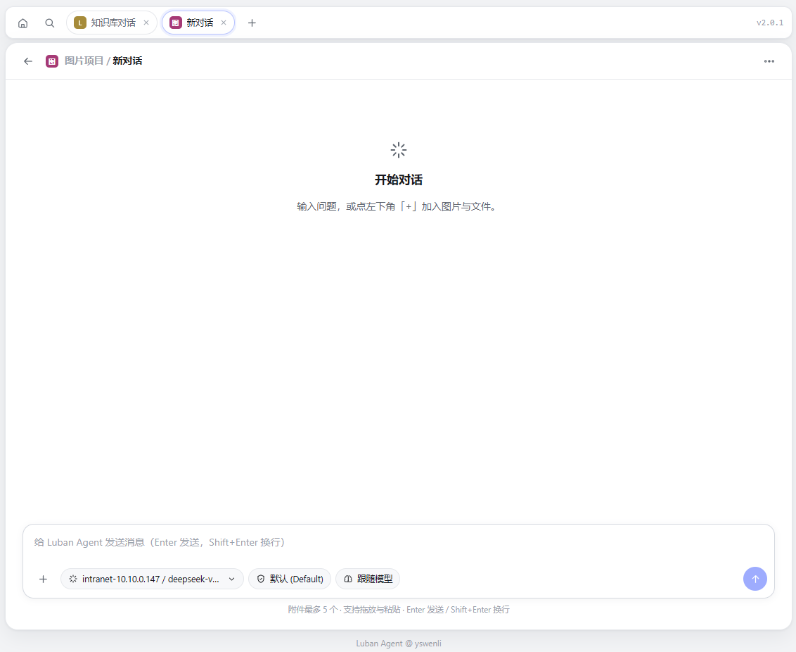
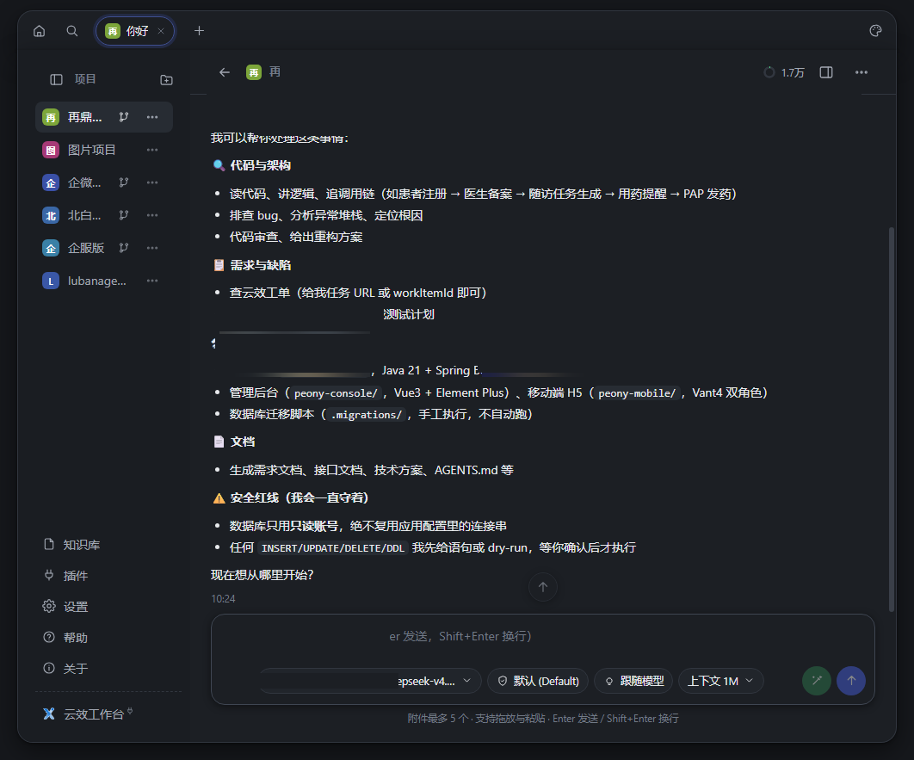
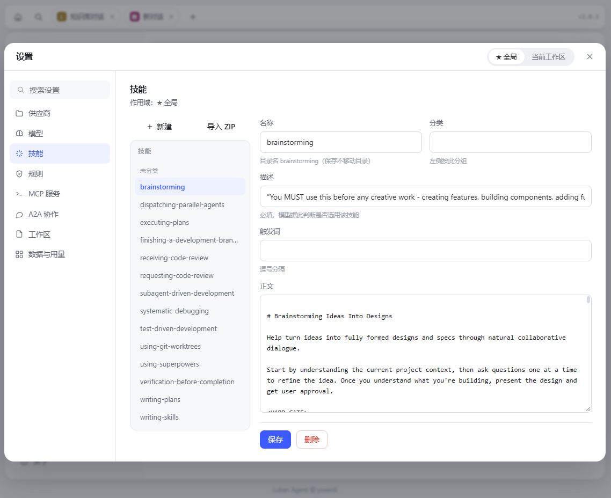
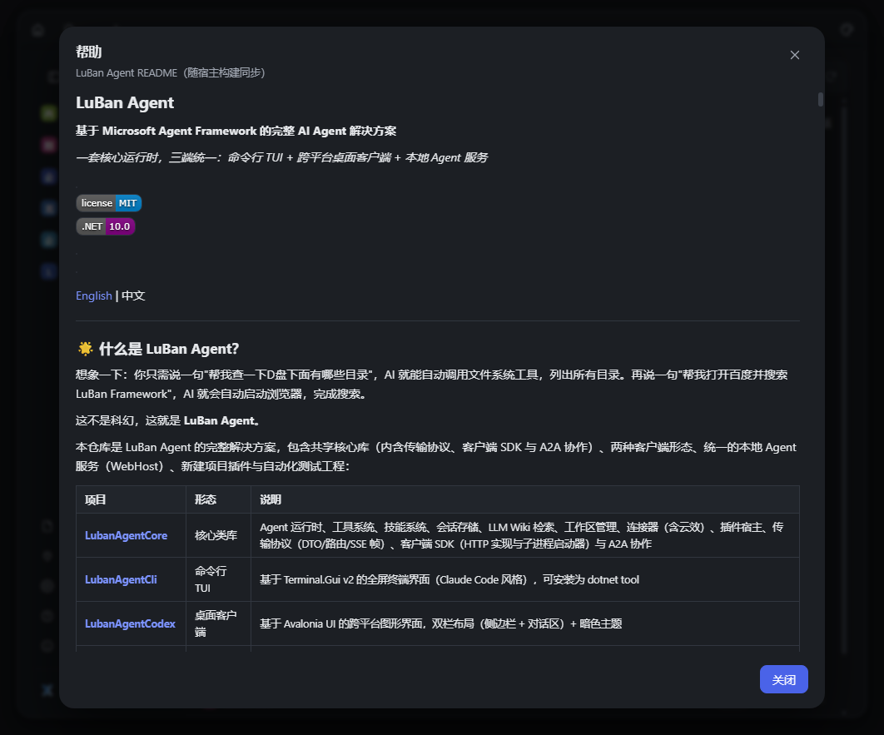

# LuBan Agent

**A Complete AI Agent Solution Based on Microsoft Agent Framework**

*One shared core runtime, three ways to use it: command-line TUI + cross-platform desktop client + local Agent service*

[](https://www.nuget.org/packages/LuBan.AIAgent/)
[](LICENSE)
[](https://dotnet.microsoft.com/)
[](https://gui-cs.github.io/Terminal.Gui/)
[](https://avaloniaui.net/)

English | [中文](README.md)

---

## 🌟 What is LuBan Agent?

Imagine this: you simply say "Show me what directories are on drive D", and the AI automatically invokes the filesystem tool to list all directories. Then you say "Open Baidu and search for LuBan Framework", and the AI launches a browser and completes the search.

This isn't science fiction—this is **LuBan Agent**.

This repository is the complete LuBan Agent solution, containing a shared core library (with its transport protocol and client SDK), two client forms, a unified local Agent service (WebHost), the new-project plugin, and an automated test project:

| Project | Form | Description |
|---------|------|-------------|
| **[LubanAgentCore](LubanAgentCore/)** | Core Library | Agent runtime, tool system, skill system, session storage, LLM Wiki retrieval, workspace management, connectors (including Aliyun DevOps), plugin hosting, transport protocol (DTOs/routes/SSE frames), client SDK (HTTP implementations + child-process launcher) |
| **[LubanAgentCli](LubanAgentCli/)** | Command-line TUI | Full-screen terminal UI based on Terminal.Gui v2 (Claude Code style), installable as a dotnet tool |
| **[LubanAgentCodex](LubanAgentCodex/)** | Desktop Client | Cross-platform GUI based on Avalonia UI, two-pane layout (sidebar + conversation) + dark theme |
| **[LubanAgentWebHost](LubanAgentWebHost/)** | Local Agent Service | Lightweight, high-performance HTTP/SSE host on SAEA.MVC: IOCP completion ports, self-hosted, no ASP.NET Core / Kestrel dependency; exposes chat, session and workspace capabilities as local endpoints |
| **[LubanAgent.Plugin.NewProject](LubanAgent.Plugin.NewProject/)** | Codex Plugin | The "new project" plugin with a pure-code UI, staged into the Codex `plugins/` directory on build |
| **[LubanAgent.Tests](LubanAgent.Tests/)** | Test Project | MSTest automated tests (connectors, NewProject plugin, Skill/Rule backends, transport protocol, etc.) |

> 📖 For detailed usage of each project, see: [LubanAgentCli README](LubanAgentCli/README.en.md) | [LubanAgentCodex README](LubanAgentCodex/README.en.md)

### Are You Facing These Challenges?

- 😫 Want LLMs to call tools and complete tasks, but struggling with MCP / Function Calling implementation details?
- 😤 Managing Skills, tool registration, and session persistence separately, leading to high maintenance costs?
- 😖 Difficulty switching model providers—rewriting tons of code just to go from Provider A to Provider B?
- 😩 Command line not intuitive enough—want a GUI without rebuilding an entire Agent infrastructure?

**LuBan Agent provides complete AI Agent infrastructure**—all core capabilities live in LubanAgentCore, shared by both CLI and Codex. Implement once, run everywhere.

---

## 📸 UI Preview


*First thing you see: projects group your working directories in the left rail, followed by knowledge base, plugins, settings, help and about entries; sessions are listed by time on the right, with a one-click new-session button up top.*

### Chat: empty state



*New session empty state: the "+" button adds images and files; the model, permission mode, reasoning strength and context budget can be switched per session. Enter sends, Shift+Enter wraps.*

### Chat: history and Markdown rendering



*Chat page: replies render as Markdown (lists, code and tables format cleanly); the back button returns to the session list, and the top right shows the workspace and token usage.*

### Knowledge base


*Knowledge base page: wiki pages, indexed files and indexed chunks at a glance; index, rebuild, lint, clear and semantic search are available, and the "Chat" button opens the session bound to this library.*

### Settings



*Settings page: twelve tabs — Account, Providers, Models, Skills, Rules, MCP servers, Workspace, Notifications, Users, Invites, Workspace roots and Data & usage, where Users, Invites and Workspace roots are administrator-only; the scope can be switched between global and the current workspace at the top.*

### Help



*Help: the repository README is rendered inside the dialog, so commands, configuration and endpoints stay in sync with the host build — no need to leave the UI to look them up.*

### About


*About: scan the QR code on a phone in the same LAN to open this instance; version, repository, author and license follow below.*

---

## 🖥️ Walkthrough: From Opening the Page to Your First Conversation

No desktop client to install — the browser is your Agent workspace. Below is a tour of each area you'll meet after opening the page, what it does and how to get started.

### ① Entering the workspace

- **From the terminal entry**: once the host is up, the terminal prints an entry address `https://<LAN IP>:18080/e/<code>` and the built-in administrator's initial password (printed only when the account is first created). Opening the short link makes the host resolve the code into the tokenized address, exchange that for a cookie and redirect to a clean URL, which lands you on the login page; sign in with the administrator account to enter the workspace. While the page stays open, the token is renewed automatically by the frontend heartbeat, so no repeated login is needed.
- **Login and registration**: sign in as the built-in administrator `yswenli` first (take the initial password from the terminal, or pin it with `LubanAgentWeb:AdminPassword`) and change it under "Settings → Account". New members receive a one-time invite code generated by an administrator under "Settings → Invites" and use it on the "Register" tab of the login page. Registration without an invite code is not available.
- **Scan the QR code on a phone**: both the terminal (below the entry address) and the About dialog show a LAN QR code; on a phone joined to the same LAN you can scan it to reach the same instance. The code encodes only the short link (~40 characters), so the matrix is far smaller than encoding the token: 33 columns × 17 rows in the terminal.
- **Certificate notice**: the local self-signed cert is installed only into the current user's trusted root, so a phone or a first-visit browser may warn that the certificate is untrusted — trust it or bypass the warning. See "[WebHost Access Token and Security](#-webhost-access-token-and-security)" below for details.

### ② Home: projects and sessions

You start on the session list, with every conversation grouped by time.

- **Left rail · Projects**: working directories are grouped by project; pick one to filter the sessions on the right, and the action button beside a project offers rename and delete.
- **New project**: two sources — an existing local directory, or a git URL cloned into `~/.luban-agent/repositories/<project-name>`. If the target directory already exists you are first asked whether to reuse it (with the risk spelled out) rather than silently overwriting; if the directory is already registered by another user you are asked "this workspace is in use — share it?" and, once confirmed, both users work in the same physical directory (separate sessions and config, but file changes are visible to each other). Where new projects may live is limited by the machine-wide workspace-roots allowlist (default `~/.luban-agent`, maintained by an administrator under Settings → Workspace roots).
- **Right side · Session list**: the search box at the top looks up sessions by title; the refresh button pulls the latest list; "New session" starts a fresh conversation. The "More" menu on each session offers rename and delete.
- **Top bar tabs**: running conversations stay as tabs in the top bar; a turn keeps streaming when you switch to home or settings, with an activity dot on the tab showing its state. Only closing a tab or deleting a session disposes of the instance and aborts the stream.

### ③ Chat: hand your idea to the Agent

Open a session to reach the chat page; the composer sits at the bottom.

- **Send and wrap**: type your question and press `Enter` to send, `Shift+Enter` for a line break; the "+" button adds images and files (up to 5 attachments per message).
- **Per-session toggles**: above the composer you can switch the model, permission mode (default / follow-model), reasoning strength and context budget (a lower budget compresses earlier); these affect only the current session and leave other conversations untouched.
- **Skills and commands**: type `@` to bring up the available skill picker; slash commands offer quick actions. Tool calls needing confirmation show a confirmation dialog, and interactive questions are listed one by one — the flow continues once you answer.
- **Page actions**: the back button by the title returns to the session list; "Open workspace" opens the current working directory (see the next section); more session actions sit on the top right.

### ④ Chat and workspace side by side


*The chat page can sit beside the workspace: keep reading the Agent's replies, reasoning and tool calls on the left, while browsing workspace files and checking code or docs on the right.*

- **Open and collapse**: click "Open workspace" in the title bar to slide the workspace panel out on the right; close it with the × in the panel or "Close workspace", and drag the splitter to resize the two columns.
- **File tree**: folders expand and collapse by level; the filter box at the top narrows files by name; you can toggle "Show ignored directories", and the refresh button reloads the current tree.
- **File preview**: pick any file to view its raw content on the right (text and images render in place); the preview area supports copying the file content and downloading the file.
- **Two-pane sync**: while the conversation runs on the left, related files can be looked up on the right; relative links and images in a session also open in this panel.

### ⑤ Knowledge base: let the Agent read your docs

Feed your scattered documents into a library, and the Agent retrieves relevant passages before answering.

- **Manage libraries**: create, rename or delete libraries in the left rail; the top shows three counters — wiki pages, indexed files and indexed chunks.
- **Index and maintenance**: optionally enter a file match pattern (e.g. `**/*.md`) and click "Index"; "Rebuild" re-ingests from the current state, "Lint" checks index health, and "Clear index" removes all indexed content.
- **Search and chat**: run a semantic search in the search box; the "Chat" button at the bottom right opens a session bound to this library, with retrieval augmentation applied automatically.

### ⑥ Plugins: extend the workspace

The plugins page manages extensions under the web plugin root, which is separate from the desktop client's plugin directory.

- **Install**: click "Install plugin" and upload the selected ZIP from the browser; it enables automatically once installed.
- **Manage**: installed plugins can be disabled or re-enabled; "Upgrade" picks a new ZIP to install over the old one; "Uninstall" removes the plugin directory and state record.
- **Details**: the detail area shows the plugin's ID, version, author and status, along with the skills, MCP services and page entries it provides; a plugin with a page entry appears at the bottom of the left rail once enabled.

### ⑦ Settings: thirteen tabs for global and workspace config

Settings is an overlay above the current view; close it with ×, `Esc`, or a backdrop click to return to where you were. The scope at the top switches between **global** and the **current workspace**, and the configuration below applies to that scope.

| Tab | What you can do |
|-----|-----------------|
| **Account** | Change your display name and password; changing the password invalidates old logins on other devices immediately and re-issues the cookie for the current browser |
| **Providers** | Configure built-in or custom OpenAI-compatible providers: ID, display name, API key, base URL, network timeout and custom models |
| **Models** | Browse available models per provider, inspect capability details, or set a model as the default for new sessions |
| **Skills** | Create skills or import a ZIP, managed per global / workspace scope; edit name, category, description, trigger words and body on the right |
| **Rules** | Add file-based rules: action type / target glob, allow or deny, priority and enabled state, with an optional guidance body |
| **MCP servers** | Add an MCP server, pick a transport such as stdio, fill in the launch command and arguments, and enable it per scope |
| **Workspace** | View and authorize the current workspace's config directory, initialize AGENTS.md, and fill in the business scenario and capability list |
| **Notifications** | Toggle the three sound cues — task complete, action needed, chat error — with a preview; preferences persist in the local browser |
| **Users** (admins only) | List every account with its last login time; reset a member's password and get a one-time new password (the built-in administrator and yourself are excluded — use the Account tab to change your own) |
| **Invites** (admins only) | Generate one-time registration invite codes (1/3/7/14/30 days), inspect usage and who redeemed them, and revoke unused codes |
| **Workspace roots** (admins only) | Maintain the machine-wide allowlist of absolute paths where new projects may be created (shared by every user); at least one entry must remain, and removing one does not affect already-registered workspaces |
| **Data & usage** | Review session count, message count, cumulative / daily-token stats filtered by time range; clear session data by scope (knowledge base content is not deleted) |

### ⑧ Help and About

- **Help**: open "Help" in the side bar to render the repository README inside a dialog; commands, configuration and endpoints stay in sync with the host build.
- **About**: shows the LAN QR code along with the version, repository URL, author and license.

---

## ✨ Core Features

### 🤖 Multi-Model Routing
- **20+ AI Provider Support**: OpenAI, Azure, DeepSeek, Kimi, GLM, Qwen, Doubao, Claude, Gemini, Ollama, MiniMax, Volcengine Ark, Alibaba Bailian, Tencent Hunyuan, Xiaomi MiMo, Baidu ERNIE, xAI Grok, Baidu Qianfan, Tencent TI Platform, Huawei Pangu, AWS Bedrock, OpenRouter, plus custom OpenAI-compatible APIs
- **Unified `provider:model` Format**: Switch models with one command, no code changes needed
- **Dynamic Routing**: LuBanChatClient automatically dispatches to the corresponding provider based on prefix

### 🛠️ 13 Built-in Tool Groups
| Tool Group | Capabilities |
|------------|--------------|
| 🌐 **Browser Tools** | Navigate, click, type, screenshot, get content (powered by Playwright) |
| 📁 **FileSystem Tools** | Read, write, edit (single/multi/replace-all), list, search, copy, move, delete; allowed directly inside the workspace, paths outside require confirmation |
| 🌿 **Git Tools** | Status, diff, log, branch, stage, commit, merge, rebase, push — 26 fine-grained tools in total |
| 🔧 **Script Execution Tools** | Execute Shell, Lua, Python scripts |
| 🌍 **Web Tools** | Send HTTP requests to fetch web content |
| 🔍 **Semantic Retrieval Tools** | Index local code/documents and search by semantic similarity |
| 🗜️ **Context Compaction Tools** | Compact the current session's conversation history to free token budget (LLM-invocable) |
| 🧠 **Local Memory Tools** | Store, query, and manage long-term memory |
| 🔌 **MCP External Tools** | Connect external MCP servers and merge their tools into the Agent toolset |
| 🧩 **Orchestration Tools** | Decompose composite tasks into a DAG and dispatch SubAgents in parallel/serial |
| 📚 **Wiki Knowledge Base Tools** | Read/write/delete wiki pages, vector search, health check (opt-in) |
| 📜 **Log Analysis Tools** | Aggregate overview, regex search, and line slicing for large log files with constant memory (enabled by default) |
| 📨 **User Interaction Tools** | Ask 1–4 multiple-choice questions (2–4 options each, optional multi-select plus an "Other" free-text field) and wait for answers; enabled by default, usable by sub-agents/orchestration nodes too, and a skip returns "cancelled" |

> Counting note: the 13 rows above list user-facing capabilities; "MCP External Tools" means merging the tools of external MCP servers into the tool set rather than a standalone tool group. The framework actually registers 16 tool groups — 4 management-only groups are not listed separately: `SkillToolGroup` (list/load skills), `SkillManageToolGroup` (write/delete skills), `McpManageToolGroup` (write/delete MCP configs) and `ConnectorManageToolGroup` (connector management); see "Conversational Skill/MCP Management" and "Configuration" below.

### 🎯 Skill System
- Ten core built-in skills (Brainstorming, Code Review, Documentation, Refactoring, Test Generation, Code Explanation, Debug Assistant, Git Commit, Skill Discovery, AGENTS.md Generation), plug and play
- **File-based Skills**: Define custom Skills via SKILL.md files, compatible with OpenCode format, auto-loaded from project-level or user-level directories
- **Conversational Management**: Create, use, and manage Skills and MCP servers through natural language conversation without manual config editing

### 🗣️ Conversational Skill/MCP Management
Operate through natural language—zero learning curve:

| Feature | How to Use |
|---------|------------|
| List Skills | "List all available Skills" |
| Use Skill | "Use the code-review-v2 Skill" |
| Create Skill | "Create a Skill named my-helper, described as general-purpose assistant" |
| Create MCP | "Add an MCP server named my-api, command is node server.js" |

**Features**:
- ✅ Workspace skill files can override same-id built-in Skills (files take precedence over built-ins and config custom Skills); pure built-ins (no same-id directory) cannot be deleted, keeping the system stable
- ✅ The settings list groups by `category`, shows `name` as the primary text and the directory name underneath; saving only rewrites frontmatter and never moves the directory
- ✅ Skills can be imported from a ZIP (entries matching `<directory>/SKILL.md`; a same-name directory is replaced by the imported content)
- ✅ Write/delete operations require user confirmation, preventing accidental operations
- ✅ Changes take effect automatically in the next conversation turn, no restart needed
- ✅ Skill ID validation to prevent injection attacks

**Storage Locations**:
- Skill: `<workspace>/.luban-agent/skills/<skill-id>/SKILL.md`
- MCP: `<workspace>/.luban-agent/mcps/<mcp-name>.json` (external MCP; in-process connector MCPs are resolved from the config.json declaration and never land here)
- Connector enablement: `<workspace>/.luban-agent/connectors/<name>.json`

### 📎 Attachment Support (Images + Text Files)
- **Two attachment kinds**: images (PNG/JPEG/GIF/WebP/BMP/TIFF/HEIC, requires a vision model) and text files (code, config, logs, etc.)
- **Multiple input paths**: CLI supports `@path` references, the `Ctrl+O` file picker, and terminal drag-and-drop; Codex supports the 📎 button, dropping onto the window, and `Ctrl+V` (clipboard files or screenshots)
- **Size tiers**: up to 5 attachments per message; text ≤50KB is inlined into the message, >50KB injects only a path hint so the model can read it on demand with file tools; **`.log` attachments (50KB–1GB) are streamed into an aggregated overview** (level distribution/time range/top error signatures), and the model then drills down on demand with the `log` tool
- **Image preprocessing**: locally resized (max edge 2000px) then sent as base64 `DataContent`; automatically blocked with a prompt when the current model lacks vision
- **Lightweight persistence**: sessions store only paths and metadata (no base64); history replays rebuild from disk or show placeholders. Codex renders thumbnails in the attachment bar and message area, click to view full size

### 🛡️ Security & Rule Engine
- **Path Access Rules**: Paths inside the workspace are allowed directly; paths outside the workspace are allowed after user confirmation
- **Dangerous Operation Confirmation**: Require user confirmation before out-of-workspace access, write, delete, or execute operations, with this-time/turn/session grant tiers
- **Custom Rules**: Support wildcard matching for flexible tool behavior control

### 💾 Session Persistence
- Conversation history automatically saved to SQLite database
- Long conversation compression (SummarizingChatReducer) ensures context is never lost
- Session statistics and Token counting at a glance

### 🔌 MCP Protocol Support
- Built-in filesystem MCP client
- Hot-loading support for external MCP servers
- Standard JSON-RPC protocol, seamlessly integrated with the ecosystem

### 🧩 Multi-Agent Task Orchestration
- **Composite Task Decomposition**: Main Agent automatically identifies complex tasks and decomposes them into DAG task graphs
- **Serial/Parallel Hybrid Orchestration**: Layer-based topological sort, parallel within same layer, serial across layers
- **SubAgent Scheduling**: Each DAG node executed by independent SubAgent with tool group isolation
- **Context Passing**: Nodes reference predecessor outputs via `{dep:xxx}` placeholders
- **Memory Context Injection**: The orchestration entry builds workspace long-term memory and rule context once, then injects it into every SubAgent's system prompt
- **Orchestration Extensions**: workspace `.luban-agent/plans/*.json` for task templates and `.luban-agent/roles/*.json` for custom SubAgent roles

### 📂 Workspace & Knowledge Base
- **Workspace Isolation**: Each workspace has its own root directory, session history, and configuration directory (`.luban-agent/`)
- **Stable Workspace ID**: The workspace ID is derived from the normalized root path, so CLI and Codex yield the same ID for the same directory and thus share long-term memory across hosts
- **LLM Wiki Knowledge Base**: Special workspace type supporting file indexing and semantic retrieval with auto-retrieval-augmented Q&A
- **Vector Store Isolation**: Index data from different workspaces is completely isolated
- **Path Authorization Management**: Paths inside the workspace are allowed directly; paths outside the workspace are allowed after user confirmation, with grants remembered per path root (this-time/this-turn/this-session tiers)

---

## 🚀 Quick Start

### Prerequisites

- [.NET 10.0 SDK](https://dotnet.microsoft.com/download) or later

### 1. Clone the Repository

```bash
git clone https://github.com/yswenli/luban-agent.git
cd luban-agent
```

### 2. Prepare the Playwright Browser (Installed Automatically on First Use)

Browser drivers are installed on demand into `~/.luban-agent/playwright-driver/{version}`; the version is taken from the `Microsoft.Playwright` package declaration, so no manual version pinning is needed. If automatic installation fails, run the command returned by `PlaywrightDriverResolver.GetInstallBrowsersHint()`.

### 3. Build the Solution

```bash
dotnet build LubanAgent.slnx
```

### 4. Choose Your Client

#### Option 1: Command-line TUI (LubanAgentCli)

```bash
# Run directly
dotnet run --project LubanAgentCli/LubanAgentCli.csproj

# Or install as a dotnet global tool (recommended)
dotnet pack LubanAgentCli/LubanAgentCli.csproj -c Release -o ./artifacts
dotnet tool install -g LuBan.Agent.CLI --add-source ./artifacts

# Launch from any directory after installation
luban-agent-cli
```

On launch, it enters the Terminal.Gui full-screen interface. Type plain text to chat with the Agent; prefix with `/` to open the command panel.

#### Option 2: Desktop Client (LubanAgentCodex)

```bash
dotnet run --project LubanAgentCodex/LubanAgentCodex.csproj
```

Select a workspace on startup, then chat with the Agent in the graphical interface.

#### Option 3: Local Agent Service (LubanAgentWebHost)

```bash
# Start manually (port comes from LubanAgentWeb:Port in appsettings.json, default 18080)
# HTTPS is on by default: a self-signed cert (CN=LuBanAgent Local) lives at ~/.luban-agent/webhost-cert.pfx
# and is installed into the current user's trusted root on startup; pass --http to drop TLS (entry and health check become http://)
# Cert maintenance: --trust-cert installs it separately, --no-trust-cert skips the install, --cert-path moves the pfx
# When ready, the terminal prints the browser entry: https://<lan-ip>:18080/e/<short code> (valid only inside this host process)
# On first start it also prints the built-in administrator yswenli's initial password (once only; pin it with LubanAgentWeb:AdminPassword)
# A QR code for the same address is printed below it: scan it on a phone in the same LAN (skipped when a client launches the host with redirected output)
# A phone will warn about the untrusted cert on first visit (the trusted root only covers this machine) — trust it or bypass the warning
# The login token renews every 15 minutes by default (open pages renew automatically), but a sign-in lasts at most 24 hours; registration needs an invite code from an administrator
dotnet run --project LubanAgentWebHost/LubanAgentWebHost.csproj

# Health check (token-free so the launcher can probe the port; add -k to curl when the cert is not trusted)
curl https://127.0.0.1:18080/system/health

# Reprint the browser entry (uses the host token to fetch the running instance's current entry; fails when no host is running)
dotnet run --project LubanAgentWebHost/LubanAgentWebHost.csproj -- --token

# Stop the resident instance
dotnet run --project LubanAgentWebHost/LubanAgentWebHost.csproj -- --stop

# Offline recovery when the built-in administrator password is lost (run --stop first; the new password is printed once)
dotnet run --project LubanAgentWebHost/LubanAgentWebHost.csproj -- --reset-password yswenli
```

Opening `https://<lan-ip>:18080/` directly lands on the login page; business endpoints return 401 until you sign in. An entry address carrying `?t=` exchanges the token for a cookie and then 302s back to a clean URL; once the login expires or a configured session ceiling is reached you must sign in again, or use `LubanAgentWebHost --token` to fetch an administrator entry.

The WebHost is a standalone service, so clients don't have to start it manually: when no service address is configured, the client SDK inside `LubanAgentCore` (`Client/`) first adopts an instance that is already running (via the discovery file) and only launches a child process when none exists. Port, timeout and user identity come from the host's `LubanAgentWeb` configuration; the host token is generated by the host on every start and written to the discovery file, so clients only read it. A launched host stays resident after the client exits; stop it with `--stop` (or by ending the host process).

> 🔐 How browser login (JWT cookie) and the client host token are split, the built-in administrator and invite-only registration, how to recover from a 401, renewal and the optional session ceiling, multi-device and post-restart behaviour, and the risk boundaries you must know are covered in "[WebHost Access Token and Security](#-webhost-access-token-and-security)" below.

### 5. Configure an AI Provider and Start Chatting

Configure your first Provider in either client:

```
> /provider -add
Select Provider type:
  1. OpenAI
  2. Azure OpenAI
  3. DeepSeek
  4. Kimi (Moonshot)
  ...
Select: 4
Enter Kimi API Key: ********
✓ Provider 'Kimi' added and saved
```

Then select a model and start your first Agent conversation:

```
> /model -switch kimi:k3
✓ Switched model: kimi:k3

You: Show me what directories are on drive D

[Calling tool]: ListDirectoryAsync
  Parameter path: D:\
[Tool result]: Program Files, Users, Windows, ...

🤖 Drive D contains the following directories:
1. Program Files
2. Users
3. Windows
...
```

> **Security Note**: API Key input is hidden (password input mode); user configuration is automatically saved to `~/.luban-agent/users/<userId>/config.json` (`userId` comes from the `LUBAN_USER_ID` environment variable, defaulting to `yswenli`)

---

## 📦 Cross-Platform Build & Publish

The project supports building into **single-file executables** that run directly on target machines without requiring .NET runtime installation.

### Prerequisites

- [.NET 10.0 SDK](https://dotnet.microsoft.com/download) or later
- Verify SDK version: `dotnet --version`

### Publish as Single-File Executable

#### Command-line TUI (LubanAgentCli)

```powershell
# Windows 10/11 x64
dotnet publish LubanAgentCli/LubanAgentCli.csproj -c Release -r win-x64 --self-contained true -p:PublishSingleFile=true

# Windows ARM64
dotnet publish LubanAgentCli/LubanAgentCli.csproj -c Release -r win-arm64 --self-contained true -p:PublishSingleFile=true

# macOS Intel (x64)
dotnet publish LubanAgentCli/LubanAgentCli.csproj -c Release -r osx-x64 --self-contained true -p:PublishSingleFile=true

# macOS Apple Silicon (ARM64)
dotnet publish LubanAgentCli/LubanAgentCli.csproj -c Release -r osx-arm64 --self-contained true -p:PublishSingleFile=true

# Linux x64
dotnet publish LubanAgentCli/LubanAgentCli.csproj -c Release -r linux-x64 --self-contained true -p:PublishSingleFile=true

# Linux ARM64
dotnet publish LubanAgentCli/LubanAgentCli.csproj -c Release -r linux-arm64 --self-contained true -p:PublishSingleFile=true
```

#### Desktop Client (LubanAgentCodex)

```powershell
# Windows 10/11 x64
dotnet publish LubanAgentCodex/LubanAgentCodex.csproj -c Release -r win-x64 --self-contained true -p:PublishSingleFile=true

# Windows ARM64
dotnet publish LubanAgentCodex/LubanAgentCodex.csproj -c Release -r win-arm64 --self-contained true -p:PublishSingleFile=true

# macOS Intel (x64)
dotnet publish LubanAgentCodex/LubanAgentCodex.csproj -c Release -r osx-x64 --self-contained true -p:PublishSingleFile=true

# macOS Apple Silicon (ARM64)
dotnet publish LubanAgentCodex/LubanAgentCodex.csproj -c Release -r osx-arm64 --self-contained true -p:PublishSingleFile=true

# Linux x64
dotnet publish LubanAgentCodex/LubanAgentCodex.csproj -c Release -r linux-x64 --self-contained true -p:PublishSingleFile=true

# Linux ARM64
dotnet publish LubanAgentCodex/LubanAgentCodex.csproj -c Release -r linux-arm64 --self-contained true -p:PublishSingleFile=true
```

### Output Location

| Project | Output Path |
|---------|-------------|
| LubanAgentCli | `LubanAgentCli/bin/Release/net10.0/<rid>/publish/LubanAgentCli[.exe]` |
| LubanAgentCodex | `LubanAgentCodex/bin/Release/net10.0/<rid>/publish/LubanAgentCodex[.exe]` |

> Windows output is `.exe`; macOS/Linux output is an extensionless ELF/Mach-O executable.

### Notes

- **NativeAOT not supported**: The project relies heavily on reflection from Terminal.Gui / Avalonia; `PublishAot=true` will cause runtime exceptions
- **Cross-compilation limitations**: Native dependencies for macOS and Linux (e.g., `libSkiaSharp`) must be compiled on the target platform; it is recommended to run `dotnet publish` directly on the target platform
- **Playwright browser**: Drivers are installed automatically into `~/.luban-agent/playwright-driver/{version}` on first use of the browser tools; no manual version pinning is required. If automatic installation fails, run the command returned by `PlaywrightDriverResolver.GetInstallBrowsersHint()`
- **Configuration files**: After publishing, `appsettings.json` is output with the artifacts and can be modified before running; user configuration is saved under `.luban-agent/` in the user's home directory (on Windows: `%USERPROFILE%\.luban-agent\`; on Linux/macOS: `~/.luban-agent/`)

---

## 🏗️ Solution Architecture

```
luban-agent/
├── LubanAgent.slnx           # Solution file (XML format, 6 projects)
│
├── LubanAgentCore/           # Core library (net10.0)
│   ├── Agents/               # Agent profiles (Normal / LLM Wiki)
│   ├── Client/               # Client SDK (HTTP/SSE implementations + child-process launcher)
│   ├── Configuration/        # Configuration management
│   ├── Connectors/           # Connectors (including the Aliyun DevOps implementation)
│   ├── Context/              # User context
│   ├── EmbeddingModels/      # AI embedding model files (bge-small-zh-v1.5)
│   ├── Entities/             # Data entities
│   ├── Hosting/              # Hosting integration
│   ├── Infrastructure/       # Infrastructure
│   ├── Models/               # Data models
│   ├── Plugins/              # Plugin host
│   ├── Protocol/             # Transport protocol (routes / DTOs / SSE frames / event translation)
│   ├── Repositories/         # Data access layer
│   ├── Retrieval/            # Semantic retrieval
│   ├── Security/             # Credential storage and protection
│   ├── Services/             # Core services (Agent host / session / workspace)
│   └── Utils/                # Utilities
│
├── LubanAgentCli/            # Command-line TUI (Terminal.Gui v2 · net10.0)
│   ├── App/                  # TUI application layer (bootstrap + DI + theming)
│   │   ├── Dialogs/          # Popup components (BaseDialog base + 5 subclasses)
│   │   ├── Models/           # Block document model
│   │   ├── Services/         # TUI services (session titles, etc.)
│   │   ├── ViewModels/       # MVVM ViewModel layer
│   │   └── Views/            # View layer (pure rendering)
│   ├── Commands/             # Command implementations
│   ├── Infrastructure/       # Input bootstrap and diagnostics
│   ├── Services/             # Spinner service
│   └── Program.cs            # Entry point
│
├── LubanAgentCodex/          # Desktop client (Avalonia UI · net10.0)
│   ├── Views/                # Avalonia views
│   ├── ViewModels/           # MVVM ViewModel layer
│   ├── Services/             # UI services
│   ├── Converters/           # Value converters
│   ├── Plugins/              # Plugin UI dispatching
│   ├── Styles/               # Style themes
│   └── Program.cs            # Entry point
│
├── LubanAgentWebHost/        # Local Agent service (SAEA.MVC · net10.0) + browser site
│   ├── Controllers/          # 12 endpoint controllers (one per route group, routing only)
│   ├── Services/             # Endpoint business logic (sessions, chat, workspaces, wiki, settings…)
│   ├── Models/               # Request / response models for the browser endpoints
│   ├── Hosting/              # Process runtime, SSE writer, startup settings, shared guards
│   ├── web/                  # Web UI sources (SolidJS + TypeScript + Vite)
│   └── wwwroot/              # Web UI build output (copied into the build output by dotnet build)
│
├── LubanAgent.Plugin.NewProject/  # "New project" plugin
├── LubanAgent.Tests/         # MSTest automated tests
├── smoke/                    # Plugin system smoke projects (intentionally outside the slnx)
└── docs/                     # Design & planning documents
```

**Architecture Overview**:

```
┌─────────────────────┐  ┌─────────────────────┐  ┌─────────────────────┐
│   LubanAgentCli     │  │   LubanAgentCodex   │  │  LubanAgentWebHost  │
│   (Terminal.Gui)    │  │     (Avalonia)      │  │     (SAEA.MVC)      │
└──────────┬──────────┘  └──────────┬──────────┘  └──────────┬──────────┘
           │                        │                        │
           └────────────────────────┼────────────────────────┘
                                    ▼
       ┌────────────────────────────────────────────────────────┐
       │ LubanAgentCore                                         │
       │  runtime / tools / skills / sessions / LLM Wiki / ws   │
       │  Client/    client SDK (HTTP/SSE + child-process)      │
       │  Protocol/  transport protocol (routes / DTOs / SSE)   │
       └────────────────────────────┬───────────────────────────┘
                                    ▼
                         ┌─────────────────────┐
                         │    LuBan.AIAgent    │
                         │  multi-model / MCP  │
                         └─────────────────────┘
                                    ▼
         OpenAI / Kimi / DeepSeek / Claude / ... (20+ Providers)
```

- **UI/Business Separation**: CLI and Codex handle only interaction and rendering; all Agent capabilities come from Core
- **Unified Service Entry**: chat, sessions and workspaces are exposed by `LubanAgentWebHost`; the transport protocol (`Core/Protocol/`) and the client implementation (`Core/Client/`) both live in `LubanAgentCore` — see "Unified Agent Service" above
- **Single Source for Embedding Models**: `bge-small-zh-v1.5.zip` is maintained only in Core and propagated to each client's output directory via ProjectReference content flow
- **Unified Configuration**: Both clients share the user configuration in `.luban-agent/` under the user's home directory (Windows: `%USERPROFILE%\.luban-agent\`; Linux/macOS: `~/.luban-agent/`); the session database `luban-ai-agent.db` is owned exclusively by the WebHost and lives in the same root (`Data Source=./luban-ai-agent.db` in `appsettings.json` is a relative path that the host rewrites to `~/.luban-agent/luban-ai-agent.db`), and clients never open it

---

## 🔗 Unified Agent Service (WebHost)

`LubanAgentWebHost` exposes Agent capabilities as HTTP/SSE endpoints via SAEA.MVC, so clients (CLI / Codex) only handle UI interaction:

| Route | Description |
|-------|-------------|
| `POST /agent/chat` | Streaming chat (SSE) |
| `POST /agent/send` | Non-streaming chat (tools disabled) |
| `POST /agent/confirm` | Return a tool confirmation result |
| `POST /agent/answer` | Return answers for an interactive question (`cancelled:true` = the user cancelled the question) |
| `POST /agent/cancel` | Cancel the round currently running for that session |
| `POST /agent/active` | Probe whether the session has a round in progress |
| `POST /agent/attach` | Attach to the round in progress (SSE, snapshot first); `204` when there is none |
| `POST /agent/reset` | Drop the server-cached Agent for a session |
| `/session/*` | Session CRUD, messages, statistics, switching |
| `/workspace/*` | Workspace list/create/switch/delete/rename, authorization and config directory |
| `/llmwiki/*` | Knowledge base create/delete, list files, index, search, stats, lint, rebuild, ingest, clear |
| `GET /e/{code}` | Entry short link (no login required; the code itself is the credential): 302 to `/?t=<login token>`, after which the gate exchanges it for a cookie and lands on the login page; an unknown or expired code returns a 410 notice page |
| `/auth/*` | Public login-page endpoints: `status` / `login` / `register` / `logout`; once signed in: `me` / `changePassword` / `updateProfile`, plus `users` / `resetPassword` / `invites` / `createInvite` / `revokeInvite` for administrators |
| `GET /system/health` | Health check (token-free, used by the launcher) |
| `GET /system/bootstrap` | Browser first-screen data (workspaces, providers and models, permission modes, attachment policy, version) |
| `GET /system/commands` | Slash-command catalogue for the browser client |
| `GET /system/entryQr` | LAN entry QR code as PNG (shown in the About dialog; scan it on a phone to open this instance — each request registers a short code that expires together with the login token) |
| `GET /system/session` | Renewal and expiry times of the current login (used by the frontend heartbeat; once less than half the lifetime remains the gate issues a new token and rewrites the cookie) |
| `GET /system/entryUrl` | Current entry address and expiry (host token only; lets `LubanAgentWebHost --token` reprint it and reopens the login once expired) |
| `POST /attachment/upload` | Browser attachment upload (JSON + Base64, written to the workspace staging directory) |
| `GET` / `POST` `/provider/*` | Read/switch the global model selection, pull a provider's models, read/write providers (keys are returned masked only) |
| `GET` / `POST` `/skill/*`, `/rule/*`, `/mcp/*` | List/read/save/delete file-based skills, rules and MCP servers (scoped to `global` or a workspace); `GET /skill/loaded` returns the skills offered by the `@` picker (session workspace, enabled only) |
| `GET` / `POST` `/model/*` | List a provider's models and add/rename/delete custom models |
| `GET /file/read` | Read a workspace file's raw content (what relative links and images in a session open; text and images only, out-of-workspace paths and other formats get a notice page) |

Constraints and known limitations:

- **All interfaces, reachable from localhost and external networks**: SAEA.MVC exposes no bind-address option (`HttpSocket` passes no IP and always binds `0.0.0.0`). Endpoints, SSE, attachments and static assets therefore all pass through the same gate: anything without a valid credential (a browser login token via `?t=` or the cookie it is exchanged for, or a client `Authorization: Bearer` host token) gets 401. Only `/system/health` (port probing by launchers), `/e/{code}` (entry short link, where the code itself is the credential), and the login page/authentication endpoints/static assets are accessible without signing in.
- **Standalone service, port and tokens decided by the host**: the port comes from `LubanAgentWeb:Port` (default 18080). The host token is random per start and fixed for the process lifetime (`LubanAgentWeb:Token` or `--host-token` pins it); the browser login token is issued after a successful sign-in and renews while the page is active. The host token dies with the process; a browser cookie stays valid until its own expiry (the signing key is persisted and reused), while short links die with the process. After starting successfully the host writes its actual address and host token to `~/.luban-agent/webhost.json` and deletes it on a clean exit; a client that reads it probes `/system/health` first, then adopts the running instance instead of launching a duplicate. A launched host stays resident after the client exits — stop it with `LubanAgentWebHost --stop`. Only one instance can own the port, so a second process exits immediately on the port conflict.
- **Entry address and token**: the terminal prints an entry short link (`/e/<code>`); opening it makes the host resolve the code back into `/?t=<login token>`, exchange that for an HttpOnly cookie and 302 to a clean URL, and an open page keeps renewing through the frontend heartbeat. Once the login expires or a configured session ceiling is reached, sign in again or fetch an entry with `LubanAgentWebHost --token`. Codes live only inside the host process, are never written to disk or logs, expire together with the login token (15 minutes by default), and at most 128 are kept at once. Full usage and risk boundaries are in "[WebHost Access Token and Security](#-webhost-access-token-and-security)" below.
- **A disconnect is not a cancellation**: a round lives in the host process's run hub, so an SSE disconnect only removes a subscriber and the round keeps running to completion. When the browser reopens the same session it first probes `POST /agent/active`, then calls `POST /agent/attach` if a round is active (a `run.snapshot` frame first, then live frames); with no active round the response is `204` and the client loads history. `attach` optionally takes `runId` (a mismatch with the current round is treated as no active round, `204`) and `fromSeq` (the highest frame sequence already received; when omitted a snapshot is sent). Stopping explicitly still uses `POST /agent/cancel`; deleting a session that is running, or a workspace containing one, is rejected with `409`, and clearing messages cancels the round and waits for it to wind down first.
- **Database owned by the WebHost**: session data is `luban-ai-agent.db` in the user-level directory (`~/.luban-agent/luban-ai-agent.db`; relative connection strings are rebased onto that directory). Clients no longer open the database; the working directory only affects relative-path inputs. An `ai_sessions.db` / `luban-ai-agent.db` left in the host program directory by an older build is moved into that directory the first time the host starts (a database in a client output directory is not read — move it into the host program directory or the user-level directory yourself); an existing database at the destination wins.
- **Orchestration progress lives on the host side**: the startup worktree reconciliation runs inside the WebHost per user workspace; sub-agent orchestration progress is streamed as `orchestration.progress` frames and replayed by the client into its local progress outlet, so UI subscriptions behave the same as when running locally.
- **Knowledge-base background tasks degrade to synchronous calls**: the `Start*` entry points rely on host-side progress events, which the client has no channel for, so remote mode always falls back to the synchronous path (the `--wait` semantics); callers must show their own busy overlay while it runs.
- **Plugin directories**: Codex plugins are handed to the WebHost via `--plugins-dir`; plugins installed from the web "Plugins" page live in a separate root (`LubanAgentWeb:WebPluginsDir` / `--web-plugins-dir`, default `~/.luban-agent/webhost/plugins`, state file `plugin-states.json`). Both roots are scanned, but the management page only lists and manages the web root, leaving Codex installs and their enabled state untouched.
- **Timeout semantics for long-lived streams**: SSE actions do not participate in SAEA's action timeout (`ActionTimeout` is left disabled), so a round is never cut off by a `408`, no matter how long it runs. `LubanAgentWeb:TimeoutSeconds` (default 86400, i.e. 24 hours) sets SAEA's socket sync-wait and session idle-reclaim limits; before writing the SSE response headers the connection is excluded from idle reclaim via `SetNoTimeout`. On the client side, 45 seconds without any bytes (including the 15-second heartbeat) is treated as a dropped connection, followed by an automatic liveness probe and `attach` resume; returning to the foreground or regaining network also reconnect on purpose and continue incrementally from the highest frame id received (every SSE frame carries `id:`), so already-rendered content is not replayed. The server also closes each SSE connection after 30 minutes on purpose (to reclaim half-open links whose peer is gone but cannot be declared dead; the value is deliberately far below `TimeoutSeconds`), and the client resumes the same way.
- **Tool confirmation**: the wait limit comes from `LuBanAgent:Confirmation:TimeoutSeconds` (default 60); a timeout is treated as a denial. When an orchestration sub-agent asks, the dialog shows a "来源：编排节点 …" line under the tool name; main-agent requests show no such line.
- **Interactive questions**: when the model calls `AskUserQuestion`, the host pushes a `tool.question` frame (`questionId` / `questions` / `timeoutSeconds` / `origin?`); clients submit per-question answers via `POST /agent/answer` (matched by question text) or cancel with `cancelled:true`. Questions share the same serial gate with tool confirmations, so one interaction is in flight per session at a time. The wait limit comes from `LuBanAgent:Interaction:TimeoutSeconds` (WebHost sets 300; falls back to `LuBanAgent:Confirmation:TimeoutSeconds` when unset); a timeout ends as "cancelled" (`cancelled:true`, not a denial and not a node failure). If the page is refreshed while an unanswered question is still pending in a remote round, `run.snapshot` carries it back and the browser restores the question dialog; once the question tool finishes (answered or cancelled) the snapshot no longer carries it.

### 🌐 Browser client (`LubanAgentWebHost/wwwroot`)

The WebHost also serves a web UI (SolidJS + TypeScript + Vite). The source lives in `LubanAgentWebHost/web/`, the build output is committed under `LubanAgentWebHost/wwwroot/`, and the project file copies it to the `wwwroot` folder of the build output on `dotnet build`.

```bash
cd LubanAgentWebHost/web
npm install
npm run build          # output goes to LubanAgentWebHost/wwwroot
```

- **`dotnet build` does not need Node**: the output is committed; rebuild only after changing sources under `LubanAgentWebHost/web/`.
- **Restart the process to pick up a new build**: `IsStaticsCached=True` keeps static file contents in memory after the first request, so a same-named file on disk is not reloaded.
- **Hash routing**: `#/` (sessions), `#/s/<sessionId>` (chat), `#/settings/<tab>` (settings), `#/wiki` (knowledge base), `#/plugins` (plugin management) and `#/plugin/<pluginId>/<entryId>` (a plugin's own page). SAEA has no SPA fallback, so history routing is not an option.
- **Runtime config**: the process writes `wwwroot/runtime-config.js` (user and port only) at startup. Neither token is written there — the browser one only becomes an HttpOnly cookie via the address-bar entry, the host one only lives in the discovery file. The file is not committed (see `.gitignore`).
- **Development loop**: start the WebHost first (`--port` to choose the port) and put the **host token** into `VITE_HOST_TOKEN` — take `token` from `~/.luban-agent/webhost.json`, or the value you passed with `--host-token` (the `?t=` in the browser entry is a login token: it can only be exchanged for a cookie and cannot be used as a Bearer token; the terminal entry itself carries only a short code that resolves to that login token); then run `npm run dev` in `LubanAgentWebHost/web/`; `VITE_HOST_PORT` sets the upstream port (default 18080, matching the host default) and `VITE_HOST_PROTOCOL` sets the upstream protocol (default `https`, matching the host default; set it to `http` when the host runs with `--http`; the proxy accepts the self-signed cert for https); `server.proxy` forwards `/agent`, `/session`, `/workspace`, `/system`, `/attachment`, `/provider`, `/skill`, `/rule`, `/mcp`, `/model`, `/llmwiki`, `/plugin` and `/plugin-web` with an added `Authorization` header, while Vite keeps serving the static assets.
- **Global top bar and SSE**: session state lives in a frontend-wide chat pool, so tabs are decoupled from routing — a running turn keeps streaming when you switch to the home page or settings, signalled by an activity dot on its tab. Only closing a tab or deleting a session disposes the instance and aborts the stream.
- **Settings is an overlay**: `#/settings/<tab>` covers the current view; closing it with ×, Esc or a backdrop click returns to where you were. There is no separate settings page and no "back to app" link.
- **Scope**: the web UI covers the global top bar (home entry + session tabs), the two-column home (project filter plus create/rename/delete project on the left, session list with create/rename/delete session on the right), chat (attachments, `@` skill picker, slash commands, tool confirmation dialog, back button on the left of a tab title), the knowledge-base page (create/rename/index/rebuild/search, with a "Chat" button at the bottom that opens a session for that library), the plugin management overlay (install / upgrade / enable / disable / uninstall for web plugins only), plugin pages (a same-origin iframe; a plugin with a page shows an entry at the bottom of the left sidebar once enabled) and the twelve-tab settings overlay (account / provider / model / skill / rule / MCP / workspace / notifications / users / invites / workspace roots / data & usage, where users, invites and workspace roots are administrator-only); up to 5 attachments per message, a 10MB per-file limit for text attachments, and a 20MB / 50-megapixel cap for images (images over 2000px or 5MB are downscaled and re-encoded in the browser before upload). Connectors, `@` file-path context and the Shell command entry point are out of scope for the web UI.

---

## 🔐 WebHost Access Token and Security

The host binds its listening socket to `0.0.0.0` (SAEA.MVC exposes no bind-address option), so any device on the same network can connect once it knows the address — and behind that channel is an Agent that can read/write workspaces and run commands. The host therefore denies everything by default and accepts exactly two credential kinds: a **login token** for browsers (an HS256 JWT issued on sign-in, stored in an HttpOnly cookie) and a **host token** for clients (fixed for the process lifetime, `Authorization: Bearer` only).

### Two credential kinds

| Credential | Who uses it | Out-of-the-box behaviour |
|------------|-------------|--------------------------|
| Login token (`luban_auth` cookie, `?t=` in the entry address) | Browsers | Issued after a successful sign-in or registration; valid for 15 minutes by default and renewed by the gate once less than half remains, but a fresh sign-in is required after 24 hours by default (`SessionMaxHours` defaults to 24; 0 disables the ceiling); invalidated immediately by a password change, an administrator reset, or disabling the account |
| Host token (`Authorization: Bearer`) | CLI / Codex / plugins / your own client | Random on start (pin it with `LubanAgentWeb:Token`); unchanged for the process lifetime |

### Accounts and login

- **Built-in administrator**: the user ID is always `yswenli`; it cannot be renamed or deleted, and neither other administrators nor the owner can reset its password from the web UI. Only the owner can change it under "Settings → Account".
- **Initial password**: on first start, when the user table has no built-in administrator yet, the host generates a random password and prints it once in the terminal ("built-in administrator yswenli initial password: …"); it is never shown again. Pin your own with `LubanAgentWeb:AdminPassword` (at least 8 characters).
- **Registration requires an invite code**: there is no open registration. An administrator generates a one-time code under "Settings → Invites" (valid for 1–30 days, 7 by default) and the new member enters it while registering. A code is consumed on first use and unused codes can be revoked at any time. Usernames start with a letter, are 3–32 characters, and contain only letters, digits, dots, underscores and hyphens; passwords are at least 8 characters.
- **Password change and reset**: changing your own password under "Settings → Account" bumps the token version, so old logins on other devices stop working immediately while the current browser receives a fresh cookie. An administrator reset under "Settings → Users" produces a one-time new password (shown once) and likewise invalidates all of that user's old logins. **You cannot reset your own password** from that tab (the new password is returned only once, so a lost response would lock you out) — use "Change password" instead.<br>If the built-in administrator forgets its password there is no web path; recover it offline on the host machine: run `--stop`, then `LubanAgentWebHost --reset-password yswenli` (it needs read/write access to `~/.luban-agent`). The random password printed in the terminal is the new one, shown once; all old logins for that account stop working.
- **Login failure lockout**: after 5 consecutive wrong passwords an account is locked for 30 minutes; while locked, every sign-in attempt is rejected with the remaining time. Once the lock expires the counter restarts from zero, and a successful sign-in also clears it. Administrators can see the lock state and unlock the account under "Settings → Users"; resetting the password clears it as well. Unknown usernames are never counted and always get the same message as a wrong password, so the lock state cannot be used to probe for accounts.
- **Sign-out**: clears the `luban_auth` cookie; the token itself has no server-side session table, so clearing it signs the current browser out.
- **No project is created for you on first sign-in**: the host does not auto-create a workspace; the sidebar shows "no projects yet — use New project", and new project directories must live under the administrator's workspace-roots allowlist.

### Using the token

| Scenario | What to do |
|----------|------------|
| First entry (browser) | Open `https://<lan-ip>:<port>/e/<code>` as printed in the terminal (`http://` when the host runs with `--http`): the host resolves the short code into `/?t=<login token>`, exchanges that for a cookie and 302s to the path without `t`, landing on the login page |
| Page left open | The web UI pings `/system/session` every 60 seconds; once less than half the lifetime remains the gate issues a fresh token and rewrites the cookie, so no manual refresh is needed |
| Terminal output is gone | Run `LubanAgentWebHost --token` on the host machine; it uses the host token to fetch the running instance's current entry address and QR code |
| Multiple devices | Sign in on each device (the same account may be signed in on several at once); a short code works exactly once, each device keeps its own cookie, and a password change or reset invalidates them all |
| Session ceiling reached | 24 hours by default (`LubanAgentWeb:SessionMaxHours` defaults to 24; 0 disables the ceiling); at that point you must sign in again, or fetch an entry with `LubanAgentWebHost --token` |
| After a restart | Short links and the host token live in the process and die with it, so use the newly printed address; a browser cookie stays valid until its own expiry (the JWT signing key is persisted and reused) and then requires signing in again |
| CLI / Codex / plugins | Send `Authorization: Bearer <host token>` automatically, reading the token from the discovery file — no manual input |

- **Token shape**: the login token is an HS256-signed JWT carrying only the user ID, display name, administrator flag, token version and validity window; the host token is Base64Url text of 32 cryptographically random bytes (`RandomNumberGenerator`), 43 characters. They are different things and cannot be used interchangeably.
- **JWT signing key**: stored at `~/.luban-agent/webhost/jwt.key` by default (change it with `LubanAgentWeb:JwtKeyPath`) and protected only by file ACLs. Deleting it invalidates every signed-in browser immediately; the next start generates a new one.
- **Entry short codes**: the terminal entry and the QR code carry only `/e/<code>` (Base64Url of 7 random bytes, 10 characters). The host maps a code back to `/?t=<login token>` in memory — never on disk, never in logs — and a code is consumed on first resolution (so the token-bearing address cannot be reopened from browser history); at most 128 are kept at once (expired ones are dropped first, then the earliest expiry is evicted). After a host restart or once a code expires (together with the login token) the link returns a 410 notice page; fetch a new address with `LubanAgentWebHost --token`.
- **Session timings are configurable**: `LubanAgentWeb:SessionTokenMinutes` (default 15, must be greater than 0) and `SessionMaxHours` (default 24, i.e. a login lasts at most 24 hours; 0 means no hard ceiling, a positive number sets one, a negative value makes startup fail).
- **Pinning the host token**: use `LubanAgentWeb:Token` or `--host-token`. Only letters, digits, `-` and `_` are allowed; a value containing spaces, semicolons or newlines would truncate the cookie or corrupt headers, so the host refuses to start instead of degrading. Pinning affects the client token only — browser login and renewal are unaffected.
- **The browser never stores the token in readable form**: the login token exists only in the `luban_auth` cookie (`Path=/; HttpOnly; SameSite=Lax`, session-scoped); the `t` parameter is removed by a 302 so it does not stay in history, and page scripts cannot read it either — `runtime-config.js` only contains `userId`/`port`. Renewed values are written back by the gate via `Set-Cookie`; the frontend never touches them.
- **What a 401 looks like**: a browser hitting a protected endpoint gets a Chinese help page (asking you to sign in, with hints for a forgotten password and for `LubanAgentWebHost --token`); once a configured session ceiling is passed the page says the session expired. When the web UI loses its login it switches the whole page to the login view instead of leaving a UI that cannot do anything. API clients get HTTP 401 with the standard envelope (`success: false`, `code: 401`, `message` explaining why); while an account is locked the login endpoint returns HTTP 429 with the remaining minutes.

### Gate coverage and implementation notes

- **One interception point covering every entry**: the decision hangs on `SAEA.MVC.HttpContext.GetActionResult()`, so routed endpoints, SSE streams, attachment uploads and static assets all pass the same gate; a second check (`WebApi.GuardAsync`) runs inside controller actions.
- **Exempt list**: `/system/health` needs no credential so launchers can probe the port; it returns only `status`/`version`/`serverTime` and carries no user identity. `/e/{code}` is the entry short link — the code itself is the credential, and a hit 302s to `/?t=`. `/auth/status`, `/auth/login`, `/auth/register`, `/auth/logout`, plus `/`, `/index.html`, `/runtime-config.js`, `/favicon.ico` and `/assets/` need no login, otherwise neither the login page nor the static assets could load.
- **Browser credentials are judged by the login token**: when the URL carries `?t=`, only that value is accepted — a wrong token is treated as signed out even when a valid cookie is present, so a bad entry is not masked by an old credential. `Bearer` is a separate credential, checked first and unaffected by browser renewal or the session ceiling.
- **Renewal happens inside the gate**: once less than half the cookie token's lifetime remains it is replaced and `Set-Cookie` is written; the old token stays valid until its own expiry (the equivalent of the old grace period). The hard ceiling counts from the session start, and once reached even renewed tokens are rejected.
- **Version numbers revoke immediately**: the JWT carries a token version, and every action re-checks that the user still exists, is not disabled, and matches that version; a password change or administrator reset bumps the version, so old logins die without waiting for expiry.
- **The QR code follows the current token**: `/system/entryQr` registers a short code (expiring with the login token) on every request and is served with `Cache-Control: no-cache`, so a stale code is never cached.
- **Constant-time comparison**: JWT signatures and password digests are both compared with `CryptographicOperations.FixedTimeEquals`, never short-circuited character by character.
- **Passwords are stored as digests only**: PBKDF2-SHA256 with 210,000 iterations and a 16-byte salt; no plaintext, and nothing is written to logs.
- **Fail closed**: the gate replaces SAEA's internal request-context type via reflection; if that fails, startup throws instead of silently running without authentication.
- **Non-read requests are not redirected**: only GET/HEAD get a 302; a POST carrying `?t=` is executed as-is once validated, so its body is not lost.

### Risk boundaries (read this)

- **Transport encryption is self-signed TLS, not a verified identity**: HTTPS is on by default with a self-signed cert (`CN=LuBanAgent Local`, installed into the current user's trusted root at startup), which stops passive sniffing on the LAN; but the private key sits under `~/.luban-agent/` behind nothing but file ACLs, so any process of the same user can read it and decrypt, and the cert does not prove who the peer is. Use a reverse proxy when you need a stronger boundary. `--http` disables TLS explicitly (tokens, passwords and conversation content then travel in plaintext; recommended only for local debugging).
- **A leaked JWT key means the administrator is compromised**: `~/.luban-agent/webhost/jwt.key` is a plaintext key, so any process that can read it can forge login tokens for any user, including administrators. Treat it like the database and the certificate: a machine-local secret.
- **Renewal is not revocation**: a login that keeps being used keeps getting renewed, but by default it expires 24 hours after sign-in (`SessionMaxHours` is configurable; 0 disables that ceiling); a password change, reset or disable bumps the token version and invalidates it immediately. To force a sign-out, change/reset the password or lower `LubanAgentWeb:SessionMaxHours`.
- **The discovery file is plaintext**: `~/.luban-agent/webhost.json` records the port and host token with no extra ACL hardening, so any process or user on the same machine that can read that profile can read it. It is only appropriate for a single-user machine.
- **Lockout can be abused for denial of service**: anyone who can open the login page can deliberately lock a known account for 30 minutes by failing 5 times. Administrators can unlock it under "Settings → Users"; the host itself applies no per-source-IP rate limiting.
- **Possession of the address and an account means full access**: while the login is valid, whoever holds an account can read/write workspaces and run commands. Do not paste the entry address or account credentials into chat groups, tickets or screenshots.
- **Internet exposure needs your own hardening**: front it with a reverse proxy that adds TLS and additional authentication, and restrict source networks; the proxy must forward `X-Forwarded-Proto` and `X-Forwarded-Host`, otherwise file links and the cookie's `Secure` fall back to the host's own scheme. This project ships no public-deployment story.

---

## ⚙️ Configuration

### Application Configuration (appsettings.json)

> The snippet below is a structural example, not the repository defaults; actual values live in `LubanAgentWebHost/appsettings.json` (for example `MaxToolLoopIterations` is 500, `Orchestration.MaxParallelism` falls back to the framework default 5 when unset, and `Tools` also contains `Git` and `Log` groups).

```json
{
  "LuBanAgent": {
    "DefaultModel": "openai:gpt-4o",
    "SystemPrompt": "You are an intelligent assistant.",
    "MaxToolLoopIterations": 10,
    "Tools": {
      "Browser":    { "Enabled": true, "Headless": false },
      "FileSystem": { "Enabled": true, "AllowedRoots": ["C:\\Work"] },
      "Script":     { "Enabled": true, "Shell": "cmd" },
      "Web":        { "Enabled": true },
      "Retrieval":  { "Enabled": true, "ModelId": "bge-small-zh-v1.5" }
    },
    "Orchestration": {
      "Enabled": true,
      "MaxParallelism": 3,
      "MaxNodes": 20
    }
  }
}
```

### User Configuration (~/.luban-agent/users/<userId>/config.json)

User configurations (Providers, custom Skills, rules, connector declarations, etc.) are automatically saved locally, shared by both clients, and loaded on restart. `userId` comes from the `LUBAN_USER_ID` environment variable and defaults to `yswenli`; the legacy single-user config at `~/.luban-agent/config.json` is copied to seed the first per-user configuration. Data that older versions wrote under `%LOCALAPPDATA%\LuBan\AIAgent` and `%LOCALAPPDATA%\luban-agent` (config, models, plugin state) is **not** moved automatically — merge it into `~/.luban-agent` manually when upgrading.

> Connectors (e.g. the Aliyun DevOps `yunxiao` connector) declare their **availability** in the `connectors` section of `config.json` (an undeclared connector counts as not installed); whether one is enabled in a given workspace is decided by `.luban-agent/connectors/<name>.json`. When an older install has no `connectors` section, a default declaration is seeded on first load.

> The workspace-roots allowlist is **machine-wide** and lives in `~/.luban-agent/workspace-roots.json` (shared by every user of the web host, defaulting to just `~/.luban-agent`); administrators maintain it under "Settings → Workspace roots". It is read on every project creation, so a manual edit needs no host restart. It only constrains where new projects may be created and never affects already-registered workspaces.

> 📖 For complete configuration options, see each sub-project's README.

---

## 🔧 Technology Stack

| Component | Description |
|-----------|-------------|
| **.NET 10.0** | Target framework |
| **LuBan.AIAgent** | Agent runtime framework (multi-model routing / MCP / orchestration) |
| **Microsoft.Extensions.AI** | Unified chat client abstraction |
| **Terminal.Gui 2.6.0-develop.61** | CLI full-screen TUI framework (24-bit TrueColor, alt-screen) |
| **Avalonia 12.1.6** | Codex cross-platform desktop UI framework |
| **CommunityToolkit.Mvvm** | MVVM framework |
| **Microsoft.Playwright** | Browser automation engine |
| **Microsoft.ML.OnnxRuntime** | ONNX model inference (semantic retrieval) |
| **SqlSugar / SQLite** | Session & vector data storage |

---

## 💡 Tips

- 🖥️ **Multiple Clients, One Core**: CLI suits terminal lovers and server environments; Codex suits GUI users—both can also go through the local WebHost service; configuration and sessions are fully shared
- ⌨️ **CLI Shortcuts**: `Esc` cancel task, `Shift+Tab` cycle permission modes, `Tab` toggle task view, `Ctrl+Q` quit, `Ctrl+O` add attachments
- 🧠 **`@` skill picker**: in the CLI, Codex and the web UI, typing `@` (or `@prefix`) in the composer lists the currently available skills — enabled ones only, including built-in, custom and workspace skills; `↑`/`↓` to move, `Tab`/`Enter` to insert `@skill`, `Esc` to close. It only inserts text; the model decides whether to call `UseSkill` based on the skill catalog in its system prompt
- 🛡️ **Four Permission Modes**: Default / Plan / AcceptEdits / BypassPermissions — in-workspace operations need no confirmation, while out-of-workspace and sensitive operations require user confirmation (this-time/turn/session grant tiers)
- 💬 Model routing uses `provider:model` format, supporting 20+ AI providers
- 🧩 **Multi-Agent Orchestration**: AI auto-decomposes complex tasks into DAG with serial/parallel SubAgent execution, and SubAgents inherit workspace long-term memory
- 📂 **Workspace Isolation**: Each workspace has its own session history and config directory (`.luban-agent/`), with a host-stable workspace ID that shares long-term memory
- 🔍 **LLM Wiki Knowledge Base**: After indexing local documents, conversations are automatically augmented with retrieval

---

## 🤝 Related Projects

- **[LuBan.Framework](https://github.com/yswenli/luban-framework)** - LuBan Framework Core
- **[LuBan.AIAgent](https://www.nuget.org/packages/LuBan.AIAgent/)** - AI Agent Runtime
- **[LuBan.DI](https://www.nuget.org/packages/LuBan.DI/)** - Dependency Injection Container
- **[LuBan.AIFlow](https://www.nuget.org/packages/LuBan.AIFlow/)** - AI Workflow Engine
- **[LuBan.Web.Core](https://www.nuget.org/packages/LuBan.Web.Core/)** - Web Core Components

---

## 📄 License

MIT License

---

## 👤 Author

**yswenli**
- 📧 Email: yswenli@outlook.com
- 🐙 GitHub: [@yswenli](https://github.com/yswenli)

---

**⭐ If this project helps you, please give it a Star! ⭐**

Made with ❤️ by yswenli
