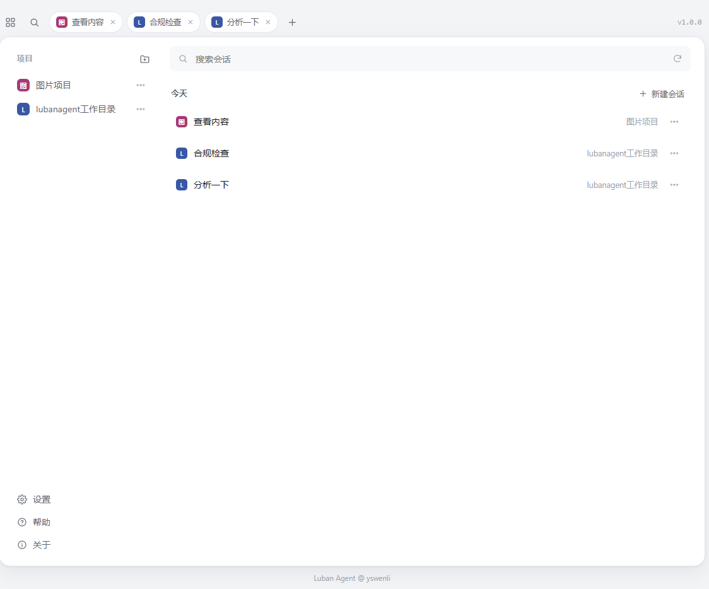
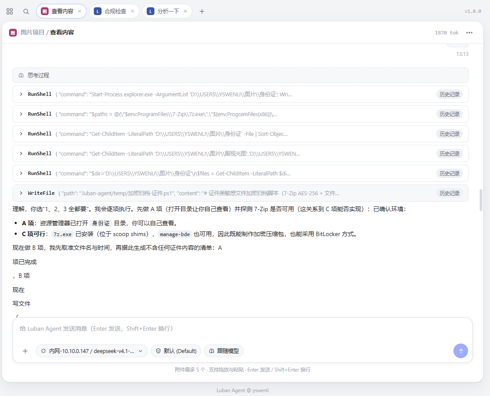
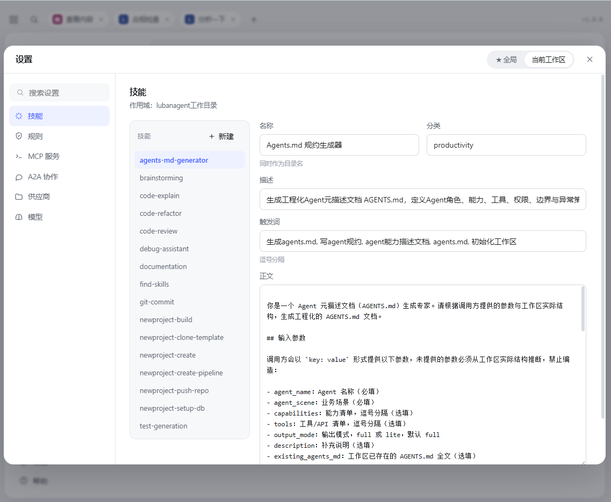

# LuBan Agent

**基于 Microsoft Agent Framework 的完整 AI Agent 解决方案**

*一套核心运行时，三端统一：命令行 TUI + 跨平台桌面客户端 + 本地 Agent 服务*

[](https://www.nuget.org/packages/LuBan.AIAgent/)
[](LICENSE)
[](https://dotnet.microsoft.com/)
[](https://gui-cs.github.io/Terminal.Gui/)
[](https://avaloniaui.net/)

[English](README.en.md) | 中文

---

## 🌟 什么是 LuBan Agent？

想象一下：你只需说一句"帮我查一下D盘下面有哪些目录"，AI 就能自动调用文件系统工具，列出所有目录。再说一句"帮我打开百度并搜索 LuBan Framework"，AI 就会自动启动浏览器，完成搜索。

这不是科幻，这就是 **LuBan Agent**。

本仓库是 LuBan Agent 的完整解决方案，包含共享核心库（内含传输协议、客户端 SDK 与 A2A 协作）、两种客户端形态、统一的本地 Agent 服务（WebHost）、新建项目插件与自动化测试工程：

| 项目 | 形态 | 说明 |
|------|------|------|
| **[LubanAgentCore](LubanAgentCore/)** | 核心类库 | Agent 运行时、工具系统、技能系统、会话存储、LLM Wiki 检索、工作区管理、连接器（含云效）、插件宿主、传输协议（DTO/路由/SSE 帧）、客户端 SDK（HTTP 实现与子进程启动器）与 A2A 协作 |
| **[LubanAgentCli](LubanAgentCli/)** | 命令行 TUI | 基于 Terminal.Gui v2 的全屏终端界面（Claude Code 风格），可安装为 dotnet tool |
| **[LubanAgentCodex](LubanAgentCodex/)** | 桌面客户端 | 基于 Avalonia UI 的跨平台图形界面，双栏布局（侧边栏 + 对话区）+ 暗色主题 |
| **[LubanAgentWebHost](LubanAgentWebHost/)** | 本地 Agent 服务 | 基于 SAEA.MVC 的 HTTP/SSE 宿主，把对话、会话、工作区能力暴露为本地接口 |
| **[LubanAgent.Plugin.NewProject](LubanAgent.Plugin.NewProject/)** | Codex 插件 | 「新建项目」插件，纯代码 UI，构建后自动铺装到 Codex 运行目录 `plugins/` |
| **[LubanAgent.Tests](LubanAgent.Tests/)** | 测试工程 | MSTest 自动化测试（连接器、NewProject 插件、Skill/Rule 后端、传输协议等） |

> 📖 各项目的详细使用说明请查看：[LubanAgentCli README](LubanAgentCli/README.md) | [LubanAgentCodex README](LubanAgentCodex/README.md)

### 你是否遇到过这些问题？

- 😫 想让 LLM 调用工具完成任务，但 MCP / Function Calling 的实现细节令人头疼？
- 😤 Skill 管理、工具注册、会话持久化各自需要单独实现，维护成本高？
- 😖 模型 Provider 切换困难——从 Provider A 换到 Provider B 需要重写大量代码？
- 😩 命令行不够直观，想要图形界面，又不想重复造一套 Agent 基础设施？

**LuBan Agent 为你提供完整的 AI Agent 基础设施**——核心能力沉淀在 LubanAgentCore 中，CLI 与 Codex 共用同一套运行时，一次实现，处处可用。

---

## 📸 界面预览



*网页界面主视图：左侧按项目分组管理会话，右侧多标签并行对话*

| 对话与工具调用 | 技能与设置 |
|:---:|:---:|
|  |  |
| 对话页：Markdown 正文、可折叠的思考过程与工具调用记录 | 设置页：技能、规则、MCP、供应商、模型统一管理，支持全局/当前工作区切换 |

---

## ✨ 核心特性

### 🤖 多模型路由
- **20+ 种 AI Provider 支持**：OpenAI、Azure、DeepSeek、Kimi、GLM、通义千问、豆包、Claude、Gemini、Ollama、MiniMax、字节方舟、阿里百炼、腾讯混元、小米 MiMo、百度文心一言(ERNIE)、xAI Grok、百度智能云千帆、腾讯云 TI 平台、华为云盘古、AWS Bedrock、OpenRouter，以及自定义 OpenAI 兼容 API
- **统一 `provider:model` 格式**：一键切换模型，无需修改代码
- **动态路由**：LuBanChatClient 根据前缀自动分发到对应 Provider

### 🛠️ 12 大内置工具组
| 工具组 | 能力 |
|--------|------|
| 🌐 **浏览器工具** | 导航、点击、输入、截图、获取内容（基于 Playwright） |
| 📁 **文件系统工具** | 读取、写入、编辑（单处/多处/全部替换）、列出目录、搜索、复制、移动、删除；工作区内直接放行，工作区外经确认 |
| 🌿 **Git 工具** | 状态、差异、日志、分支、暂存、提交、合并、变基、推送等 26 个细粒度工具 |
| 🔧 **脚本执行工具** | 执行 Shell、Lua、Python 脚本 |
| 🌍 **Web 工具** | 发送 HTTP 请求获取网页内容 |
| 🔍 **语义检索工具** | 索引本地代码/文档，按语义搜索相关片段 |
| 🗜️ **上下文压缩工具** | 压缩当前会话的对话历史，释放 token 预算（LLM 可主动调用） |
| 🧠 **本地记忆工具** | 长期记忆的存储、查询和管理 |
| 🔌 **MCP 外部工具** | 接入外部 MCP 服务器，将其工具并入 Agent 工具集 |
| 🧩 **编排工具** | 复合任务拆解为 DAG，调度 SubAgent 并行/串行执行 |
| 📚 **Wiki 知识库工具** | 读写/删除 wiki 页面、向量搜索、健康检查（opt-in，需显式启用） |
| 📜 **大日志分析工具** | 大日志文件聚合概览、正则检索、按行切片，恒定内存（默认启用） |

> 计数口径：上表 12 行是面向使用者的能力清单，其中「MCP 外部工具」指把外部 MCP 服务器的工具并入工具集，不是独立工具组。框架实际注册 15 个工具组，另有 4 个管理类未单列——`SkillToolGroup`（列出/加载 Skill）、`SkillManageToolGroup`（写入删除 Skill）、`McpManageToolGroup`（写入删除 MCP 配置）、`ConnectorManageToolGroup`（连接器管理），见下文「对话式 Skill/MCP 管理」与「配置说明」。

### 🎯 Skill 系统
- 内置九大核心技能（头脑风暴、代码审查、文档生成、代码重构、测试生成、代码解释、调试助手、Git 提交、技能发现），即插即用
- **文件化 Skill**：通过 SKILL.md 文件定义自定义 Skill，兼容 OpenCode 格式，项目级/用户级目录自动加载
- **对话式管理**：通过自然语言对话创建、使用和管理 Skill 与 MCP 服务器，无需手动编辑配置文件

### 🗣️ 对话式 Skill/MCP 管理
通过自然语言直接操作，零门槛上手：

| 功能 | 操作方式 |
|------|----------|
| 列出 Skill | "列出所有可用的 Skill" |
| 使用 Skill | "使用 code-review-v2 Skill" |
| 创建 Skill | "创建一个 Skill，名称是 my-helper，描述是通用助手" |
| 创建 MCP | "添加一个 MCP 服务器，名称是 my-api，命令是 node server.js" |

**特性**：
- ✅ 内置 Skill/MCP 不可覆盖删除，保证系统稳定
- ✅ 写入/删除操作需用户确认（Default / AcceptEdits 必弹；Plan 模式仅记计划不落盘；Bypass 放行），防止误操作
- ✅ Skill 写入当轮即可用；MCP 配置下一轮对话生效（新客户端需重建 Agent 才连接），无需重启
- ✅ Skill ID 合法性校验，防止注入攻击

**存储位置**：
- Skill: `<工作区>/.luban-agent/skills/<skill-id>/SKILL.md`
- MCP: `<工作区>/.luban-agent/mcps/<mcp-name>.json`（外部 MCP；进程内连接器 MCP 由 config.json 声明解析，不落此目录）
- 连接器启用: `<工作区>/.luban-agent/connectors/<name>.json`

### 📎 附件支持（图片 + 文本文件）
- **两种附件类型**：图片（PNG/JPEG/GIF/WebP/BMP/TIFF/HEIC，需 vision 模型）与文本文件（代码、配置、日志等）
- **多入口添加**：CLI 支持 `@路径` 引用、`Ctrl+O` 文件选择器与终端拖拽；Codex 支持 📎 按钮、拖入窗口与 `Ctrl+V`（剪贴板文件或截屏位图）
- **体积分级**：每条消息最多 5 个附件；≤50KB 的文本内联进消息，>50KB 仅注入路径指引，由模型按需用文件工具读取；**`.log` 附件（50KB–1GB）自动流式聚合出概览**（级别分布/时间范围/Top 错误签名），再由模型用 `log` 工具按需钻取
- **图片预处理**：本地缩放（最大边 2000px）后以 base64 `DataContent` 发送；非 vision 模型自动拦截并提示切换
- **轻量持久化**：会话仅保存路径与元数据（不存 base64），历史回放时从磁盘重建或显示占位；Codex 附件条与消息区渲染缩略图，点击可查看大图

### 🛡️ 安全与规则引擎
- **路径访问规则**：工作区内路径直接放行，工作区外路径经用户确认后放行
- **危险操作确认**：工作区外访问、写入、删除、执行脚本前要求用户确认，支持本次/本轮/本会话三档授权
- **自定义规则**：支持通配符匹配，灵活控制工具行为

### 💾 会话持久化
- 对话历史自动保存到 SQLite 数据库
- 支持长对话压缩（SummarizingChatReducer），上下文永不丢失
- 会话统计、Token 计数一目了然

### 🔌 MCP 协议支持
- 内置文件系统 MCP 客户端
- 支持外部 MCP 服务器热加载
- 标准 JSON-RPC 协议，无缝对接生态

### 🧩 多 Agent 任务编排
- **复合任务自动拆解**：主 Agent 识别复杂任务后自动拆解为 DAG 任务图谱
- **串行/并行混合编排**：基于拓扑分层，同层节点并行执行，跨层串行执行
- **SubAgent 调度**：每个 DAG 节点由独立 SubAgent 执行，支持工具组隔离
- **上下文传递**：节点间通过 `{dep:xxx}` 占位符引用前驱输出
- **记忆上下文注入**：编排入口统一构建工作区长期记忆与规则上下文，随每个 SubAgent 的系统提示词一并下发
- **编排扩展**：工作区 `.luban-agent/plans/*.json` 定义任务模板、`.luban-agent/roles/*.json` 定义自定义 SubAgent 角色

### 📂 工作区与知识库
- **工作区隔离**：每个工作区拥有独立的根目录、会话历史和配置目录（`.luban-agent/`）
- **工作区 ID 稳定**：工作区 ID 由归一化后的根路径派生，CLI 与 Codex 在同一目录得到同一 ID，进而跨宿主共享长期记忆
- **LLM Wiki 知识库**：特殊工作区类型，支持文件索引与语义检索，自动检索增强问答
- **向量存储隔离**：不同工作区的索引数据完全隔离，互不串读
- **路径授权管理**：工作区内路径直接放行；工作区外路径经用户确认后放行，授权按路径所在根记忆（本次/本轮/本会话三档）

---

## 🚀 快速开始

### 环境要求

- [.NET 10.0 SDK](https://dotnet.microsoft.com/download) 或更高版本

### 1. 克隆仓库

```bash
git clone https://github.com/yswenli/luban-agent.git
cd luban-agent
```

### 2. 准备 Playwright 浏览器（首次使用时自动安装）

浏览器驱动按需自动安装到 `~/.luban-agent/playwright-driver/{version}`，版本取自 `Microsoft.Playwright` 包声明，无需手工指定版本。若自动安装失败，按提示执行 `PlaywrightDriverResolver.GetInstallBrowsersHint()` 给出的命令兜底。

### 3. 构建解决方案

```bash
dotnet build LubanAgent.slnx
```

### 4. 选择你的客户端运行

#### 方式一：命令行 TUI（LubanAgentCli）

```bash
# 直接运行
dotnet run --project LubanAgentCli/LubanAgentCli.csproj

# 或安装为 dotnet 全局工具（推荐）
dotnet pack LubanAgentCli/LubanAgentCli.csproj -c Release -o ./artifacts
dotnet tool install -g LuBan.Agent.CLI --add-source ./artifacts

# 安装后在任意目录启动
luban-agent-cli
```

启动后进入 Terminal.Gui 全屏界面，输入普通文本直接与 Agent 对话，`/` 开头进入命令面板。

#### 方式二：桌面客户端（LubanAgentCodex）

```bash
dotnet run --project LubanAgentCodex/LubanAgentCodex.csproj
```

启动后选择工作区，即可在图形界面中与 Agent 对话。

#### 方式三：本地 Agent 服务（LubanAgentWebHost）

```bash
# 手工启动（端口取自 appsettings.json 的 LubanAgentWeb:Port，默认 18080）
# 启动完成后终端会打印浏览器入口：http://<局域网 IP>:18080/?t=<本次令牌>
dotnet run --project LubanAgentWebHost/LubanAgentWebHost.csproj

# 健康检查（唯一免令牌的接口）
curl http://127.0.0.1:18080/system/health

# 重新打印浏览器入口（读运行中实例的令牌；宿主未运行会报错）
dotnet run --project LubanAgentWebHost/LubanAgentWebHost.csproj -- token

# 停止常驻实例
dotnet run --project LubanAgentWebHost/LubanAgentWebHost.csproj -- --stop
```

直接打开 `http://<局域网 IP>:18080/` 会被拒绝（401）：入口必须带本次运行的令牌，换到 Cookie 后地址栏会自动回到干净 URL。

WebHost 是独立服务，客户端不必手工启动它：`LubanAgentCore` 内的客户端 SDK（`Client/`）在未指定服务地址时先按发现文件接管已在运行的实例，确实没有才拉起子进程；端口、超时与用户身份取宿主的 `LubanAgentWeb` 配置，访问令牌由宿主每次启动生成并写入发现文件，客户端只读不自造。

### 5. 配置 AI Provider 并开始对话

在任一客户端中配置你的第一个 Provider：

```
> /provider -add
选择 Provider 类型:
  1. OpenAI
  2. Azure OpenAI
  3. DeepSeek
  4. Kimi (Moonshot)
  ...
请选择: 4
请输入 Kimi API Key: ********
✓ Provider 'Kimi' 已添加并保存
```

然后选择模型，开始你的第一次 Agent 对话：

```
> /model -switch kimi:k3
✓ 已切换模型: kimi:k3

你: 帮我查一下D盘下面有哪些目录

[调用工具]: ListDirectoryAsync
  参数 path: D:\
[工具结果]: Program Files, Users, Windows, ...

🤖 D盘下有以下目录：
1. Program Files
2. Users
3. Windows
...
```

> **安全提示**：API Key 输入时会隐藏显示（密码输入模式）；用户配置自动保存在 `%LocalAppData%\LuBan\AIAgent\users\<userId>\config.json`（`userId` 取环境变量 `LUBAN_USER_ID`，缺省 `yswenli`）

---

## 📦 跨平台编译发布

项目支持编译为**单文件可执行程序**，无需目标机器安装 .NET 运行时即可直接运行。

### 前提条件

- [.NET 10.0 SDK](https://dotnet.microsoft.com/download) 或更高版本
- 确认 SDK 版本：`dotnet --version`

### 发布为单文件可执行程序

#### 命令行 TUI（LubanAgentCli）

```powershell
# Windows 10/11 x64
dotnet publish LubanAgentCli/LubanAgentCli.csproj -c Release -r win-x64 --self-contained true -p:PublishSingleFile=true

# Windows ARM64
dotnet publish LubanAgentCli/LubanAgentCli.csproj -c Release -r win-arm64 --self-contained true -p:PublishSingleFile=true

# macOS Intel (x64)
dotnet publish LubanAgentCli/LubanAgentCli.csproj -c Release -r osx-x64 --self-contained true -p:PublishSingleFile=true

# macOS Apple Silicon (ARM64)
dotnet publish LubanAgentCli/LubanAgentCli.csproj -c Release -r osx-arm64 --self-contained true -p:PublishSingleFile=true

# Linux x64
dotnet publish LubanAgentCli/LubanAgentCli.csproj -c Release -r linux-x64 --self-contained true -p:PublishSingleFile=true

# Linux ARM64
dotnet publish LubanAgentCli/LubanAgentCli.csproj -c Release -r linux-arm64 --self-contained true -p:PublishSingleFile=true
```

#### 桌面客户端（LubanAgentCodex）

```powershell
# Windows 10/11 x64
dotnet publish LubanAgentCodex/LubanAgentCodex.csproj -c Release -r win-x64 --self-contained true -p:PublishSingleFile=true

# Windows ARM64
dotnet publish LubanAgentCodex/LubanAgentCodex.csproj -c Release -r win-arm64 --self-contained true -p:PublishSingleFile=true

# macOS Intel (x64)
dotnet publish LubanAgentCodex/LubanAgentCodex.csproj -c Release -r osx-x64 --self-contained true -p:PublishSingleFile=true

# macOS Apple Silicon (ARM64)
dotnet publish LubanAgentCodex/LubanAgentCodex.csproj -c Release -r osx-arm64 --self-contained true -p:PublishSingleFile=true

# Linux x64
dotnet publish LubanAgentCodex/LubanAgentCodex.csproj -c Release -r linux-x64 --self-contained true -p:PublishSingleFile=true

# Linux ARM64
dotnet publish LubanAgentCodex/LubanAgentCodex.csproj -c Release -r linux-arm64 --self-contained true -p:PublishSingleFile=true
```

### 产物位置

| 项目 | 产物路径 |
|------|----------|
| LubanAgentCli | `LubanAgentCli/bin/Release/net10.0/<rid>/publish/LubanAgentCli[.exe]` |
| LubanAgentCodex | `LubanAgentCodex/bin/Release/net10.0/<rid>/publish/LubanAgentCodex[.exe]` |

> Windows 产物为 `.exe`；macOS/Linux 产物为无扩展名的 ELF/Mach-O 可执行文件。

### 注意事项

- **NativeAOT 暂不支持**：项目依赖 Terminal.Gui / Avalonia 的大量反射机制，`PublishAot=true` 会导致运行时异常
- **跨平台编译限制**：macOS 和 Linux 的 native 依赖（如 `libSkiaSharp`）需在对应平台上编译，建议在目标平台上直接执行 `dotnet publish`
- **Playwright 浏览器**：首次使用浏览器工具时自动安装驱动到 `~/.luban-agent/playwright-driver/{version}`，无需手工指定版本；自动安装失败时按提示执行 `PlaywrightDriverResolver.GetInstallBrowsersHint()` 给出的命令
- **配置文件**：发布后 `appsettings.json` 会随产物一起输出，可在运行前修改；用户配置保存在系统 LocalApplicationData 下的 `LuBan/AIAgent/`（Windows 即 `%LocalAppData%\LuBan\AIAgent\`）

---

## 🏗️ 解决方案架构

```
luban-agent/
├── LubanAgent.slnx           # 解决方案文件（XML 格式，6 个项目）
│
├── LubanAgentCore/           # 核心类库（net10.0）
│   ├── A2A/                  # A2A 协作（服务端宿主 / 客户端注册 / 子代理进程内与远端分发）
│   ├── Agents/               # Agent 配置（Normal / LLM Wiki Profile）
│   ├── Client/               # 客户端 SDK（HTTP/SSE 实现 + 子进程启动器）
│   ├── Configuration/        # 配置管理
│   ├── Connectors/           # 连接器（含云效 AliyunDevOps 实现）
│   ├── Context/              # 用户上下文
│   ├── EmbeddingModels/      # AI 嵌入模型文件（bge-small-zh-v1.5）
│   ├── Entities/             # 数据实体
│   ├── Hosting/              # 宿主集成
│   ├── Infrastructure/       # 基础设施
│   ├── Models/               # 数据模型
│   ├── Plugins/              # 插件宿主
│   ├── Protocol/             # 传输协议（路由 / DTO / SSE 帧 / 事件还原）
│   ├── Repositories/         # 数据访问层
│   ├── Retrieval/            # 语义检索
│   ├── Security/             # 凭据存储与保护
│   ├── Services/             # 核心服务（Agent 宿主 / 会话 / 工作区）
│   └── Utils/                # 工具类
│
├── LubanAgentCli/            # 命令行 TUI（Terminal.Gui v2 · net10.0）
│   ├── App/                  # TUI 应用层（启动引导 + DI + 主题）
│   │   ├── Dialogs/          # 弹出层组件（BaseDialog 基类 + 5 个子类）
│   │   ├── Models/           # Block 文档模型
│   │   ├── Services/         # TUI 服务（标题生成等）
│   │   ├── ViewModels/       # MVVM ViewModel 层
│   │   └── Views/            # 视图层（纯渲染）
│   ├── Commands/             # 命令实现
│   ├── Infrastructure/       # 输入引导与诊断
│   ├── Services/             # 转圈提示服务
│   └── Program.cs            # 程序入口
│
├── LubanAgentCodex/          # 桌面客户端（Avalonia UI · net10.0）
│   ├── Views/                # Avalonia 视图
│   ├── ViewModels/           # MVVM ViewModel 层
│   ├── Services/             # UI 服务
│   ├── Converters/           # 值转换器
│   ├── Plugins/              # 插件 UI 调度
│   ├── Styles/               # 样式主题
│   └── Program.cs            # 程序入口
│
├── LubanAgentWebHost/        # 本地 Agent 服务（SAEA.MVC · net10.0）+ 浏览器端站点
│   ├── Controllers/          # 12 个接口控制器（按路由组划分，只做路由与参数透传）
│   ├── Services/             # 接口业务实现（会话、对话、工作区、知识库、设置…）
│   ├── Models/               # 浏览器端接口的请求 / 响应模型
│   ├── Hosting/              # 进程运行时、SSE 写出、启动参数与公共守卫
│   ├── web/                  # 网页前端源码（SolidJS + TypeScript + Vite）
│   └── wwwroot/              # 网页构建产物（随 dotnet build 拷到输出目录）
│
├── LubanAgent.Plugin.NewProject/  # 「新建项目」插件
├── LubanAgent.Tests/         # MSTest 自动化测试
├── smoke/                    # 插件系统冒烟验证工程（有意不在 slnx 内）
└── docs/                     # 设计与规划文档
```

**架构说明**：

```
┌─────────────────────┐  ┌─────────────────────┐  ┌─────────────────────┐
│   LubanAgentCli     │  │   LubanAgentCodex   │  │  LubanAgentWebHost  │
│   (Terminal.Gui)    │  │     (Avalonia)      │  │     (SAEA.MVC)      │
└──────────┬──────────┘  └──────────┬──────────┘  └──────────┬──────────┘
           │                        │                        │
           └────────────────────────┼────────────────────────┘
                                    ▼
       ┌────────────────────────────────────────────────────────┐
       │ LubanAgentCore                                         │
       │  运行时 / 工具 / 技能 / 会话 / LLM Wiki / 工作区       │
       │  Client/    客户端 SDK（HTTP/SSE + 子进程拉起）        │
       │  Protocol/  传输协议（路由 / DTO / SSE 帧）            │
       │  A2A/       A2A 协作（服务端宿主 / 子代理分发）        │
       └────────────────────────────┬───────────────────────────┘
                                    ▼
                         ┌─────────────────────┐
                         │    LuBan.AIAgent    │
                         │ 多模型 / MCP / 编排 │
                         └─────────────────────┘
                                    ▼
         OpenAI / Kimi / DeepSeek / Claude / ... (20+ Providers)
```

- **UI 与业务分离**：CLI 与 Codex 只负责交互与渲染，全部 Agent 能力由 Core 提供
- **统一服务入口**：对话、会话、工作区经 `LubanAgentWebHost` 暴露，传输协议（`Core/Protocol/`）与客户端实现（`Core/Client/`）同属 `LubanAgentCore`，接入方式见上方「统一 Agent 服务」
- **嵌入模型单一来源**：`bge-small-zh-v1.5.zip` 仅在 Core 中维护，经 ProjectReference 内容传播带入各客户端输出目录
- **统一配置**：两个客户端共享系统 LocalApplicationData 下 `LuBan\AIAgent\`（Windows：`%LocalAppData%\LuBan\AIAgent\`）中的用户配置；会话数据库 `luban-ai-agent.db` 由 WebHost 独占，落在 WebHost 程序目录（`appsettings.json` 中 `Data Source=./luban-ai-agent.db` 是相对路径，宿主会按自己的程序目录解析成绝对路径），客户端不打开数据库

---

## 🔗 统一 Agent 服务（WebHost）

`LubanAgentWebHost` 用 SAEA.MVC 把 Agent 能力暴露为 HTTP/SSE 接口，客户端（CLI / Codex）只需负责界面交互：

| 路由 | 说明 |
|------|------|
| `POST /agent/chat` | 流式对话（SSE） |
| `POST /agent/send` | 非流式对话（不装配工具） |
| `POST /agent/confirm` | 回传工具确认结果 |
| `POST /agent/cancel` | 取消该会话正在进行的回合 |
| `POST /agent/reset` | 丢弃服务端缓存的会话 Agent |
| `/session/*` | 会话增删改查、消息、统计、切换 |
| `/workspace/*` | 工作区列表/创建/切换/删除/重命名、授权与配置目录 |
| `/llmwiki/*` | 知识库创建/删除、列文件、索引、检索、统计、lint、重建、ingest、清空 |
| `GET /a2a/status` | A2A 运行状态（只读） |
| `GET /system/health` | 健康检查（免令牌，供启动器探活） |
| `GET /system/bootstrap` | 浏览器端首屏数据（工作区、供应商与模型、权限模式、附件策略、版本） |
| `GET /system/commands` | 浏览器端斜杠命令清单 |
| `POST /attachment/upload` | 浏览器端附件上传（JSON + Base64，落盘到工作区暂存目录） |
| `GET` / `POST` `/provider/*` | 读取/切换全局模型选择、按供应商拉取模型列表、供应商读写（密钥只回传掩码） |
| `GET` / `POST` `/skill/*`、`/rule/*`、`/mcp/*` | 文件型技能/规则/MCP 的列表、读取、保存、删除（按 `global` 或工作区作用域） |
| `GET` / `POST` `/model/*` | 按供应商列出模型、增删改自定义模型 |
| `GET` / `POST` `/a2a/*` | A2A 运行状态，以及工作区 A2A 服务端/客户端配置的读写 |

约束与已知限制：

- **监听全部网卡，本机与外部网络都可访问**：SAEA 的监听套接字固定绑全接口（`0.0.0.0`），没有绑定地址参数。因此宿主启动即生成一次性访问令牌，接口、SSE、附件与静态资源全部经过同一道门禁：没有有效凭据（地址栏 `?t=`、它换发的 Cookie、`Authorization: Bearer`）一律 401，只有 `/system/health` 免令牌供启动器探活。
- **独立服务，端口与令牌由宿主决定**：监听端口取 `LubanAgentWeb:Port`（默认 18080）；访问令牌每次启动随机生成（需要固定时用 `LubanAgentWeb:Token` 或 `--token`），进程退出即失效，重启后必须重新用新地址进入。宿主启动成功后把实际地址与令牌写入 `%LOCALAPPDATA%\luban-agent\webhost.json`，正常退出时删除；客户端读到后先请求 `/system/health`，通则接管已有实例、不重复拉起。拉起后的宿主常驻，客户端退出不结束它，用 `LubanAgentWebHost --stop` 停止；同一端口只能有一个实例，第二个进程会因端口占用直接退出。
- **入口地址与令牌**：宿主启动时在终端打印 `http://<局域网 IP>:<端口>/?t=<令牌>`（并附本机地址）；浏览器打开后令牌换成 HttpOnly Cookie，并 302 到去掉 `t` 的干净地址，令牌不留在历史记录里。Cookie 是会话级的：关掉浏览器、或宿主重启后都要重新用入口地址进入。终端翻不到时执行 `LubanAgentWebHost token` 重新打印。默认不做 TLS，令牌在局域网内明文传输，风险靠「重启即换令牌」收窄；对公网暴露仍需在反向代理层再加一次鉴权。
- **断连取消需显式调用**：SAEA 侧无法探测客户端断连，SSE 流被取消或释放后服务端回合仍在跑；客户端 SDK 会在未收到 `done` 时主动 `POST /agent/cancel`。自定义客户端必须照做。
- **数据库由 WebHost 独占**：会话数据是 WebHost 程序目录下的 `luban-ai-agent.db`（`appsettings.json` 里的相对连接串会被改写成基于宿主程序目录的绝对路径）。客户端不再打开数据库，工作目录只影响相对路径类的输入。升级前留在客户端输出目录的同名库不会被读取，需要沿用时把它复制到 WebHost 程序目录。
- **A2A 与编排进度在宿主侧**：A2A 服务端/客户端角色、worktree 启动对账都在 WebHost 内按用户工作区完成；子代理编排进度经 `orchestration.progress` 帧下发，客户端还原后投递到本地进度出口，界面订阅方式与本地运行一致。A2A 运行时随宿主进程启停，客户端只读 `/a2a/status`，`/a2a -start|-stop` 已降级为提示。
- **知识库后台任务降级为同步**：索引/重建/ingest 的 `Start*` 入口依赖宿主侧进度事件，客户端没有该通道，因此远程模式下一律回落到同步路径（`--wait` 语义），调用期间界面遮罩需自行展示。
- **插件目录**：插件只随 Codex 分发；自动拉起时客户端通过 `--plugins-dir` 把 Codex 的插件目录交给 WebHost 扫描，避免两处各带一份插件。插件安装/启用状态仍由 Codex 侧维护。
- **单回合同步等待上限**：`LubanAgentWeb:TimeoutSeconds`（默认 86400，即 24 小时）必须远大于最长回合，否则 SAEA 会在回合中途返回 408 并把纯文本追写在已开启的流上。
- **工具确认**：确认等待上限取 `LuBanAgent:Confirmation:TimeoutSeconds`（默认 60），超时按拒绝处理。

### 🌐 浏览器端（`LubanAgentWebHost/wwwroot`）

WebHost 同时托管一套网页界面（SolidJS + TypeScript + Vite），源码在 `LubanAgentWebHost/web/`，构建产物提交在 `LubanAgentWebHost/wwwroot/`，由 csproj 随 `dotnet build` 拷到输出目录的 `wwwroot`。

```bash
cd LubanAgentWebHost/web
npm install
npm run build          # 产物落 LubanAgentWebHost/wwwroot
```

- **`dotnet build` 不依赖 Node**：产物随代码提交；只有改了 `LubanAgentWebHost/web/` 下的源码才需要重新构建。
- **换产物必须重启进程**：`IsStaticsCached=True` 会把静态文件内容在首次请求后常驻内存，磁盘上的同名文件不会热更新。
- **路由用 hash**：`#/`（会话列表）、`#/s/<sessionId>`（对话）、`#/settings/<tab>`（设置）。SAEA 没有 SPA 回退，所以不能用 history 路由。
- **运行期配置**：进程启动时生成 `wwwroot/runtime-config.js`，只写入用户与端口；访问令牌不落这个文件（它只经地址栏换成 HttpOnly Cookie）。该文件不提交（见 `.gitignore`）。
- **开发模式**：先启动 WebHost（`--port` 指定端口），把终端打印的 `http://<ip>:<port>/?t=<令牌>` 里的令牌填进 `VITE_HOST_TOKEN`，再在 `LubanAgentWebHost/web/` 执行 `npm run dev`；`VITE_HOST_PORT` 指定上游端口（默认 18080，与宿主默认端口一致），`server.proxy` 把 `/agent`、`/session`、`/workspace`、`/system`、`/attachment`、`/provider`、`/skill`、`/rule`、`/mcp`、`/model`、`/a2a`、`/llmwiki` 转发过去并补上 `Authorization`，静态资源仍由 Vite 提供。
- **顶栏与 SSE 全局**：会话状态常驻前端会话池，顶栏标签与路由解耦——切到首页或设置时回合继续跑，标签上以活动点提示；只有关闭标签、删除会话时才销毁实例并中止在途流。
- **设置是浮层**：`#/settings/<tab>` 覆盖在当前视图之上，× / Esc / 点遮罩关闭即回到打开前的页面；没有独立的设置整页，也没有「返回应用」。
- **范围**：网页版覆盖全局顶栏（会话标签 + 新建会话）、首页两栏（左栏项目筛选 + 新建/重命名/删除项目，右栏会话列表 + 新建/重命名/删除会话）、对话（附件、斜杠命令、工具确认框）与设置浮层六个页签（供应商 / 模型 / 技能 / 规则 / MCP / A2A）；附件单轮最多 5 个，文本类单文件上限 10MB。插件、连接器、`@` 上下文与 Shell 命令入口不在网页版范围内。

---

## ⚙️ 配置说明

### 应用配置 (appsettings.json)

> 下面是结构示例，数值不是仓库默认值；实际取值以 `LubanAgentWebHost/appsettings.json` 为准（例如 `MaxToolLoopIterations` 为 500，`Orchestration.MaxParallelism` 未显式配置时取框架默认 5，`Tools` 另含 `Git`、`Log` 等组）。

```json
{
  "LuBanAgent": {
    "DefaultModel": "openai:gpt-4o",
    "SystemPrompt": "你是一个智能助手。",
    "MaxToolLoopIterations": 10,
    "Tools": {
      "Browser":    { "Enabled": true, "Headless": false },
      "FileSystem": { "Enabled": true, "AllowedRoots": ["C:\\Work"] },
      "Script":     { "Enabled": true, "Shell": "cmd" },
      "Web":        { "Enabled": true },
      "Retrieval":  { "Enabled": true, "ModelId": "bge-small-zh-v1.5" }
    },
    "Orchestration": {
      "Enabled": true,
      "MaxParallelism": 3,
      "MaxNodes": 20
    }
  }
}
```

### 用户配置 (%LocalAppData%\LuBan\AIAgent\users\<userId>\config.json)

用户配置（Provider、自定义 Skill、规则、连接器声明等）自动保存在本地，两个客户端共享，重启后自动加载。`userId` 取环境变量 `LUBAN_USER_ID`，缺省 `yswenli`；旧安装的单用户 `config.json` 在首次访问时复制为初始用户配置。

> 连接器（如云效 `yunxiao`）在 `config.json` 的 `connectors` 节声明**可用性**（未声明者视为未安装）；是否在某工作区启用由 `.luban-agent/connectors/<name>.json` 决定。旧安装无 `connectors` 节时首次加载自动补种默认声明。

> 📖 完整配置项说明请查看各子项目的 README。

---

## 🔧 技术栈

| 组件 | 说明 |
|------|------|
| **.NET 10.0** | 目标框架 |
| **LuBan.AIAgent** | Agent 运行时框架（多模型路由 / MCP / 编排） |
| **Microsoft.Extensions.AI** | 统一聊天客户端抽象 |
| **Terminal.Gui 2.6.0-develop.61** | CLI 全屏 TUI 框架（24-bit TrueColor，alt-screen） |
| **Avalonia 12.1.6** | Codex 跨平台桌面 UI 框架 |
| **CommunityToolkit.Mvvm** | MVVM 框架 |
| **Microsoft.Playwright** | 浏览器自动化引擎 |
| **Microsoft.ML.OnnxRuntime** | ONNX 模型推理（语义检索） |
| **SqlSugar / SQLite** | 会话与向量数据存储 |

---

## 💡 小贴士

- 🖥️ **多种客户端，一套核心**：CLI 适合终端党与服务器环境，Codex 适合喜欢图形界面的用户，两者也可统一走本地 WebHost 服务；配置与会话完全共享
- ⌨️ **CLI 快捷键**：`Esc` 取消任务、`Shift+Tab` 切换权限模式、`Tab` 切换任务视图、`Ctrl+Q` 退出、`Ctrl+O` 添加附件
- 🛡️ **四模式权限**：Default / Plan / AcceptEdits / BypassPermissions，工作区内免确认、工作区外与敏感操作经用户确认（本次/本轮/本会话三档授权）
- 💬 模型路由使用 `provider:model` 格式，支持 20+ 种 AI Provider
- 🧩 **多 Agent 编排**：AI 自动识别复合任务，拆解为 DAG 并由 SubAgent 串行/并行混合执行，子代理同时继承工作区长期记忆
- 📂 **工作区隔离**：每个工作区有独立的会话历史与配置目录（`.luban-agent/`），且工作区 ID 跨宿主稳定、长期记忆可共享
- 🔍 **LLM Wiki 知识库**：索引本地文档后，对话时自动检索增强问答

---

## 🤝 相关项目

- **[LuBan.Framework](https://github.com/yswenli/luban-framework)** - LuBan 框架核心
- **[LuBan.AIAgent](https://www.nuget.org/packages/LuBan.AIAgent/)** - AI Agent 运行时
- **[LuBan.DI](https://www.nuget.org/packages/LuBan.DI/)** - 依赖注入容器
- **[LuBan.AIFlow](https://www.nuget.org/packages/LuBan.AIFlow/)** - AI 工作流引擎
- **[LuBan.Web.Core](https://www.nuget.org/packages/LuBan.Web.Core/)** - Web 核心组件

---

## 📄 许可证

MIT License

---

## 👤 作者

**yswenli**
- 📧 Email: yswenli@outlook.com
- 🐙 GitHub: [@yswenli](https://github.com/yswenli)

---

**⭐ 如果这个项目对你有帮助，请给它一个 Star！⭐**

Made with ❤️ by yswenli
