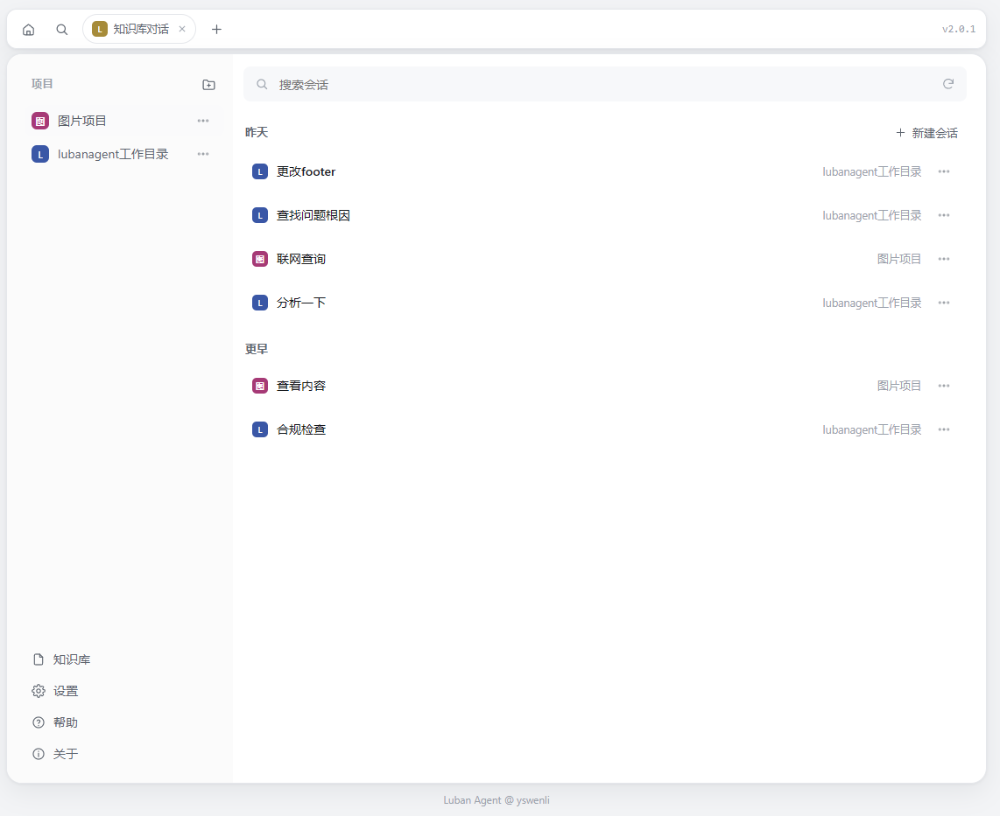
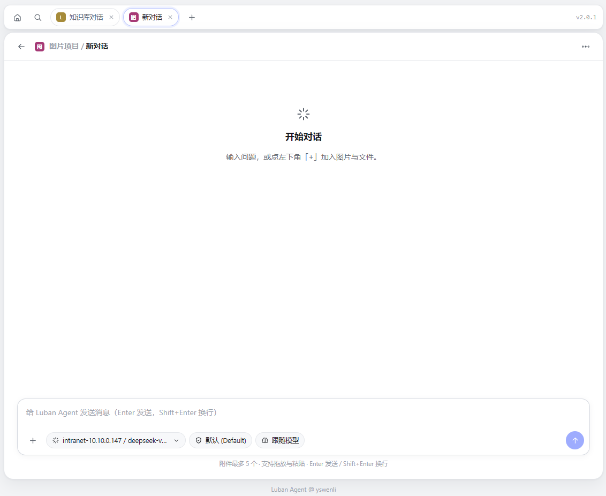
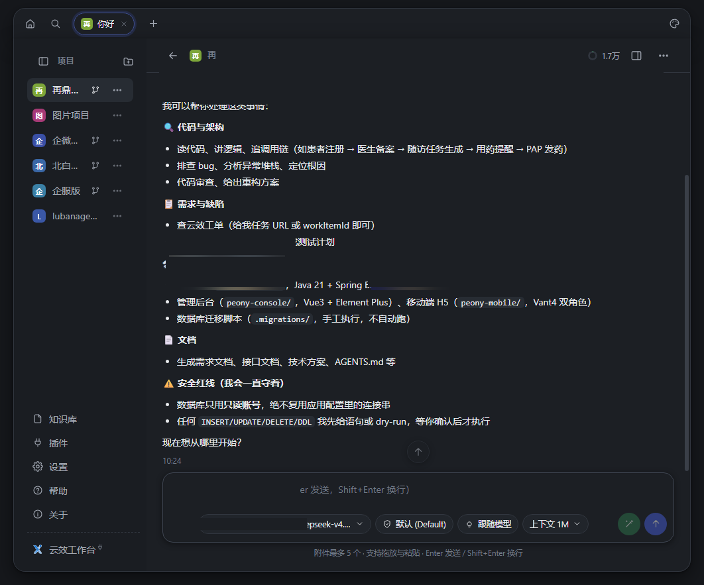
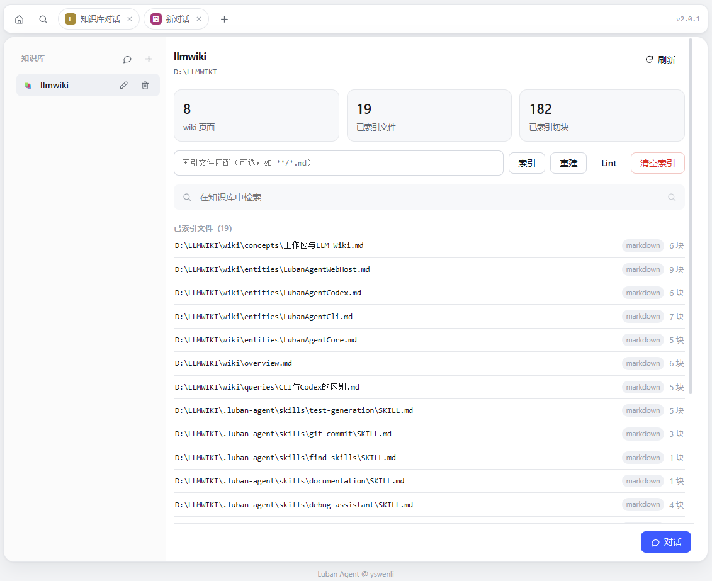
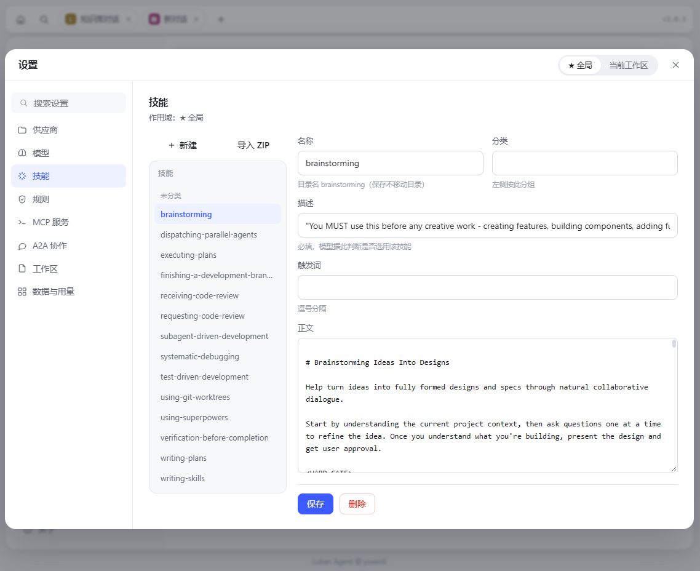
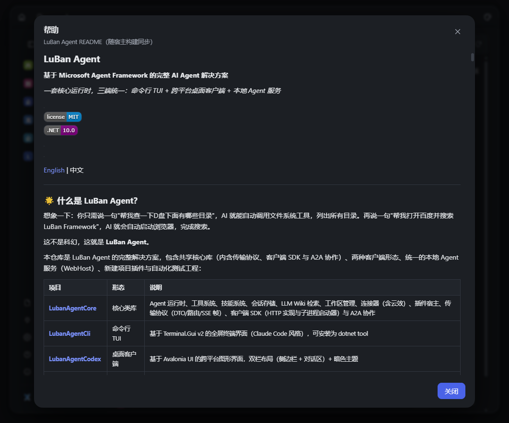
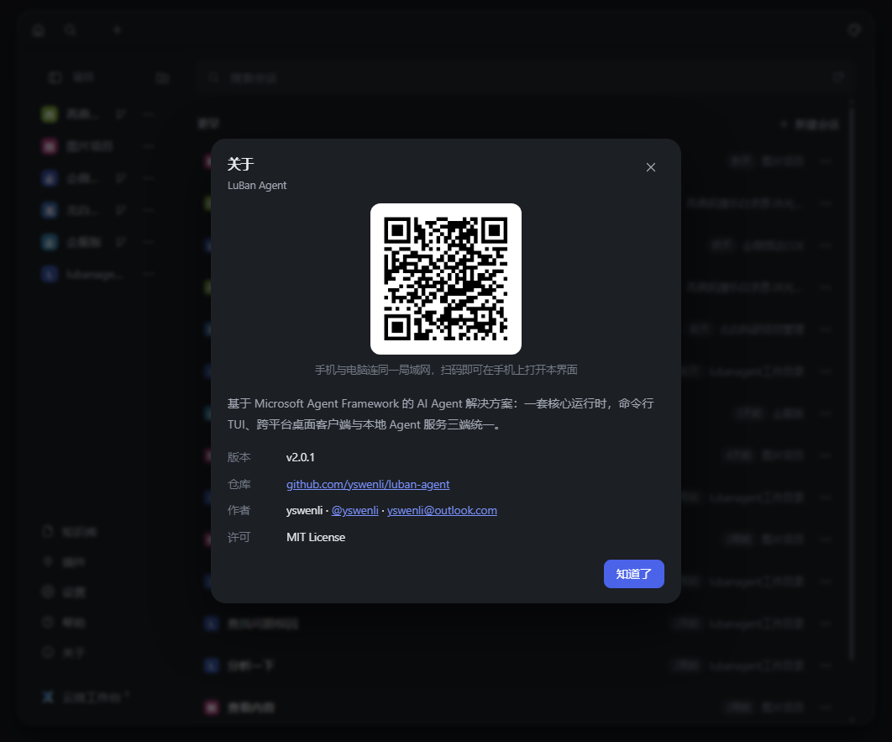
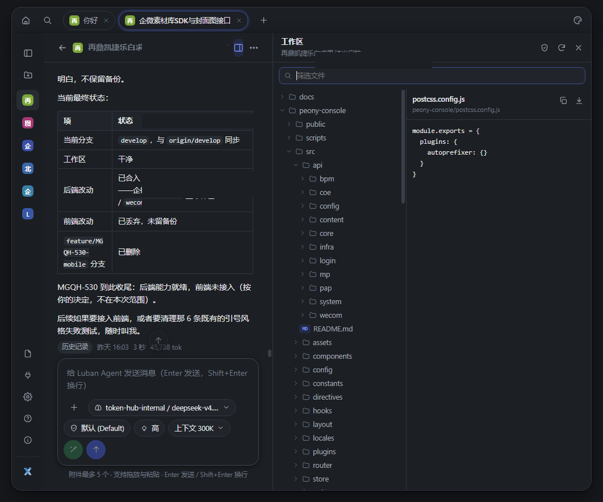

# LuBan Agent

**基于 Microsoft Agent Framework 的完整 AI Agent 解决方案**

*一套核心运行时，三端统一：命令行 TUI + 跨平台桌面客户端 + 本地 Agent 服务*

[](https://www.nuget.org/packages/LuBan.AIAgent/)
[](LICENSE)
[](https://dotnet.microsoft.com/)
[](https://gui-cs.github.io/Terminal.Gui/)
[](https://avaloniaui.net/)

[English](README.en.md) | 中文

---

## 🌟 什么是 LuBan Agent？

想象一下：你只需说一句"帮我查一下D盘下面有哪些目录"，AI 就能自动调用文件系统工具，列出所有目录。再说一句"帮我打开百度并搜索 LuBan Framework"，AI 就会自动启动浏览器，完成搜索。

这不是科幻，这就是 **LuBan Agent**。

本仓库是 LuBan Agent 的完整解决方案，包含共享核心库（内含传输协议与客户端 SDK）、两种客户端形态、统一的本地 Agent 服务（WebHost）、新建项目插件与自动化测试工程：

| 项目 | 形态 | 说明 |
|------|------|------|
| **[LubanAgentCore](LubanAgentCore/)** | 核心类库 | Agent 运行时、工具系统、技能系统、会话存储、LLM Wiki 检索、工作区管理、连接器（含云效）、插件宿主、传输协议（DTO/路由/SSE 帧）、客户端 SDK（HTTP 实现与子进程启动器） |
| **[LubanAgentCli](LubanAgentCli/)** | 命令行 TUI | 基于 Terminal.Gui v2 的全屏终端界面（Claude Code 风格），可安装为 dotnet tool |
| **[LubanAgentCodex](LubanAgentCodex/)** | 桌面客户端 | 基于 Avalonia UI 的跨平台图形界面，双栏布局（侧边栏 + 对话区）+ 暗色主题 |
| **[LubanAgentWebHost](LubanAgentWebHost/)** | 本地 Agent 服务 | 基于 SAEA.MVC 的轻量高性能 HTTP/SSE 宿主：IOCP 完成端口、自宿主，不依赖 ASP.NET Core / Kestrel；把对话、会话、工作区能力暴露为本地接口 |
| **[LubanAgent.Plugin.NewProject](LubanAgent.Plugin.NewProject/)** | Codex 插件 | 「新建项目」插件，纯代码 UI，构建后自动铺装到 Codex 运行目录 `plugins/` |
| **[LubanAgent.Tests](LubanAgent.Tests/)** | 测试工程 | MSTest 自动化测试（连接器、NewProject 插件、Skill/Rule 后端、传输协议等） |

> 📖 各项目的详细使用说明请查看：[LubanAgentCli README](LubanAgentCli/README.md) | [LubanAgentCodex README](LubanAgentCodex/README.md)

### 你是否遇到过这些问题？

- 😫 想让 LLM 调用工具完成任务，但 MCP / Function Calling 的实现细节令人头疼？
- 😤 Skill 管理、工具注册、会话持久化各自需要单独实现，维护成本高？
- 😖 模型 Provider 切换困难——从 Provider A 换到 Provider B 需要重写大量代码？
- 😩 命令行不够直观，想要图形界面，又不想重复造一套 Agent 基础设施？

**LuBan Agent 为你提供完整的 AI Agent 基础设施**——核心能力沉淀在 LubanAgentCore 中，CLI 与 Codex 共用同一套运行时，一次实现，处处可用。

---

## 📸 界面预览



*打开即见：左栏按项目归置各个工作目录，往下是知识库、插件、设置、帮助、关于等入口；右栏会话按「今天 / 更早」排开，右上角一键新建对话。*

### 对话：新会话空态



*新会话空态：左下角「+」添加图片与文件，底部可切换本会话模型、权限模式、思考强度与上下文预算；Enter 发送，Shift+Enter 换行。*

### 对话：历史消息与 Markdown 渲染



*对话页：正文按 Markdown 渲染（清单、代码、表格都能正常排版），标题左侧可返回会话列表，右上角查看工作区与 token 用量。*

### 知识库



*知识库页：wiki 页面、已索引文件、已索引切块一目了然；支持索引、重建、Lint、清空索引与语义检索，右下角「对话」直接进入该知识库的会话。*

### 设置



*设置页：账号、供应商、模型、技能、规则、MCP 服务、工作区、通知、用户、邀请码、工作区根目录、数据与用量共十二个页签，其中用户、邀请码与工作区根目录仅管理员可见；顶部可在全局与当前工作区之间切换作用域。*

### 帮助



*帮助页：弹窗内直读仓库 README，命令、配置与接口说明随宿主构建同步，不用翻文档也能就地查。*

### 关于



*关于页：手机与电脑连同一局域网，扫码即可在手机上打开本界面；下方是版本、仓库、作者与许可信息。*

---

## 🖥️ 跟着界面走：从打开网页到完成第一次对话

不用装客户端，浏览器就是你的 Agent 工作台。下面按你打开页面后会依次碰到的位置，逐一说清每个区域能做什么、怎么上手。

### ① 进入工作台

- **从终端入口进入**：宿主启动后，终端会打印入口地址 `https://<局域网 IP>:18080/e/<短码>` 与内置管理员的初始密码（仅首次创建时打印一次）。浏览器打开短链后，宿主先把短码换成带登录令牌的地址，再换发 Cookie 并跳回干净地址，随即落在登录页；用管理员账号登录即可进入工作台。页面开着时令牌由前端心跳自动续期，无需重复登录。
- **登录与注册**：首次使用内置管理员 `yswenli` 登录（初始密码看终端，也可用 `LubanAgentWeb:AdminPassword` 预先指定），随后在「设置 → 账号」改密；新成员由管理员在「设置 → 邀请码」生成一次性邀请码，在登录页切到「注册」填写邀请码即可创建账号。不开放无邀请码注册。
- **手机扫码访问**：终端入口下方与「关于」弹窗都会给出局域网二维码，手机与电脑连同一局域网即可扫码打开同一实例。二维码只编码短链（约 40 个字符），矩阵比直接编码令牌小得多，终端里是 33 列 × 17 行。
- **证书提示**：本机自签证书只装入当前用户受信任根，手机或首次访问的浏览器可能提示证书不受信任，手动信任或绕过警告即可，详见下文「[WebHost 访问令牌与安全](#-webhost-访问令牌与安全)」。
- **界面语言**：顶栏主题按钮与用户按钮之间的地球按钮可切换 14 种界面语言（简繁中文、英、日、韩、西、葡、意、俄、波、土、泰、阿塞拜疆、印尼语）；选择记入账号，换设备登录自动沿用，未登录时只作用于当前浏览器。

### ② 首页：项目与会话

打开页面先落在会话列表，所有对话按时间分组排开。

- **左栏 · 项目**：把工作目录按项目归类，点选某个项目即可过滤右侧会话；项目旁的操作按钮支持重命名、删除等管理动作。
- **新建项目**：两种来源——选本机已有目录，或填 git 仓库地址自动克隆到 `~/.luban-agent/repositories/<项目名>`。目标目录已存在时先提示「是否复用」并说明风险，不静默覆盖；目录已被别的用户登记过时提示「此工作区已被使用，是否共用」，确认后两人共用同一物理目录（会话与配置各自独立，文件改动互相可见）。新建位置受机器级「工作区根目录」白名单限制（默认 `~/.luban-agent`，管理员在「设置 → 工作区根目录」增删）。
- **右栏 · 会话列表**：顶部搜索框按标题检索会话，刷新按钮拉取最新列表；「新建会话」开一个新对话。每条会话右侧的「更多」菜单提供重命名、删除等操作。
- **顶栏标签**：正在进行的对话以标签形式常驻顶栏，切到首页或设置时回合继续跑，标签上的活动点提示状态；关闭标签或删除会话才会结束在途流程。

### ③ 对话：把想法交给 Agent

点进会话即进入对话页，输入框就在底部。

- **发送与换行**：在输入框写下问题，`Enter` 发送，`Shift+Enter` 换行；左下角「+」可添加图片与文件（单轮最多 5 个附件）。
- **会话级开关**：输入框上方可切换本会话使用的模型、权限模式（默认 / 跟随模型）、思考强度与上下文预算（档位越小越早自动压缩）；这些设置只影响当前会话，不牵动其他对话。
- **技能与命令**：输入 `@` 唤起当前可用技能候选；斜杠命令提供快捷操作；需要确认的工具调用会弹出确认框，需要你作答的交互提问会逐题列出，答复后流程继续。
- **页面操作**：标题左侧「返回列表」回到会话页，「查看工作区」在右侧打开当前工作目录（详见下一小节）；右上角可查看更多会话操作。

### ④ 对话与工作区双栏



*对话页可与工作区并排：左侧继续看 Agent 的回复、思考过程与工具调用，右侧随时翻阅工作区文件、对照代码与文档。*

- **打开与收起**：标题栏点「查看工作区」，右侧滑出工作区面板；点面板右上角 × 或「关闭工作区」即可收起，分隔条可拖动调整两栏宽度。
- **文件树**：目录按层级展开 / 折叠；顶部筛选框按文件名过滤；可切换「显示被忽略的目录」，刷新按钮重读当前目录结构。
- **文件预览**：点选任一文件，右侧展示原文（文本与图片可直接查看）；预览区支持复制文件内容、下载该文件。
- **双栏联动**：左侧对话进行时，右侧可同时翻找相关文件；会话内的相对链接与图片点击后也在该面板打开。

### ⑤ 知识库：让 Agent 读懂你的文档

把散落的文档喂给知识库，对话时它会自己检索相关内容再作答。

- **管理知识库**：左栏新建知识库、重命名或删除现有库；顶部展示 wiki 页面、已索引文件、已索引切块三类统计。
- **索引与维护**：可填文件匹配规则（如 `**/*.md`）后点「索引」；「重建」按现状重新入库，「Lint」检查索引健康度，「清空索引」移除全部已索引内容。
- **检索与对话**：在检索框输入关键词做语义检索；右下角「对话」直接进入绑定该知识库的会话，问答自动带上检索增强。

### ⑥ 插件：给工作台扩展能力

插件页管理装在 Web 插件根下的扩展（与桌面端插件目录相互独立）。

- **安装**：点「安装插件」上传浏览器选中的 ZIP 包，安装成功后自动启用。
- **管理**：已安装插件可停用 / 重新启用；「升级」选择新版本 ZIP 覆盖安装；「卸载」删除插件目录与状态记录。
- **详情**：详情区展示插件标识、版本、作者、状态，以及它提供的技能、MCP 服务与页面入口；带页面入口的插件启用后会出现在左侧栏底部。

### ⑦ 设置：十三个页签管全局与工作区

设置是覆盖在当前视图之上的浮层，×、`Esc` 或点遮罩即可关闭并回到原页面。顶部作用域可在 **全局** 与 **当前工作区** 之间切换，下方配置随作用域生效。

| 页签 | 能做什么 |
|------|----------|
| **账号** | 修改本人显示名、界面语言与密码；改密后其他设备上的旧登录立即失效，当前浏览器自动换发新 Cookie |
| **供应商** | 配置内置或自定义 OpenAI 兼容 Provider：标识、显示名、API Key、BaseUrl、网络超时与自定义模型 |
| **模型** | 按供应商浏览可用模型，查看能力详情，或把某个模型设为新会话默认 |
| **技能** | 新建技能、导入 ZIP，按全局 / 工作区作用域管理；右侧直接编辑名称、分类、描述、触发词与正文 |
| **规则** | 新增文件型规则，配置动作类型 / 目标通配、放行或拦截、优先级与启用状态，可附加引导正文 |
| **MCP 服务** | 新建 MCP 服务器，选择 stdio 等传输方式，填写启动命令与参数，按作用域启用 |
| **工作区** | 查看并授权当前工作区的配置目录，初始化 AGENTS.md，填写业务场景与能力清单 |
| **通知** | 开关任务完成、需要操作、对话出错三类提示音，可试听；偏好保存在本机浏览器 |
| **用户**（仅管理员） | 查看全部账号与最后登录时间；为成员重置密码并拿到一次性新密码（内置管理员与本人除外——本人改密走「账号」页） |
| **邀请码**（仅管理员） | 生成一次性注册邀请码（1/3/7/14/30 天）、查看使用状态与使用者、作废未使用的码 |
| **工作区根目录**（仅管理员） | 维护允许新建项目的本机绝对路径白名单（机器级、所有用户共用）；至少保留一项，移除后已登记的工作区仍可继续使用 |
| **数据与用量** | 查看会话数、消息数、累计 / 日均 Token 统计，按时间范围筛选；可按范围清空会话数据（不删除知识库内容） |

### ⑧ 帮助与关于

- **帮助**：侧边栏「帮助」打开弹窗，仓库 README 直接渲染在弹窗内，命令、配置与接口说明随宿主构建同步。
- **关于**：展示局域网扫码二维码，以及版本号、仓库地址、作者与许可信息。

---

## ✨ 核心特性

### 🤖 多模型路由
- **20+ 种 AI Provider 支持**：OpenAI、Azure、DeepSeek、Kimi、GLM、通义千问、豆包、Claude、Gemini、Ollama、MiniMax、字节方舟、阿里百炼、腾讯混元、小米 MiMo、百度文心一言(ERNIE)、xAI Grok、百度智能云千帆、腾讯云 TI 平台、华为云盘古、AWS Bedrock、OpenRouter，以及自定义 OpenAI 兼容 API
- **统一 `provider:model` 格式**：一键切换模型，无需修改代码
- **动态路由**：LuBanChatClient 根据前缀自动分发到对应 Provider

### 🛠️ 13 大内置工具组
| 工具组 | 能力 |
|--------|------|
| 🌐 **浏览器工具** | 导航、点击、输入、截图、获取内容（基于 Playwright） |
| 📁 **文件系统工具** | 读取、写入、编辑（单处/多处/全部替换）、列出目录、搜索、复制、移动、删除；工作区内直接放行，工作区外经确认 |
| 🌿 **Git 工具** | 状态、差异、日志、分支、暂存、提交、合并、变基、推送等 26 个细粒度工具 |
| 🔧 **脚本执行工具** | 执行 Shell、Lua、Python 脚本 |
| 🌍 **Web 工具** | 发送 HTTP 请求获取网页内容 |
| 🔍 **语义检索工具** | 索引本地代码/文档，按语义搜索相关片段 |
| 🗜️ **上下文压缩工具** | 压缩当前会话的对话历史，释放 token 预算（LLM 可主动调用） |
| 🧠 **本地记忆工具** | 长期记忆的存储、查询和管理 |
| 🔌 **MCP 外部工具** | 接入外部 MCP 服务器，将其工具并入 Agent 工具集 |
| 🧩 **编排工具** | 复合任务拆解为 DAG，调度 SubAgent 并行/串行执行 |
| 📚 **Wiki 知识库工具** | 读写/删除 wiki 页面、向量搜索、健康检查（opt-in，需显式启用） |
| 📜 **大日志分析工具** | 大日志文件聚合概览、正则检索、按行切片，恒定内存（默认启用） |
| 📨 **用户交互工具** | 向用户提出 1～4 个选择题（每题 2～4 个选项，支持多选与「其它」自由输入）并等待作答；默认启用，子代理/编排节点同样可提问，用户跳过按「已取消」返回 |

> 计数口径：上表 13 行是面向使用者的能力清单，其中「MCP 外部工具」指把外部 MCP 服务器的工具并入工具集，不是独立工具组。框架实际注册 16 个工具组，另有 4 个管理类未单列——`SkillToolGroup`（列出/加载 Skill）、`SkillManageToolGroup`（写入删除 Skill）、`McpManageToolGroup`（写入删除 MCP 配置）、`ConnectorManageToolGroup`（连接器管理），见下文「对话式 Skill/MCP 管理」与「配置说明」。

### 🎯 Skill 系统
- 内置十大核心技能（头脑风暴、代码审查、文档生成、代码重构、测试生成、代码解释、调试助手、Git 提交、技能发现、AGENTS.md 规约生成），即插即用
- **文件化 Skill**：通过 SKILL.md 文件定义自定义 Skill，兼容 OpenCode 格式，项目级/用户级目录自动加载
- **对话式管理**：通过自然语言对话创建、使用和管理 Skill 与 MCP 服务器，无需手动编辑配置文件

### 🗣️ 对话式 Skill/MCP 管理
通过自然语言直接操作，零门槛上手：

| 功能 | 操作方式 |
|------|----------|
| 列出 Skill | "列出所有可用的 Skill" |
| 使用 Skill | "使用 code-review-v2 Skill" |
| 创建 Skill | "创建一个 Skill，名称是 my-helper，描述是通用助手" |
| 创建 MCP | "添加一个 MCP 服务器，名称是 my-api，命令是 node server.js" |

**特性**：
- ✅ 工作区技能文件可覆盖同名内置 Skill（文件优先于内置与 config 自定义）；纯内置（无同名目录）不可删除，保证系统稳定
- ✅ 设置页左侧按 `category` 分组、主文本为 `name`、小字为目录名；保存只改 frontmatter，不移动目录
- ✅ 技能支持 ZIP 导入（包内按 `<目录>/SKILL.md` 识别，同名目录以新导入为准）
- ✅ 写入/删除操作需用户确认（Default / AcceptEdits 必弹；Plan 模式仅记计划不落盘；Bypass 放行），防止误操作
- ✅ Skill 写入当轮即可用；MCP 配置下一轮对话生效（新客户端需重建 Agent 才连接），无需重启
- ✅ Skill ID 合法性校验，防止注入攻击

**存储位置**：
- Skill: `<工作区>/.luban-agent/skills/<skill-id>/SKILL.md`
- MCP: `<工作区>/.luban-agent/mcps/<mcp-name>.json`（外部 MCP；进程内连接器 MCP 由 config.json 声明解析，不落此目录）
- 连接器启用: `<工作区>/.luban-agent/connectors/<name>.json`

### 📎 附件支持（图片 + 文本文件）
- **两种附件类型**：图片（PNG/JPEG/GIF/WebP/BMP/TIFF/HEIC，需 vision 模型）与文本文件（代码、配置、日志等）
- **多入口添加**：CLI 支持 `@路径` 引用、`Ctrl+O` 文件选择器与终端拖拽；Codex 支持 📎 按钮、拖入窗口与 `Ctrl+V`（剪贴板文件或截屏位图）
- **体积分级**：每条消息最多 5 个附件；≤50KB 的文本内联进消息，>50KB 仅注入路径指引，由模型按需用文件工具读取；**`.log` 附件（50KB–1GB）自动流式聚合出概览**（级别分布/时间范围/Top 错误签名），再由模型用 `log` 工具按需钻取
- **图片预处理**：本地缩放（最大边 2000px）后以 base64 `DataContent` 发送；非 vision 模型自动拦截并提示切换
- **轻量持久化**：会话仅保存路径与元数据（不存 base64），历史回放时从磁盘重建或显示占位；Codex 附件条与消息区渲染缩略图，点击可查看大图

### 🛡️ 安全与规则引擎
- **路径访问规则**：工作区内路径直接放行，工作区外路径经用户确认后放行
- **危险操作确认**：工作区外访问、写入、删除、执行脚本前要求用户确认，支持本次/本轮/本会话三档授权
- **自定义规则**：支持通配符匹配，灵活控制工具行为

### 💾 会话持久化
- 对话历史自动保存到 SQLite 数据库
- 支持长对话压缩（SummarizingChatReducer），上下文永不丢失
- 会话统计、Token 计数一目了然

### 🔌 MCP 协议支持
- 内置文件系统 MCP 客户端
- 支持外部 MCP 服务器热加载
- 标准 JSON-RPC 协议，无缝对接生态

### 🧩 多 Agent 任务编排
- **复合任务自动拆解**：主 Agent 识别复杂任务后自动拆解为 DAG 任务图谱
- **串行/并行混合编排**：基于拓扑分层，同层节点并行执行，跨层串行执行
- **SubAgent 调度**：每个 DAG 节点由独立 SubAgent 执行，支持工具组隔离
- **上下文传递**：节点间通过 `{dep:xxx}` 占位符引用前驱输出
- **记忆上下文注入**：编排入口统一构建工作区长期记忆与规则上下文，随每个 SubAgent 的系统提示词一并下发
- **编排扩展**：工作区 `.luban-agent/plans/*.json` 定义任务模板、`.luban-agent/roles/*.json` 定义自定义 SubAgent 角色

### 📂 工作区与知识库
- **工作区隔离**：每个工作区拥有独立的根目录、会话历史和配置目录（`.luban-agent/`）
- **工作区 ID 稳定**：工作区 ID 由归一化后的根路径派生，CLI 与 Codex 在同一目录得到同一 ID，进而跨宿主共享长期记忆
- **LLM Wiki 知识库**：特殊工作区类型，支持文件索引与语义检索，自动检索增强问答
- **向量存储隔离**：不同工作区的索引数据完全隔离，互不串读
- **路径授权管理**：工作区内路径直接放行；工作区外路径经用户确认后放行，授权按路径所在根记忆（本次/本轮/本会话三档）

---

## 🚀 快速开始

### 环境要求

- [.NET 10.0 SDK](https://dotnet.microsoft.com/download) 或更高版本

### 1. 克隆仓库

```bash
git clone https://github.com/yswenli/luban-agent.git
cd luban-agent
```

### 2. 准备 Playwright 浏览器（首次使用时自动安装）

浏览器驱动按需自动安装到 `~/.luban-agent/playwright-driver/{version}`，版本取自 `Microsoft.Playwright` 包声明，无需手工指定版本。若自动安装失败，按提示执行 `PlaywrightDriverResolver.GetInstallBrowsersHint()` 给出的命令兜底。

### 3. 构建解决方案

```bash
dotnet build LubanAgent.slnx
```

### 4. 选择你的客户端运行

#### 方式一：命令行 TUI（LubanAgentCli）

```bash
# 直接运行
dotnet run --project LubanAgentCli/LubanAgentCli.csproj

# 或安装为 dotnet 全局工具（推荐）
dotnet pack LubanAgentCli/LubanAgentCli.csproj -c Release -o ./artifacts
dotnet tool install -g LuBan.Agent.CLI --add-source ./artifacts

# 安装后在任意目录启动
luban-agent-cli
```

启动后进入 Terminal.Gui 全屏界面，输入普通文本直接与 Agent 对话，`/` 开头进入命令面板。

#### 方式二：桌面客户端（LubanAgentCodex）

```bash
dotnet run --project LubanAgentCodex/LubanAgentCodex.csproj
```

启动后选择工作区，即可在图形界面中与 Agent 对话。

#### 方式三：本地 Agent 服务（LubanAgentWebHost）

```bash
# 手工启动（端口取自 appsettings.json 的 LubanAgentWeb:Port，默认 18080）
# 默认以 HTTPS 提供服务：自签证书（CN=LuBanAgent Local）落盘 ~/.luban-agent/webhost-cert.pfx，
# 启动时自动装入当前用户受信任根；不想要 TLS 就加 --http，入口与健康检查随之变成 http://
# 证书维护：--trust-cert 单独补装进当前用户受信任根，--no-trust-cert 启动时不装，--cert-path 换 pfx 位置
# 启动完成后终端会打印浏览器入口：https://<局域网 IP>:18080/e/<短码>（短码只在本次宿主进程内有效）
# 首次启动还会打印内置管理员 yswenli 的初始密码（只打印一次；也可用 LubanAgentWeb:AdminPassword 指定）
# 入口下方还会打印同一地址的二维码，手机（同一局域网）直接扫码打开；宿主由客户端拉起、输出被重定向时不打印
# 手机首次访问会提示证书不受信任（受信任根只装在本机用户下），需手动信任或绕过警告
# 登录令牌默认每 15 分钟自动续期（页面开着会自动续期），但登录最多持续 24 小时；注册需管理员生成邀请码
dotnet run --project LubanAgentWebHost/LubanAgentWebHost.csproj

# 健康检查（免令牌，供启动器探活；证书没装进受信任根时 curl 加 -k）
curl https://127.0.0.1:18080/system/health

# 重新打印浏览器入口（凭宿主令牌向运行中实例取当前入口；宿主未运行会报错）
dotnet run --project LubanAgentWebHost/LubanAgentWebHost.csproj -- --token

# 停止常驻实例
dotnet run --project LubanAgentWebHost/LubanAgentWebHost.csproj -- --stop

# 忘记内置管理员密码时的离线恢复（先 --stop 停止宿主再执行；新密码只打印一次）
dotnet run --project LubanAgentWebHost/LubanAgentWebHost.csproj -- --reset-password yswenli
```

直接打开 `https://<局域网 IP>:18080/` 会落在登录页；未登录调用业务接口一律 401。带 `?t=` 的入口地址在换发 Cookie 后 302 回干净 URL；登录过期或配置了会话上限后到点，需要重新登录，或用 `LubanAgentWebHost --token` 取管理员入口。

WebHost 是独立服务，客户端不必手工启动它：`LubanAgentCore` 内的客户端 SDK（`Client/`）在未指定服务地址时先按发现文件接管已在运行的实例，确实没有才拉起子进程；端口、超时与用户身份取宿主的 `LubanAgentWeb` 配置，宿主令牌由宿主每次启动生成并写入发现文件，客户端只读不自造。

> 🔐 浏览器登录（JWT Cookie）与客户端宿主令牌的分工、初始管理员与邀请码注册、401 怎么处理、续期与绝对上限、多设备与重启后的行为、以及必须了解的风险边界，见下文「[WebHost 访问令牌与安全](#-webhost-访问令牌与安全)」。

### 5. 配置 AI Provider 并开始对话

在任一客户端中配置你的第一个 Provider：

```
> /provider -add
选择 Provider 类型:
  1. OpenAI
  2. Azure OpenAI
  3. DeepSeek
  4. Kimi (Moonshot)
  ...
请选择: 4
请输入 Kimi API Key: ********
✓ Provider 'Kimi' 已添加并保存
```

然后选择模型，开始你的第一次 Agent 对话：

```
> /model -switch kimi:k3
✓ 已切换模型: kimi:k3

你: 帮我查一下D盘下面有哪些目录

[调用工具]: ListDirectoryAsync
  参数 path: D:\
[工具结果]: Program Files, Users, Windows, ...

🤖 D盘下有以下目录：
1. Program Files
2. Users
3. Windows
...
```

> **安全提示**：API Key 输入时会隐藏显示（密码输入模式）；用户配置自动保存在 `~/.luban-agent/users/<userId>/config.json`（`userId` 取环境变量 `LUBAN_USER_ID`，缺省 `yswenli`）

---

## 📦 跨平台编译发布

项目支持编译为**单文件可执行程序**，无需目标机器安装 .NET 运行时即可直接运行。

### 前提条件

- [.NET 10.0 SDK](https://dotnet.microsoft.com/download) 或更高版本
- 确认 SDK 版本：`dotnet --version`

### 发布为单文件可执行程序

#### 命令行 TUI（LubanAgentCli）

```powershell
# Windows 10/11 x64
dotnet publish LubanAgentCli/LubanAgentCli.csproj -c Release -r win-x64 --self-contained true -p:PublishSingleFile=true

# Windows ARM64
dotnet publish LubanAgentCli/LubanAgentCli.csproj -c Release -r win-arm64 --self-contained true -p:PublishSingleFile=true

# macOS Intel (x64)
dotnet publish LubanAgentCli/LubanAgentCli.csproj -c Release -r osx-x64 --self-contained true -p:PublishSingleFile=true

# macOS Apple Silicon (ARM64)
dotnet publish LubanAgentCli/LubanAgentCli.csproj -c Release -r osx-arm64 --self-contained true -p:PublishSingleFile=true

# Linux x64
dotnet publish LubanAgentCli/LubanAgentCli.csproj -c Release -r linux-x64 --self-contained true -p:PublishSingleFile=true

# Linux ARM64
dotnet publish LubanAgentCli/LubanAgentCli.csproj -c Release -r linux-arm64 --self-contained true -p:PublishSingleFile=true
```

#### 桌面客户端（LubanAgentCodex）

```powershell
# Windows 10/11 x64
dotnet publish LubanAgentCodex/LubanAgentCodex.csproj -c Release -r win-x64 --self-contained true -p:PublishSingleFile=true

# Windows ARM64
dotnet publish LubanAgentCodex/LubanAgentCodex.csproj -c Release -r win-arm64 --self-contained true -p:PublishSingleFile=true

# macOS Intel (x64)
dotnet publish LubanAgentCodex/LubanAgentCodex.csproj -c Release -r osx-x64 --self-contained true -p:PublishSingleFile=true

# macOS Apple Silicon (ARM64)
dotnet publish LubanAgentCodex/LubanAgentCodex.csproj -c Release -r osx-arm64 --self-contained true -p:PublishSingleFile=true

# Linux x64
dotnet publish LubanAgentCodex/LubanAgentCodex.csproj -c Release -r linux-x64 --self-contained true -p:PublishSingleFile=true

# Linux ARM64
dotnet publish LubanAgentCodex/LubanAgentCodex.csproj -c Release -r linux-arm64 --self-contained true -p:PublishSingleFile=true
```

### 产物位置

| 项目 | 产物路径 |
|------|----------|
| LubanAgentCli | `LubanAgentCli/bin/Release/net10.0/<rid>/publish/LubanAgentCli[.exe]` |
| LubanAgentCodex | `LubanAgentCodex/bin/Release/net10.0/<rid>/publish/LubanAgentCodex[.exe]` |

> Windows 产物为 `.exe`；macOS/Linux 产物为无扩展名的 ELF/Mach-O 可执行文件。

### 注意事项

- **NativeAOT 暂不支持**：项目依赖 Terminal.Gui / Avalonia 的大量反射机制，`PublishAot=true` 会导致运行时异常
- **跨平台编译限制**：macOS 和 Linux 的 native 依赖（如 `libSkiaSharp`）需在对应平台上编译，建议在目标平台上直接执行 `dotnet publish`
- **Playwright 浏览器**：首次使用浏览器工具时自动安装驱动到 `~/.luban-agent/playwright-driver/{version}`，无需手工指定版本；自动安装失败时按提示执行 `PlaywrightDriverResolver.GetInstallBrowsersHint()` 给出的命令
- **配置文件**：发布后 `appsettings.json` 会随产物一起输出，可在运行前修改；用户配置保存在用户主目录下的 `.luban-agent/`（Windows 即 `%USERPROFILE%\.luban-agent\`，Linux/macOS 为 `~/.luban-agent/`）

---

## 🏗️ 解决方案架构

```
luban-agent/
├── LubanAgent.slnx           # 解决方案文件（XML 格式，6 个项目）
│
├── LubanAgentCore/           # 核心类库（net10.0）
│   ├── Agents/               # Agent 配置（Normal / LLM Wiki Profile）
│   ├── Client/               # 客户端 SDK（HTTP/SSE 实现 + 子进程启动器）
│   ├── Configuration/        # 配置管理
│   ├── Connectors/           # 连接器（含云效 AliyunDevOps 实现）
│   ├── Context/              # 用户上下文
│   ├── EmbeddingModels/      # AI 嵌入模型文件（bge-small-zh-v1.5）
│   ├── Entities/             # 数据实体
│   ├── Hosting/              # 宿主集成
│   ├── Infrastructure/       # 基础设施
│   ├── Models/               # 数据模型
│   ├── Plugins/              # 插件宿主
│   ├── Protocol/             # 传输协议（路由 / DTO / SSE 帧 / 事件还原）
│   ├── Repositories/         # 数据访问层
│   ├── Retrieval/            # 语义检索
│   ├── Security/             # 凭据存储与保护
│   ├── Services/             # 核心服务（Agent 宿主 / 会话 / 工作区）
│   └── Utils/                # 工具类
│
├── LubanAgentCli/            # 命令行 TUI（Terminal.Gui v2 · net10.0）
│   ├── App/                  # TUI 应用层（启动引导 + DI + 主题）
│   │   ├── Dialogs/          # 弹出层组件（BaseDialog 基类 + 5 个子类）
│   │   ├── Models/           # Block 文档模型
│   │   ├── Services/         # TUI 服务（标题生成等）
│   │   ├── ViewModels/       # MVVM ViewModel 层
│   │   └── Views/            # 视图层（纯渲染）
│   ├── Commands/             # 命令实现
│   ├── Infrastructure/       # 输入引导与诊断
│   ├── Services/             # 转圈提示服务
│   └── Program.cs            # 程序入口
│
├── LubanAgentCodex/          # 桌面客户端（Avalonia UI · net10.0）
│   ├── Views/                # Avalonia 视图
│   ├── ViewModels/           # MVVM ViewModel 层
│   ├── Services/             # UI 服务
│   ├── Converters/           # 值转换器
│   ├── Plugins/              # 插件 UI 调度
│   ├── Styles/               # 样式主题
│   └── Program.cs            # 程序入口
│
├── LubanAgentWebHost/        # 本地 Agent 服务（SAEA.MVC · net10.0）+ 浏览器端站点
│   ├── Controllers/          # 12 个接口控制器（按路由组划分，只做路由与参数透传）
│   ├── Services/             # 接口业务实现（会话、对话、工作区、知识库、设置…）
│   ├── Models/               # 浏览器端接口的请求 / 响应模型
│   ├── Hosting/              # 进程运行时、SSE 写出、启动参数与公共守卫
│   ├── web/                  # 网页前端源码（SolidJS + TypeScript + Vite）
│   └── wwwroot/              # 网页构建产物（随 dotnet build 拷到输出目录）
│
├── LubanAgent.Plugin.NewProject/  # 「新建项目」插件
├── LubanAgent.Tests/         # MSTest 自动化测试
├── smoke/                    # 插件系统冒烟验证工程（有意不在 slnx 内）
└── docs/                     # 设计与规划文档
```

**架构说明**：

```
┌─────────────────────┐  ┌─────────────────────┐  ┌─────────────────────┐
│   LubanAgentCli     │  │   LubanAgentCodex   │  │  LubanAgentWebHost  │
│   (Terminal.Gui)    │  │     (Avalonia)      │  │     (SAEA.MVC)      │
└──────────┬──────────┘  └──────────┬──────────┘  └──────────┬──────────┘
           │                        │                        │
           └────────────────────────┼────────────────────────┘
                                    ▼
       ┌────────────────────────────────────────────────────────┐
       │ LubanAgentCore                                         │
       │  运行时 / 工具 / 技能 / 会话 / LLM Wiki / 工作区       │
       │  Client/    客户端 SDK（HTTP/SSE + 子进程拉起）        │
       │  Protocol/  传输协议（路由 / DTO / SSE 帧）            │
       └────────────────────────────┬───────────────────────────┘
                                    ▼
                         ┌─────────────────────┐
                         │    LuBan.AIAgent    │
                         │ 多模型 / MCP / 编排 │
                         └─────────────────────┘
                                    ▼
         OpenAI / Kimi / DeepSeek / Claude / ... (20+ Providers)
```

- **UI 与业务分离**：CLI 与 Codex 只负责交互与渲染，全部 Agent 能力由 Core 提供
- **统一服务入口**：对话、会话、工作区经 `LubanAgentWebHost` 暴露，传输协议（`Core/Protocol/`）与客户端实现（`Core/Client/`）同属 `LubanAgentCore`，接入方式见上方「统一 Agent 服务」
- **嵌入模型单一来源**：`bge-small-zh-v1.5.zip` 仅在 Core 中维护，经 ProjectReference 内容传播带入各客户端输出目录
- **统一配置**：两个客户端共享用户主目录下 `.luban-agent/`（Windows：`%USERPROFILE%\.luban-agent\`，Linux/macOS：`~/.luban-agent/`）中的用户配置；会话数据库 `luban-ai-agent.db` 由 WebHost 独占，落在同一根目录（`appsettings.json` 中的 `Data Source=./luban-ai-agent.db` 是相对路径，宿主会改写到 `~/.luban-agent/luban-ai-agent.db`），客户端不打开数据库

---

## 🔗 统一 Agent 服务（WebHost）

`LubanAgentWebHost` 用 SAEA.MVC 把 Agent 能力暴露为 HTTP/SSE 接口，客户端（CLI / Codex）只需负责界面交互：

| 路由 | 说明 |
|------|------|
| `POST /agent/chat` | 流式对话（SSE） |
| `POST /agent/send` | 非流式对话（不装配工具） |
| `POST /agent/confirm` | 回传工具确认结果 |
| `POST /agent/answer` | 回传交互提问的答案（`cancelled:true` 表示用户取消提问） |
| `POST /agent/cancel` | 取消该会话正在进行的回合 |
| `POST /agent/active` | 探活：该会话是否有正在进行的回合 |
| `POST /agent/attach` | 接上该会话正在进行的回合（SSE，先补快照）；无活跃回合返回 204 |
| `POST /agent/reset` | 丢弃服务端缓存的会话 Agent |
| `/session/*` | 会话增删改查、消息、统计、切换 |
| `/workspace/*` | 工作区列表/创建/切换/删除/重命名、授权与配置目录 |
| `/llmwiki/*` | 知识库创建/删除、列文件、索引、检索、统计、lint、重建、ingest、清空 |
| `GET /e/{code}` | 入口短链（免登录，短码本身即凭据）：302 到 `/?t=<登录令牌>`，随后由门禁换 Cookie 并落到登录页；短码无效或过期回 410 提示页 |
| `/auth/*` | 登录页公开接口：`status` / `login` / `register` / `logout`；登录后另有 `me` / `changePassword` / `updateProfile` 与管理员使用的 `users` / `resetPassword` / `invites` / `createInvite` / `revokeInvite` |
| `GET /system/health` | 健康检查（免令牌，供启动器探活） |
| `GET /system/bootstrap` | 浏览器端首屏数据（工作区、供应商与模型、权限模式、附件策略、版本） |
| `GET /system/commands` | 浏览器端斜杠命令清单 |
| `GET /system/entryQr` | 局域网入口二维码 PNG（关于弹窗展示，手机扫码直接打开本实例；每次按当前登录令牌现登记短码再生成，短码与令牌同时到期） |
| `GET /system/session` | 当前登录的续期与到期时刻（前端心跳用，令牌剩余不足一半时换新并回写 Cookie） |
| `GET /system/entryUrl` | 当前入口地址与到期时刻（只认宿主令牌，供 `LubanAgentWebHost --token` 重新打印，会话到期时自动重开） |
| `POST /attachment/upload` | 浏览器端附件上传（JSON + Base64，落盘到工作区暂存目录） |
| `GET` / `POST` `/provider/*` | 读取/切换全局模型选择、按供应商拉取模型列表、供应商读写（密钥只回传掩码） |
| `GET` / `POST` `/skill/*`、`/rule/*`、`/mcp/*` | 文件型技能/规则/MCP 的列表、读取、保存、删除（按 `global` 或工作区作用域）；`GET /skill/loaded` 返回输入 `@` 时可选的技能（按会话绑定的工作区，仅启用项） |
| `GET` / `POST` `/model/*` | 按供应商列出模型、增删改自定义模型 |
| `GET /file/read` | 按工作区读取文件原文（会话内相对链接与图片点击后打开；只回传文本与图片，越界与其它格式回提示页） |

约束与已知限制：

- **监听全部网卡，本机与外部网络都可访问**：SAEA.MVC 未暴露绑定地址参数（`HttpSocket` 不传 IP，固定绑 `0.0.0.0`）。因此接口、SSE、附件与静态资源全部经过同一道门禁：没有有效凭据（浏览器登录令牌 `?t=` / 它换发的 Cookie、客户端 `Authorization: Bearer` 宿主令牌）一律 401；只有 `/system/health`（供启动器探活）、`/e/{code}`（入口短链，短码本身即凭据）与登录页/认证接口/静态资源免登录。
- **独立服务，端口与令牌由宿主决定**：监听端口取 `LubanAgentWeb:Port`（默认 18080）；宿主令牌启动时随机生成、进程内固定（需要固定时用 `LubanAgentWeb:Token` 或 `--host-token`），浏览器登录令牌则在登录成功后签发、随活动自动续期。宿主令牌进程退出即失效；浏览器 Cookie 在自身到期前（签名密钥落盘复用）仍有效，短链重启即失效。宿主启动成功后把实际地址与宿主令牌写入 `~/.luban-agent/webhost.json`，正常退出时删除；客户端读到后先请求 `/system/health`，通则接管已有实例、不重复拉起。拉起后的宿主常驻，客户端退出不结束它，用 `LubanAgentWebHost --stop` 停止；同一端口只能有一个实例，第二个进程会因端口占用直接退出。
- **入口地址与令牌**：终端会打印入口短链（`/e/<短码>`），浏览器打开后宿主把短码换回 `/?t=<登录令牌>`，再换发 HttpOnly Cookie 并 302 回干净地址；页面开着时由前端心跳续期，登录过期或配置了会话上限后到点需重新登录，也可用 `LubanAgentWebHost --token` 重新取入口。短码只存在于宿主进程内、不落盘也不进日志，与本次登录令牌同时到期（默认 15 分钟），最多同时保留 128 条。完整用法与风险边界见下文「[WebHost 访问令牌与安全](#-webhost-访问令牌与安全)」。
- **断连不等于取消**：一轮对话挂在宿主进程内的轮次中心上，SSE 连接断开只移除订阅者，轮次继续跑完；浏览器重开同一会话时先 `POST /agent/active` 探活，有活跃轮次则 `POST /agent/attach` 续流（先补 `run.snapshot`，再转实时帧），无活跃轮次回 `204` 并由客户端拉历史。`attach` 可选带 `runId`（与当前轮次不符时按无活跃处理回 `204`）与 `fromSeq`（已收到的最大帧序号，缺省则下发快照）。主动停止仍走 `POST /agent/cancel`；删除进行中的会话、删除含进行中会话的工作区会被 `409` 拒绝，清空消息会先取消并等轮次收尾。
- **数据库由 WebHost 独占**：会话数据是用户级目录下的 `luban-ai-agent.db`（`~/.luban-agent/luban-ai-agent.db`；`appsettings.json` 里的相对连接串会被改写到该目录）。客户端不再打开数据库，工作目录只影响相对路径类的输入。升级前留在宿主程序目录的 `ai_sessions.db` / `luban-ai-agent.db` 会在宿主首次启动时自动移入该目录（客户端输出目录里的旧库不会被读取，需要自己搬到宿主程序目录或该用户目录），已有同名库时以现有库为准。
- **编排进度在宿主侧**：worktree 启动对账在 WebHost 内按用户工作区完成；子代理编排进度经 `orchestration.progress` 帧下发，客户端还原后投递到本地进度出口，界面订阅方式与本地运行一致。
- **知识库后台任务降级为同步**：索引/重建/ingest 的 `Start*` 入口依赖宿主侧进度事件，客户端没有该通道，因此远程模式下一律回落到同步路径（`--wait` 语义），调用期间界面遮罩需自行展示。
- **插件目录**：桌面端（Codex）的插件经 `--plugins-dir` 交给 WebHost 扫描；网页「插件」页安装的插件落在独立根（`LubanAgentWeb:WebPluginsDir` / `--web-plugins-dir`，缺省 `~/.luban-agent/webhost/plugins`，状态文件 `plugin-states.json`）。两个根都会被扫描，但管理页只列出并操作 Web 根下的插件，桌面端的安装与启用状态不受影响。
- **长连接的超时口径**：SSE 动作不参与 SAEA 的动作超时（`ActionTimeout` 未启用），回合再长也不会被 `408` 截断。`LubanAgentWeb:TimeoutSeconds`（默认 86400，即 24 小时）决定 SAEA 的 socket 同步等待与会话空闲回收上限；SSE 在写出响应头前已用 `SetNoTimeout` 摘出会话空闲回收。客户端侧连续 45 秒收不到任何数据（含 15 秒一次的心跳）即按断线处理，自动探活并 `attach` 续流；页面从后台切回前台或网络恢复时也会主动重连，并按已收到的最大帧序号（SSE 帧自带 `id:`）增量续传，不重放已渲染内容。服务端每 30 分钟主动收口一次单条 SSE 连接（用于回收对端已消失却无法判死的半开连接，取值刻意远小于 `TimeoutSeconds`），客户端同样按断线续接。
- **工具确认**：确认等待上限取 `LuBanAgent:Confirmation:TimeoutSeconds`（默认 60），超时按拒绝处理；编排子代理发起时确认框在工具名下方显示「来源：编排节点 …」，主代理发起时不显示。
- **交互提问**：模型调用 `AskUserQuestion` 时推 `tool.question` 帧（`questionId` / `questions` / `timeoutSeconds` / `origin?`），客户端用 `POST /agent/answer` 逐题回答案（按问题正文匹配）或带 `cancelled:true` 取消；提问与工具确认共用同一个串行门，同一会话同一时刻只有一个交互在途。等待上限取 `LuBanAgent:Interaction:TimeoutSeconds`（WebHost 配 300；未配置时回退 `LuBanAgent:Confirmation:TimeoutSeconds`），超时按「用户取消」收尾（返回 `cancelled:true`，不计拒绝、不失败节点）。远程回合中提问未被答完就刷新页面时，`run.snapshot` 会带回进行中的提问，浏览器据此恢复提问弹窗；提问工具收尾（已作答/已取消）后快照不再带回旧提问。

### 🌐 浏览器端（`LubanAgentWebHost/wwwroot`）

WebHost 同时托管一套网页界面（SolidJS + TypeScript + Vite），源码在 `LubanAgentWebHost/web/`，构建产物提交在 `LubanAgentWebHost/wwwroot/`，由 csproj 随 `dotnet build` 拷到输出目录的 `wwwroot`。

```bash
cd LubanAgentWebHost/web
npm install
npm run build          # 产物落 LubanAgentWebHost/wwwroot
```

- **`dotnet build` 不依赖 Node**：产物随代码提交；只有改了 `LubanAgentWebHost/web/` 下的源码才需要重新构建。
- **换产物必须重启进程**：`IsStaticsCached=True` 会把静态文件内容在首次请求后常驻内存，磁盘上的同名文件不会热更新。
- **路由用 hash**：`#/`（会话列表）、`#/s/<sessionId>`（对话）、`#/settings/<tab>`（设置）、`#/wiki`（知识库）、`#/plugins`（插件管理）、`#/plugin/<pluginId>/<entryId>`（插件自带页面）。SAEA 没有 SPA 回退，所以不能用 history 路由。
- **运行期配置**：进程启动时生成 `wwwroot/runtime-config.js`，只写入用户与端口；两类令牌都不落这个文件（浏览器侧只经地址栏换成 HttpOnly Cookie，宿主令牌只在发现文件里）。该文件不提交（见 `.gitignore`）。
- **开发模式**：先启动 WebHost（`--port` 指定端口），把**宿主令牌**填进 `VITE_HOST_TOKEN` —— 取 `~/.luban-agent/webhost.json` 的 `token`，或启动时用 `--host-token` 指定（浏览器入口里的 `?t=` 是登录令牌，只能换 Cookie，不能当 Bearer 用；终端打印的入口本身只带短码，短码在宿主内换成这条带 `t=` 的地址）；再在 `LubanAgentWebHost/web/` 执行 `npm run dev`；`VITE_HOST_PORT` 指定上游端口（默认 18080，与宿主默认端口一致），`VITE_HOST_PROTOCOL` 指定上游协议（默认 `https`，与宿主默认一致；宿主用 `--http` 起时设为 `http`；https 上游由代理接受自签证书），`server.proxy` 把 `/agent`、`/session`、`/workspace`、`/system`、`/attachment`、`/provider`、`/skill`、`/rule`、`/mcp`、`/model`、`/llmwiki`、`/plugin`、`/plugin-web` 转发过去并补上 `Authorization`，静态资源仍由 Vite 提供。
- **顶栏与 SSE 全局**：会话状态常驻前端会话池，顶栏标签与路由解耦——切到首页或设置时回合继续跑，标签上以活动点提示；只有关闭标签、删除会话时才销毁实例并中止在途流。
- **设置是浮层**：`#/settings/<tab>` 覆盖在当前视图之上，× / Esc / 点遮罩关闭即回到打开前的页面；没有独立的设置整页，也没有「返回应用」。
- **范围**：网页版覆盖全局顶栏（首页入口 + 会话标签）、首页两栏（左栏项目筛选 + 新建/重命名/删除项目，右栏会话列表 + 新建/重命名/删除会话）、对话（附件、`@` 技能候选、斜杠命令、工具确认框、标签左侧返回按钮）、知识库页（建库/重命名/索引/重建/检索，底部「对话」直接进入该库的会话）、插件管理浮层（安装 / 升级 / 启停 / 卸载 Web 插件，只作用于 Web 插件根）与插件自带页面（同源 iframe，启用且有页面时出现在左侧栏底部）、设置浮层十二个页签（账号 / 供应商 / 模型 / 技能 / 规则 / MCP / 工作区 / 通知 / 用户 / 邀请码 / 工作区根目录 / 数据与用量，其中用户、邀请码与工作区根目录仅管理员可见）；附件单轮最多 5 个，文本类单文件上限 10MB，图片单文件上限 20MB 且像素数不超过 5000 万（超过 2000px 或 5MB 的图片先在浏览器端缩放重编码，压缩后再上传）。连接器、`@` 文件路径上下文与 Shell 命令入口不在网页版范围内。

---

## 🔐 WebHost 访问令牌与安全

宿主把监听套接字绑在 `0.0.0.0`（SAEA.MVC 未暴露绑定地址参数），同网段任何设备只要拿到地址就能连上；而这条通道背后是能读写工作区、执行命令的 Agent。所以全站默认拒绝，只认两类凭据：浏览器用的**登录令牌**（登录后签发的 HS256 JWT，落在 HttpOnly Cookie）与客户端用的**宿主令牌**（进程内固定，只走 `Authorization: Bearer`）。

### 两类凭据

| 凭据 | 谁用 | 出厂行为 |
|------|------|----------|
| 登录令牌（`luban_auth` Cookie，入口地址里的 `?t=`） | 浏览器 | 登录或注册成功后签发；默认 15 分钟有效，剩余不足一半时由门禁自动续期，但默认 24 小时后必须重新登录（`SessionMaxHours` 默认 24，0 表示不设上限）；改密、被管理员重置或账号被禁用后立即失效 |
| 宿主令牌（`Authorization: Bearer`） | CLI / Codex / 插件 / 自研客户端 | 启动随机生成（可用 `LubanAgentWeb:Token` 固定），进程内不变 |

### 账号与登录

- **内置管理员**：用户标识固定为 `yswenli`，不可改名、不可删除，也不允许被其他管理员（或本人）在网页上重置密码；密码只能由本人在「设置 → 账号」修改。
- **初始密码**：首次启动时若用户表里还没有内置管理员，宿主会生成随机密码并在终端打印一次（「内置管理员 yswenli 初始密码：…」），之后不再显示；想自己指定就配 `LubanAgentWeb:AdminPassword`（至少 8 位）。
- **注册只走邀请码**：不开放公开注册。管理员在「设置 → 邀请码」生成一次性邀请码（1–30 天，默认 7 天），注册时填写；邀请码用后即失效，未使用的可随时作废。用户名需字母开头、3–32 位，只含字母、数字、点、下划线与连字符；密码至少 8 位。
- **改密与重置**：本人在「设置 → 账号」改密成功后，服务端递增令牌版本，其他设备上的旧登录立即失效，当前浏览器换发新 Cookie；管理员在「设置 → 用户」重置成员密码会生成一次性新密码（只显示这一次），同样让该用户所有旧登录失效。**不能重置自己的密码**（新密码只回一次，响应丢失就等于锁死自己），本人改密走「修改密码」。<br>内置管理员忘记密码时没有网页入口，只能在本机离线恢复：先 `--stop` 停止宿主，再执行 `LubanAgentWebHost --reset-password yswenli`（需能读写 `~/.luban-agent`），终端打印的随机密码即新密码，只显示这一次；执行后该账号所有旧登录失效。
- **登录失败锁定**：同一账号连续 5 次密码错误后锁定 30 分钟，锁定期内一律拒绝登录并提示剩余时间；锁定到期后从零重新计数，登录成功也会清零。管理员可在「设置 → 用户」查看锁定状态并手动解锁，重置密码同样会清零。未知用户名不计数、提示与密码错误一致，避免把锁定状态变成账号探测通道。
- **登出**：清除 `luban_auth` Cookie；令牌本身没有服务端会话表，清掉后当前浏览器即退出。
- **首次登录没有默认项目**：宿主不会自动建工作区，左侧显示「还没有项目，点右上角新建」；新建的项目目录只能落在管理员配置的「工作区根目录」白名单内。

### 令牌怎么用

| 场景 | 做法 |
|------|------|
| 首次进入（浏览器） | 打开终端打印的 `https://<局域网 IP>:<端口>/e/<短码>`（宿主以 `--http` 启动时为 `http://`）：宿主先把短码换成 `/?t=<登录令牌>`，再换发 Cookie 并 302 到去掉 `t` 的干净地址，随后落在登录页 |
| 页面一直开着 | 前端每 60 秒请求一次 `/system/session`；令牌剩余不足一半时由门禁换新并回写 Cookie，不必手动刷新 |
| 终端翻不到了 | 在宿主机执行 `LubanAgentWebHost --token`，凭宿主令牌向运行实例取当前入口地址与二维码重新打印 |
| 多台设备 | 每台设备各自登录（同一账号可以多处同时登录）；入口短码解析一次即失效，各设备用自己的登录 Cookie，改密或重置会让所有设备一起失效 |
| 超过会话绝对上限后 | 默认 24 小时（`LubanAgentWeb:SessionMaxHours` 默认 24，0 表示不设上限）；到点后一律需要重新登录，也可用 `LubanAgentWebHost --token` 取新入口 |
| 宿主重启后 | 短链与宿主令牌都是进程内的，重启即失效，需用新打印的地址进入；浏览器 Cookie 只要还没到期就继续有效（JWT 签名密钥落盘复用），到期后重新登录 |
| CLI / Codex / 插件 | 自动带 `Authorization: Bearer <宿主令牌>`，令牌从发现文件读取，无需手工填写 |

- **令牌形态**：登录令牌是 HS256 签名的 JWT，只承载用户标识、显示名、是否管理员、令牌版本与有效期；宿主令牌是 32 字节密码学随机数（`RandomNumberGenerator`）的 Base64Url 文本，43 个字符。两者不是同一种东西，不能混用。
- **JWT 签名密钥**：默认落在 `~/.luban-agent/webhost/jwt.key`（可用 `LubanAgentWeb:JwtKeyPath` 换位置），文件权限只靠 ACL 保护。删掉它会让所有已登录浏览器立即失效，下一次启动重新生成。
- **入口短码**：终端入口与二维码只携带 `/e/<短码>`（7 字节随机数的 Base64Url，10 个字符），短码在宿主进程内映射到 `/?t=<登录令牌>`，不落盘、不进日志，解析一次即失效（避免带令牌的地址留在浏览器历史里反复打开），最多同时保留 128 条（超出先清过期、再淘汰最早到期的）；宿主重启或短码到期（与登录令牌同时）后打开即 410 提示页，重新执行 `LubanAgentWebHost --token` 取新地址。
- **会话时长可配**：`LubanAgentWeb:SessionTokenMinutes`（默认 15，必须大于 0）与 `SessionMaxHours`（默认 24，即登录最多持续 24 小时；0 表示不设上限，正数为上限，负数导致启动失败）。
- **要固定宿主令牌**：用 `LubanAgentWeb:Token` 配置或 `--host-token`。值**只允许字母、数字、`-`、`_`**；含空格、分号或换行会截断 Cookie、污染响应头，宿主直接拒绝启动而不是降级放行。固定的是给客户端用的那个，浏览器侧的登录与续期不受影响。
- **浏览器侧不落令牌**：登录令牌只存在于 `luban_auth` Cookie（`Path=/; HttpOnly; SameSite=Lax`，会话级），URL 里的 `t` 被 302 抹掉、不留在历史记录；页面脚本也读不到——`runtime-config.js` 只写 `userId`/`port`。续期后的新令牌同样由门禁以 `Set-Cookie` 回写，前端不参与。
- **401 长什么样**：浏览器直接访问受保护接口会看到中文提示页（含「请先登录」、忘记密码与 `LubanAgentWebHost --token` 两条自助指引）；配置了会话上限且已超时的，提示页换成「会话已过期」。网页里登录状态失效时会整页换成登录页，不再渲染一个点不动的界面。API 客户端收到 HTTP 401 与统一响应壳（`success: false`、`code: 401`、`message` 说明原因）；账号处于锁定期时登录接口返回 HTTP 429 与剩余分钟数。

### 门禁覆盖范围与实现要点

- **单点拦截，覆盖全部入口**：判定挂在 `SAEA.MVC.HttpContext.GetActionResult()`，命中路由的接口、SSE 流、附件上传与静态资源走同一道闸；控制器动作内还有 `WebApi.GuardAsync` 第二道复核。
- **放行清单**：`/system/health` 免凭据供启动器探活，只回 `status`/`version`/`serverTime`，不含用户身份；`/e/{code}` 是入口短链，短码本身即凭据，命中后 302 回 `/?t=`；`/auth/status`、`/auth/login`、`/auth/register`、`/auth/logout` 与 `/`、`/index.html`、`/runtime-config.js`、`/favicon.ico`、`/assets/` 免登录，否则登录页与静态资源都加载不出来。
- **浏览器凭据优先判会话**：地址栏带 `?t=` 时只认它——带错令牌时即使手里握有有效 Cookie 也按未登录处理，避免错误入口被旧凭据掩盖；`Bearer` 是另一类凭据，先判且不受浏览器登录的续期与上限影响。
- **续期在门禁内完成**：Cookie 令牌剩余不足一半时换新并 `Set-Cookie`，旧令牌在自身到期前仍然有效（等价于旧实现的宽限期）；绝对上限从会话起始时刻算起，到点后连续期令牌一起拒绝。
- **版本号即时失效**：JWT 里带令牌版本，每次动作复核用户未删除、未禁用且版本一致；改密或管理员重置递增版本，旧登录不用等过期就失效。
- **二维码跟随当前令牌**：`/system/entryQr` 每次请求现登记一条短码（与登录令牌同时到期）并带 `Cache-Control: no-cache`，不会留着一张早已过期的旧码。
- **常数时间比对**：JWT 签名与密码摘要都用 `CryptographicOperations.FixedTimeEquals` 比较，不按字符逐位短路。
- **密码只存摘要**：口令用 PBKDF2-SHA256（210,000 次迭代、16 字节盐）存储，不保存明文，也不写日志。
- **失败即关门**：门禁靠反射替换 SAEA 内部请求上下文类型，替换失败会抛异常终止启动，不会静默退化成不鉴权。
- **非读请求不 302**：只有 GET/HEAD 会被重定向改写；带 `?t=` 的 POST 等请求校验通过后原样执行，避免丢请求体。

### 风险边界（务必了解）

- **传输加密是自签 TLS，不等于可信身份**：默认已开 HTTPS，用的是本机自签证书（`CN=LuBanAgent Local`，启动时装进当前用户受信任根），能挡住局域网被动嗅探；但私钥就落在 `~/.luban-agent/` 下、只靠文件 ACL 保护，同一用户的进程可直接读取解密，证书本身也不证明对端身份。需要更强边界时仍应前置反向代理。`--http` 可显式关掉 TLS（此时令牌、密码与对话内容明文传输，只建议本机调试）。
- **JWT 密钥泄漏等于管理员失守**：`~/.luban-agent/webhost/jwt.key` 是明文密钥，能读该文件的进程可以为任意用户（含管理员）伪造登录令牌；它和数据库、证书一样属于本机敏感文件。
- **续期不等于收回权限**：一个持续使用的登录会一路续期，默认 24 小时后到点需重新登录（`SessionMaxHours` 可调，0 表示不设上限）；改密、重置或禁用会让令牌版本变化并立即失效。要强制下线就改密/重置，或把 `LubanAgentWeb:SessionMaxHours` 调小。
- **发现文件是明文**：`~/.luban-agent/webhost.json` 记录端口与宿主令牌，未额外收紧 ACL，同机上能读该用户目录的进程/用户都能拿到。它只适用于本机单用户环境。
- **锁定可被用于拒绝服务**：能打开登录页的人只要对已知账号连续输错 5 次，就能把它锁定 30 分钟；管理员可在「设置 → 用户」解锁，宿主本身不做按来源 IP 的限流。
- **拿到地址与账号即有完整权限**：登录有效期内，持有账号者可读写工作区、执行命令。不要把入口地址与账号密码发到群聊、工单或截图中。
- **对公网暴露需自行加固**：前置反向代理加 TLS 与额外鉴权，并限制来源网段；反代需转达 `X-Forwarded-Proto` 与 `X-Forwarded-Host`，否则页面里的文件链接与 Cookie 的 `Secure` 会按宿主自身的协议判定。本项目不提供公网部署方案。

---

## ⚙️ 配置说明

### 应用配置 (appsettings.json)

> 下面是结构示例，数值不是仓库默认值；实际取值以 `LubanAgentWebHost/appsettings.json` 为准（例如 `MaxToolLoopIterations` 为 500，`Orchestration.MaxParallelism` 未显式配置时取框架默认 5，`Tools` 另含 `Git`、`Log` 等组）。

```json
{
  "LuBanAgent": {
    "DefaultModel": "openai:gpt-4o",
    "SystemPrompt": "你是一个智能助手。",
    "MaxToolLoopIterations": 10,
    "Tools": {
      "Browser":    { "Enabled": true, "Headless": false },
      "FileSystem": { "Enabled": true, "AllowedRoots": ["C:\\Work"] },
      "Script":     { "Enabled": true, "Shell": "cmd" },
      "Web":        { "Enabled": true },
      "Retrieval":  { "Enabled": true, "ModelId": "bge-small-zh-v1.5" }
    },
    "Orchestration": {
      "Enabled": true,
      "MaxParallelism": 3,
      "MaxNodes": 20
    }
  }
}
```

### 用户配置 (~/.luban-agent/users/<userId>/config.json)

用户配置（Provider、自定义 Skill、规则、连接器声明等）自动保存在本地，两个客户端共享，重启后自动加载。`userId` 取环境变量 `LUBAN_USER_ID`，缺省 `yswenli`；根目录下的旧版单用户配置 `~/.luban-agent/config.json` 会在首次访问时复制为初始用户配置。更早版本写在 `%LOCALAPPDATA%\LuBan\AIAgent` 与 `%LOCALAPPDATA%\luban-agent` 下的配置、模型与插件状态不会被自动搬运，升级时需手工并入 `~/.luban-agent`。

> 连接器（如云效 `yunxiao`）在 `config.json` 的 `connectors` 节声明**可用性**（未声明者视为未安装）；是否在某工作区启用由 `.luban-agent/connectors/<name>.json` 决定。旧安装无 `connectors` 节时首次加载自动补种默认声明。

> 工作区根目录白名单是**机器级**配置，落在 `~/.luban-agent/workspace-roots.json`（Web 宿主的所有用户共用，默认只有 `~/.luban-agent` 一项），由管理员在「设置 → 工作区根目录」维护；该文件每次新建项目时读取，手工改完不必重启宿主。它只限制新建位置，不影响已登记工作区的使用。

> 📖 完整配置项说明请查看各子项目的 README。

---

## 🔧 技术栈

| 组件 | 说明 |
|------|------|
| **.NET 10.0** | 目标框架 |
| **LuBan.AIAgent** | Agent 运行时框架（多模型路由 / MCP / 编排） |
| **Microsoft.Extensions.AI** | 统一聊天客户端抽象 |
| **Terminal.Gui 2.6.0-develop.61** | CLI 全屏 TUI 框架（24-bit TrueColor，alt-screen） |
| **Avalonia 12.1.6** | Codex 跨平台桌面 UI 框架 |
| **CommunityToolkit.Mvvm** | MVVM 框架 |
| **Microsoft.Playwright** | 浏览器自动化引擎 |
| **Microsoft.ML.OnnxRuntime** | ONNX 模型推理（语义检索） |
| **SqlSugar / SQLite** | 会话与向量数据存储 |

---

## 💡 小贴士

- 🖥️ **多种客户端，一套核心**：CLI 适合终端党与服务器环境，Codex 适合喜欢图形界面的用户，两者也可统一走本地 WebHost 服务；配置与会话完全共享
- ⌨️ **CLI 快捷键**：`Esc` 取消任务、`Shift+Tab` 切换权限模式、`Tab` 切换任务视图、`Ctrl+Q` 退出、`Ctrl+O` 添加附件
- 🧠 **`@` 技能候选**：CLI / Codex / 网页版均在输入框键入 `@`（或 `@内容`）时列出当前可用技能——只含已启用项，含内置、自定义与工作区技能；候选按输入内容过滤（id / 名称 / 描述 / 分类任一包含即命中，id 或名称前缀命中的排前面）；`↑`/`↓` 选择、`Tab`/`Enter` 插入 `@技能名`，`Esc` 关闭。插入的只是文本，由模型依据系统提示里的技能目录决定是否调用 `UseSkill`
- 🛡️ **四模式权限**：Default / Plan / AcceptEdits / BypassPermissions，工作区内免确认、工作区外与敏感操作经用户确认（本次/本轮/本会话三档授权）
- 💬 模型路由使用 `provider:model` 格式，支持 20+ 种 AI Provider
- 🧩 **多 Agent 编排**：AI 自动识别复合任务，拆解为 DAG 并由 SubAgent 串行/并行混合执行，子代理同时继承工作区长期记忆
- 📂 **工作区隔离**：每个工作区有独立的会话历史与配置目录（`.luban-agent/`），且工作区 ID 跨宿主稳定、长期记忆可共享
- 🔍 **LLM Wiki 知识库**：索引本地文档后，对话时自动检索增强问答

---

## 🤝 相关项目

- **[LuBan.Framework](https://github.com/yswenli/luban-framework)** - LuBan 框架核心
- **[LuBan.AIAgent](https://www.nuget.org/packages/LuBan.AIAgent/)** - AI Agent 运行时
- **[LuBan.DI](https://www.nuget.org/packages/LuBan.DI/)** - 依赖注入容器
- **[LuBan.AIFlow](https://www.nuget.org/packages/LuBan.AIFlow/)** - AI 工作流引擎
- **[LuBan.Web.Core](https://www.nuget.org/packages/LuBan.Web.Core/)** - Web 核心组件

---

## 📄 许可证

MIT License

---

## 👤 作者

**yswenli**
- 📧 Email: yswenli@outlook.com
- 🐙 GitHub: [@yswenli](https://github.com/yswenli)

---

**⭐ 如果这个项目对你有帮助，请给它一个 Star！⭐**

Made with ❤️ by yswenli
