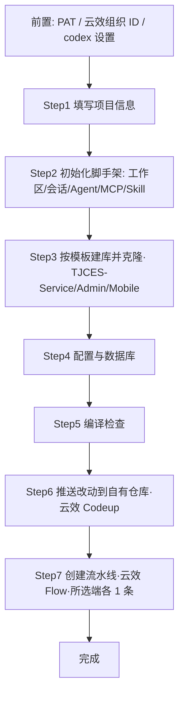
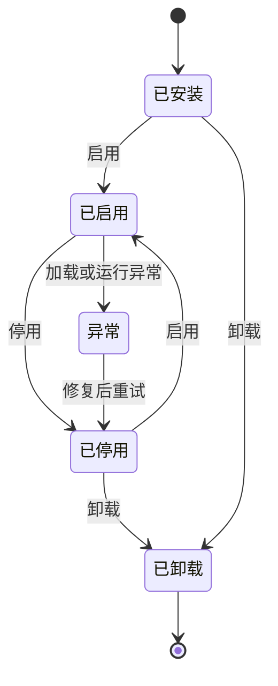

# PRD：luban-agent 插件体系设计与「新建项目」插件需求

- **版本**：v0.17（决策：采用可回收 ALC 做**程序集级热卸载**；据此改写 §1.3/§1.4 目标边界、强化 §3.5 卸载流程、新增 §3.12「ALC 热卸载设计约束」，并明确卸载失败降级策略）
- **日期**：2026-10-14
- **作者**：luban 团队
- **状态**：设计评审中
- **关联仓库**：`luban-agent`（宿主为 `LubanAgentCodex`）
- **修订说明**：v0.2 经多 agent 评审结合**云效 Codeup / Flow** 与 **PAT** 真实能力及现有代码深度修订；v0.3 明确**架构分层**（框架 `LuBan.AIAgent` 定义插件/生命周期/管理/基础插件，解决方案实现具体插件，宿主 `LubanAgentCodex` 操作）；v0.4 补充两点业务与体验约束：①新项目**必须含后端与管理后台，移动端按需可选**（端选择由 Step1 决定、贯穿克隆/建库/编译/建流水线）；②向导界面在表单/进度基础上**实时展示 Agent 操作记录**，让用户直观感知过程并据结果就地调整重试；v0.5 新增**插件专属 Skill 设计（§4.10）**：框架契约支持插件贡献 Skill（`IPlugin.ContributeSkills()` / `IPluginHost.RegisterSkill()` / `SkillDefinition`），「新建项目」插件提供主 skill `newproject-create` + 4 个原子 skill，与向导共享 `INewProjectService` 后端，既可由左侧栏向导触发、也可由 Agent 在聊天以自然语言触发；v0.6 新增**云效连接器与专属 MCP 设计（§3.10 / §4.11）**：框架层新增 `Connectors/AliyunDevOps`（YunxiaoConnector/CodeupClient/FlowClient + PAT 取用），并用进程内 `YunxiaoMCPClient : IMCPClient` 包装暴露 8 个 `mcp_yunxiao_*` 工具；插件 `INewProjectService` 直连连接器（C#），`newproject-*` skill 云效步骤委托 MCP 工具；`plugin.json` 增 `mcpServers` 字段使 MCP 生命周期随插件启停；M1/M4 增连接器与 MCP、新增 M6 联调。
- **修订说明（v0.7）**：①新增**初始化阶段（§4.3 Step 2）**——用户填完 Step 1（含新增字段「项目介绍」「本地目录」）并点「下一步」后，自动初始化 **工作区 / 会话（SessionContext）/ 项目级 Agent / `yunxiao` MCP 客户端 / `newproject-*` Skill**（经新增的 `SkillRegistry.RegisterPluginSkill` 与 `MCPRegistry.RegisterPluginClient`，随 M1 落地），再进入克隆；向导由 5 步扩展为 **6 步**，同步刷新流程图、ProjectSpec、步骤条、验收与里程碑。②修订深度评审发现的 P0/P1：补全动态注册 API（`SkillRegistry`/`MCPRegistry` 当前为静态只读，需扩展）、统一生命周期为 4 态（移除 §2.5 多余的 `Running`）、修正 skill 云效路径表述（§4.10.3 与 §4.10.7/§4.11.4 矛盾）、明确克隆归属（§3.10 复用 `GitToolPlugin`，§4.11.2 由 `CodeupClient.CopyToLocalAsync` 内部复用）、补定义 `PluginCommandDescriptor`、统一 `PluginRegistry`→`PluginManager` 与 `Scan`→`ScanAsync` 命名。③澄清「建库」语义（§1.4 指目标数据库构建，见 Step 4；新建项目推送至云效代码仓库为可选写路径，见 §4.4）。
- **修订说明（v0.8）**：**依据阿里云云效官方 OpenAPI 文档（服务接入点 / 个人访问令牌 / 错误码中心 / Codeup 仓库 4 篇 / Flow 流水线 6 篇，共 12 篇）核对并订正 API 事实错误**：①**统一接入点与鉴权**——云效 OpenAPI 接入点为 `openapi-rdc.aliyuncs.com`（中心版）/ Region版实例域名，路径 `oapi/v1/codeup/...` 与 `oapi/v1/flow/...`，鉴权统一用请求头 **`x-yunxiao-token: <PAT>`**（**弃用原假设的 `devops 2021-06-25` 产品版本与 `Private-Token` 头**）；Git 克隆/推送仍用 `https://oauth2:<PAT>@codeup.aliyun.com/...`。②**中心版 / Region版差异**——`organizationId` **仅中心版**路径必填，Region版不传；`region` 不作为参数，而是编码在接入点域中（原 §4.3 Step6「需传 ORGANIZATION_ID 与 region」表述错误，已订正）。③**订正 Codeup / Flow 各 API 路径与参数**（CreateRepository 增 `path`/`templateProject`、ListRepositories 的 `search`/`perPage`、CreatePipeline 请求体 `{name,content}` 等）。④**订正 MCP 工具入参命名**（`keyword`→`search`、`pageSize`→`perPage`、`nameKeyword`→`pipelineName`、增 `repositoryId`/中心版 `organizationId` 等），并补充 `flow_run_pipeline` 实为 **ExecutePipelineJobRun（运行单次运行实例中的单个任务，需 `pipelineRunId`+`jobId`）**，整条流水线触发 run 的创建 API 标注为待确认。⑤补充错误码映射（401/403/429/500 等）。
- **修订说明（v0.9）**：**确认本企业使用云效「中心版」**（用户决策，落地 §6 开放问题 #7）。据此：①接入点固定 `openapi-rdc.aliyuncs.com`，所有 OpenAPI 路径统一带 `/organizations/{organizationId}`；②`ProjectSpec.organizationId` 由「可选」升为**必填**，并从 codex 设置中的云效连接配置读取；③`flowRegion` 在中心版下无意义（region 已隐含于中心版统一接入点），数据模型中标注为「中心版不使用，仅 Region版 预留」，无需用户填写；④§4.3 前置条件将 `organizationId` 列为必配项（缺失时阻断 Step 3/Step 6）；⑤§6 开放问题 #7 标记为已解决。
- **修订说明（v0.10）**：**深度审查「创建流水线」步骤，对齐真实工程实践**（用户领域输入：三端通常各对应一条流水线，先据企服版 TJCES 的 3 条参考流水线定义克隆为本项目流水线，并替换名称/端口/Codeup 仓库地址/流水线参数）。据此重写 §4.3 **Step 6**：由「生成单条 YAML」改为「**每端一条、共 3 条**（mobile 仅当选），按 `GetPipeline` 拉取 TJCES 参考 YAML → 按 `ProjectSpec` 替换 → `CreatePipeline` 逐端创建」的**克隆-替换-创建**流程，并明确 4 类替换点与「流水线源仓库须指向本项目自有 Codeup 仓库」的依赖（推荐默认建新仓库并推送）。同步：§4.5 `ProjectSpec` 增 `referencePipelines`（TJCES 三端参考流水线 ID）；§4.11.2 `FlowClient` 增 `GetPipelineAsync`+`ClonePipelinesFromTemplateAsync`；§4.11.3 `flow_clone_pipeline` 工具明确「读取源 YAML→替换→创建」语义与 4 类替换；§4.10.4 / §4.10.7 的 `newproject-create-pipeline` 改为按端 ×3 克隆 TJCES 参考；§4.8 验收 #2 改为「（三端）共 3 条流水线创建成功」。
- **修订说明（v0.11）**：①**「推送到新代码仓库」升级为正式步骤**——因 Step 7 流水线源仓库必须指向本项目自有仓库（v0.10 已确认为强依赖），原「可选写路径」不足以支撑 CI，故正式新增 **Step 6 · 推送到新代码仓库**（创建本项目专属 Codeup 仓库 + 推送代码），向导由 6 步扩展为 **7 步**（原 Step 6 建流水线顺延为 **Step 7**），并同步数据模型、`INewProjectService`、原子 Skill、验收、流程图、步骤条与里程碑。②**新增「逐步界面草图」（§4.6）**——为全部 7 步各绘制一张中文界面草图（左向导区 / 右 Agent 操作记录区），并把界面相关信息集中到该节，便于产品与非技术同事评审。③**去代码化**——移除全文的代码片段（C# / TypeScript / JSON / 类图 / 时序图 / 加载伪代码），一律改用**表格与中文说明**表达，使非开发人员也能读懂；数据模型改为字段表，服务接口改为能力表，插件清单字段改为清单表。
- **阅读说明**：本文档面向**产品、项目管理与非技术评审者**，正文不含代码；实现相关细节（类型、接口、端点）以表格或名词表形式给出。顶部「修订说明」是**版本变更记录**（面向开发，为便于追溯保留了少量类型/接口名），评审时可直接跳过；**§3.9 代码挂载点索引**与 **§4.11.3 MCP 工具表**属**开发实现附录**，同样可跳过。
- **修订说明（v0.12）**：**明确新项目代码仓库的创建方式**（用户领域输入：应以 `TJCES-Admin` / `TJCES-Service` / `TJCES-Mobile` 三端模板仓为模板创建，可见性为**组织可见**，再用 Git 工具按仓库 HTTPS 地址克隆到本地）。据此调整：①**Step 3 由「直接克隆模板仓库到本地」改为「以对应模板仓为模板创建本项目各端专属仓库（可见性固定＝组织内公开）→ 取其 HTTPS 地址用 Git 克隆到本地」**，并给出三端模板对照表（后端←`TJCES-Service`、管理端←`TJCES-Admin`、移动端←`TJCES-Mobile`，默认仓库名 `{缩写}-Service/-Admin/-Mobile`）；②**Step 6 相应由「创建仓库并推送」调整为「把本地已改造并通过编译的最终改动提交并推送回各端自有仓库」**；③Step 7 每条流水线各自绑定**本端对应的仓库**（而非单一仓库）；④同步流程图节点、每步云效能力表、数据模型（模板对照 + 按端目标仓库）、共享能力层、原子 Skill 与 MCP 映射、`codeup_create_repo` 工具入参与注③、§4.4 集成表，并重绘第 3、6、7 步界面草图。
- **修订说明（v0.13）**：**保留建库的「用户确认界面」**。因 v0.12 已把建库前置到 Step 3，确认界面随之**移至 Step 3**（而非留在 Step 6）：执行前展示并允许用户调整①**各端新仓库名称**（可逐端修改，默认 `{缩写}-Service/-Admin/-Mobile`）②**可见性**（默认且推荐「组织内公开＝组织可见」，可改「私有」＝仅项目成员可见）③**归属组织**（默认取自云效连接配置），需勾选「我已确认」后才开始创建与克隆；Step 6 维持纯粹的「提交 + 推送」界面。第 3 步草图已重绘为「确认区 + 执行进度」形态。
- **修订说明（v0.14）**：**全文正确性与一致性审查**（三路并行评审：内部一致性 / 云效 API 事实 / 草图与可读性）。①**修正一处功能性缺陷**——「创建仓库」接口返回**不含 HTTPS 克隆地址**，原文档直接拿返回值克隆会失败；现明确需**再调「查询单个仓库」取 `httpUrlToRepo`** 后再用 Git 克隆，并同步订正 `codeup_create_repo` / `codeup_search_repos` 工具出参说明与注③。②**修正草图自相矛盾**——示例项目 JNMS 在第 1 步**未勾选移动端**，第 7 步却画了 3 条流水线；现改为**所选端各 1 条（本例 2 条）**并显式标出「移动端已跳过（第 1 步未勾选）」，第 3/5/6/7 步口径统一；第 5 步「下一步」改为**编译通过后才可用**（对齐「编译失败阻断后续步骤」）；第 6 步左右栏进度状态对齐并补齐「提交管理端改动」记录；步骤条 `3 模板`→`3 建库`、`6 仓库`→`6 推送`；第 3 步主按钮改为「确认并创建」；补第 2 步「全部成功后自动进入第 3 步」说明。③**订正 API 事实**——建库增 `createParentPath`（含多级分组时自动建父路径）；`flow_update_pipeline` 的 `name` 为**必填**且出参为布尔；流水线 YAML 取自 `pipelineConfig.flow` 字段；403 错误码补全为 `Forbidden.InvalidUser.UserNotInCurrentOrganization` / `Forbidden.InvalidOrganizationMember`；新增注⑥说明运行日志接口 `GetPipelineJobRunLog` 与 `UpdatePipeline` 中心版路径待联调确认。④**可读性**——§1.1 新增**名词速查表**（插件 / Skill / MCP / 连接器 / ALC / PAT / Codeup / Flow / 组织可见 等 14 条）；§4.9.1 明确 Git 鉴权的**方式 A（默认 `oauth2:<PAT>@`）与方式 B（HTTPS 克隆账号）**；英文缩写命名规范改为白话；§4.11.3 与 §3.9 标注为「开发实现附录 / 可跳过」；移除残余代码片段（`alc.Unload()`、`services.AddSingleton<...>`、`mcpServers` JSON）。⑤**口径统一**——「端 ×3」一律改为「所选端各 1 条，最多 3 条」（§4.8 验收 #2、§4.10.2、§4.10.4、§4.10.7）；全文术语「代码库」统一为「代码仓库」。
- **修订说明（v0.17）：决策——采用可回收 ALC 实现程序集级热卸载（不采用「停用后重启生效」的简化方案）**。据此：①**§1.4 第 2 条由「不做」改为「要做」**，撤销 v0.15 的限定语；②**§3.5「禁用 / 卸载」给出严格卸载顺序**（关闭 → 注销 UI 与事件 → 注销 Skill/MCP → 删除工作区文件 → 卸载 ALC → GC 验证）；③**新增 §3.12「ALC 热卸载设计约束」**，列出宿主侧禁止项（注册表长寿命强引用、Avalonia 全局样式与静态缓存、事件订阅、`Dispatcher.UIThread` 延续）与「卸载失败降级为提示重启」的兜底口径；④**§3.11 补充**：文件式 Skill 对 ALC 友好（不产生程序集引用），而进程内 `YunxiaoMCPClient` 实例是**唯一会阻止卸载的强引用**，必须靠注册口在卸载第一步注销；⑤§4.8 第 4 条与 §6 #8 同步更新为「真卸载 + 卸载失败降级」的双重判定。
- **修订说明（v0.16）：§6 风险与开放问题共 13 项已逐条决策并回写正文**。①**错误提示措辞定案**——PAT 失效统一报「**个人令牌无效**」；权限类失败统一提示「**缺少 XX 权限，请到云效个人令牌页面设置**」（§4.7）。②**凭据安全按「不用太严格」放宽**——不强求 Windows 凭据管理器 / DPAPI 加密，**沿用宿主现有配置存储方式**（与现有 API Key 同基线）即可，但**日志、会话消息、操作记录中仍不得出现明文 PAT**（§4.9.3、§4.8 #6/#7/#11）。③**仅支持中心版**——移除 Region 版预留与「未来切换」表述（§4.4、§4.5、§4.3 前置）。④**模板版本 pin**——不跟随模板升级，找不到即报错阻断（§4.3 Step 3、§6 #5）。⑤**ALC 卸载增设专项测试**（§4.8 #4、M5）。⑥**插件目录固定** `luban-agent-codex/plugins/`，用户级覆盖暂不考虑（§3.3、§6 #9）。⑦**模板占位符规范不与维护方对齐**——改为「按约定扫描替换 + 第 5 步编译验证兜底」，残余风险显式记录在 §6 #10。⑧**ListPipelines 字段不足**——改用 `GetPipeline`（查询流水线详情）补充创建人与状态（§4.11.3、§6 #13）。⑨同步更正工作区根 `AGENTS.md` 中与代码相反的依赖表述。
- **修订说明（v0.15）：对照更新后的代码重新审查**（三路并行事实核查：框架侧能力 / 宿主挂载点与重载机制 / PRD 逐条验真）。**纠正 4 处会导致实现失败的事实错误**：①**依赖方式写反**——§3.0 原写「已通过 ProjectReference…发布期按 AGENTS.md 改为 NuGet」，实际当前**就是** `ProjectReference`（`LubanAgentCore.csproj:9-11` 注释 `TEMP-LOCAL-VERIFY` 明示「开发期一律走项目引用…验收后统一发最终版本包并还原为 PackageReference」），`LuBan.*` 的 `PackageReference` 数为 0。②**Step 2「复用宿主会话」不可行**——`SessionRuntimeManager.cs:83-88` 在 runtime 创建时一次性写入 `SessionId/WorkspaceId/WorkspaceRoot/AllowedRoots`，Codex UI 路径此后无追加入口，旧会话看不到新 `localPath`，所有文件工具被 `IsWithinEffectiveRoot` 拒绝；改为「必须新建会话」并给出正确顺序。③**技能命名全部非法**——框架 `SkillManageToolGroup.cs:26` 校验正则 `^[a-z0-9][a-z0-9_-]{0,63}$` **不含点号**，`newproject-create` 等被硬拒；全套改为中划线（如 `newproject-create`）。④**UI 模板是死代码**——`SkillManageWindow`/`MCPManageWindow`/`RuleManageWindow` 零引用、已被 `SettingsWindow` 取代（`MainWindowViewModel.cs:721/729/737`）。**复用框架新增能力**：⑤`SkillRegistry`/`MCPRegistry` 实为**带读写锁的实例类**（非 PRD 原说的静态只读），且框架已提供「写文件 → `LoadFromWorkspace()` → `RequestReload()`」三件套（`SkillManage`/`McpManage` 工具组）与 `IAgentReloadTrigger` + `PendingReload` 延迟重载链，M1 由「新增三个注册 API」降为「复用三件套 + 补一个进程内客户端注册口」。⑥补订义**卸载语义**（工作区文件式 Skill/MCP 不随插件卸载消失，须显式删除）。⑦订正 MainWindow 挂载点位置（包 `ContentRoot` 外会连带包进侧栏，应包 `Grid.Column="1"` 内层 Grid）。⑧补 PAT 明文弹窗泄漏面与 DI 硬约束 `ValidateScopes/ValidateOnBuild`。

---

## 1. 背景与目标

### 1.1 现状

`luban-agent` 当前已具备两类扩展能力：

| 能力 | 机制 | 适用场景 | 局限 |
|------|------|----------|------|
| Skills | `.luban-agent/skills/*/SKILL.md`（frontmatter + 提示词） | 让 LLM 执行某类任务 | 纯提示词，无 UI、无代码执行 |
| Commands | `LubanAgentCore/Commands/`（斜杠命令） | 快捷文本指令 | 文本交互，无持久 UI 面板 |

两者都不能以「代码 + UI 面板 + 外部系统集成」的方式扩展宿主。桌面端 `LubanAgentCodex`（Avalonia，.NET 10）有完整的「侧栏 + 内容区」外壳，却没有任何承载第三方面板的扩展点。

> **术语与集成边界（本次修订补充）**
> 本 PRD 中「新建项目」插件对接的外部系统是**云效**（阿里云一站式 DevOps 平台）。云效包含多个子服务，本项目仅集成其中两个：
> - **云效 Codeup**：代码管理子服务（代码仓库、分支、标签、提交、Webhook），访问域名 `codeup.aliyun.com`。本项目的企服版模板仓库按端分别为 `TJCES-Service`（后端）、`TJCES-Admin`（管理端）、`TJCES-Mobile`（移动端），新项目的代码仓库以它们为模板创建。
> - **云效 Flow**：流水线 / CI-CD 子服务（YAML 化流水线定义与运行），Web 控制台域名 `flow.aliyun.com`，本项目参考页为 `flow.aliyun.com/all`（企服版流水线定义）。
> 二者均为云效平台子服务，鉴权统一使用**云效个人访问令牌（PAT）**；Codeup 同时支持 Git over HTTPS 与 REST API 两种调用方式，Flow 通过云效**新版 OpenAPI** 创建流水线（接入点 `openapi-rdc.aliyuncs.com`，路径 `/oapi/v1/flow/...`，鉴权请求头 `x-yunxiao-token`）。

> **名词速查（非技术评审者读这一张表就够）**

| 名词 | 一句话解释 |
|------|------------|
| **插件（Plugin）** | 一段可安装/卸载的扩展程序，能给左侧栏加入口、加面板，还能调用外部系统。本文档的「新建项目」就是这样一个插件。 |
| **Skill（技能）** | 交给 AI 助手的一段「做事说明」。装配后助手就懂怎么做某类事，用户用自然语言即可触发。 |
| **MCP** | 一种把外部系统能力包装成「助手可调用的工具」的标准方式。本文档用它把云效操作变成 8 个工具。 |
| **连接器（Connector）** | 封装某个外部平台（这里是云效）的鉴权与接口，供插件和 MCP 共用的内部代码库，避免重复实现。 |
| **ALC（加载上下文）** | 插件的「独立沙箱」。每个插件一份，停用后可整体卸载回收（受 §3.12 约束：需先注销 Skill / MCP 等强引用，且失败时降级为提示重启）。 |
| **PAT（个人访问令牌）** | 云效给个人发的「专用密码」，代替账号密码调用接口与 Git；只在创建时显示一次，存于本机安全凭据区。 |
| **Codeup** | 云效的代码管理（代码仓库、分支、提交）。 |
| **Flow** | 云效的流水线 / CI-CD（代码提交后自动构建部署）。 |
| **流水线** | 一条「代码提交 → 编译 → 部署」的自动化流程定义，本文每个端各一条。 |
| **CI/CD** | 持续集成 / 持续部署，即代码提交后自动构建、自动发布。 |
| **SDLC** | 软件全生命周期（需求→开发→构建→测试→发布→运维），本文向导覆盖其中的「新建项目」这一段。 |
| **组织可见 / 组织内公开** | 代码仓库的一种可见性：本企业（云效组织）成员都能看到，外部看不到。另一种「私有」则仅项目成员可见。 |
| **工作区 / 会话** | 工作区＝本项目在本机的专属目录与上下文；会话＝助手与用户围绕本项目的一段连续对话。 |
| **占位符替换** | 把模板里的示例项目名、缩写、端口等，批量换成新项目的真实值。 |

### 1.2 痛点

用户（后端/全栈开发）需要**向导式工程工具**来完成重复性搭建，例如「新建项目」：从企服版模板复制代码、调配置、建库、编译、建流水线。新项目**必须包含后端与管理后台，移动端按需可选**。这类工具需要：
- 可视化向导面板（多步表单 + 进度 + 日志 + **Agent 操作记录**）；
- 后端逻辑（文件操作、git、编译、数据库、外部 API）；
- 对宿主生命周期的依赖（安装/启用/停用/卸载）。

现有 skill / command 均无法支撑。

### 1.3 目标

1. 抽象一套**通用插件设计原则**（与具体宿主解耦）。
2. 在 `luban-agent-codex` 落地为**富插件体系**：manifest + 生命周期 + 代码执行 + UI 贡献，支持安装/启用/停用/卸载。插件核心（契约/生命周期/管理/基础插件）定义于框架 `LuBan.AIAgent`，具体插件在 `LubanAgent` 解决方案实现（见 §3.0）。
3. 以「**新建项目**」插件作为首个落地验证，跑通整套体系，并打通与**云效 Codeup / 云效 Flow** 的集成（模板克隆 + 流水线创建）。
4. **（v0.17 由「非目标」升为「目标」）做程序集级热卸载**：采用**可回收 `AssemblyLoadContext`**，停用 / 卸载插件时**不重启宿主**即可释放其程序集（详见 §3.12）。
   > **两层重载的边界（务必区分）**：
   > - **配置级**（`IAgentReloadTrigger` + `PendingReload`，见 §3.11）：Skill / MCP 的文本配置变更，重建会话 Agent 即生效，**不触碰程序集**。
   > - **程序集级**（可回收 ALC，见 §3.12）：插件 DLL 的加载与卸载，`Reset(sessionId)` **做不到**这一层——它只清空会话缓存的 Agent 实例，卸不掉已加载的程序集。两者互补，不可互相替代。
   > - **已知现实**：.NET 的 collectible ALC 卸载是**协作式、不保证成功**的（任何残留强引用都会导致卸载失败）。因此 §3.12 定义了「卸载验证未通过 → 降级为提示重启」的兜底，而不是把它当成硬失败。

### 1.4 非目标（明确不做）

- 不做插件市场 / 远端分发（首版仅本地目录）。
- ~~不做程序集级运行时热重载~~ → **v0.17 已升为目标**，见 §1.3 第 4 条与 §3.12。
- 不替代 skills / commands（三者边界见 §3.8）。
- 首版不实现插件间依赖图的自动解析与安装（仅声明 `dependencies` 并由宿主做存在性校验）。
- 首版不实现与云效的**深度双向同步**（如流水线状态回写、仓库 Webhook 自动注册、分支保护策略下发等），仅完成单向的「**按模板创建代码仓库并克隆 → 配置与数据库构建 → 编译 → 推送改动到自有仓库 → 创建流水线**」。其中「建库」在本节指**目标数据库构建**（见 Step 4）；而创建云效代码仓库（Step 3）与推送改动（Step 6）均为**必经步骤**，非可选项（见 §4.3 / §4.4 / §4.9.2）。
- 首版不托管云效凭据的**生命周期管理**（令牌生成、到期轮换由用户在云效控制台与 codex 设置中操作，插件仅负责安全存储与取用）。

---

## 2. 通用插件设计原则（抽象层）

> 本层与具体宿主无关，定义「插件」应有的契约与行为规范，供任意 .NET 宿主复用。

### 2.1 插件定义
可独立部署、通过稳定契约与宿主交互的扩展单元。一个插件 = 一份清单（manifest）+ 一组程序集（含 UI 与逻辑）。

### 2.2 分层
- **宿主（Host）**：提供外壳、加载器、生命周期管理与 UI 容器。
- **契约（Contracts）**：宿主与插件共享的接口/数据模型程序集，版本稳定。
- **插件（Plugin）**：实现契约的具体扩展，独立部署。
- **参考实现位置**：插件核心（契约 `IPlugin`、生命周期、管理 `PluginManager`、基础插件 `PluginBase`）位于框架 `luban-framework/LuBan.AIAgent/Plugins/`，随 `LuBan.AIAgent` NuGet 包发布；具体插件项目在 `luban-agent` 解决方案内（见 §3.0）。

### 2.3 契约优先（Contract-First）
宿主只依赖契约程序集，绝不直接依赖插件内部类型。插件升级不破坏宿主，宿主升级通过 `minHostVersion` 约束。

### 2.4 隔离（Isolation）
每个插件在独立的 `AssemblyLoadContext`（ALC）中加载，互不共享类型与静态状态，单个插件崩溃不影响宿主与其他插件，且可被单独卸载。

### 2.5 生命周期
`安装(Installed) → 启用(Enabled) → 禁用(Disabled) → 卸载(Uninstalled)`，异常时进入 `Error`。状态需可持久化，重启后恢复（详见 §3.5 与附录状态机）。

### 2.6 安全（最小权限）
插件在 manifest 中**声明**所需权限（文件、网络、git、数据库、进程执行、凭据）。默认拒绝，未声明即不可用；加载前静态校验，不合规直接置为 `Disabled` 并提示。

### 2.7 发现与注册
通过目录扫描 + manifest 自动发现，亦支持显式注册。宿主维护已发现插件注册表。

### 2.8 UI 贡献模型
插件声明「侧栏条目」（`uiContributions`），宿主在侧栏渲染入口；点击后在内容区加载插件提供的面板（如 Avalonia `UserControl`）。

---

## 3. luban-agent 插件体系落地设计

### 3.0 三层职责划分（框架 / 解决方案 / 宿主）

本插件体系跨 `luban-framework` 与 `luban-agent` 两个仓库，职责按层划分，避免把框架能力下沉到应用层：

| 层 | 仓库 / 工程 | 职责 | 关键产物 |
|----|-------------|------|----------|
| **框架层** | `luban-framework/LuBan.AIAgent`（PackageId = `LuBan.AIAgent`） | **定义插件与连接器**：插件契约 `IPlugin`、插件**生命周期**状态机、**插件管理** `PluginManager` / `PluginLoader`、**基础插件**抽象 `PluginBase` 与 `BuiltinPluginCatalog`；**外部系统集成连接器** `Connectors/AliyunDevOps`（封装云效 Codeup 代码管理 / Flow 流水线，PAT 鉴权，详见 §3.10） | `LuBan.AIAgent/Plugins/*` 与 `LuBan.AIAgent/Connectors/*`（随框架 `GeneratePackageOnBuild` 生成 NuGet 包，供下游引用） |
| **解决方案层** | `luban-agent`（解决方案 `LubanAgent.slnx`） | **实现具体插件**：如「新建项目」插件项目 `LubanAgent.Plugin.NewProject`，引用 `LuBan.AIAgent`，实现 `IPlugin` / 继承 `PluginBase`，并提供 `plugin.json` | 插件程序集 + 清单（部署到宿主 `plugins/<id>/`） |
| **宿主 / 操作层** | `luban-agent/LubanAgentCodex`（Avalonia 桌面端） | **操作插件**：加载（ALC）、管理（安装 / 启用 / 停用 / 卸载）、渲染 UI 贡献（侧栏条目 + 面板）、提供 `PluginManageWindow` | 运行时宿主，消费框架 `PluginManager` |

- 框架 `LuBan.AIAgent` 已有同构模块（`Skills/`、`Rules/`、`MCP/`），插件模块 `Plugins/` 沿用同一模式：`IPlugin` / `PluginBase` 类比 `ISkill` / `SkillBase`；`PluginManager`（含插件注册表）类比 `SkillRegistry`（`LuBan.AIAgent/Skills/SkillRegistry.cs`）。
- **依赖方式（v0.15 订正）**：当前 `LubanAgentCore.csproj:11` 就是 **`<ProjectReference>`** 指向 `..\..\luban-framework\LuBan.AIAgent\LuBan.AIAgent.csproj`，且 csproj 第 9–10 行有明确注释：`TEMP-LOCAL-VERIFY: P0/P1/P2 开发期框架一律走项目引用，避免反复发本 nupkg；三阶段全部验收后统一发最终版本包并还原为 PackageReference`。即**先项项目引用、后还原 NuGet**，`luban-agent` 内 `LuBan.*` 的 `PackageReference` 当前**为 0 条**。因此**改 framework 源码即时生效，无需打包发布**（这一点与仓库 `AGENTS.md` 的表述相反，AGENTS.md 待更正）。具体插件项目同样引用 `LuBan.AIAgent` 以获得契约与 `PluginBase`。
- 框架当前**尚无** `Plugins/` 目录（已确认），本次为新增模块。

### 3.1 宿主定位
- **宿主**：`LubanAgentCodex`（Avalonia 桌面端，.NET 10）。
- **选择理由**：具备完整 UI 外壳（侧栏 `Sidebar` + 内容区 `MainWindow` 的 `ContentRoot`），适合承载插件面板与管理器。`LubanAgentCli` 为 TUI、`LubanAgentCore` 为类库，均不适合做 UI 宿主。
- **复用与服务桥**：宿主核心服务经 `LubanAgentCore.Hosting.AgentHostBuilder.BuildServiceProvider` 构建，封装为 `AgentHostServices`（持有根容器与进程常驻用户作用域）。插件**不直接引用**核心内部类型，而是通过 `IPluginHost.Services`（`IServiceProvider`）获取 `IWorkspaceManager`、`ConfigManager`、`ICommandCatalog` 等——即「契约优先 + DI 桥接」。

### 3.2 插件清单 `plugin.json`

| 字段 | 类型 | 说明 |
|------|------|------|
| `id` | string | 全局唯一，建议反向域名，如 `com.tjc.newproject` |
| `name` | string | 展示名，如「新建项目」 |
| `version` | string | 语义化版本 |
| `author` | string | 作者/团队 |
| `description` | string | 简介 |
| `entryAssembly` | string | 入口程序集文件名（含 `IPlugin` 实现） |
| `targetApp` | string | 宿主标识，如 `LubanAgentCodex` |
| `minHostVersion` | string | 最低宿主版本 |
| `uiContributions` | array | 侧栏条目：`{ id, label, icon, panelType }`（`panelType` 对应契约 `IPluginPanel` 实现） |
| `skills` | array | 插件贡献的专属 Skill 定义（见 §4.10）：`{ id, name, description, entry }`，加载时由 `PluginManager` 注册进 `SkillRegistry`，使插件既可由向导触发、也可由 Agent 在聊天中以自然语言触发 |
| `mcpServers` | array | 声明插件启用的**内置 MCP 服务器**（如 `["yunxiao"]`）：`{ name, transport, enabled }`。插件 **Enabled** 时 `PluginManager` 将其注册进 `MCPRegistry`，**Disabled/Uninstalled** 时反注册，使 MCP 生命周期跟随插件（见 §4.11）。连接器本身属框架共享集，不在本字段声明 |
| `permissions` | array | 权限声明：`filesystem`/`network`/`git`/`database`/`process`/`credential` 及范围 |
| `dependencies` | array | 依赖插件 id 列表（仅校验存在性） |

**「新建项目」插件的清单内容举例（用表格表达，不含代码）：**

| 清单项 | 取值 |
|--------|------|
| 插件标识 | `com.tjc.newproject` |
| 名称 | 新建项目 |
| 版本 / 作者 | 1.0.0 / luban-team |
| 说明 | 向导式生成后端与管理后台（移动端可选）项目代码、配置、数据库与流水线，并实时展示 Agent 操作记录 |
| 入口程序集 | `LubanAgent.Plugin.NewProject.dll` |
| 适用宿主 | LubanAgentCodex（最低版本 2026.10.0） |
| 界面贡献 | 侧栏条目「新建项目」（图标 project，面板类型 向导面板） |
| 贡献的技能 | `newproject-create`（新建项目）等，指向包内说明文件 |
| 启用的 MCP | `yunxiao`（进程内） |
| 声明的权限 | 文件系统（工作区）、网络（云效域名）、Git（克隆与推送）、数据库（执行）、进程（dotnet / git）、凭据（云效 PAT） |
| 依赖插件 | 无 |

### 3.3 目录约定

> **（v0.16 定案）插件目录固定为宿主目录下的 `plugins/<插件标识>/`（首版即 `luban-agent-codex/plugins/`）。用户级（`~/.luban-agent/plugins/`）覆盖机制**本期不实现**，不在设计范围内（见 §6 #9）。
- **应用内置目录**：`<AppContext.BaseDirectory>/plugins/<plugin-id>/`，结构：`plugin.json` + `lib/`（程序集，含 `entryAssembly` 及其依赖）+ `assets/`（图标/模板）。
- **用户级覆盖（开发/调试优先）**：对齐现有记忆库约定 `Environment.GetFolderPath(SpecialFolder.LocalApplicationData)/LuBan/AIAgent/plugins/<plugin-id>/`；原 `~/.luban-agent/plugins/` 可并存作为备选。解析顺序：用户级优先，未命中回退应用内置。建议新增 `PluginLocation.ResolveDirectories()` 统一返回有序目录列表。
- **契约与插件核心（来自框架）**：`IPlugin` / `PluginBase` / `PluginManager` / `BuiltinPluginCatalog` 定义于框架 `luban-framework/LuBan.AIAgent/Plugins/`，随 NuGet 包 `LuBan.AIAgent` 发布；宿主与具体插件项目均引用该包（开发期 `ProjectReference`，发布期 NuGet），**不单独新建 agent 侧契约工程**。插件工程引用时契约程序集置于默认 ALC，不随插件包分发。

### 3.4 加载与隔离（方案 B：ALC + `IPlugin`）—— 已确认落地

> 方案 B 在 .NET 10 / Avalonia 完全可行：`AssemblyLoadContext` 支持 `isCollectible:true`，配合 `AssemblyDependencyResolver` 实现按插件隔离的依赖解析；UI 控件（`UserControl`）在独立 ALC 中实例化后由宿主内容区挂载。

**契约与插件核心（框架 `LuBan.AIAgent/Plugins/` 模块，参照 `Skills/` 同构）：**
**核心约定与角色（框架层定义，以下用表格表达）：**

| 约定 / 角色 | 职责 | 关键能力 |
|-------------|------|----------|
| 插件主程序 | 每个插件的入口 | 提供插件标识、初始化、关闭、声明要贡献的技能 |
| 宿主能力接口 | 宿主提供给插件的「手」 | 写日志、访问宿主核心服务（工作区/配置等）、读取配置、注册面板、注册侧栏条目、注册命令、注册技能 |
| 面板约定 | 插件提供的界面 | 标题；在卸载前由宿主调用以释放界面订阅与定时器 |
| 侧栏条目 | 左侧栏显示的一项 | 贡献标识、标题、图标、点击后要打开的面板 |
| 命令描述 | 插件贡献的命令 | 命令名、说明、参数列表、处理入口 |
| 技能定义 | 插件贡献的技能描述 | 标识、名称、说明、包内说明文件路径、所需权限（默认继承插件权限） |
| 插件清单 | 与 `plugin.json` 一一对应 | 见 §3.2 清单字段表 |
| 生命周期状态 | 插件处于哪一档 | 已安装 / 已启用 / 已禁用 / 异常 |
| 插件基类 | 框架的复用样板 | 提供初始化与关闭的默认实现，具体插件继承即可 |
| 内置插件目录 | 框架自带的「基础插件」 | 登记随框架发布的内建插件清单 |

**加载器（`LuBan.AIAgent.Plugins.PluginManager` / `PluginLoader`，位于框架，宿主无关）：**
**加载流程（按顺序执行）：**
1. 扫描插件目录，逐个读取清单文件；
2. **静态校验**：清单是否合法、权限声明、最低宿主版本、依赖插件是否存在、凭据权限是否齐备；
3. 为每个插件创建**独立且可回收的加载上下文**，并用依赖解析器加载 `lib/` 下的依赖；
4. 加载入口程序集并创建插件主程序实例；
5. 调用插件初始化：注册侧栏条目与面板工厂；
6. 遍历插件声明的技能，逐个注册到宿主的技能表中；
7. 遍历插件声明的 MCP 服务，逐个注册到宿主的 MCP 注册表中。
> 说明：第 6、7 步依赖新增的注册能力（M1 落地）；当前技能表与 MCP 注册表为只读结构，需先扩展才支持插件作用域的注册与注销（见 §4.10.1 / §4.11.3）。
**ALC 关键实现要点（避免类型/资源冲突）：**
- `PluginLoadContext` 重写 `Load(AssemblyName)`：当 `name` 属于**共享框架集**（`LuBan.AIAgent`、`LuBan.AIAgent.Plugins`、`Avalonia`、`Avalonia.Controls` 等）时，直接返回默认 ALC 中已加载的同名程序集（`Assembly.Load(name)`），**禁止插件自带副本**；其余依赖走 `AssemblyDependencyResolver` 的 `Resolve` 路径。
- 卸载：`Disabled`/`Uninstalled` 时先 `plugin.ShutdownAsync()` 释放 UI 订阅/文件句柄/定时器，再 `alc.Unload()`。Collectible ALC 无文件锁，但需确保无对插件类型的强引用（含事件订阅、静态缓存）方可 GC。**（v0.17）完整顺序以 §3.5「禁用」6 步为准，约束与验证见 §3.12**——本条只说明机制，不构成可执行的卸载流程。
- 隔离收益：插件版本冲突、异常、资源泄漏被限制在自身 ALC 内，不污染宿主与其他插件。

**类图说明：**上文「核心约定与角色」表格已完整表达插件各组成部分及其职责，此处不再重复绘制。

**加载时序（按参与方与先后顺序列出）：**

| 顺序 | 谁 | 做什么 |
|------|-----|--------|
| 1 | 宿主启动器 | 构建插件管理器，并把它装配到宿主容器中 |
| 2 | 插件管理器 | 扫描插件目录 → 读取并校验清单（合法性、权限、最低版本、依赖、凭据权限） |
| 3 | 插件加载器 | 为每个插件创建**独立且可回收的加载上下文** |
| 4 | 加载上下文 | 用依赖解析器加载 `lib/` 依赖，再加载入口程序集 |
| 5 | 插件加载器 | 创建插件主程序实例 |
| 6 | 插件主程序 | 初始化：向宿主注册侧栏条目与面板工厂 |
| 7 | 插件管理器 | 把插件声明的技能注册进技能表；把声明的 MCP 服务注册进 MCP 注册表 |
| 8 | 宿主界面 | 侧栏出现插件条目；点击后挂载对应面板 |

### 3.4.1 基础插件（PluginBase / BuiltinPluginCatalog）

- **`PluginBase`**：框架提供的抽象基类（位于 `LuBan.AIAgent/Plugins`），封装 `InitializeAsync` / `ShutdownAsync` 默认实现与 `IPluginHost` 持有逻辑。具体插件（如 `LubanAgent.Plugin.NewProject`）继承后只需关注业务与 UI 贡献，降低样板代码。
- **`BuiltinPluginCatalog`**：框架级「基础插件」目录，用于登记随 `LuBan.AIAgent` 发布的内建插件；宿主启动时可选择性启用。与 `Skills/BuiltinSkillCatalog.cs` 同构。
- **基础插件 vs 解决方案插件**：「基础插件」是框架提供的抽象 / 内建能力（定义于 `LuBan.AIAgent`）；「新建项目」等具体插件在 `LubanAgent` 解决方案内作为独立项目实现，二者通过 `IPlugin` / `PluginBase` 契约衔接。

### 3.5 生命周期管理
- **状态**：`Installed` / `Enabled` / `Disabled` / `Error`。
- **持久化**：状态存入 SQLite（复用 `LubanAgentCore` 现有仓储模式，新增 `PluginStateRepository`），记录 `id / version / state / installedAt / lastError`，重启后恢复。
- **安装**：复制插件包到 `plugins/<id>/`（开发态可直接指向源码 `bin`）。
- **启用**：`PluginManager.Enable` → 建可回收 ALC + `InitializeAsync` + 注册 UI 贡献 + 注册 Skill / MCP + 置 `Enabled`。
- **禁用**（v0.17 严格化，**顺序不可颠倒**）：
  1. 调用插件的关闭方法（`ShutdownAsync`），由插件自行退订全部事件、停止定时器、释放文件句柄；
  2. 注销 UI 贡献（移除侧栏条目、把内容区还原为聊天 Grid）；
  3. 注销 Skill / MCP——**必须先于 ALC 卸载执行**，否则注册表里的实例会成为残留强引用、导致卸载必然失败；
  4. 显式删除工作区文件式 Skill / MCP（见下方「卸载语义」）；
  5. 卸载该插件的可回收 ALC；
  6. 执行卸载验证（多轮 `GC.Collect` + 弱引用存活断言）。
  - **验证通过**：置 `Disabled`，保留文件。
  - **验证未通过**：**降级而非硬失败**——仍置 `Disabled` 并释放所有显式持有的引用，但提示用户「该插件的程序集未能完全释放，建议重启应用以彻底清理」，同时把失败的引用链路记入诊断日志（见 §3.12）。
  > **v0.15 明确「卸载语义」**：按 §3.11 采用**文件式**（`.luban-agent/skills`、`mcps`）注册的 Skill / MCP **不会**随插件禁用 / 卸载而消失——它们已落在本机文件里，会被宿主的 `LoadFromWorkspace()` 重新加载。故在转入 `Disabled` / `Uninstalled` 时，必须显式调用 `DeleteSkillAsync` / `DeleteMcpServerAsync`（§3.11 三件套）删除这些文件，否则会出现「插件已卸载、技能仍可用」的幽灵状态，并直接违反 §4.8 验收第 11 条。
- **卸载**：禁用 → 删除目录 → 清理状态。

### 3.6 插件管理器 UI（codex 内）
- **参照模板**：`SkillManageWindow` / `MCPManageWindow` / `RuleManageWindow`（`LubanAgentCodex/Views/`）的独立 `Window` + `ListBox` + 带参构造函数 `(IServiceProvider, WorkspaceInfo)` + `LoadXxx()` 模式。插件管理涉及安装/启停/卸载等重操作，**采用独立 `PluginManageWindow`**（而非 `SettingsWindow` 的页签模式）。
- **列表视图**：名称、版本、状态徽标、启用开关、操作（安装 / 启用 / 停用 / 卸载 / 查看明细）。
- **明细视图**：manifest 全量信息、权限清单、依赖、最近错误堆栈。
- **安装入口**：从本地目录选择插件包，或拖入 `.zip` 自动解压到 `plugins/`。

### 3.7 权限与安全（落到云效集成）
- **权限维度与范围**：
  - `filesystem`：允许路径范围（如 `workspace`）。
  - `network`：**域名白名单**（`codeup.aliyun.com`、`flow.aliyun.com`、`*.aliyuncs.com`）；宿主在网络出口处校验，越界访问被拦截并记录（对应 §4.8 验收第 5 条）。
  - `git`：`clone_push` 能力。
  - `database`：建库/执行脚本。
  - `process`：允许执行的命令（如 `dotnet`、`git`）；宿主以 `System.Diagnostics.Process` 启动前校验命令名白名单。
  - `credential`：声明插件可访问的凭据存储（如 `yunxiao_pat`）；未声明则无法读取云效 PAT（对应 §4 的 PAT 取用）。
- **默认拒绝**；manifest 未声明即不可用。
- **加载前静态校验**权限、`credential` 声明与 `minHostVersion`，不合规直接 `Disabled` 并提示用户。
- **凭据（云效 PAT）安全存储**：
  - **绝不入 DB 明文**。
  - **优先** Windows Credential Manager（`Windows.Security.Credentials.PasswordVault`，桌面 .NET 可用），以 `Resource="luban-agent/codeup"`、`UserName="pat"` 写入；
  - **兜底** DPAPI（`System.Security.Cryptography.ProtectedData`）将 PAT 加密后存于 `LocalApplicationData/LuBan/AIAgent/credentials/codeup.bin`（用户/机器作用域，非明文文件）；
  - 环境变量 `LUBAN_CODEUP_PAT` 作为三级兜底（CI/临时场景）。
  - 仅在插件运行时**按需取用**，用完即释放引用。
- **PAT 取用时序（云效集成，逐步说明）：**

| 顺序 | 谁 | 做什么 |
|------|-----|--------|
| 1 | 插件 | 向凭据服务索取令牌，传入凭据键名（如 `codeup:pat`） |
| 2 | 凭据服务 | 向操作系统凭据区读取（优先 Windows 凭据管理器，兜底 DPAPI 加密文件，再次环境变量） |
| 3 | 操作系统凭据区 | 返回令牌明文（**仅驻留内存，不落盘、不入库**） |
| 4 | 插件 | 用令牌执行 Git 克隆（`https://oauth2:<令牌>@codeup.aliyun.com/...`） |
| 5 | 云效 | 校验通过后返回仓库数据 |
| 6 | 插件 | **立即释放令牌引用**，内存中不再保留 |
| — | 补充说明 | 云效 OpenAPI 统一接入点为 `openapi-rdc.aliyuncs.com`；REST 调用用请求头 `x-yunxiao-token`；Git 克隆用 `oauth2:<令牌>@codeup.aliyun.com/...`；中心版路径带 `/organizations/{组织ID}` |

### 3.8 与 skills / commands / rules 的关系（共存边界）
| 扩展点 | 机制（真实类型） | 适用场景 | 与插件边界 |
|--------|------------------|----------|------------|
| **Skills** | `.luban-agent/skills/*/SKILL.md` + `SkillRegistry`(`LuBan.AIAgent.Skills`) | 让 LLM 执行某类提示词任务 | 纯提示词，无 UI、无代码执行 |
| **Commands** | 斜杠命令：`ICommandCatalog`/`CommandCatalog`/`SlashCommandDefinition`(`LubanAgentCore.Commands`) | 快捷文本指令 | 文本交互，无持久 UI 面板 |
| **Rules** | `.luban-agent` 规则 + `RuleEngine`(`LuBan.AIAgent.Rules`) | 约束 Agent 行为 | 配置型，无 UI 面板 |
| **Plugins** | 宿主扩展：`IPlugin` + `IPluginPanel` + ALC | 工具型/向导型（UI + 代码 + 外部集成） | 三者不取代，插件可**调用** skills、可**贡献** skills 与 commands（详见 §4.10） |

- **不变原则**：插件不取代 skills/commands/rules（见 §1.4 非目标）。
- **开放扩展点**：插件在 `InitializeAsync` 中可调用 `IPluginHost.RegisterSkill(...)` 向 `SkillRegistry` 贡献专属 Skill（如 `newproject-create`，见 §4.10）；命令/技能元数据仍由宿主对应 catalog 统一分发与路由。
  > **v0.15 事实更正 · 命令扩展本期不做**：原写「可调用 `IPluginHost.RegisterCommand(...)` 向 `ICommandCatalog` 贡献斜杠命令」。核查：`ICommandCatalog` 声明在 **`luban-agent/LubanAgentCore/Commands/ICommandCatalog.cs`**（注意**不在框架**），实现 `CommandCatalog.cs:27` 为 `sealed class`、`:30` `All => DefaultCommands` 为 `static readonly` 字段（`:36-41` 静态构造）——运行时**无写入口、无重置入口**，且该集合（约 38 条默认命令）为单一不可变引用。要支持须把它改为实例字段并注入 `IEnumerable<SlashCommandDefinition>`。**本期不解决**：斜杠命令语义改由 Skill 的 `TriggerKeywords` + 自然语言触发承载，详情移入 §6 开放问题。
- **调用方向**：插件面板内可触发 Agent 执行 skill；插件后端逻辑可复用 `IWorkspaceManager`/`ConfigManager` 等核心服务。

### 3.9 代码挂载点索引（基于现有真实文件）
| 挂载点 | 真实文件 | 改动说明 |
|--------|----------|----------|
| **插件引导入口** | `LubanAgentCodex/App.axaml.cs` | 在 `OnFrameworkInitializationCompleted` 中，`_services = AgentHostBuilder.BuildServiceProvider(...)` 之后、`mainWindow.Show()` 之前，从服务容器取出「插件管理器」并调用其「加载全部插件」方法（传入插件目录列表）；并在服务注册回调中把「插件宿主接口」与「插件管理器」绑定为同一个单例。闪屏步骤追加 `SetStatus("加载插件…")`。 |
| **DI 注册** | `LubanAgentCore/Hosting/AgentHostBuilder.cs`（框架 `LuBan.AIAgent.Plugins.PluginManager` 经此处注入为单例） | 或经 App 的 `configureServices` 注入；宿主通过 `PluginManager`（来自框架）管理生命周期，`CredentialStore` 作为单例注册，保证 `Sidebar`/`MainWindow` 可解析。**⚠️ 硬约束（v0.15 补充）**：`AgentHostBuilder.cs:147-151` 设置了 `ValidateScopes = true` 与 `ValidateOnBuild = true`——①所有插件服务**必须**在 `configureServices` 回调（`AgentHostBuilder.cs:145`）执行前注册完毕，否则 `BuildServiceProvider` 直接抛异常、宿主启动进 catch（`App.axaml.cs:177-184`）白屏；②`PluginManager` / `CredentialStore` 若注册为**单例**，其构造依赖链中**不得出现任何 Scoped 服务**（`SkillRegistry`、`MCPRegistry`、`IAgentReloadTrigger`、`ISessionContext`、`IWorkspaceContext`、`IUserContext` 等），否则运行时抛 `InvalidOperationException`；只能注入 `IServiceProvider` 延迟解析。 |
| **侧栏插件入口渲染** | `LubanAgentCodex/Views/Controls/Sidebar.axaml` + `.cs` | 新增一行放置 `PluginsListBox`；`Sidebar.cs` 仿 `LoadLlmWikiItems()` 新增 `LoadPluginEntries()`，读取 `IPluginHost` 已注册条目；新增事件 `PluginPanelRequested`（类比 `SettingsRequested`/`LlmWikiInitRequested`/`AgentsMdInitRequested`）。`SetServiceProvider` 内追加 `LoadPluginEntries()`。**⚠️ v0.15 补充**：①`Sidebar.axaml:9` 的 `RowDefinitions="*,Auto,Auto,Auto,Auto"` 需同步扩为 6+ 行并调整全部 `Grid.Row` 索引；②`SetServiceProvider` 会被 `MainWindow.axaml.cs:199/569/608/735/805` **反复调用**，`LoadPluginEntries()` 必须**幂等**，否则条目重复叠加；③现有 Load 方法为 `async void`（`LoadWorkspaces()` :214），插件条目加载不要照抄该线程模型。 |
| **插件面板挂载（内容区）** | `LubanAgentCodex/Views/MainWindow.axaml` + `.cs` | `MainWindow.cs` 订阅 `Sidebar.PluginPanelRequested`，在 UI 线程切换 `PluginHost.Content = host.GetPanel(id)`；关闭插件时还原聊天 Grid。**⚠️ v0.15 位置订正**：原写「`ContentRoot` 现有 `Grid(MessageStream+InputBox)` 外包一层 `ContentControl`」是错的——`ContentRoot`（`MainWindow.axaml:19`）是 **280,\* 的两列 Grid**，`Sidebar` 占 `Grid.Column="0"`、`MessageStream+InputBox` 的内层 Grid 占 `Grid.Column="1"`（`:24`）。若把 `ContentControl` 包在 `ContentRoot` **外面**，会连带把侧栏一起包进去，插件面板将覆盖侧栏。**正确做法是包在 `Grid.Column="1"` 的那个内层 Grid 上**。另注意 `UpdateBusyOverlay()`（`MainWindow.axaml.cs:302-311`）会执行 `_contentRoot.IsEnabled = !busy`，面板若置于 `ContentRoot` 内会被忙碌遮罩一并禁用；还原时应保留原 Grid 引用而非重建，否则 `MessageStream` 的 `SetMessages` 绑定（`:224`）会丢失。 |
| **插件管理器 UI 模板** | **首选**：`Views/SettingsWindow.axaml.cs`（1739 行，三栏 IDE 风，**真正的 CRUD** 读写 `.luban-agent`）、`Views/WorkManageWindow.axaml.cs`（197 行，含 增删/授权/切换）、`Views/NewWorkspaceDialog.axaml.cs`（121 行，**自带目录选择器**，直接供 §4.3 Step 1「本地目录」复用） | **⚠️ v0.15 重大更正**：原写以 `SkillManageWindow`/`MCPManageWindow`/`RuleManageWindow` 为模板。核查结果：这三个窗口**已零引用、被 `SettingsWindow` 取代**——`MainWindowViewModel.cs:721/729/737` 注释明写「打开工作区设置中心并定位到「技能/规则/MCP」页签（**替代旧的 SkillManageWindow / RuleManageWindow / MCPManageWindow**）」，实际入口是 `OpenSettings(SettingsTabKind)`（`:748-757`）+ `MainWindow.axaml.cs:801`。它们且**只读**（无增删改）。**不要继承其只读语义**；`SettingsWindow` 的第二构造参数为 `WorkspaceInfo?`（**可空**），更适合插件这种「可能不绑定工作区」的场景。`PluginManageWindow` 关闭后需参照 `MainWindow.axaml.cs:805` 调 `_sidebar?.SetServiceProvider(services)` 刷新侧栏。 |
| **核心服务桥（被插件使用）** | `LubanAgentCore/Hosting/AgentHostServices.cs`、`Context/SessionContext.cs` 等 | 插件经 `IPluginHost.Services` 解析；`SessionContext`/`WorkspaceContext`/`UserContext` 提供作用域只读视图，可在 `InitializeAsync` 时由宿主传入快照。 |
| **Skill / MCP 动态注册与延迟重载（v0.15 关键依托）** | ①`LuBan.AIAgent/Tools/SkillManage/SkillManageToolGroup.cs`（`WriteSkillAsync` :76 / `DeleteSkillAsync` :121）；②`LuBan.AIAgent/Tools/McpManage/McpManageToolGroup.cs`（`WriteMcpServerAsync` :56 / `DeleteMcpServerAsync` :96）；③`LuBan.AIAgent/Skills/SkillRegistry.cs`（`LoadFromWorkspace` :52 / `Reload` :126）；④`LuBan.AIAgent/MCP/MCPRegistry.cs`（`LoadFromWorkspace` :53 / `Reload` :202）；⑤`LuBan.AIAgent/Abstractions/IAgentReloadTrigger.cs`；⑥`luban-agent/LubanAgentCore/Services/SessionRuntimeReloadTrigger.cs`；⑦`luban-agent/LubanAgentCore/Services/AgentHostService.cs`（回合 `finally` :322-326 消费 `PendingReload` → `Reset(sessionId)`） | **已有能力，直接复用**：「写文件到 `.luban-agent/skills` / `mcps` → 对应注册表 `LoadFromWorkspace()` → `RequestReload()`」三件套已跑通（详见 §3.11）。M1 只需在此基础上补一个**进程内 `IMCPClient` 实例的注册口**（正则很难描述 `YunxiaoMCPClient` 为 stdio/http 子进程），详见 §4.11.3。 |
| **具体插件项目（解决方案层）** | `LubanAgent.Plugin.NewProject/`（luban-agent 解决方案**新增**项目） | 继承框架 `PluginBase`、实现 `IPlugin`，提供 `plugin.json` 与向导面板 `WizardPanel`；构建产物部署到宿主 `plugins/<id>/`。 |
| **命令扩展（本期不做）** | `LubanAgentCore/Commands/ICommandCatalog.cs`、`CommandCatalog.cs` | **v0.15 降级**：`CommandCatalog` 为 `sealed` + `static readonly All`（:27/:30），运行时无写入口，且声明在 **luban-agent 而非框架**（跨仓库且不可扩展）。本期改用 Skill 的 `TriggerKeywords` + 自然语言触发（`/newproject` 语义由 `newproject-create` 技能承载）；如需真斜杠命令，见 §6 开放问题。 |

---

### 3.10 连接器（Connectors）—— 外部系统集成库

> 与 `Skills/` `Rules/` `MCP/` 同构，Connector 是框架级**可复用集成库**：封装第三方平台（如阿里云云效）的鉴权与 API，向宿主/插件暴露**强类型 C# 方法**。它不直接面向 LLM，而是被两层消费：① 插件后端（`INewProjectService` 等）**直接 C# 调用**以获得确定性、低开销；② 进程内 **MCP 服务器**（`YunxiaoMCPClient : IMCPClient`）**包装**它，把操作暴露为 Agent 工具（`mcp_yunxiao_*`）；二者共用唯一实现，无逻辑分叉。

- **与 Plugin 关系**：Connector 属 `LuBan.AIAgent` 默认 ALC 共享集（随 `GeneratePackageOnBuild` 进 NuGet），插件通过普通代码引用使用，**不**在 `plugin.json` 声明（避免与 §3.4 共享集规则冲突）；仅 MCP 启用声明走 `mcpServers` 字段（§3.2）。
- **与 MCP 关系**：MCP 服务器是 Connector 的「Agent 暴露面」，1:1 包装；MCP 不重写云效逻辑（见 §4.11）。
- **与 Skill 关系**：Skill 经 MCP 工具间接使用 Connector 的云效操作；本地步骤仍走插件后端服务（§4.10.7）。
- **设计选择说明**：框架已有 `ILuBanToolPlugin`（如 `GitToolPlugin`，`GroupName="git"`）可作为原生工具面；但用户明确要求「专门的 MCP」，故云效操作走**独立 MCP 服务器**（`IMCPClient`）而非 `ILuBanToolPlugin`，工具以 `mcp_yunxiao_*` 暴露，任何对话中 Agent 均可即席调用（查库/查流水线），而不仅限于新建项目流程。
- **结构（以云效为例，`LuBan.AIAgent/Connectors/AliyunDevOps/`）**：`YunxiaoConnector`（门面，聚合 Codeup+Flow、统一 PAT 取用/重试）→ `CodeupClient`（Git over HTTPS：`oauth2:<PAT>@` 克隆/推送；REST 走 `oapi/v1/codeup/...` + 请求头 `x-yunxiao-token`：搜索/查库/建库/更新）+ `FlowClient`（REST 走 `oapi/v1/flow/...` + 请求头 `x-yunxiao-token`：列表/查详情/建/克隆/更新/运行流水线）→ `Auth/PatCredential` + `IYunxiaoCredentialProvider`（从宿主 `CredentialStore` 按需取用，§3.7）→ `Mcp/YunxiaoMCPClient`（包装上述客户端为 8 个 MCP 工具）。中心版路径含 `/organizations/{organizationId}`，Region版不含。
- **复用现有能力**：克隆/推送复用框架 `Tools/Git/GitToolPlugin`（`GitCloneAsync`/`GitPushAsync`），连接器仅负责拼出带 `oauth2:<PAT>@` 的 clone/push URL，避免重复实现 Git 协议细节。

---

### 3.11 Skill / MCP 动态注册与延迟重载（v0.15 新增 · 复用框架现有能力）

> 本节是 v0.15 重新审查后的**关键依托**。框架在 v0.14 之后新增的能力，已经把 PRD 原计划的「补全三条动态注册 API」大部分实现了。M1 的工作方式应据此从「造新轮子」改为「复用 + 补一个口」。

**已具备的能力清单（均在框架 `LuBan.AIAgent` 中，已跑通）：**

| 能力 | 位置 | 说明 |
|------|------|------|
| 写技能文件 | `Tools/SkillManage/SkillManageToolGroup.cs`（`WriteSkillAsync` :76） | 把技能定义写入 `.luban-agent/skills`，内含 Id 合法性校验与越权审查 |
| 删技能文件 | 同上（`DeleteSkillAsync` :121） | 卸载时必须调用，否则出现「插件已卸载、技能仍在」的幽灵状态 |
| 写 MCP 配置 | `Tools/McpManage/McpManageToolGroup.cs`（`WriteMcpServerAsync` :56） | 写入 `.luban-agent/mcps` |
| 删 MCP 配置 | 同上（`DeleteMcpServerAsync` :96） | 同上 |
| 工作区热重载 | `Skills/SkillRegistry.cs`（`LoadFromWorkspace` :52 / `Reload` :126）；`MCP/MCPRegistry.cs`（`LoadFromWorkspace` :53 / `Reload` :202） | 文件变更后重新合并三级字典，**无需重启宿主** |
| 延迟重载触发 | `Abstractions/IAgentReloadTrigger.cs` → `luban-agent/LubanAgentCore/Services/SessionRuntimeReloadTrigger.cs` → `Services/AgentHostService.cs`（回合 `finally` :322-326 消费 `PendingReload` → `Reset(sessionId)`） | 会话缓存的 Agent 软重建，使新技能在下一次对话生效 |
| 原生实例注册通道 | `ToolPluginRegistry.AddRange(IEnumerable<ILuBanToolPlugin>)`（`:83`） | 冷启动期全量扫描后追加；插件晚于此时加载则需另开口（见下） |

**推荐做法（三件套）：** `WriteSkillAsync/WriteMcpServerAsync` 写文件 → 对应注册表 `LoadFromWorkspace()` → `IAgentReloadTrigger.RequestReload()`。**由此获得的额外收益**：技能持久化、可被 AI 自行修正、天然受宿主越权审查约束。

**⚠️ 三个必须写进实现的坑（v0.15 补充）：**

1. **`RequestReload()` 在「用户作用域」下会静默失效。** `SessionRuntimeReloadTrigger.cs:47-51` 先取 `_sessionContext.SessionId`，为空则**直接 return**，且**无日志、无异常**；`SessionRuntimeManager` 中查不到 runtime 时同样静默返回。而插件面板 / `PluginManageWindow` / `MainWindowViewModel` 拿到的是**用户作用域**的 `IServiceProvider`（`SessionId` 默认值 `null`，见 `Context/SessionContextState.cs:20`，只有会话 scope 创建后才在 `SessionRuntimeManager.cs:84` 填充）。
   → **禁止**在用户作用域解析并调用 `IAgentReloadTrigger`。应改用 `AgentHostService.Reset(sessionId)`（`Services/AgentHostService.cs:78-89`，**即时生效**，与「切换模型」走的是同一条路，见 `MainWindowViewModel.cs:591`），或经根单例 `SessionRuntimeManager` + `ISessionManager.CurrentSession.SessionId` 定位后再触发。
2. **空闲期调用会延迟一个回合。** `PendingReload` 是普通 `bool`（`SessionRuntime.cs:51-57`，无 `volatile`、无锁），消费点在回合 `finally` 里。若会话空闲（没有回合在跑）时请求重载，标记会一直挂着，**直到下一个回合结束才被消费**——即第 N+1 回合仍用旧 Agent，N+2 才生效。而「安装插件/改配置」恰恰通常发生在空闲期。**这也是上面推荐使用即时 `Reset` 而非延迟 `PendingReload` 的原因。**
3. **不能在 User/Enterprise 作用域写入。** 写技能/配置时若把作用域指定为用户级或企业级，会被宿主越权审查拦下——本场景必须显式指定**工作区（Workspace）**作用域。

**仍未闭环的一处（需 M1 补）：** 上述文件式通道只能描述「外部进程 MCP」（`McpServerConfig.Command` 必填），描述不了**进程内**实例 `YunxiaoMCPClient`。故需在 `MCPRegistry` 上新增一个实例注册/注销口。

> **⚠️ v0.17 补充 · 从 ALC 热卸载视角看这两条通道**（决定卸载能否成功）：
> - **文件式 Skill**（`.luban-agent/skills` 的 markdown）**对 ALC 友好**——它们不引用插件程序集，不会阻止卸载；但正因如此，它们也不会随卸载消失，必须显式 `DeleteSkillAsync`（见 §3.5「卸载语义」）。
> - **进程内 `YunxiaoMCPClient` 实例是唯一会阻止 ALC 卸载的强引用**——`MCPRegistry` 一旦持有该实例，插件程序集就无法释放。因此「注册口」必须配套一个**注销口**，且注销动作必须排在 §3.5 卸载流程的**第 3 步**（ALC 卸载之前）。
> - 结论：选用文件式通道承载 `newproject-*` 技能、用实例注册口承载 `yunxiao`，在 ALC 前提下依然成立，只是**卸载顺序变成了硬约束**。已评估并**否决**的替代方案：把 `YunxiaoMCPClient` 改成外部 stdio 子进程——那样 PAT 必须以明文写进 `.luban-agent/mcps/<名称>.json` 的 `Args`，与 §4.9.3「PAT 不落磁盘明文」直接冲突。详见 §4.11.3。

---

### 3.12 ALC 热卸载设计约束（v0.17 新增 · 决策落地）

> **决策**：采用**可回收 `AssemblyLoadContext`（collectible ALC）**实现程序集级热卸载。停用 / 卸载插件**不需要重启宿主**。
> **同时接受一个现实**：.NET 的 collectible ALC 卸载是**协作式的，不保证成功**——任何一处残留强引用都会让卸载静默失败。因此本节的约束是**强制性的**，第 5 条的降级是**允许的兜底**。

**1. 卸载目标与判定**

| 项 | 要求 |
|----|------|
| 卸载粒度 | 每个插件**一个独立的**可回收 ALC，互不影响 |
| 成功判定 | 多轮 `GC.Collect()` + `GC.WaitForPendingFinalizers()` 后，对程序集的 **弱引用已死亡**（`WeakReference.IsAlive == false`） |
| 失败处理 | **降级**——仍置 `Disabled`、释放所有显式引用，提示用户「建议重启以彻底清理」，并把失败链路写入诊断日志。不算硬失败，但**必须可观测** |

**2. 宿主侧禁止项（任一条都会导致卸载失败）**

| # | 禁止项 | 说明与缓解 |
|---|--------|-----------|
| 1 | **注册表持有插件实例** | `SkillRegistry` / `MCPRegistry` 不得长期持有插件程序集里的对象。进程内 `YunxiaoMCPClient` 必须在卸载流程第 3 步先注销 |
| 2 | **宿主订阅插件控件的事件** | `Sidebar` / `MainWindow` 订阅插件面板事件后不退订 → 插件被宿主强引用。卸载第 1 步必须由插件显式退订 |
| 3 | **Avalonia 全局静态污染** | 禁止向 `Application.Current.Styles` / `Resources` 合并字典、`AvaloniaLocator` 注册服务；插件自带的 XamlIl 编译绑定会生成类型解析缓存，需评估是否随 ALC 释放 |
| 4 | **`Dispatcher.UIThread` 上的定时器 / 延续** | `Task.Delay` 延续、`DispatcherTimer` 未停止会让插件实例被 UI 线程栈持有 |
| 5 | **静态缓存 / 单例** | 插件不得把自身类型写进任何静态字段或跨 ALC 共享的单例 |
| 6 | **未完成的异步操作** | 卸载前必须取消并等待插件发起的后台任务结束 |

**3. 卸载顺序（硬性，不可颠倒）**

```
① 插件 ShutdownAsync（退订事件 / 停定时器 / 关句柄 / 取消后台任务）
② 注销 UI 贡献（侧栏条目移除、内容区还原）
③ 注销 Skill / MCP（★ 必须早于 ALC 卸载）
④ 删除工作区文件式 Skill / MCP 文件（★ 否则重启后复活）
⑤ ALC.Unload()
⑥ 多轮 GC + 弱引用断言验证
⑦ 通过 → Disabled；未通过 → Disabled + 提示重启 + 记诊断日志
```

**4. 与 §3.11 的关系（不要混淆）**

- `IAgentReloadTrigger` / `PendingReload` / `AgentHostService.Reset(sessionId)` 处理的是**配置级**变更（Skill / MCP 文本），**不能**卸载程序集。
- ALC 处理的是**程序集级**卸载，两者是互补的两层，实现时不要把 `Reset` 当成热卸载的替代品。

**5. 测试要求（对应 §4.8 第 4 条、§6 #8）**

- 正向：启用 → 停用 → 验证程序集弱引用死亡、侧栏入口消失、工具表中 `mcp_yunxiao_*` 消失。
- 反向（更重要）：**故意制造残留引用**（如注册后不注销、订阅后不退订），验证卸载能被检出失败并正确降级，而不是静默通过。
- 重启验证：卸载后重启应用，确认工作区 `.luban-agent/skills|mcps` 中已无 `newproject-*` 与 `yunxiao`（验证 §3.5「卸载语义」生效）。

---

## 4. 「新建项目」插件需求 PRD

### 4.1 概述
一个**向导式插件**，帮用户从企服版模板快速搭建新项目（**后端与管理后台为必选，移动端按需可选**），并完成配置、建库、编译、流水线。入口：`codex` 左侧栏「插件」→「新建项目」，右侧渲染向导面板。向导界面**在表单/进度的基础上，实时展示 Agent 操作记录**，让用户直观感知执行过程并据结果即时调整。外部系统为**云效 Codeup**（以企服版模板仓 `TJCES-Service` / `TJCES-Admin` / `TJCES-Mobile` **为模板创建本项目各端专属仓库**，可见性为组织内公开（即组织可见），再克隆到本地）与**云效 Flow**（参照 `flow.aliyun.com/all` 创建本项目各端流水线）。

### 4.2 用户故事
> 作为**后端开发**，我希望通过向导生成**后端与管理后台**（移动端按需）代码骨架并自动完成配置、建库、编译与流水线创建，从而把重复劳动降到最低，并避免手工出错。

> 作为**团队负责人**，我希望新项目都基于统一的企服版模板与流水线规范创建，从而保证技术栈、目录结构、CI 流程的一致性，降低后续维护成本。

> 作为**首次使用云效的新人**，我希望向导能明确告知如何获取并配置个人访问令牌（PAT）及其所需权限，从而顺利跑通克隆与建流水线，而不必自行摸索鉴权。

### 4.3 功能需求（7 步向导）

**前置条件 · 凭据与云效组织（中心版）**
- **PAT 预配置**：用户需在 codex 设置中预先录入**云效个人访问令牌（PAT）**（详见 §4.9）。插件运行时从宿主安全凭据区按需取用，不落库明文、不回显日志。
- **云效组织（中心版必填）**：`ProjectSpec.organizationId`（云效企业/组织 ID）取自 codex 设置中的云效连接配置（见 §4.5、§6 开放问题 #7，已确认本企业用**中心版**）；中心版所有 OpenAPI 路径均带 `/organizations/{organizationId}`，接入点固定 `openapi-rdc.aliyuncs.com`。`flowRegion` 在中心版下无需填写（region 已隐含于统一接入点，详见 §4.5）。当前以 PAT 为统一鉴权假设，AK/SK 方案待定（见 §6 #6）。
- 若 PAT 未配置/已过期，或 `organizationId` 缺失，应在 Step 3 / Step 6 / Step 7 前阻断并给出明确引导（见 §4.7）。

**Step 1 · 填写项目信息**
- 必填：项目名称、英文缩写（唯一性校验；命名规范：**只能小写字母开头，后面可跟小写字母或数字**，不能有空格、中文或符号）、**项目介绍**（一句话描述项目用途，写入 `ProjectSpec.projectIntro`，并用于初始化项目级 Agent 上下文与生成 README 占位）、**本地目录**（`localPath`，通过目录选择器指定，作为 Step 2 工作区根目录，需做可写校验）。
- 端选择：**后端、管理端为必选**；**移动端为可选**（按需勾选）。向导据此决定后续克隆、建库、编译与建流水线的范围。
- 调用的云效能力：**无**（纯本地表单）。
- 产出：`ProjectSpec`（含 `projectName` / `abbreviation` / `projectIntro` / `ends` / `localPath`）。
- 操作：点击「下一步」后**自动进入 Step 2 初始化项目脚手架**（见下），再由 Step 3 起执行实际创建。

**Step 2 · 初始化项目脚手架（agent / mcp / skill / 工作区 / 会话）**
- **触发**：用户在 Step 1 点击「下一步」后**立即自动执行**，无需额外操作；全过程实时呈现在右侧 **Agent 操作记录区**（§4.6），每条初始化动作作为首批评次记录（进行中 → 成功/失败）。
- **依次初始化**（全部就绪后才会进入 Step 3）：
  1. **工作区（Workspace）**：经宿主 `IWorkspaceManager.CreateWorkspaceAsync(localPath)` 创建本项目工作区，写入 `ProjectSpec` 快照（`projectName` / `abbreviation` / `projectIntro` / `ends` / `localPath`），随后 `EnsureAuthorizedAsync(ws)` 完成授权落库，最后 `SetCurrentAsync(ws.WorkspaceId)` 切换为当前工作区。后续步骤均在该工作区作用域内执行。
  2. **会话（Session）—— 必须「新建」而非「复用」**：由 `SwitchWorkspaceAsync`（经 `SetCurrentAsync` 内部触发）为该工作区**新建一个会话**（全新工作区无历史会话时自动 `CreateSessionAsync("新会话", workspaceId)`），作为本次新建项目任务的执行载体与 **Agent 操作记录区的数据源**；会话与向导生命周期绑定，向导关闭/中止时一并释放。
  3. **Skill 注册**：将插件贡献的 `newproject-*` 系列技能（主技能 + 5 个单步技能，见 §4.10）按 §3.11 的三件套写入本工作区，使其在该项目的对话中可用（详见 §4.10 / §3.11）。
  4. **MCP 客户端注册**：把 `yunxiao` 客户端注册进 `MCPRegistry`（M1 落地，形态定案详见 §4.11.3），使 `mcp_yunxiao_*` 工具在后续步骤与聊天中可用。
  5. **项目级 Agent**（实为「绑定本项目工作区的新会话 Agent」）：首次向该会话发消息时由 `EnsureRuntimeAsync` 惰性创建 `SessionRuntime` 与 Agent，承载后续各步的执行与操作记录采集；向导后端 `INewProjectService` 同样在该上下文中解析（见 §4.10.2）。

> **⚠️ P0 · v0.15 设计纠错：本步原写的「复用宿主会话」不可行**
> `SessionRuntimeManager.cs:83-88` 的 `CreateRuntime` 在**会话 runtime 创建的那一刻一次性写入** `SessionId` / `WorkspaceId` / `WorkspaceRoot` / `AllowedRoots.Add(workspaceRoot)`，此后**没有任何追加入口**（全仓 `AllowedRoots` 写入点仅此处与 CLI 的 `StartupWorkspaceResolver.cs:216-218`，Codex UI 路径只有前者）。因此若沿用旧会话，新建项目的 `localPath` 不在其 `AllowedRoots` 内，`SessionContext.IsWithinEffectiveRoot`（`Context/SessionContext.cs:39-46`）会把**所有文件/目录/分析类工具**全部拒掉。
> **正确顺序（缺一不可）**：`CreateWorkspaceAsync(localPath)` → `EnsureAuthorizedAsync(ws)` → `SetCurrentAsync(ws.WorkspaceId)`（内部自动建新会话）→ **首次发消息时**才由 `EnsureRuntimeAsync` 把新根写入 `AllowedRoots`。桌面端已把 `AuthorizationPrompt` 置为恒 `true`（`App.axaml.cs:119-124`），故无需弹授权框，但仍**必须显式调用** `EnsureAuthorizedAsync` 以落库 `IsAuthorized=true`。

- 调用的云效能力：**无**（纯本地初始化，不触网）。
- 产出：初始化完成的 `ProjectSpec` + 就绪的 **工作区 / 新会话 / 会话 Agent / `yunxiao` MCP 客户端 / `newproject-*` Skill** 上下文。
- 失败处理：任一项初始化失败（如 `localPath` 不可写、会话创建异常）立即阻断并提示，仅回滚本步；用户修正后**仅重跑本步**。

> **⚠️ 两处重试陷阱（v0.15 补充，原 PRD 未覆盖）**
> ① **工作区重跑会抛异常**：`WorkspaceId` 由路径派生（`WorkspaceManager.cs:315` `WorkspaceIdGenerator.Compute(fullPath)`），同路径再次 `CreateWorkspaceAsync` 会命中 `:306-309` 的「工作区已存在」并抛 `InvalidOperationException`。**向导重跑同目录必须走「复用已有工作区」分支**，不能无条件新建。
> ② **回滚不能删目录**：`CreateWorkspaceAsync` 只在数据库登记并创建 `.luban-agent` 配置目录（`WorkspaceManager.cs:330`），**不创建业务目录**。回滚应调用 `DeleteWorkspaceAsync`（`WorkspaceManager.cs:470`）而非删除 `localPath` 目录——后者可能删掉用户已有文件。

**Step 3 · 创建代码仓库并克隆到本地（云效 Codeup）**
- **做法**：**不直接克隆企服版模板仓库**来改，而是先在云效 Codeup **以企服版对应模板仓「为模板」创建新项目的专属仓库**，再把**新仓库**克隆到本地。这样企业 SDLC 从第一步起就落在项目自己的仓库上。
- **模板对照（三端各有自己的模板仓与自建仓库）**：

  | 端 | 以哪个模板仓为模板 | 新建的本项目仓库（默认名） |
  |----|--------------------|----------------------------|
  | 后端（必选） | `TJCES-Service` | `{英文缩写}-Service` |
  | 管理端（必选） | `TJCES-Admin` | `{英文缩写}-Admin` |
  | 移动端（可选） | `TJCES-Mobile` | `{英文缩写}-Mobile` |

  > 仅创建第 1 步所选的端对应的仓库；未勾选的端跳过。默认名取自项目英文缩写。
- **用户确认界面（保留）**：执行前弹出确认区，用户可**逐端修改仓库名称**，并选择**可见性**（默认且推荐**「组织内公开」＝组织可见**，也可改为「私有」＝仅项目成员可见），以及确认**归属组织**（默认取自云效连接配置）；勾选「我已确认」后才开始创建与克隆。
- **可见性**：默认**「组织内公开」（即组织可见）**，如用户在确认界面改为「私有」则从之；归属组织取自云效连接配置。
- **（v0.16 定案）模板版本采用 pin 策略**：三端模板仓与三条参考流水线均**按插件配置中登记的版本/ID 定位，不跟随企服版升级**。**定位不到即报错阻断该步**（提示措辞见 §4.7），不自动改用最新版本、不跳过、不猜测。理由：新建项目必须可复现，同一批次项目应基于同一版模板；模板升级由维护方显式更新插件配置并发版，而不是让运行中的向导静默漂移。
- **克隆到本地**：先调用「查询单个仓库」接口取新建仓库的 **HTTPS 克隆地址**（**创建仓库接口的返回中不含该字段，必须补查**），再用 **Git 工具**克隆到 Step 2 初始化的工作区（`localPath`）下；鉴权用 `https://oauth2:<PAT>@<仓库地址>`（Git over HTTPS；若该形式在本企业实例不可用，回退为「HTTPS 克隆账号名 + PAT 作为密码」，见 §4.9.1）。
- **随后**自动替换占位符：命名空间、项目名、缩写（保证后续编译通过）。
- 调用的云效能力：**Codeup 以模板创建仓库 + Git 克隆**（创建需 代码管理·读写，克隆需 读）。
- 产出：本项目各端**专属 Codeup 仓库**（含 HTTPS 地址）+ 已克隆到本地的所选端代码目录。

**Step 4 · 配置与数据库**
- 生成/修改 `appsettings.json`、连接串等配置。
- 执行数据库构建脚本（建库 / 建表 / 种子数据）。
- 调用的云效能力：**无**（本地配置 + 数据库连接）。
- 产出：可连接的数据库 + 配置就绪。

**Step 5 · 编译检查**
- 对所选端分别调用 `dotnet build`，汇总结果。
- 失败可定位到工程与错误行，阻断后续步骤但保留已完成产物。
- 调用的云效能力：**无**（本地 `dotnet build`）。

**Step 6 · 推送改动到自有代码仓库（云效 Codeup）**
- **为什么必须有这一步**：Step 3 之后，第 4、5 步在本地做了配置改写、占位符替换与编译验证；这些**改动必须提交回本项目自己的仓库**，Step 7 的流水线才能基于本项目真实代码自动构建。
- **做什么**：对第 1 步所选的**每一个端**逐一执行「**提交 + 推送**」，推到 Step 3 为该端创建的专属仓库：
  - 后端 → `{英文缩写}-Service` 仓库；管理端 → `{英文缩写}-Admin` 仓库；移动端 → `{英文缩写}-Mobile` 仓库（未勾选则跳过）。
- 推送内容为本地工作区中已通过编译验证的最终代码。
- 调用的云效能力：**Git 推送**（需 代码管理·读写 权限）。
- 产出：各端专属仓库均已包含本项目改造后的代码 —— **供 Step 7 流水线用作代码来源**。

**Step 7 · 创建流水线（云效 Flow，所选端各 1 条，最多 3 条）**
- **数量与来源**：三端通常各对应一条流水线（backend / admin / mobile），**三端全选时共 3 条**；mobile 流水线仅在 Step 1 勾选移动端时创建（**未勾选的端不建流水线**）。做法：**先依据企服版 TJCES 的 3 条参考流水线定义，克隆为本项目的对应流水线**，而非从零手写 YAML（参考源 ID 见 `ProjectSpec.referencePipelines`，来自插件配置，§4.5）。
- **克隆-替换-创建流程**（对 Step 1 所选的每一个端执行）：
  1. **拉取参考定义**：经连接器 `FlowClient.GetPipelineAsync` 取企服版 TJCES 该端的流水线 YAML（`pipelineConfig.flow` / `content`；MCP 侧由 `flow_clone_pipeline` 工具封装此读取）。
  2. **按本项目替换**（替换点见下），得到新流水线 `content`。
  3. **创建**：调用云效 Flow 的创建流水线接口（中心版路径 `/oapi/v1/flow/organizations/{organizationId}/pipelines`），提交**流水线名称**与**流水线定义内容（YAML）**，返回新建流水线的标识。接入点与鉴权见 §4.4。
- **必须变更的替换点**（替换规则由 `ProjectSpec` 推导，确定性、可回放）：
  - **名称**：流水线名及内部服务/应用名，`tjces-*` → `{abbreviation}-*`（如 `tjces-backend` → `demo-backend`）。
  - **端口**：后端/管理端/移动端监听端口（模板默认端口 → 本项目端口，来源于 `dbConfig`/模板约定或 Step 4 配置）。
  - **Codeup 代码仓库地址**：流水线源（`sources[].data.repo`）由企服版模板仓改为**本项目该端在 Step 3 创建、并在 Step 6 完成推送的专属仓库地址**（后端→`-Service`、管理端→`-Admin`、移动端→`-Mobile`）。
  - **流水线参数**：环境变量、构建参数、部署目标等随端与服务名同步调整。
- **依赖说明**：Step 3 已按端建好专属仓库、Step 6 已把改造后的代码推送进去，因此 Step 7 **每条流水线各自绑定本端对应的仓库**（后端流水线→`-Service`，管理端流水线→`-Admin`，移动端流水线→`-Mobile`）；第 1 步未勾选的端不建流水线。
- 调用的云效能力：**Flow `GetPipeline` + `CreatePipeline` OpenAPI**（需 流水线·读写权限）。
- 产出：云效 Flow 中已创建的**本项目各端流水线**（id 列表）。

**向导流程图：**


**每步实际调用的云效能力：**

| 步骤 | 调用的云效能力 | 协议 / 接口 | 所需 PAT 权限 |
|------|----------------|-------------|----------------|
| Step 1 | 无 | — | — |
| Step 2 | 无（本地初始化：工作区/会话/Agent/MCP/Skill） | — | — |
| Step 3 | 以 TJCES-Service/Admin/Mobile 为模板**创建本项目各端仓库**（可见性＝组织内公开），再 **Git 克隆**新仓库 HTTPS 地址到本地 | OpenAPI 创建仓库（`oapi/v1/codeup/...`，`x-yunxiao-token`，模板导入）+ Git 克隆（`oauth2:<PAT>@`） | 代码管理·读写 |
| Step 4 | 无 | — | — |
| Step 5 | 无 | — | — |
| Step 6 | Git **推送**本地改动到各自专属仓库（`-Service` / `-Admin` / `-Mobile`） | Git over HTTPS（`oauth2:<PAT>@...`） | 代码管理·读写 |
| Step 7 | 云效 Flow 创建流水线（**所选端各 1 条，最多 3 条**，先克隆替换） | OpenAPI `GetPipeline`（读 TJCES 参考 YAML）+ `CreatePipeline`（`POST /oapi/v1/flow/.../pipelines`，`x-yunxiao-token`） | 流水线·读写 |

### 4.4 外部系统集成
| 系统 | 用途 | 鉴权方式（真实 PAT 用法） | 域名 / 端点 |
|------|------|---------------------------|-------------|
| 云效 Codeup（`codeup.aliyun.com`；模板仓 `TJCES-Service` / `TJCES-Admin` / `TJCES-Mobile`） | **以三端模板仓为模板创建本项目各端专属仓库**（可见性＝组织内公开），再按 HTTPS 地址**克隆到本地**；后续本地改动**推送**回各自仓库 | Git：`https://oauth2:<TOKEN>@codeup.aliyun.com/...`（Git over HTTPS）；REST OpenAPI：请求头 `x-yunxiao-token: <TOKEN>`，域 `openapi-rdc.aliyuncs.com`（`oapi/v1/codeup/...`） | `codeup.aliyun.com`（Git / Web）、`openapi-rdc.aliyuncs.com`（OpenAPI 接入点；Region版为实例域名） |
| 云效 Flow（`flow.aliyun.com/all` 参考页） | 参照企服版流水线定义；调用 OpenAPI 创建/查/克隆/更新/运行本项目流水线 | 请求头 `x-yunxiao-token: <TOKEN>`，域 `openapi-rdc.aliyuncs.com`（`oapi/v1/flow/...`）；**中心版**路径含 `/organizations/{organizationId}`（**本期仅中心版，不支持 Region 版**） | Web 参考：`flow.aliyun.com`；OpenAPI 接入点：`openapi-rdc.aliyuncs.com`（中心版）或 Region版实例域名 |

- PAT 由用户在 codex 设置中配置，插件按权限白名单取用，不落库明文，存于宿主安全凭据区。
- **本设计仅支持云效「中心版」**（v0.16 定案）：接入点固定 `openapi-rdc.aliyuncs.com`，所有 OpenAPI 路径带 `/organizations/{organizationId}`，`organizationId` 取自 codex 云效连接配置（必填）。**Region 版不在本期范围内**，实现上无需保留 Region 版分支。

### 4.5 数据模型

新建项目全过程围绕一份「**项目档案**」推进，下表是这份档案的主要信息（去除了实现细节，只保留业务含义）：

| 信息项 | 说明 | 来源 / 约束 |
|--------|------|-------------|
| 项目名称 | 项目的中文名称 | Step 1 用户填写 |
| 英文缩写 | 项目代号，用于目录、仓库名、流水线名；需唯一 | Step 1 用户填写（命名规范：小写字母开头，可含数字） |
| 项目介绍 | 一句话描述项目用途 | Step 1 用户填写；用于初始化项目助手与 README 占位 |
| 端选择 | 后端、管理端**必选**；移动端可选 | Step 1 用户勾选，决定后续各步范围 |
| 本地目录 | 代码落到本机的位置 | Step 1 用户选择；即工作区根目录 |
| 模板对照 | 后端←`TJCES-Service`、管理端←`TJCES-Admin`、移动端←`TJCES-Mobile` | 固定，插件配置 |
| **目标代码仓库（按端）** | 每个所选端各自的**专属仓库**：模板来源、仓库名（默认 `{英文缩写}-Service` / `-Admin` / `-Mobile`，可改）、可见性**默认＝组织内公开（组织可见）**，可在 Step 3 确认界面改为「私有」、创建后的 HTTPS 地址 | Step 3 创建并克隆；Step 6 推送改动；**各端仓库地址是 Step 7 对应流水线的代码来源** |
| 数据库配置 | 连接串、建库脚本 | Step 4 生成/填写 |
| 流水线参考 | 企服版流水线参考页 | 固定；Step 7 以此为模板克隆 |
| 参考流水线清单 | 企服版三端各自的参考流水线标识（后端/管理端/移动端） | 来自插件配置，Step 2 载入；Step 7 的克隆来源 |
| 凭据引用 | 云效 PAT 在安全凭据区中的键名（**不含令牌明文**） | 由 codex 设置录入 |
| 组织 ID | 云效企业/组织 ID | 中心版必填，取自 codex 云效连接配置 |
| 地域（region） | **本期不支持**（仅中心版，region 已隐含于统一接入点域） | 无需用户填写，数据模型中不再保留该字段 |
| 创建时间 | 项目创建时间 | 自动生成 |

- 插件运行状态（当前步、日志、错误）另行存于宿主的插件状态记录中，便于中断后恢复。
- 安全要点：**令牌明文不进入项目档案与任何数据库**，仅保存凭据区的键名。

### 4.6 界面（codex）

> **UI 设计原则（向导 + Agent 操作记录）**：面板采用「向导区」与「Agent 操作记录区」双栏布局。向导区负责结构化采集用户输入与推进步骤；Agent 操作记录区以**时间线**形式实时呈现 Agent 已执行 / 正在执行 / 已失败的动作（克隆、占位符替换、建库、编译、建流水线等），每条记录含动作名、输入参数、输出/结果摘要、耗时与状态。用户可据此**直观感知执行过程**，并在出错的步骤上**就地调整参数后重试**，而不必从头再来。

- **左侧栏**：插件条目「新建项目」（安装启用后由 `uiContributions` 渲染）。
- **右侧内容区（双栏）**：
  - **左栏 · 向导区**：步骤条（1–7）指示进度；当前步表单 / 进度条；操作按钮：上一步 / 下一步 / 完成 / 取消。
  - **右栏 · Agent 操作记录区**（核心交互区）：
    - 时间线式流式记录，随向导执行**实时追加**；
    - 每条记录：动作图标 + 动作名 + 状态徽标（进行中 / 成功 / 失败 / 跳过）+ 输入参数摘要 + 结果/输出（可折叠展开）+ 发生时间；
    - **不回显 PAT 明文**（凭据仅显示 `***`），与日志区同源脱敏；
    - 失败记录提供「查看详情 / 重试 / 调整参数」入口：用户可修改当前步相关输入（如英文缩写、模板路径、连接串、端选择）后**仅重跑该步**，已成功步骤的产物予以保留；
    - 顶部提供「清空 / 导出记录」与按状态、按步骤的过滤。
- **设置项（前置）**：codex 设置中提供「云效 PAT」录入入口（仅写入宿主安全凭据区），并在向导 Step 3/6/7 前提示是否已配置。

#### 4.6.1 七步界面草图

下面 7 张草图按步骤顺序展示界面形态：**左边是向导区**（做什么、填什么），**右边是 Agent 操作记录区**（正在做什么、成功还是失败）。草图仅为示意，用于对齐产品理解，不代表最终视觉稿。

**第 1 步 · 填写项目信息** —— 用户填写项目基本资料并选择要创建哪些端，填完点「下一步」触发后续自动化。

```
┌───── 新建项目向导 ───────────────────────────────────────────────────────────────────┐
│ ● 1 信息 ─ 2 初始化 ─ 3 建库 ─ 4 数据 ─ 5 编译 ─ 6 推送 ─ 7 流水线                    │
├──────────────────────────────────────────┼────────────────────────────────┤
│ 第 1 步 · 填写项目信息                    │ Agent 操作记录                 │
│                                          │ ────────────────────────────── │
│                                          │ ● 等待填写表单      [进行中] —  │
│ 项目名称 *     [ 智慧门禁管理系统                   ] │ ○ 校验项目名称      [待执行] —  │
│ 英文缩写 *     [ JNMS                               ] │ ○ 校验英文缩写      [待执行] —  │
│ 项目介绍 *     [ 面向园区的一体化门禁               ] │ ○ 检查本地目录      [待执行] —  │
│                 [ 与访客管理平台（多端协同）         ] │                                │
│ 本地目录 *     [ D:\WorkBench\JNMS          ] [浏览] │                                │
│                                          │                                │
│ 需要创建哪些端？                           │                                │
│  [✓] 后端（必选，默认勾选，不可取消）       │                                │
│  [✓] 管理端（必选，默认勾选，不可取消）     │                                │
│  [ ] 移动端（可选，勾选后才会创建）         │                                │
│                                          │                                │
│ 提示：带 * 为必填，端选择决定后面几步做什么。│                                │
├──────────────────────────────────────────┴────────────────────────────────┤
│  [取消]                    [下一步 ▶]                │  第 1 步 / 共 7 步  │
└──────────────────────────────────────────┴────────────────────────────────┘
```

**第 2 步 · 初始化项目脚手架** —— 用户只需等待，助手自动完成环境准备；右栏实时滚动每条动作的状态与耗时。

```
┌───── 新建项目向导 ───────────────────────────────────────────────────────────────────┐
│ ✓ 1 信息 ─ ● 2 初始化 ─ 3 建库 ─ 4 数据 ─ 5 编译 ─ 6 推送 ─ 7 流水线                  │
├──────────────────────────────────────────┼────────────────────────────────┤
│ 第 2 步 · 初始化项目脚手架                │ Agent 操作记录                 │
│                                          │ ────────────────────────────── │
│ 正在为项目准备专属环境，无需操作，请稍候…  │ ✓ 准备工作区        [成功] 3秒  │
│ 总体进度  ████████░░░░  4 / 5             │ ✓ 建立项目会话      [成功] 2秒  │
│                                          │ ✓ 装配项目技能      [成功] 5秒  │
│ ✓ 准备工作区      3 秒    已完成          │ ✓ 接通云效连接器    [成功] 4秒  │
│    └ 已建好项目专属目录，用于存放本项目文件 │ ● 生成项目专用助手  [进行中] —  │
│ ✓ 建立项目会话    2 秒    已完成          │    └ 最后一步，完成后自动继续   │
│    └ 后面每一步都会在这个会话里进行       │                                │
│ ✓ 装配项目技能    5 秒    已完成          │                                │
│ ✓ 接通云效连接器  4 秒    已完成          │                                │
│ ● 生成项目专用助手 —      进行中          │                                │
│    └ 正在生成一个懂这个项目的专属助手     │                                │
│                                          │                                │
│ 提示：本步无需任何输入，全部由助手自动完成。│ 已完成 4 项 · 进行中 1 项       │
├──────────────────────────────────────────┴────────────────────────────────┤
│  [上一步]                [下一步 ▶]                 │  第 2 步 / 共 7 步  │
└──────────────────────────────────────────┴────────────────────────────────┘
```

> 说明：第 2 步的 5 项动作**全部成功后会自动进入第 3 步**，无需再点「下一步」；若其中某项失败则停留在本步并给出「重试」。

**第 3 步 · 创建代码仓库并克隆到本地** —— 用户先确认每个端「以哪个模板仓为模板、建成哪个本项目仓库」（名称可改）以及**可见性**（默认组织内公开）与归属组织，确认后自动创建并按新仓库地址克隆到本地。

```
┌───── 新建项目向导 ───────────────────────────────────────────────────────────────────┐
│ ✓ 1 信息 ─ ✓ 2 初始化 ─ ● 3 建库 ─ 4 数据 ─ 5 编译 ─ 6 推送 ─ 7 流水线                │
├──────────────────────────────────────────┼────────────────────────────────┤
│ 第 3 步 · 创建代码仓库并克隆到本地          │ Agent 操作记录                 │
│ 确认各端新仓库的名称与可见性，再执行       │ ────────────────────────────── │
│                                          │ ● 等待确认建库信息  [进行中] —  │
│ 建库对照（模板 → 新仓库名，名称可改）      │    └ 用户确认后自动开始         │
│  后端   TJCES-Service → [ JNMS-Service ] │ ○ 建后端仓库(模板)  [待执行] —  │
│  管理端 TJCES-Admin   → [ JNMS-Admin   ] │ ○ 建管理端仓库(模板)[待执行] —  │
│  移动端 TJCES-Mobile  → [ JNMS-Mobile  ] │ ○ 建移动端仓库(模板)[跳过] —    │
│                          （未勾选，置灰） │    └ 第 1 步未勾选移动端        │
│                                          │ ○ 克隆后端仓库      [待执行] —  │
│ 可见性 *  (•) 组织内公开（推荐，组织可见） │ ○ 克隆管理端仓库    [待执行] —  │
│           ( ) 私有（仅项目成员可见）      │ ○ 替换项目名与缩写  [待执行] —  │
│ 归属组织 *[ 企服研发组织                  ] │                                │
│ 落地位置  D:\WorkBench\JNMS               │                                │
│                                          │                                │
│ [✓] 我已确认仓库名称与可见性，开始创建并克隆                                          │
│                                          │                                │
│ 提示：以企服版模板仓为模板创建；创建成功后 │                                │
│ 需再补查一次仓库信息拿到 HTTPS 地址，      │                                │
│ 再用 Git 克隆到本地。                     │                                │
├──────────────────────────────────────────┴────────────────────────────────┤
│  [上一步]          [确认并创建 ▶（勾选后可用）]         │  第 3 步 / 共 7 步  │
└──────────────────────────────────────────┴────────────────────────────────┘
```

**第 4 步 · 配置与数据库** —— 用户填写数据库连接信息并可先测试连接，随后助手生成配置文件并执行建库、建表、导入初始数据。

```
┌───── 新建项目向导 ───────────────────────────────────────────────────────────────────┐
│ ✓ 1 信息 ─ ✓ 2 初始化 ─ ✓ 3 建库 ─ ● 4 数据 ─ 5 编译 ─ 6 推送 ─ 7 流水线              │
├──────────────────────────────────────────┼────────────────────────────────┤
│ 第 4 步 · 配置与数据库                    │ Agent 操作记录                 │
│ 请填写数据库连接信息（仅本地开发用）      │ ────────────────────────────── │
│                                          │ ✓ 生成配置文件      [成功] 2秒  │
│ 主机地址 *     [ 127.0.0.1                          ] │ ● 连接数据库        [进行中] — │
│ 端口 *         [ 3306                               ] │    └ 用你填的信息试连一次     │
│ 用户名 *       [ root                               ] │ ○ 创建数据库        [待执行] — │
│ 密码 *         [ ********                           ] │ ○ 创建数据表        [待执行] — │
│ 数据库名 *     [ JNMS_DB                            ] │ ○ 导入初始数据      [待执行] — │
│                                          │                                │
│  [ 测试连接 ]  [ 使用默认值 ]             │                                │
│                                          │                                │
│ 生成与执行进度                             │                                │
│ ✓ 生成配置文件   2 秒    已完成            │                                │
│ ● 连接数据库     —       进行中            │                                │
│ ○ 创建数据库     —       待执行            │                                │
│ ○ 创建数据表     —       待执行            │                                │
│ ○ 导入初始数据   —       待执行            │                                │
│                                          │                                │
│ 提示：连接串会写入配置文件，可点开查看；   │                                │
│ 若连不上，改完信息后点「重新测试」即可。   │                                │
├──────────────────────────────────────────┴────────────────────────────────┤
│  [上一步]                [下一步 ▶]                 │  第 4 步 / 共 7 步  │
└──────────────────────────────────────────┴────────────────────────────────┘
```

**第 5 步 · 编译检查** —— 用户看到各端编译结果与失败定位（哪个工程、哪一行、什么原因），可查看完整错误、修好后重试。

```
┌───── 新建项目向导 ───────────────────────────────────────────────────────────────────┐
│ ✓ 1 信息 ─ ✓ 2 初始化 ─ ✓ 3 建库 ─ ✓ 4 数据 ─ ● 5 编译 ─ 6 推送 ─ 7 流水线            │
├──────────────────────────────────────────┼────────────────────────────────┤
│ 第 5 步 · 编译检查                        │ Agent 操作记录                 │
│ 正在逐端编译代码，确认代码能正常构建       │ ────────────────────────────── │
│                                          │ ✓ 准备编译环境      [成功] 5秒  │
│ ✓ 后端            48 秒   成功            │ ✓ 编译后端          [成功] 48秒 │
│ ✗ 管理端          32 秒   失败            │ ✗ 编译管理端        [失败] 32秒 │
│ ⊘ 移动端          —       已跳过          │ ⊘ 编译移动端        [跳过] —    │
│    └ 第 1 步没有勾选移动端                │ ● 汇总各端结果      [失败] —    │
│                                          │    └ 1 个端失败，需重试         │
│ 失败详情（管理端）                        │                                │
│ ┌────────────────────────────────────────────┐                             │
│ │ 所在工程：管理端 Web 工程                  │                             │
│ │ 错误位置：第 132 行附近                    │                             │
│ │ 原因：少了一个必填的配置项                 │                             │
│ └────────────────────────────────────────────┘                             │
│                                          │                                │
│  [ 查看完整错误 ]   [ 修好后重试 ]   [ 跳过本步 ]                                      │
│                                          │                                │
│ 修好后点「修好后重试」，只重跑失败的那个端； │                                │
├──────────────────────────────────────────┴────────────────────────────────┤
│  [上一步]      [下一步 ▶（编译通过后可用）]       │  第 5 步 / 共 7 步  │
└──────────────────────────────────────────┴────────────────────────────────┘
```

**第 6 步 · 推送改动到自有代码仓库** —— 把本地已完成改造并通过编译的最终代码提交并推送到各端自己的仓库（仓库在第 3 步已按模板建好），推送后流水线才基于本项目真实代码构建。

```
┌───── 新建项目向导 ───────────────────────────────────────────────────────────────────┐
│ ✓ 1 信息 ─ ✓ 2 初始化 ─ ✓ 3 建库 ─ ✓ 4 数据 ─ ✓ 5 编译 ─ ● 6 推送 ─ 7 流水线          │
├──────────────────────────────────────────┼────────────────────────────────┤
│ 第 6 步 · 推送改动到自有代码仓库            │ Agent 操作记录                 │
│ 把本地已改造并通过编译的代码提交并推送     │ ────────────────────────────── │
│                                          │ ✓ 汇总本地改动      [成功] 3秒  │
│ 提交说明  [ 初始化 JNMS 项目：            │    └ 后端 12 个文件·管理端 8 个 │
│            替换项目名/缩写、写入配置   ]   │ ● 提交并推送后端    [进行中] —  │
│                                          │ ○ 提交并推送管理端  [待执行] —  │
│ 推送目标（第 3 步已建好的仓库）            │ ⊘ 提交并推送移动端  [跳过] —    │
│  后端   → JNMS-Service                    │    └ 第 1 步未勾选移动端        │
│  管理端 → JNMS-Admin                      │ ○ 核对远端仓库      [待执行] —  │
│  移动端 → JNMS-Mobile（未勾选，跳过）      │    └ 确认推送到了本项目仓库     │
│                                          │                                │
│ 推送进度                                   │                                │
│ ● 后端   提交并推送       进行中           │                                │
│ ○ 管理端 提交并推送       待执行           │                                │
│ ⊘ 移动端 —                已跳过           │                                │
│                                          │                                │
│ 提示：推送后，流水线才会基于本项目真实代码   │                                │
│ 自动构建；未勾选的端不会推送也不会建流水线。│                                │
├──────────────────────────────────────────┴────────────────────────────────┤
│  [上一步]                [下一步 ▶]                 │  第 6 步 / 共 7 步  │
└──────────────────────────────────────────┴────────────────────────────────┘
```

**第 7 步 · 创建流水线** —— 用户看到要为**所选端各建 1 条流水线**（最多 3 条；本例 JNMS 未勾选移动端，故为 2 条），以及每条会替换的 4 项内容；全部成功后点「完成」结束向导。

```
┌───── 新建项目向导 ───────────────────────────────────────────────────────────────────┐
│ ✓ 1 信息 ─ ✓ 2 初始化 ─ ✓ 3 建库 ─ ✓ 4 数据 ─ ✓ 5 编译 ─ ✓ 6 推送 ─ ● 7 流水线        │
├──────────────────────────────────────────┼────────────────────────────────┤
│ 第 7 步 · 创建流水线                      │ Agent 操作记录                 │
│ 为所选端各建一条流水线（本例共 2 条）     │ ────────────────────────────── │
│                                          │ ✓ 读取后端参考      [成功] 6秒  │
│ 参考来源：云效流水线平台（Flow）          │ ✓ 创建后端流水线    [成功] 8秒  │
│           企服版 TJCES 参考流水线         │ ✓ 读取管理端参考    [成功] 5秒  │
│                                          │ ● 创建管理端流水线  [进行中] —  │
│ ✓ 后端流水线    端口 8080      [成功]     │ ⊘ 创建移动端流水线  [跳过] —    │
│    名称 JNMS-后端流水线                   │    └ 第 1 步未勾选移动端        │
│    仓库 JNMS-Service                      │ ○ 校验流水线参数    [待执行] —  │
│ ● 管理端流水线  端口 8081      [进行中]   │    └ 核对端口/仓库/参数替换     │
│    名称 JNMS-管理端流水线                 │                                │
│    仓库 JNMS-Admin                        │                                │
│ ⊘ 移动端流水线  —              [已跳过]   │                                │
│    └ 第 1 步未勾选移动端                  │                                │
│                                          │                                │
│ 每条流水线会自动替换这 4 项：             │                                │
│   ① 流水线名称    ② 服务端口              │                                │
│   ③ 代码仓库地址  ④ 流水线参数            │                                │
│                                          │                                │
│ 提示：流水线建好后，代码提交就会自动构建部署。                                        │
│ 所选端的流水线都成功后，点「完成」即可结束向导。                                      │
├──────────────────────────────────────────┴────────────────────────────────┤
│  [上一步]                  [完成]                   │  第 7 步 / 共 7 步  │
└──────────────────────────────────────────┴────────────────────────────────┘
```

> 说明：第 1 步未勾选的端，第 3 步不建库、第 5 步不编译、第 6 步不推送、第 7 步也不建流水线（图中标记为「已跳过」）。三端全选时本步为 3 条流水线，端口默认 `8080 / 8081 / 8082`。

### 4.7 异常处理与回滚
- 每步可独立失败并提示，不影响已成功步骤的产物。
- 提供「中止并清理」：调用 `DeleteWorkspaceAsync` 注销本项目工作区（**不要删除 `localPath` 目录**，见 §4.3 Step 2 的重试陷阱②）、显式删除已写入的 `newproject-*` Skill 与 `yunxiao` MCP 文件（见 §3.5「卸载语义」）、标记 `ProjectSpec` 为未完成。
- 编译 / 建库失败阻断后续步骤，但已生成代码保留供排查。
- 网络/鉴权失败给出明确引导：
  - **PAT 未配置 / 已过期（措辞定案）**：统一提示 **「个人令牌无效」**，并在其下给出操作引导——「请到云效 **个人设置 → 个人访问令牌** 页面重新生成令牌，并在 codex 设置中更新」。保留已完成产物，不静默失败。
    - 触发面：Step 3 克隆、Step 6 推送、Step 7 建流水线（三者均依赖 PAT）。
    - （可选）到期前提醒：PAT 创建时记录了到期时间，可在到期前 7 天于插件入口处提示，本期作为增强项不强制。
  - **权限不足（措辞定案）**：统一提示 **「缺少 XX 权限，请到云效个人令牌页面设置」**（XX 代入具体权限名，如 `代码管理·读写`、`流水线·读写`）。保留已完成产物。
  - **模板仓库无访问权限（措辞定案）**：同样归入权限类，提示 **「缺少 `TJCES-Service` / `TJCES-Admin` / `TJCES-Mobile` 模板仓库读权限，请到云效个人令牌页面设置」**（若为企业私有仓需管理员授权，则在提示后追加一句「如需管理员授权，请联系企服版管理员」）。
  - **模板 / 参考流水线不存在（v0.16 新增，对应 §6 #5「不升级、找不到就报错」）**：按 pin 版本定位不到模板仓库或参考流水线时，**直接报错阻断**，不做任何回退（不自动改用最新版、不跳过、不猜测）。提示形如「未找到已登记版本的代码仓库『{模板仓名}』/ 参考流水线『{名称或 ID}』，请检查插件配置中的登记信息」。

### 4.8 验收标准
1. 插件安装并启用后，codex 左侧栏出现「新建项目」入口，点击右侧显示向导面板。
2. 完整走完 7 步（含 Step 2 初始化项目脚手架）可：生成**后端与管理后台代码（移动端按需）**、配置就绪、数据库构建成功、`dotnet build` 通过、**已按模板创建本项目各端 Codeup 仓库（可见性＝组织内公开）并克隆到本地**、**本地改动已推送回各端自有仓库**、**云效 Flow 流水线创建成功（所选端各一条；三端全选时共 3 条，mobile 仅当选时）**，且每条流水线的代码来源指向**本端对应的自有仓库**、名称/端口已按本项目替换。
3. 任一外部系统不可用（如 **PAT 失效 / 权限不足 / 网络不通**）时，给出明确错误与修复指引，不静默失败。
4. 停用 / 卸载后：UI 入口消失、ALC 卸载、无文件/进程残留、状态表清理。**（v0.17 定案）ALC 热卸载须有专项测试覆盖**（设计约束见 §3.12）：事件订阅退订、文件句柄释放、定时器停止、`Dispatcher.UIThread` 上的延续清理，并以「多轮 `GC.Collect` + 弱引用存活断言」验证程序集确实被回收。**判定口径为双重**：①**卸载成功**——弱引用死亡；②**卸载未成功但正确降级**——释放全部显式引用、置 `Disabled`、提示用户重启并记入诊断日志，也算通过（因为 .NET 的 collectible ALC 卸载本身不保证成功，**静默失败才算不通过**）。同时验证 §3.5「卸载语义」——工作区文件式 `newproject-*` Skill 与 `yunxiao` MCP 已被显式删除，重启后不复活。
5. 权限越界操作（如访问白名单外域名）被宿主拦截并记录。
6. 未配置 PAT 或 PAT 权限不足时，向导能在 Step 3 / Step 6 / Step 7 前给出明确拦截与修复指引（措辞见 §4.7）；**PAT 不出现在日志、会话消息与 Agent 操作记录中**（按 §4.9.3 的放宽基线，允许存放在宿主配置文件中）。
7. 向导在执行过程中**实时展示 Agent 操作记录**（时间线、状态、输入参数与结果摘要），用户可在失败步骤就地调整参数并重试；PAT 明文不出现于操作记录中。
8. 插件启用后，除左侧栏向导入口外，聊天中输入自然语言（如「新建项目，缩写 demo，后端+管理后台」）可由 Agent 调用 `newproject-create` 完成同等七步流程（含初始化脚手架）；`newproject-*` 系列 skill 经 `SkillRegistry.RegisterPluginSkill` 注册后可见、可触发、卸载时经 `UnregisterPluginSkill` 注销。
9. 向导与 `newproject-*` skill 共享同一 `INewProjectService`，改动后端逻辑对两条入口同时生效，无逻辑分叉。
10. 框架云效连接器 `YunxiaoConnector` 的 8 个操作有单元/集成测试覆盖（PAT 取用、Codeup/Flow 调用、错误映射）；连接器不缓存 PAT 明文、不回显日志。
11. 启用插件后，Agent 工具表出现 `mcp_yunxiao_codeup_*` / `mcp_yunxiao_flow_*` 共 8 个工具，可在任意对话即席调用（查库/查流水线）并受 `IToolConfirmationService` 规划/确认；`newproject-*` skill 的云效步骤经这些工具执行且 PAT 不回显；**停用/卸载插件后 `yunxiao` MCP 客户端从 `MCPRegistry` 移除、工具消失**。
12. Step 1 点击「下一步」后**自动执行 Step 2 初始化脚手架**：向导右侧 Agent 操作记录区实时出现「创建工作区 / 创建会话 / 注册 Skill / 注册 MCP 客户端 / 启动项目级 Agent」五条记录；完成后 `IWorkspaceManager` 中可见本项目工作区、`SkillRegistry`（**工作区**作用域）含 `newproject-*` 技能、`MCPRegistry`（**工作区**作用域）含 `yunxiao` 客户端；任一项失败仅回滚本步并重试，已成功步骤产物保留。

### 4.9 个人访问令牌（PAT）规范（新增）

**4.9.1 获取步骤**
1. 登录**云效工作台**，右上角账户头像 → **个人设置**。
2. 左侧导航 → **个人访问令牌** → **新建访问令牌**。
3. 填写令牌名称、到期时间，按最小授权原则勾选权限范围（见 §4.9.2），确认创建。
4. **令牌仅在创建时显示一次**，复制并立即在 codex 设置中录入；云效对令牌加密存储，后续不可再次查看。
5. （可选）查看 HTTPS 克隆账号名：个人设置 → **HTTPS 密码**。Git 克隆/推送有两种写法，本插件**默认用方式 A**：
   - **方式 A（默认）**：`https://oauth2:<PAT>@codeup.aliyun.com/...`，用户名固定 `oauth2`、密码就是 PAT，无需额外设置。
   - **方式 B（备用）**：`https://<克隆账号>:<PAT>@codeup.aliyun.com/...`，用户名是上一步查到的 HTTPS 克隆账号。

**4.9.2 建议权限范围**
- **代码管理（Codeup）**：需 **代码仓库 读写** —— 以模板创建本项目各端仓库（CreateRepository）、Git 克隆与推送均需写权限；仅查询场景（查询/查看仓库）只需只读。最小可用集：**读写**（Step 3 建库 + 克隆、Step 6 推送均需要）。
- **流水线（Flow）**：流水线 **读写**（CreatePipeline / UpdatePipeline / 运行等 OpenAPI 权限）。
- **鉴权方式（统一）**：云效 OpenAPI 一律通过请求头 **`x-yunxiao-token: <PAT>`** 鉴权（非 `Private-Token`、非 AK/SK 签名），接入点域见 §4.4；Git 操作用 `https://oauth2:<PAT>@codeup.aliyun.com/...`。
- 遵循**最小授权原则**，不使用永久令牌，按项目周期设置合理到期时间。

**4.9.3 安全存储与轮换要求**
- **（v0.16 定案·放宽）不强求加密存储**：**沿用宿主现有的配置存储方式**即可（与现有 LLM `ApiKey` 同基线，见 `LubanAgentCore/Configuration/ConfigManager.cs:174`），**不强制** Windows 凭据管理器 / DPAPI / 环境变量三级方案。
- **不硬编码**：PAT 不得写进源码、插件包或 `plugin.json`。
- 插件运行时按需取用，日志、会话消息、Agent 操作记录与报错中**均不回显明文令牌**（这一条是硬要求，不随放宽而取消）。
- **⚠️ v0.15 补充：明文泄漏面不止日志，还有「确认弹窗」与「会话记录」两条（现成代码路径，必须显式封堵）**
  - `LuBan.AIAgent/Tools/Git/GitToolPlugin.cs:598` 会把**包含 PAT 的完整 URL**（`https://oauth2:<PAT>@codeup.aliyun.com/...`）原样放进确认服务的参数字典；
  - 该字典经 `ToolConfirmationService.FormatArguments`（`:781-799`）渲染时**只做长度截断、不做敏感字段遮蔽** → 用户点「允许」时**弹窗上就是明文 PAT**；
  - 同一 URL 还会进入 `ToolResult` 的 `commandLine` 字段（`GitToolPlugin.cs:238` / `:250`）→ 随工具结果**写入会话消息记录**。
  - **结论**：凭证的安全存储（Windows 凭据管理器 / DPAPI）做得再好，也会在这两处漏光。M1 必须在 `GitCloneAsync` / `GitPushAsync` 的 URL 传递链路统一脱敏（复用 `LubanAgentCore/Utils/SecretMasker.cs:29` 的现有掩码能力），并在 MCP 工具的 `arguments` 出参侧同样处理。
  - **附带**：`GitCloneAsync`（`GitToolPlugin.cs:588`）的参数仅有 `url` / `directory` / `workingDirectory` / `timeoutMs`，**不支持 `-b/--branch`**，因此 §4.3 Step 3「克隆指定分支」当前做不到，需在 M1 一并扩展（否则 Step 3 只能克隆默认分支）。
- 定期轮换；发现泄露第一时间在云效控制台**删除令牌**并重新生成。

---

### 4.10 插件专属 Skill 设计（新增）

> 设计目标：让「新建项目」插件**既可由左侧栏向导触发，也可由 Agent 在聊天中以自然语言触发**，且两类入口共享同一套后端逻辑，避免重复实现。插件通过框架新增的「贡献 Skill」能力，把自身能力登记进宿主 `SkillRegistry`（`LuBan.AIAgent.Skills`）。

**4.10.1 契约层支持（框架 `LuBan.AIAgent/Plugins/`）**
- 插件契约新增「声明本插件要贡献哪些技能」的能力；宿主的插件接口新增「登记一项技能」的方法（见 §3.4）。
- 新增 `SkillDefinition`（见 §3.4）：含 `Id` / `Name` / `Description` / `Entry`（插件包内 SKILL.md 相对路径）/ `Permissions`（默认继承插件 `permissions`）。
- `PluginManager.LoadAllAsync` 在加载插件后，遍历 `ContributeSkills()`，调用 **`SkillRegistry.RegisterPluginSkill(def)`** 完成注册；卸载时调用 `SkillRegistry.UnregisterPluginSkill(id)` 反向注销。
  > **实现注意 · v0.15 事实更正与方案调整（原标 P0，现已降级）**
> **① 订正对现状的描述**：`LuBan.AIAgent.Skills.SkillRegistry` **并非静态只读**——它是普通实例类（`SkillRegistry.cs:26`），持有 `ReaderWriterLockSlim`（`:28`）与三级字典 `_hardcoded` / `_workspace` / `_config`（`:29-31`），**运行时本就可增删**（增删的是 `_workspace` 层）。真正缺的只是「注册**单个**技能」的公开方法：现有 API 仅有 `LoadFromWorkspace`(52) / `LoadFromConfig`(91) / `Reload`(126) / `GetAll`(137) / `Get`(155) / `Contains`(173) / `GetByCategory`(191) / `Search`(209) / `DetectSkills`(234) / `BuildCatalogPrompt`(275) / `IsBuiltin`(312)；且 `IncrementalSourceWatcher.cs:29-37` 已支持 `Added/Modified/Removed` 热更新回调。
> **② 由「造新轮子」改为「复用现成三件套」**：M1 不必再造 `RegisterPluginSkill` / `UnregisterPluginSkill`。框架新增的 `SkillManageToolGroup`（`WriteSkillAsync` :76 / `DeleteSkillAsync` :121）已实现「**把技能定义写成文件到 `.luban-agent/skills` → 触发 `LoadFromWorkspace()` → 调 `IAgentReloadTrigger.RequestReload()`**」的完整闭环（详见 §3.11）。`newproject-*` 系列只需借此写入即可，同时天然获得「持久化 + 复用宿主既有习惯 + AI 自更新」三项能力。
> **③ 命名硬约束**：`SkillManageToolGroup.cs:26` 的校验正则为 `^[a-z0-9][a-z0-9_-]{0,63}$`——**不含点号**。原 PRD 的 `newproject.create` 等命名会被**直接拒绝**（v0.15 已统一改为中划线形式）。写入时还须显式指定工作区作用域，写入用户级 / 企业级作用域会因越权审查失败。

**4.10.2 共享后端服务（关键）**
插件对外提供一套「**共享能力层**」，封装七步流程中的六项后端能力（第 1 步表单采集不在此层）。**向导面板与聊天入口都调用这一层**，因此不存在两套实现、也不会逻辑分叉：

| 能力 | 对应步骤 | 做什么 |
|------|----------|--------|
| 初始化项目环境 | Step 2 | 建工作区、建会话、装配技能、接通云效、生成项目助手 |
| 按模板建库并克隆 | Step 3 | 以对应 TJCES 模板仓为模板创建本项目各端仓库（可见性＝组织内公开），再按 HTTPS 地址克隆到本地并替换占位符 |
| 配置与建库 | Step 4 | 生成配置、执行建库脚本 |
| 编译检查 | Step 5 | 逐端编译并汇总结果 |
| **推送改动到自有仓库** | **Step 6** | **把本地最终改动提交并推送到各端专属仓库** |
| 创建流水线 | Step 7 | 逐端克隆参考流水线并替换后创建（**所选端各 1 条，最多 3 条**） |

> 该能力层在插件初始化时注册到宿主容器；向导与聊天取得的是**同一个实例**，改动对两条入口同时生效。

**4.10.3 主 Skill：`newproject-create`**
- **触发方式**：聊天输入「新建一个项目，缩写 xxx，要后端和管理后台」等自然语言，Agent 解析后调用该 skill。
- **SKILL.md 要点**：引导 Agent 收集项目名称 / 英文缩写 / 项目介绍 / 端选择（后端、管理端必选，移动端可选）/ 本地目录；**本地步骤**（初始化、配置建库、编译）直接调用共享能力层，**云效步骤**（按模板建库并克隆、推送改动、建流水线）编排 `mcp_yunxiao_*` 工具（见 §4.10.7）；必要时唤起向导面板由用户补填。
- **输入**：`ProjectSpec`（含端选择约束）；**输出**：新建项目本地路径、数据库状态、流水线 ID 列表。
- **与向导关系**：主 skill 是向导的「对话式入口」；二者最终都落到 `INewProjectService`，结果一致。

**4.10.4 原子 Skill（可选，供编排 / 单步调用）**
| Skill Id | 对应步骤 | 能力 | 典型调用场景 |
|----------|----------|------|--------------|
| `newproject-clone-template` | Step 3 | 按 TJCES 模板创建各端仓库并克隆到本地 | 单独补建/补克隆某端 |
| `newproject-setup-db` | Step 4 | 配置 + 建库 | 仅重建数据库 |
| `newproject-build` | Step 5 | 编译检查 | 仅重新编译 |
| `newproject-push-repo` | Step 6 | 提交并推送改动到各端专属仓库 | 重新推送 / 补推某端 |
| `newproject-create-pipeline` | Step 7 | 克隆 TJCES 参考流水线并替换创建（**所选端各 1 条，最多 3 条**） | 仅补建某端流水线 |

> 原子 skill 与「Agent 操作记录区」（§4.6）天然契合：每一步执行都在操作记录区留下时间线条目，用户可就单步失败就地调整重试。

**4.10.5 清单与注册示例（见 §3.2 `skills` 字段）**
- 插件清单中的「技能」项指向包内的说明文件，声明技能的**标识、名称与说明文件路径**（如：标识 `newproject-create`、名称「新建项目」、说明文件 `skills/newproject-create.md`）。
- 加载时由插件管理器注册进宿主的技能表；用户在聊天中即可自然语言触发，左侧栏向导入口仍保留。

**4.10.6 验收补充**
见 §4.8 第 8、9、12 条：聊天自然语言可触发 `newproject-create` 完成同等七步（含初始化脚手架）、卸载时注销；向导与 skill 共享 `INewProjectService` 无逻辑分叉。

**4.10.7 云效步骤委托 MCP 工具（与 §4.11 对齐）**
`newproject-create` 与 5 个原子 skill 的**云效相关步骤不再自行实现**，改为编排 `mcp_yunxiao_*` 工具：
- `newproject-clone-template` → `mcp_yunxiao_codeup_search_repos`（定位 `TJCES-Service/Admin/Mobile` 模板仓）+ `mcp_yunxiao_codeup_create_repo`（**以该模板仓为模板**创建本项目仓库，可见性＝组织内公开）+ `mcp_yunxiao_codeup_clone`（按新建仓库的 HTTPS 地址克隆到本地）；
- `newproject-push-repo` → `mcp_yunxiao_codeup_push`（把本地改动推送到各端专属仓库）；
- `newproject-create-pipeline` → `mcp_yunxiao_flow_clone_pipeline`（内部 `GetPipeline` 拉取 TJCES 该端参考 YAML → 替换名称/端口/Codeup 仓库地址/流水线参数 → `CreatePipeline` 逐端创建（**所选端各 1 条，最多 3 条**）；参考页 `flow.aliyun.com/all`）；
- `newproject-setup-db` / `newproject-build` 为纯本地步骤，仍调用 `INewProjectService`。
如此 Skill 与向导共享同一 `INewProjectService` 与同一连接器，云效逻辑零分叉（满足 §4.8 第 9、11 条）。

---

### 4.11 云效连接器与 MCP 设计

**4.11.1 复用框架云效连接器（不重复实现）**
「新建项目」插件**不**在插件内直接拼 REST/OpenAPI，而是复用框架级连接器 `LuBan.AIAgent.Connectors.AliyunDevOps`：
- `YunxiaoConnector`（门面）→ `CodeupClient`（Git over HTTPS：`oauth2:<PAT>@` 克隆/推送；REST 走 `oapi/v1/codeup/...` + 请求头 `x-yunxiao-token`）、`FlowClient`（REST 走 `oapi/v1/flow/...` + 请求头 `x-yunxiao-token`）。
- PAT 经 `IYunxiaoCredentialProvider` 由宿主 `CredentialStore` 按需取用（§3.7），连接器不缓存明文、不回显日志。

**4.11.2 插件后端直连连接器（推荐）**
向导的云效步骤**直接调用连接器的能力方法**（不走 MCP）：Step 3 创建代码仓库并克隆→「以模板创建仓库」+「克隆到本地」能力（连接器内部复用框架的 Git 能力，拼 `oauth2:<PAT>@` 地址）；**Step 6 推送改动到自有代码仓库→「提交」+「推送」能力（不含建库）**；Step 7 创建流水线→「按模板克隆流水线」能力（内部：读取 TJCES 该端参考流水线定义 → 按项目档案替换名称/端口/代码仓库地址/流水线参数 → 逐端创建）。理由：向导为确定性流程，直连避免序列化与工具确认开销，且连接器为单一实现、零分叉。

**4.11.3 云效专属 MCP 服务器（Agent 暴露面）**

> **阅读提示**：本节是**开发实现附录**。产品与非技术评审者只需知道一句话——插件启用后，助手会多出 8 个云效操作能力（查仓库、建仓库、克隆、推送、查流水线、克隆流水线、改流水线、跑任务），且停用插件后这些能力会随之消失。下面的参数表供开发实现与联调使用，可直接跳过。

框架内置进程内 MCP 客户端 `YunxiaoMCPClient : IMCPClient`（client 名 `yunxiao`），包装连接器暴露 8 个工具，对 Agent 名为 `mcp_yunxiao_*`，经 `MCPToolPlugin` 并入工具表并受 `IToolConfirmationService` 规划/确认：

| Tool（base） | 对应操作 | 入参（草拟，REST 均带 `x-yunxiao-token` 头） | 出参（草拟） |
|--------------|----------|--------------|--------------|
| `codeup_search_repos` | 查找代码仓库（ListRepositories） | `search?`（模糊匹配路径）, `page?`, `perPage?`, `orderBy?`, `sort?`, `archived?`，**中心版必带** `organizationId` | `repos:[{id, name, path, pathWithNamespace, visibility, webUrl}]`（**HTTPS 地址与默认分支需再调「查询单个仓库」获取**） |
| `codeup_clone` | 复制代码到本地（Git） | `repoId` 或 URL 编码全路径 / `httpsUrl`（取自 GetRepository `httpUrlToRepo`）, `localPath`, `branch?`（鉴权 `oauth2:<PAT>@`） | `localPath`, `commitId` |
| `codeup_create_repo` | 创建新代码仓库（**以指定模板仓为模板**） | `name`(必), `path`(必), `templateProject`{`templateProjectId`(模板仓 ID，对应 TJCES-Service/Admin/Mobile), `templateType`(1 自定义模板 / 2 系统预置模板), `syncAllBranches`(**建议 true**，否则新仓可能无分支)}, `visibility`(**默认 internal＝组织内公开**，可选 `private`＝私有), `namespaceId?`(组织下的分组/命名空间，不传则建在组织根下), `createParentPath?`(`path` 含多级分组时是否自动创建父路径，建议 `true`), `description?`, **中心版必带** `organizationId` | `id`, `path`, `pathWithNamespace`, `webUrl`（**注意：返回不含 HTTPS 克隆地址，需再调「查询单个仓库」取 `httpUrlToRepo`**） |
| `codeup_push` | 上传代码到新代码仓库（Git push） | `localPath`, `remoteUrl`/`repoId`, `branch`, `force?`（鉴权 `oauth2:<PAT>@`） | `pushedCommit`, `remoteUrl` |
| `flow_list_pipelines` | 查找流水线（ListPipelines） | `pipelineName?`, `page?`, `perPage?`, `statusList?`, **中心版必带** `organizationId` | `pipelines:[{pipelineId, pipelineName, createTime}]`（**注意：返回体不含创建人与状态**，Step 7 界面需要这两项时须**再调 `GetPipeline`（查询流水线详情）逐条补充**，见注⑦） |
| `flow_clone_pipeline` | 复制流水线（**读取源 YAML → 替换 → 创建**） | `sourcePipelineId`(TJCES 参考), `newName`, `substitutions`(名称/端口/repo/参数 替换表), **中心版必带** `organizationId` | `newPipelineId` |
| `flow_update_pipeline` | 编辑流水线（UpdatePipeline） | `pipelineId`(必), `name`(**必填**——更新会一并覆盖流水线名称，须回传现有名称以免被改名), `content`(YAML，必), **中心版必带** `organizationId` | `success: bool` |
| `flow_run_pipeline` | 运行流水线任务（ExecutePipelineJobRun，见注②） | `pipelineId`, `pipelineRunId`, `jobId`，**中心版必带** `organizationId` | `success: bool` |

> **注① 鉴权与接入点**：所有 OpenAPI 统一用请求头 `x-yunxiao-token: <PAT>`；**本期仅支持中心版**，路径恒含 `/organizations/{organizationId}`，接入点域固定 `openapi-rdc.aliyuncs.com`（见 §4.4）。`codeup_clone` / `codeup_push` 为 **Git 操作**（非 REST），用 `https://oauth2:<PAT>@codeup.aliyun.com/...`。
> **注② `flow_run_pipeline` 语义校正**：文档 `ExecutePipelineJobRun` 仅运行**某次运行实例（`pipelineRunId`）中的单个任务（`jobId`）**，需先经 ListPipelineRuns / GetPipelineRun 取得 `pipelineRunId`+`jobId`，并非「一键触发整条流水线」。官方另有 `CreatePipelineRun`（中心版 `POST /oapi/v1/flow/organizations/{organizationId}/pipelines/{pipelineId}/runs`，提交分支与环境变量等参数，返回运行实例标识）可**触发整条流水线运行**；本插件 Step 7 建完流水线通常无需立即运行，故该工具主要供 Agent 即席排障。
> **注③ 模板建库（本项目采用）**：新建项目的代码仓库**一律以企服版对应模板仓为模板创建**——后端用 `TJCES-Service`、管理端用 `TJCES-Admin`、移动端用 `TJCES-Mobile`——对应创建仓库接口的模板导入参数；**可见性统一设为「组织内公开」（组织可见）**。创建成功后**还需调用「查询单个仓库」接口取其 HTTPS 克隆地址**（创建接口返回不含该字段），再用 Git 工具克隆到本地（即 Step 3），后续本地改动在 Step 6 推送回去。
> **注④ 错误码映射**（见官方错误码中心，统一在连接器层捕获并转译为友好提示）：`401 ExpiredTokenError/InvalidTokenError`→引导重配 PAT；`403 Forbidden.InvalidUser.UserNotInCurrentOrganization`（令牌所属用户不在当前组织）/ `Forbidden.InvalidOrganizationMember`（非该组织成员）→提示无组织/资源权限；`429 TooManyRequests`→退避重试；`400 UnsupportedCurrentTokenType`→提示当前令牌类型不支持该 API；`500 InternalServerError`→联系云效支持。
> **注⑤ 流水线克隆-替换（`flow_clone_pipeline` 核心语义）**：本项目 Step 7 采用「**先据企服版 TJCES 参考流水线克隆，再替换**」而非从零写 YAML——`flow_clone_pipeline` 内部依次：`GetPipeline`（查询流水线详情，YAML 取自返回结果中的 `pipelineConfig.flow` 字段）读源 YAML → 按 `substitutions` 做**名称 / 端口 / Codeup 仓库地址 / 流水线参数** 4 类替换 → `CreatePipeline` 创建。三端各有一条参考流水线（`ProjectSpec.referencePipelines`，见 §4.5），故对 Step 1 所选的**每个端各调用一次**（mobile 仅当选），共约 3 条。参考流水线 ID 可通过 `flow_list_pipelines`（按 `pipelineName` 过滤）检索确认后固化到插件配置。

> **注⑦ 列表字段不足的补偿（v0.16 定案）**：`ListPipelines` 的返回体只有 `pipelineId` / `pipelineName` / `createTime`，**没有创建人与运行状态**。第 7 步界面若需展示这两项，采用「先 `ListPipelines` 拿到 ID 列表 → 对每个 ID 调 `GetPipeline`（查询流水线详情）」的方式补充（官方文档：https://help.aliyun.com/zh/yunxiao/developer-reference/getpipeline-get-pipeline-details ）。代价是 N+1 次调用，需注意频率与超时；若列表较长，改为**仅在用户展开某条流水线时再查详情**的懒加载方式。
> **注⑥ 运行与日志**：`flow_run_pipeline` 只运行**单个任务**；如需排查运行结果，可经「查询流水线运行实例」与「查询任务运行日志」（官方 `GetPipelineJobRunLog`）取日志。本插件建完流水线后**不自动运行**，该能力仅留给助手即席排障。另：`UpdatePipeline` 的中心版完整路径建议在 M6 联调时用实机请求确认一次（其余接口均已按中心版 `/oapi/v1/flow/organizations/{organizationId}/...` 校验）。
> 插件 `plugin.json` 通过「MCP 服务」字段声明启用（服务名 `yunxiao`，进程内传输方式）；`PluginManager` 在插件 Enabled 时把 `YunxiaoMCPClient` 经 **`MCPRegistry.RegisterPluginClient(...)`** 注册进 `MCPRegistry`、Uninstalled 时经 **`UnregisterPluginClient(...)`** 反注册（§3.2、§3.10）。
> **实现注意 · v0.15 事实更正与形态定案（原标 P0）**
> **① 订正对现状的描述**：`LuBan.AIAgent.MCP.MCPRegistry` 同样是**实例类**（`MCPRegistry.cs:22`），持有 `ReaderWriterLockSlim`（`:24`）与 `_workspace` / `_config` 两级字典（`:25-27`），支持运行时增删；缺少的只是「注册单个客户端」的公开方法。优先级规则：`_workspace` 层优先于 `_config` 层。
> **② 形态冲突与定案**：现有两条通道**都接纳不了** `YunxiaoMCPClient`——外部进程通道要求 `McpServerConfig.Command`（**必填**，见 `IMCPFactory.cs` / `MCPServerEntry.cs` 的 `[RequiredIf]` 校验），而 `YunxiaoMCPClient` 是**进程内**实例；原生工具面（`ILuBanToolPlugin`）的注册是冷启动期全量扫描，插件要在之后追加实例，只能新开一个注册口。**本报告定案：保留进程内形态，补一个实例注册口。** 理由是否定了「改成外部进程 stdio MCP」这条看似零成本的替代方案——那条路会把 PAT 以明文写进 `.luban-agent/mcps/<名称>.json` 的 `Args` 字段，与 §4.9.3「PAT 不落磁盘明文」直接冲突。代价是需在 `MCPRegistry` 上新增注册/注销方法，工作量远小于原估计。
> **③ 卸载别忘了删文件**：文件式 Skill / MCP 在插件卸载后仍会被 `LoadFromWorkspace()` 重新加载，必须在 `Disabled` / `Uninstalled` 时显式 `DeleteMcpServerAsync`（见 §3.5「卸载语义」）。

**4.11.4 分层调用关系**
- 向导（UI）→ `INewProjectService` → 连接器（C# 直连）。
- `newproject-*` Skill（LLM）→ 编排：云效步骤委托 `mcp_yunxiao_*` 工具，本地步骤（占位符替换/配置/建库/编译）调用 `INewProjectService`。
- 任意对话中 Agent 亦可即席调用 `mcp_yunxiao_*` 做查库/查流水线等操作。
- 三者最终都收敛于同一个连接器与同一个 `INewProjectService`，云效逻辑零分叉（满足 §4.8 第 9、11 条）。

---

## 5. 里程碑概览（仅规划，不在本文档实现）

| 里程碑 | 内容 | 关键交付物 / 对应文件 |
|--------|------|----------------------|
| **M1** | 框架层插件模块 + `plugin.json` schema + **云效连接器与 MCP** | 在 `luban-framework/LuBan.AIAgent` **新增 `Plugins/` 模块**：契约 `IPlugin`/`IPluginHost`/`IPluginPanel`/`PluginCommandDescriptor`、生命周期枚举 `PluginState`、管理 `PluginManager`/`PluginLoader`/`PluginLoadContext(collectible)`/`ManifestValidator`（**v0.17：热卸载为必做项**，须实现 §3.12 的 7 步卸载顺序、6 条禁止项检查与「GC + 弱引用断言」验证，以及卸载失败降级路径）、基础插件 `PluginBase`/`BuiltinPluginCatalog`，以及**贡献 Skill 能力**（`SkillDefinition` + `IPlugin.ContributeSkills()` + `IPluginHost.RegisterSkill()`）；**v0.15 方案调整：不再从零造注册 API，改为复用 §3.11 三件套**——①Skill 侧直接复用 `SkillManageToolGroup.WriteSkillAsync`/`DeleteSkillAsync`（写 `.luban-agent/skills` → `SkillRegistry.LoadFromWorkspace()` → 即时 `AgentHostService.Reset(sessionId)`），**不再新增 `RegisterPluginSkill`/`UnregisterPluginSkill`**；②MCP 侧因文件式通道描述不了进程内 `YunxiaoMCPClient`，仍需补一个实例注册口 `MCPRegistry.RegisterPluginClient(...)`/`UnregisterPluginClient(name)`（**两者都是实例类而非静态只读**，新增方法而非推翻结构）；③注意 `IAgentReloadTrigger.RequestReload()` 在用户作用域会静默失效，UI/插件侧须走 `Reset` 或经 `SessionRuntimeManager` 定位（见 §3.11 坑①②③）；加载时由 `PluginManager` 调用完成注册/反注册；新增 **`Connectors/AliyunDevOps/`**（YunxiaoConnector/CodeupClient/FlowClient/PatCredential/IYunxiaoCredentialProvider）与进程内 **`YunxiaoMCPClient : IMCPClient`（8 tools）**；`plugin.json` schema 增加 `mcpServers` 字段。随 `LuBan.AIAgent` NuGet 发布。`AgentHostBuilder` 注入 `PluginManager` 骨架。 |
| **M2** | codex 插件管理器与侧栏 | `PluginManageWindow`（参照 `SkillManageWindow` 模式：列表/明细/安装/启停/卸载）；`Sidebar` 新增插件条目区 + `PluginPanelRequested` 事件；`MainWindow` 内容区 `PluginHost` 挂载点 + 面板切换。 |
| **M3** | 权限 / 凭据安全 | 网络白名单（`codeup.aliyun.com`/`flow.aliyun.com`/`*.aliyuncs.com`）与进程白名单（`dotnet`/`git`）静态校验；`CredentialStore`（Windows Credential Manager / DPAPI，绝不入 DB）；PAT 取用时序落地（§3.7）。 |
| **M4** | 「新建项目」插件（LubanAgent 解决方案项目，复用框架云效连接器） | 在 `luban-agent` 解决方案**新增项目 `LubanAgent.Plugin.NewProject`**（引用框架 `LuBan.AIAgent`，继承 `PluginBase`）；向导面板 `WizardPanel : UserControl, IPluginPanel`；对外提供 §4.10.2 的**共享能力层**（初始化 / 克隆 / 配置建库 / 编译 / 推送代码仓库 / 建流水线）作为向导与聊天入口的同一后端，**云效步骤直连框架 `YunxiaoConnector`**（不自带 REST/OpenAPI 客户端）；`plugin.json` 声明 `mcpServers:["yunxiao"]`；贡献专属技能 `newproject-create` 及 5 个单步技能（§4.10），云效步骤委托 `mcp_yunxiao_*`（§4.10.7/§4.11）。完整 7 步向导（§4.3，含 Step 2 初始化项目脚手架与 Step 6 推送到新代码仓库）。 |
| **M5** | 联调与验收 | 按 §4.8 验收标准逐项验证：侧栏入口、7 步全流程（含 Step 2 初始化脚手架、Step 3 按模板建库并克隆、Step 6 推送改动）、Token 失效明确报错、停用/卸载无残留、越权访问被拦截。 |
| **M6** | 云效连接器与 MCP 联调 | 验证 `YunxiaoConnector` 8 操作（单测/集成）；Agent 可自然语言调用 `mcp_yunxiao_*` 即席查库/查流水线并受确认；插件停用后 `yunxiao` MCP 从 `MCPRegistry` 反注册、工具消失；`newproject-*` skill 云效步骤经 MCP 执行且 PAT 不回显。 |

---

## 6. 风险与开放问题

1. **【已定案】PAT 过期导致克隆 / 流水线失败**：过期后 Step 3 / Step 6 / Step 7 失败。**错误统一报「个人令牌无效」**，并在其下给出「到云效 个人设置 → 个人访问令牌 页面重新生成并在 codex 设置中更新」的引导；保留已完成产物。**到期前提醒作为增强项，本期不强制。**（措辞已落地 §4.7）
2. **【已定案】权限不足**：权限清单见 §4.9.2（代码管理·读写、流水线·读写）。**失败提示统一为「缺少 XX 权限，请到云效个人令牌页面设置」**（措辞已落地 §4.7）。
3. **【已定案·放宽】凭据安全**：按「不用太严格」处理——**不强求加密存储，沿用宿主现有配置存储方式**（与现有 LLM `ApiKey` 同基线）即可；**不硬编码**；**禁止在日志 / 会话消息 / Agent 操作记录 / 工具确认弹窗中回显明文**；定期轮换、泄露即删。（已落地 §4.9.3 与 §4.8 #6/#7/#11）
4. **【已定案】模板仓库访问权限**：归入权限类失败，**提示「缺少 `TJCES-Service` / `TJCES-Admin` / `TJCES-Mobile` 模板仓库读权限，请到云效个人令牌页面设置」**；企业私有仓需管理员授权时追加一句联系管理员。（措辞已落地 §4.7）
5. **【已定案·pin 版本】多端模板版本同步**：**不跟随企服版模板升级**。三端模板仓与三条参考流水线一律**按插件配置中登记的版本 / ID 定位**，**找不到就报错阻断**，不自动改用最新版、不跳过、不猜测。模板升级由维护方显式更新插件配置并发版。（已落地 §4.3 Step 3 与 §4.7 的「模板 / 参考流水线不存在」分支）
6. **【已定案·统一 PAT】Flow OpenAPI 鉴权凭据类型**：经核对官方 OpenAPI 文档，`oapi/v1/codeup` 与 `oapi/v1/flow` 的统一鉴权方式为请求头 `x-yunxiao-token`（PAT），文档未给出 AK/SK 用法（AK/SK 多见于旧版 `devops` 接口，非本次采用的新版 OpenAPI）。**建议统一采用 PAT**，不引入 AK/SK 复杂度（与 §4.9 一致）。仅当企业合规强制 AK/SK 时，才需另行评估旧版接口并单列风险。
7. **【已定案·仅中心版】Flow OpenAPI 区域与组织**：已确认本企业使用**中心版**。`region` 编码于统一接入点域 `openapi-rdc.aliyuncs.com`，不作为参数；`organizationId` **必填**且所有 OpenAPI 路径带 `/organizations/{organizationId}`；`flowRegion` 无需填写（见 §4.5）。`ProjectSpec.organizationId` 必收集（取自 codex 云效连接配置），§4.3 前置条件已据此更新。**本期仅支持中心版，Region 版不在范围内**，实现上无需保留 Region 版分支（§4.4 / §4.5 / §4.11.3 注① 已同步移除相关表述）。
8. **【已定案·做真热卸载 + 卸载失败降级】ALC 卸载资源释放**：采用**可回收 ALC 实现程序集级热卸载，停用 / 卸载不重启宿主**（不采用「重启生效」简化方案）。配套：①§1.4 相应条目由「不做」改为「要做」；②§3.5 给出不可颠倒的 6 步卸载顺序（§3.12 含验证与降级共 7 步）；③§3.12 列出 6 条宿主侧禁止项与测试要求（含**故意制造残留引用**的反向用例）；④**卸载失败降级而非硬失败**——释放显式引用后置 `Disabled` 并提示重启、记诊断日志，**静默失败才算不通过**。
9. **【已定案·暂不考虑】插件目录位置**：固定为宿主目录下的 `plugins/<插件标识>/`（首版 `luban-agent-codex/plugins/`）。**用户级（`~/.luban-agent/plugins/`）覆盖机制本期不实现**。（已落地 §3.3）
10. **【已定案·暂不与维护方对齐，改为工程兜底】模板占位符规范**：本期**不等待**与模板维护方约定命名规范，改用**工程兜底策略**——①首次接入时对 `TJCES-Service` / `TJCES-Admin` / `TJCES-Mobile` 做一次「占位符扫描」（grep `TJCES` / `tjces` 的全部出现位置与文件类型），据此生成替换规则表并**固化进插件配置**；②第 3 步按规则表替换；③**第 5 步编译检查作为兜底闸门**——替换后编译不通过即阻断并给出失败定位，由人工介入修正规则表。
     **残余风险（显式接受）**：若模板命名散乱、无稳定规律，规则表维护成本会较高，且「自动替换后一定能编译通过」这一承诺可能不成立。届时退化为「替换 + 人工复核编译」，并把第 5 步从「自动通过」调整为「辅助定位」。
11. **【已定案·本期不做】斜杠命令扩展**：`ICommandCatalog` 声明在 `luban-agent/LubanAgentCore/Commands/`（注意**不在框架**），实现 `CommandCatalog.cs:27` 为 `sealed class`、`:30` `All` 为 `static readonly` 字段（`:36-41` 静态构造），运行时无写入口、无重置入口。若确需插件贡献 `/newproject` 这类命令，须先把它改为实例字段并注入 `IEnumerable<SlashCommandDefinition>`。本期改用 Skill 的 `TriggerKeywords` + 自然语言触发替代。**【已定案】维持本期不做。**
12. **【已定案·已修复】仓库 `AGENTS.md` 的依赖表述与代码相反**：AGENTS.md 称「luban-agent 只通过 NuGet 包依赖 framework，无 ProjectReference」，实际 `LubanAgentCore.csproj:11` 就是 `ProjectReference`，且 csproj 第 9–10 行注释（`TEMP-LOCAL-VERIFY`）明示「开发期一律走项目引用…验收后统一发最终版本包并还原为 PackageReference」；`LuBan.*` 的 `PackageReference` 当前为 **0** 条。**【已定案·已修复】** 工作区根 `AGENTS.md` 已按实际情况更正为「当前为项目引用、改 framework 即时生效、验收后统一还原为 PackageReference」。
13. **【已定案】ListPipelines 返回字段不足**：确认该接口返回体**只有** `pipelineId` / `pipelineName` / `createTime`，**不含创建人与状态**。改用 **`GetPipeline`（查询流水线详情）逐条补充**（官方文档：https://help.aliyun.com/zh/yunxiao/developer-reference/getpipeline-get-pipeline-details ）。为控制调用量，采用**懒加载**——仅在用户展开某条流水线时再查详情。（已落地 §4.11.3 注⑦）

---

## 7. 附录：插件生命周期状态机



**状态含义一览：**

| 状态 | 含义 | 常见进入原因 |
|------|------|--------------|
| 已安装 | 插件包已就位但未启用 | 刚放进插件目录 |
| 已启用 | 正在生效，侧栏可见 | 用户在插件管理中启用 |
| 已停用 | 暂时关闭，界面入口消失 | 用户主动停用，或异常后修复前的中间态 |
| 异常 | 加载或运行出错 | 依赖缺失、兼容版本不符、运行时报错 |
| 已卸载 | 已移除 | 用户在插件管理中卸载 |
