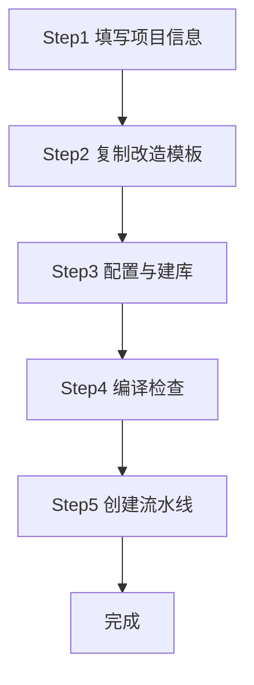
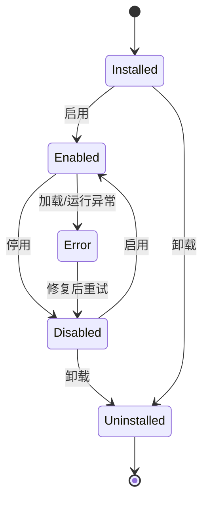

# PRD：luban-agent 插件体系设计与「新建项目」插件需求

- **版本**：v0.1（草稿）
- **日期**：2026-10-14
- **作者**：luban 团队
- **状态**：设计评审中
- **关联仓库**：`luban-agent`（宿主为 `LubanAgentCodex`）

---

## 1. 背景与目标

### 1.1 现状

`luban-agent` 当前已具备两类扩展能力：

| 能力 | 机制 | 适用场景 | 局限 |
|------|------|----------|------|
| Skills | `.luban-agent/skills/*/SKILL.md`（frontmatter + 提示词） | 让 LLM 执行某类任务 | 纯提示词，无 UI、无代码执行 |
| Commands | `LubanAgentCore/Commands/`（斜杠命令） | 快捷文本指令 | 文本交互，无持久 UI 面板 |

两者都不能以「代码 + UI 面板 + 外部系统集成」的方式扩展宿主。桌面端 `LubanAgentCodex`（Avalonia，.NET 10）有完整的「侧栏 + 内容区」外壳，却没有任何承载第三方面板的扩展点。

### 1.2 痛点

用户（后端/全栈开发）需要**向导式工程工具**来完成重复性搭建，例如「新建项目」：从企服版模板复制三端代码、调配置、建库、编译、建流水线。这类工具需要：
- 可视化向导面板（多步表单 + 进度 + 日志）；
- 后端逻辑（文件操作、git、编译、数据库、外部 API）；
- 对宿主生命周期的依赖（安装/启用/停用/卸载）。

现有 skill / command 均无法支撑。

### 1.3 目标

1. 抽象一套**通用插件设计原则**（与具体宿主解耦）。
2. 在 `luban-agent-codex` 落地为**富插件体系**：manifest + 生命周期 + 代码执行 + UI 贡献，支持安装/启用/停用/卸载。
3. 以「**新建项目**」插件作为首个落地验证，跑通整套体系。

### 1.4 非目标（明确不做）

- 不做插件市场 / 远端分发（首版仅本地目录）。
- 不做运行时热重载（卸载通过重建 `AssemblyLoadContext` 实现，需重新加载而非即时替换）。
- 不替代 skills / commands（三者边界见 §5.8）。
- 首版不实现插件间依赖图的自动解析与安装（仅声明 `dependencies` 并由宿主做存在性校验）。

---

## 2. 通用插件设计原则（抽象层）

> 本层与具体宿主无关，定义「插件」应有的契约与行为规范，供任意 .NET 宿主复用。

### 2.1 插件定义
可独立部署、通过稳定契约与宿主交互的扩展单元。一个插件 = 一份清单（manifest）+ 一组程序集（含 UI 与逻辑）。

### 2.2 分层
- **宿主（Host）**：提供外壳、加载器、生命周期管理与 UI 容器。
- **契约（Contracts）**：宿主与插件共享的接口/数据模型程序集，版本稳定。
- **插件（Plugin）**：实现契约的具体扩展，独立部署。

### 2.3 契约优先（Contract-First）
宿主只依赖契约程序集，绝不直接依赖插件内部类型。插件升级不破坏宿主，宿主升级通过 `minHostVersion` 约束。

### 2.4 隔离（Isolation）
每个插件在独立的 `AssemblyLoadContext`（ALC）中加载，互不共享类型与静态状态，单个插件崩溃不影响宿主与其他插件，且可被单独卸载。

### 2.5 生命周期
`安装(Installed) → 启用(Enabled) → 运行(Running) → 禁用(Disabled) → 卸载(Uninstalled)`。状态需可持久化，重启后恢复。

### 2.6 安全（最小权限）
插件在 manifest 中**声明**所需权限（文件、网络、git、数据库、进程执行）。默认拒绝，未声明即不可用；加载前静态校验，不合规直接置为 `Disabled` 并提示。

### 2.7 发现与注册
通过目录扫描 + manifest 自动发现，亦支持显式注册。宿主维护已发现插件注册表。

### 2.8 UI 贡献模型
插件声明「侧栏条目」（`uiContributions`），宿主在侧栏渲染入口；点击后在内容区加载插件提供的面板（如 Avalonia `UserControl`）。

---

## 3. luban-agent 插件体系落地设计

### 3.1 宿主定位
- **宿主**：`LubanAgentCodex`（Avalonia 桌面端）。
- **选择理由**：具备完整 UI 外壳（侧栏 + 内容区），适合承载插件面板与管理器。`LubanAgentCli` 为 TUI、`LubanAgentCore` 为类库，均不适合做 UI 宿主。
- **复用**：插件可调用 `LubanAgentCore` 的服务（如配置、日志、数据库初始化），通过契约而非直接耦合。

### 3.2 插件清单 `plugin.json`

| 字段 | 类型 | 说明 |
|------|------|------|
| `id` | string | 全局唯一，建议反向域名，如 `com.tjc.newproject` |
| `name` | string | 展示名，如「新建项目」 |
| `version` | string | 语义化版本 |
| `author` | string | 作者/团队 |
| `description` | string | 简介 |
| `entryAssembly` | string | 入口程序集文件名（含 `IPlugin` 实现） |
| `targetApp` | string | 宿主标识，如 `LubanAgentCodex` |
| `minHostVersion` | string | 最低宿主版本 |
| `uiContributions` | array | 侧栏条目：`{ id, label, icon, panelType }` |
| `permissions` | array | 权限声明：`filesystem`/`network`/`git`/`database`/`process` 及范围 |
| `dependencies` | array | 依赖插件 id 列表（仅校验存在性） |

**示例（新建项目插件）：**
```json
{
  "id": "com.tjc.newproject",
  "name": "新建项目",
  "version": "1.0.0",
  "author": "luban-team",
  "description": "向导式生成三端项目代码、配置、数据库与流水线",
  "entryAssembly": "LubanAgent.Plugin.NewProject.dll",
  "targetApp": "LubanAgentCodex",
  "minHostVersion": "2026.10.0",
  "uiContributions": [
    { "id": "newproject.main", "label": "新建项目", "icon": "project", "panelType": "WizardPanel" }
  ],
  "permissions": [
    { "type": "filesystem", "scope": "workspace" },
    { "type": "network", "hosts": ["codeup.aliyun.com", "flow.aliyun.com"] },
    { "type": "git", "scope": "clone_push" },
    { "type": "database", "scope": "execute" },
    { "type": "process", "commands": ["dotnet"] }
  ],
  "dependencies": []
}
```

### 3.3 目录约定
- **主目录（用户确认）**：`luban-agent-codex/plugins/<plugin-id>/`
  - 结构：`plugin.json` + `lib/`（程序集）+ `assets/`（图标/模板）
- **可选用户级覆盖**：`~/.luban-agent/plugins/<plugin-id>/`（优先级高于内置，便于开发调试）
- 契约程序集 `LubanAgent.PluginContracts.dll` 由宿主提供，置于默认 ALC，插件引用但不随包分发。

### 3.4 加载与隔离（方案 B：ALC + `IPlugin`）

```
PluginLoader.Scan(pluginsDir)
   └─ 读取 plugin.json → 校验 manifest / 权限 / minHostVersion
        └─ 为每个插件创建独立 AssemblyLoadContext (ALC)
             └─ 从 entryAssembly 反射实例化实现 IPlugin 的类型
                  └─ 调用 IPlugin.Initialize(hostContext)
                       └─ 注册 uiContributions → 宿主侧栏渲染入口
```

- **契约接口（示例）**：
  ```csharp
  public interface IPlugin {
      string Id { get; }
      void Initialize(IPluginHost host);
      void Shutdown();
  }
  public interface IPluginHost {
      void RegisterPanel(string contributionId, Func<UserControl> factory);
      ILogger Log { get; }
  }
  ```
- **卸载**：`Disabled`/`Uninstalled` 时先调用 `IPlugin.Shutdown()`，再 `alc.Unload()` 释放资源。ALC 须使用 `Collectible` 模式，避免文件锁。
- **隔离收益**：插件版本冲突、异常、资源泄漏被限制在自身 ALC 内，不污染宿主。

### 3.5 生命周期管理
- **状态**：`Installed` / `Enabled` / `Disabled` / `Error`。
- **持久化**：状态存入 SQLite（复用 `luban-ai-agent.db` 或新建 `plugins` 表），记录 `id / version / state / installedAt / lastError`。
- **安装**：复制插件包到 `plugins/<id>/`（开发态可直接指向源码 `bin`）。
- **启用**：加载 ALC + 注册 UI 贡献 + 置 `Enabled`。
- **禁用**：`Shutdown()` + `Unload()` ALC，保留文件，置 `Disabled`。
- **卸载**：禁用 → 删除目录 → 清理状态。

### 3.6 插件管理器 UI（codex 内）
- **列表视图**：名称、版本、状态徽标、启用开关、操作（安装 / 启用 / 停用 / 卸载 / 查看明细）。
- **明细视图**：manifest 全量信息、权限清单、依赖、最近错误堆栈。
- **安装入口**：从本地目录选择插件包，或拖入 `.zip` 自动解压到 `plugins/`。

### 3.7 权限与安全
- 权限维度与范围：
  - `filesystem`：允许路径范围（如 `workspace`）。
  - `network`：域名白名单（`codeup.aliyun.com`、`flow.aliyun.com`）。
  - `git`：clone / push 能力。
  - `database`：建库/执行脚本。
  - `process`：允许执行的命令（如 `dotnet`）。
- 默认拒绝；manifest 未声明即不可用。
- 加载前静态校验权限与 `minHostVersion`，不合规直接 `Disabled` 并提示用户。
- 凭据（如阿里云 Access Token）**不入库明文**，存于宿主安全凭据区（系统凭据库 / 加密配置），仅插件运行时按需取用。

### 3.8 与 skills / commands 的关系
- **skills**：LLM 提示词能力，无 UI、无代码执行 → 适合「让 AI 做什么」。
- **commands**：斜杠命令，文本交互 → 适合快捷指令。
- **plugins**：宿主扩展（UI + 代码 + 外部集成）→ 适合「工具型 / 向导型」功能。
- 三者并存，插件可调用 core 服务，但不取代前两者。

---

## 4. 「新建项目」插件需求 PRD

### 4.1 概述
一个**向导式插件**，帮用户从企服版模板快速搭建新项目（移动端 / 管理端 / 后端），并完成配置、建库、编译、流水线。入口：`codex` 左侧栏「插件」→「新建项目」，右侧渲染向导面板。

### 4.2 用户故事
> 作为后端开发，我希望通过向导生成三端代码骨架并自动完成配置、建库、编译与流水线创建，从而把重复劳动降到最低，并避免手工出错。

### 4.3 功能需求（5 步向导）

**Step 1 · 填写项目信息**
- 必填：项目名称、英文缩写（唯一性校验、命名规范 `[a-z][a-z0-9]*`）。
- 三端选择：移动端 / 管理端 / 后端（可多选，至少选一）。
- 产出：`ProjectSpec`。

**Step 2 · 模板复制与改造**
- 按英文缩写，从阿里云 Codeup `tjc/TJCES` 企服版克隆所选三端模板到本地工作区。
- 自动替换占位符：命名空间、项目名、缩写（保证编译通过）。
- 鉴权：**Access Token**（用户预配置，存于安全凭据区；域名 `codeup.aliyun.com`）。
- 产出：本地三端代码目录。

**Step 3 · 配置与数据库**
- 生成/修改 `appsettings.json`、连接串等配置。
- 执行数据库构建脚本（建库 / 建表 / 种子数据）。
- 产出：可连接的数据库 + 配置就绪。

**Step 4 · 编译检查**
- 对三端分别调用 `dotnet build`，汇总结果。
- 失败可定位到工程与错误行，阻断后续步骤但保留已完成产物。

**Step 5 · 流水线**
- 参照 `flow.aliyun.com/all` 企服版流水线定义，为本项目三端生成流水线配置（YAML / 模板）。
- 提交到 Flow 创建流水线。
- 鉴权：同 Access Token（域名 `flow.aliyun.com`）。

**向导流程图：**


### 4.4 外部系统集成
| 系统 | 用途 | 鉴权 | 域名 |
|------|------|------|------|
| 阿里云 Codeup (`tjc/TJCES`) | 克隆企服版三端模板、推送新项目 | Access Token | `codeup.aliyun.com` |
| 阿里云 Flow | 读取企服版流水线定义、创建本项目流水线 | Access Token | `flow.aliyun.com` |

- Access Token 由用户在 codex 设置中配置，插件按权限白名单取用，不落库明文。

### 4.5 数据模型
```typescript
ProjectSpec {
  projectName: string
  abbreviation: string        // 英文缩写，唯一
  ends: ('mobile'|'admin'|'backend')[]
  templateSource: 'tjc/TJCES'
  localPath: string
  dbConfig: { connectionString, scripts[] }
  pipelineRef: 'flow.aliyun.com/all'
  createdAt: datetime
}
```
- 插件运行状态（当前步、日志、错误）存于宿主插件状态表，便于中断恢复。

### 4.6 界面（codex）
- **左侧栏**：插件条目「新建项目」（安装启用后由 `uiContributions` 渲染）。
- **右侧内容区**：
  - 步骤条（1–5）指示进度；
  - 当前步表单 / 进度条；
  - 实时日志输出区；
  - 操作按钮：上一步 / 下一步 / 完成 / 取消。

### 4.7 异常处理与回滚
- 每步可独立失败并提示，不影响已成功步骤的产物。
- 提供「中止并清理」：删除已生成目录、标记 `ProjectSpec` 为未完成。
- 编译 / 建库失败阻断后续步骤，但已生成代码保留供排查。
- 网络/鉴权失败给出明确引导（检查 Access Token 与网络）。

### 4.8 验收标准
1. 插件安装并启用后，codex 左侧栏出现「新建项目」入口，点击右侧显示向导面板。
2. 完整走完 5 步可：生成三端代码、配置就绪、数据库构建成功、`dotnet build` 通过、Flow 流水线创建成功。
3. 任一外部系统不可用（如 Token 失效）时，给出明确错误与修复指引，不静默失败。
4. 停用 / 卸载后：UI 入口消失、ALC 卸载、无文件/进程残留、状态表清理。
5. 权限越界操作（如访问白名单外域名）被宿主拦截并记录。

---

## 5. 里程碑概览（仅规划，不在本文档实现）

| 里程碑 | 内容 |
|--------|------|
| M1 | 插件契约程序集 `PluginContracts` + ALC 加载器 + `plugin.json` schema |
| M2 | codex 插件管理器 UI（列表 / 明细 / 安装 / 启停 / 卸载） |
| M3 | 权限与安全（白名单校验、Access Token 凭据存储） |
| M4 | 「新建项目」插件实现（5 步向导 + Codeup/Flow 集成） |
| M5 | 联调与验收（按 §4.8 验收标准） |

---

## 6. 风险与开放问题

1. **阿里云 API 稳定性与权限粒度**：Access Token 的权限范围需与企服版管理员确认，避免越权或不足。
2. **模板占位符规范**：模板改造依赖企服版模板的命名约定（命名空间/项目名占位符），需先与模板维护方对齐。
3. **ALC 卸载资源释放**：事件订阅、文件句柄、定时器需在 `Shutdown()` 中严格释放，须专项测试。
4. **网络与凭据安全**：Codeup / Flow 网络可达性、Token 安全存储（系统凭据库 vs 加密配置文件）待定。
5. **多端模板版本同步**：企服版模板升级后，新项目应基于哪版模板，需约定追溯策略。
6. **插件目录位置**：首版采用 `luban-agent-codex/plugins/`，后续是否支持用户级 `~/.luban-agent/plugins/` 覆盖待评估。

---

## 7. 附录：插件生命周期状态机


