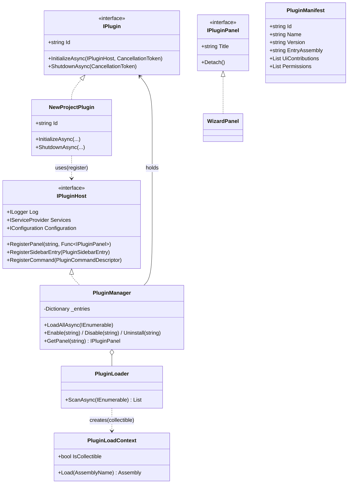
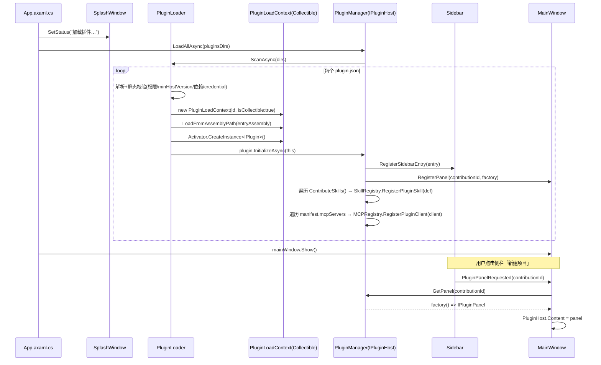
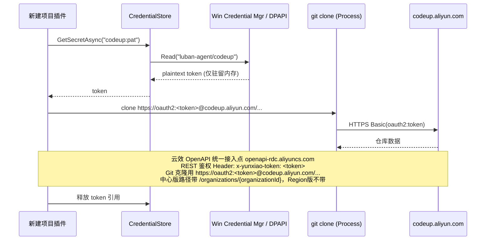
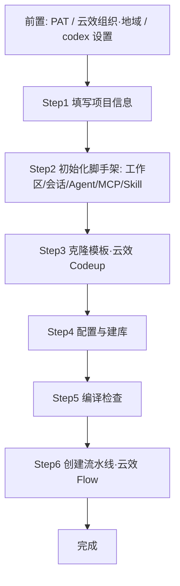
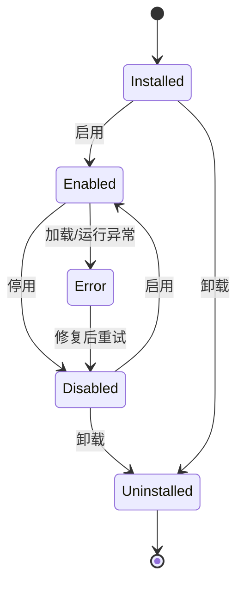

# PRD：luban-agent 插件体系设计与「新建项目」插件需求

- **版本**：v0.8（依据云效官方 OpenAPI 文档修订 API 事实）
- **日期**：2026-10-14
- **作者**：luban 团队
- **状态**：设计评审中
- **关联仓库**：`luban-agent`（宿主为 `LubanAgentCodex`）
- **修订说明**：v0.2 经多 agent 评审结合**云效 Codeup / Flow** 与 **PAT** 真实能力及现有代码深度修订；v0.3 明确**架构分层**（框架 `LuBan.AIAgent` 定义插件/生命周期/管理/基础插件，解决方案实现具体插件，宿主 `LubanAgentCodex` 操作）；v0.4 补充两点业务与体验约束：①新项目**必须含后端与管理后台，移动端按需可选**（端选择由 Step1 决定、贯穿克隆/建库/编译/建流水线）；②向导界面在表单/进度基础上**实时展示 Agent 操作记录**，让用户直观感知过程并据结果就地调整重试；v0.5 新增**插件专属 Skill 设计（§4.10）**：框架契约支持插件贡献 Skill（`IPlugin.ContributeSkills()` / `IPluginHost.RegisterSkill()` / `SkillDefinition`），「新建项目」插件提供主 skill `newproject.create` + 4 个原子 skill，与向导共享 `INewProjectService` 后端，既可由左侧栏向导触发、也可由 Agent 在聊天以自然语言触发；v0.6 新增**云效连接器与专属 MCP 设计（§3.10 / §4.11）**：框架层新增 `Connectors/AliyunDevOps`（YunxiaoConnector/CodeupClient/FlowClient + PAT 取用），并用进程内 `YunxiaoMCPClient : IMCPClient` 包装暴露 8 个 `mcp_yunxiao_*` 工具；插件 `INewProjectService` 直连连接器（C#），`newproject.*` skill 云效步骤委托 MCP 工具；`plugin.json` 增 `mcpServers` 字段使 MCP 生命周期随插件启停；M1/M4 增连接器与 MCP、新增 M6 联调。
- **修订说明（v0.7）**：①新增**初始化阶段（§4.3 Step 2）**——用户填完 Step 1（含新增字段「项目介绍」「本地目录」）并点「下一步」后，自动初始化 **工作区 / 会话（SessionContext）/ 项目级 Agent / `yunxiao` MCP 客户端 / `newproject.*` Skill**（经新增的 `SkillRegistry.RegisterPluginSkill` 与 `MCPRegistry.RegisterPluginClient`，随 M1 落地），再进入克隆；向导由 5 步扩展为 **6 步**，同步刷新流程图、ProjectSpec、步骤条、验收与里程碑。②修订深度评审发现的 P0/P1：补全动态注册 API（`SkillRegistry`/`MCPRegistry` 当前为静态只读，需扩展）、统一生命周期为 4 态（移除 §2.5 多余的 `Running`）、修正 skill 云效路径表述（§4.10.3 与 §4.10.7/§4.11.4 矛盾）、明确克隆归属（§3.10 复用 `GitToolPlugin`，§4.11.2 由 `CodeupClient.CopyToLocalAsync` 内部复用）、补定义 `PluginCommandDescriptor`、统一 `PluginRegistry`→`PluginManager` 与 `Scan`→`ScanAsync` 命名。③澄清「建库」语义（§1.4 指目标数据库构建，见 Step 4；新建项目推送至云效代码库为可选写路径，见 §4.4）。
- **修订说明（v0.8）**：**依据阿里云云效官方 OpenAPI 文档（服务接入点 / 个人访问令牌 / 错误码中心 / Codeup 仓库 4 篇 / Flow 流水线 6 篇，共 12 篇）核对并订正 API 事实错误**：①**统一接入点与鉴权**——云效 OpenAPI 接入点为 `openapi-rdc.aliyuncs.com`（中心版）/ Region版实例域名，路径 `oapi/v1/codeup/...` 与 `oapi/v1/flow/...`，鉴权统一用请求头 **`x-yunxiao-token: <PAT>`**（**弃用原假设的 `devops 2021-06-25` 产品版本与 `Private-Token` 头**）；Git 克隆/推送仍用 `https://oauth2:<PAT>@codeup.aliyun.com/...`。②**中心版 / Region版差异**——`organizationId` **仅中心版**路径必填，Region版不传；`region` 不作为参数，而是编码在接入点域中（原 §4.3 Step6「需传 ORGANIZATION_ID 与 region」表述错误，已订正）。③**订正 Codeup / Flow 各 API 路径与参数**（CreateRepository 增 `path`/`templateProject`、ListRepositories 的 `search`/`perPage`、CreatePipeline 请求体 `{name,content}` 等）。④**订正 MCP 工具入参命名**（`keyword`→`search`、`pageSize`→`perPage`、`nameKeyword`→`pipelineName`、增 `repositoryId`/中心版 `organizationId` 等），并补充 `flow_run_pipeline` 实为 **ExecutePipelineJobRun（运行单次运行实例中的单个任务，需 `pipelineRunId`+`jobId`）**，整条流水线触发 run 的创建 API 标注为待确认。⑤补充错误码映射（401/403/429/500 等）。

---

## 1. 背景与目标

### 1.1 现状

`luban-agent` 当前已具备两类扩展能力：

| 能力 | 机制 | 适用场景 | 局限 |
|------|------|----------|------|
| Skills | `.luban-agent/skills/*/SKILL.md`（frontmatter + 提示词） | 让 LLM 执行某类任务 | 纯提示词，无 UI、无代码执行 |
| Commands | `LubanAgentCore/Commands/`（斜杠命令） | 快捷文本指令 | 文本交互，无持久 UI 面板 |

两者都不能以「代码 + UI 面板 + 外部系统集成」的方式扩展宿主。桌面端 `LubanAgentCodex`（Avalonia，.NET 10）有完整的「侧栏 + 内容区」外壳，却没有任何承载第三方面板的扩展点。

> **术语与集成边界（本次修订补充）**
> 本 PRD 中「新建项目」插件对接的外部系统是**云效**（阿里云一站式 DevOps 平台）。云效包含多个子服务，本项目仅集成其中两个：
> - **云效 Codeup**：代码管理子服务（代码仓库、分支、标签、提交、Webhook），访问域名 `codeup.aliyun.com`。本项目的企服版模板仓库为 `codeup.aliyun.com/tjc/TJCES`（组织 `tjc` / 仓库 `TJCES`）。
> - **云效 Flow**：流水线 / CI-CD 子服务（YAML 化流水线定义与运行），Web 控制台域名 `flow.aliyun.com`，本项目参考页为 `flow.aliyun.com/all`（企服版流水线定义）。
> 二者均为云效平台子服务，鉴权统一使用**云效个人访问令牌（PAT）**；Codeup 同时支持 Git over HTTPS 与 REST API 两种调用方式，Flow 通过 OpenAPI（`devops` 产品，API 版本 `2021-06-25`）创建流水线。

### 1.2 痛点

用户（后端/全栈开发）需要**向导式工程工具**来完成重复性搭建，例如「新建项目」：从企服版模板复制代码、调配置、建库、编译、建流水线。新项目**必须包含后端与管理后台，移动端按需可选**。这类工具需要：
- 可视化向导面板（多步表单 + 进度 + 日志 + **Agent 操作记录**）；
- 后端逻辑（文件操作、git、编译、数据库、外部 API）；
- 对宿主生命周期的依赖（安装/启用/停用/卸载）。

现有 skill / command 均无法支撑。

### 1.3 目标

1. 抽象一套**通用插件设计原则**（与具体宿主解耦）。
2. 在 `luban-agent-codex` 落地为**富插件体系**：manifest + 生命周期 + 代码执行 + UI 贡献，支持安装/启用/停用/卸载。插件核心（契约/生命周期/管理/基础插件）定义于框架 `LuBan.AIAgent`，具体插件在 `LubanAgent` 解决方案实现（见 §3.0）。
3. 以「**新建项目**」插件作为首个落地验证，跑通整套体系，并打通与**云效 Codeup / 云效 Flow** 的集成（模板克隆 + 流水线创建）。

### 1.4 非目标（明确不做）

- 不做插件市场 / 远端分发（首版仅本地目录）。
- 不做运行时热重载（卸载通过重建 `AssemblyLoadContext` 实现，需重新加载而非即时替换）。
- 不替代 skills / commands（三者边界见 §3.8）。
- 首版不实现插件间依赖图的自动解析与安装（仅声明 `dependencies` 并由宿主做存在性校验）。
- 首版不实现与云效的**深度双向同步**（如流水线状态回写、仓库 Webhook 自动注册、分支保护策略下发等），仅完成单向的「模板克隆 → 新项目建库 → 编译 → 创建流水线」（其中「建库」指**目标数据库构建**，见 Step 4；将新项目代码推送至云效代码库为可选写路径，见 §4.4 / §4.9.2）。
- 首版不托管云效凭据的**生命周期管理**（令牌生成、到期轮换由用户在云效控制台与 codex 设置中操作，插件仅负责安全存储与取用）。

---

## 2. 通用插件设计原则（抽象层）

> 本层与具体宿主无关，定义「插件」应有的契约与行为规范，供任意 .NET 宿主复用。

### 2.1 插件定义
可独立部署、通过稳定契约与宿主交互的扩展单元。一个插件 = 一份清单（manifest）+ 一组程序集（含 UI 与逻辑）。

### 2.2 分层
- **宿主（Host）**：提供外壳、加载器、生命周期管理与 UI 容器。
- **契约（Contracts）**：宿主与插件共享的接口/数据模型程序集，版本稳定。
- **插件（Plugin）**：实现契约的具体扩展，独立部署。
- **参考实现位置**：插件核心（契约 `IPlugin`、生命周期、管理 `PluginManager`、基础插件 `PluginBase`）位于框架 `luban-framework/LuBan.AIAgent/Plugins/`，随 `LuBan.AIAgent` NuGet 包发布；具体插件项目在 `luban-agent` 解决方案内（见 §3.0）。

### 2.3 契约优先（Contract-First）
宿主只依赖契约程序集，绝不直接依赖插件内部类型。插件升级不破坏宿主，宿主升级通过 `minHostVersion` 约束。

### 2.4 隔离（Isolation）
每个插件在独立的 `AssemblyLoadContext`（ALC）中加载，互不共享类型与静态状态，单个插件崩溃不影响宿主与其他插件，且可被单独卸载。

### 2.5 生命周期
`安装(Installed) → 启用(Enabled) → 禁用(Disabled) → 卸载(Uninstalled)`，异常时进入 `Error`。状态需可持久化，重启后恢复（详见 §3.5 与附录状态机）。

### 2.6 安全（最小权限）
插件在 manifest 中**声明**所需权限（文件、网络、git、数据库、进程执行、凭据）。默认拒绝，未声明即不可用；加载前静态校验，不合规直接置为 `Disabled` 并提示。

### 2.7 发现与注册
通过目录扫描 + manifest 自动发现，亦支持显式注册。宿主维护已发现插件注册表。

### 2.8 UI 贡献模型
插件声明「侧栏条目」（`uiContributions`），宿主在侧栏渲染入口；点击后在内容区加载插件提供的面板（如 Avalonia `UserControl`）。

---

## 3. luban-agent 插件体系落地设计

### 3.0 三层职责划分（框架 / 解决方案 / 宿主）

本插件体系跨 `luban-framework` 与 `luban-agent` 两个仓库，职责按层划分，避免把框架能力下沉到应用层：

| 层 | 仓库 / 工程 | 职责 | 关键产物 |
|----|-------------|------|----------|
| **框架层** | `luban-framework/LuBan.AIAgent`（PackageId = `LuBan.AIAgent`） | **定义插件与连接器**：插件契约 `IPlugin`、插件**生命周期**状态机、**插件管理** `PluginManager` / `PluginLoader`、**基础插件**抽象 `PluginBase` 与 `BuiltinPluginCatalog`；**外部系统集成连接器** `Connectors/AliyunDevOps`（封装云效 Codeup 代码管理 / Flow 流水线，PAT 鉴权，详见 §3.10） | `LuBan.AIAgent/Plugins/*` 与 `LuBan.AIAgent/Connectors/*`（随框架 `GeneratePackageOnBuild` 生成 NuGet 包，供下游引用） |
| **解决方案层** | `luban-agent`（解决方案 `LubanAgent.slnx`） | **实现具体插件**：如「新建项目」插件项目 `LubanAgent.Plugin.NewProject`，引用 `LuBan.AIAgent`，实现 `IPlugin` / 继承 `PluginBase`，并提供 `plugin.json` | 插件程序集 + 清单（部署到宿主 `plugins/<id>/`） |
| **宿主 / 操作层** | `luban-agent/LubanAgentCodex`（Avalonia 桌面端） | **操作插件**：加载（ALC）、管理（安装 / 启用 / 停用 / 卸载）、渲染 UI 贡献（侧栏条目 + 面板）、提供 `PluginManageWindow` | 运行时宿主，消费框架 `PluginManager` |

- 框架 `LuBan.AIAgent` 已有同构模块（`Skills/`、`Rules/`、`MCP/`），插件模块 `Plugins/` 沿用同一模式：`IPlugin` / `PluginBase` 类比 `ISkill` / `SkillBase`；`PluginManager`（含插件注册表）类比 `SkillRegistry`（`LuBan.AIAgent/Skills/SkillRegistry.cs`）。
- 依赖方式：开发期 `LubanAgentCore.csproj` 已通过 `ProjectReference` 引用 `..\..\luban-framework\LuBan.AIAgent\LuBan.AIAgent.csproj`（见 `LubanAgentCore/LubanAgentCore.csproj`）；发布期按 `AGENTS.md` 改为 NuGet `LuBan.*` 包。具体插件项目同样引用 `LuBan.AIAgent` 以获得契约与 `PluginBase`。
- 框架当前**尚无** `Plugins/` 目录（已确认），本次为新增模块。

### 3.1 宿主定位
- **宿主**：`LubanAgentCodex`（Avalonia 桌面端，.NET 10）。
- **选择理由**：具备完整 UI 外壳（侧栏 `Sidebar` + 内容区 `MainWindow` 的 `ContentRoot`），适合承载插件面板与管理器。`LubanAgentCli` 为 TUI、`LubanAgentCore` 为类库，均不适合做 UI 宿主。
- **复用与服务桥**：宿主核心服务经 `LubanAgentCore.Hosting.AgentHostBuilder.BuildServiceProvider` 构建，封装为 `AgentHostServices`（持有根容器与进程常驻用户作用域）。插件**不直接引用**核心内部类型，而是通过 `IPluginHost.Services`（`IServiceProvider`）获取 `IWorkspaceManager`、`ConfigManager`、`ICommandCatalog` 等——即「契约优先 + DI 桥接」。

### 3.2 插件清单 `plugin.json`

| 字段 | 类型 | 说明 |
|------|------|------|
| `id` | string | 全局唯一，建议反向域名，如 `com.tjc.newproject` |
| `name` | string | 展示名，如「新建项目」 |
| `version` | string | 语义化版本 |
| `author` | string | 作者/团队 |
| `description` | string | 简介 |
| `entryAssembly` | string | 入口程序集文件名（含 `IPlugin` 实现） |
| `targetApp` | string | 宿主标识，如 `LubanAgentCodex` |
| `minHostVersion` | string | 最低宿主版本 |
| `uiContributions` | array | 侧栏条目：`{ id, label, icon, panelType }`（`panelType` 对应契约 `IPluginPanel` 实现） |
| `skills` | array | 插件贡献的专属 Skill 定义（见 §4.10）：`{ id, name, description, entry }`，加载时由 `PluginManager` 注册进 `SkillRegistry`，使插件既可由向导触发、也可由 Agent 在聊天中以自然语言触发 |
| `mcpServers` | array | 声明插件启用的**内置 MCP 服务器**（如 `["yunxiao"]`）：`{ name, transport, enabled }`。插件 **Enabled** 时 `PluginManager` 将其注册进 `MCPRegistry`，**Disabled/Uninstalled** 时反注册，使 MCP 生命周期跟随插件（见 §4.11）。连接器本身属框架共享集，不在本字段声明 |
| `permissions` | array | 权限声明：`filesystem`/`network`/`git`/`database`/`process`/`credential` 及范围 |
| `dependencies` | array | 依赖插件 id 列表（仅校验存在性） |

**示例（新建项目插件）：**
```json
{
  "id": "com.tjc.newproject",
  "name": "新建项目",
  "version": "1.0.0",
  "author": "luban-team",
  "description": "向导式生成后端与管理后台（移动端可选）项目代码、配置、数据库与流水线，并实时展示 Agent 操作记录",
  "entryAssembly": "LubanAgent.Plugin.NewProject.dll",
  "targetApp": "LubanAgentCodex",
  "minHostVersion": "2026.10.0",
  "uiContributions": [
    { "id": "newproject.main", "label": "新建项目", "icon": "project", "panelType": "WizardPanel" }
  ],
  "skills": [
    { "id": "newproject.create", "name": "新建项目", "description": "向导式/对话式创建后端与管理后台（移动端可选）项目，含克隆模板、建库、编译、建流水线", "entry": "skills/newproject.create.md" }
  ],
  "mcpServers": [
    { "name": "yunxiao", "transport": "inprocess", "enabled": true }
  ],
  "permissions": [
    { "type": "filesystem", "scope": "workspace" },
    { "type": "network", "hosts": ["codeup.aliyun.com", "flow.aliyun.com", "*.aliyuncs.com"] },
    { "type": "git", "scope": "clone_push" },
    { "type": "database", "scope": "execute" },
    { "type": "process", "commands": ["dotnet", "git"] },
    { "type": "credential", "stores": ["yunxiao_pat"] }
  ],
  "dependencies": []
}
```

### 3.3 目录约定
- **应用内置目录**：`<AppContext.BaseDirectory>/plugins/<plugin-id>/`，结构：`plugin.json` + `lib/`（程序集，含 `entryAssembly` 及其依赖）+ `assets/`（图标/模板）。
- **用户级覆盖（开发/调试优先）**：对齐现有记忆库约定 `Environment.GetFolderPath(SpecialFolder.LocalApplicationData)/LuBan/AIAgent/plugins/<plugin-id>/`；原 `~/.luban-agent/plugins/` 可并存作为备选。解析顺序：用户级优先，未命中回退应用内置。建议新增 `PluginLocation.ResolveDirectories()` 统一返回有序目录列表。
- **契约与插件核心（来自框架）**：`IPlugin` / `PluginBase` / `PluginManager` / `BuiltinPluginCatalog` 定义于框架 `luban-framework/LuBan.AIAgent/Plugins/`，随 NuGet 包 `LuBan.AIAgent` 发布；宿主与具体插件项目均引用该包（开发期 `ProjectReference`，发布期 NuGet），**不单独新建 agent 侧契约工程**。插件工程引用时契约程序集置于默认 ALC，不随插件包分发。

### 3.4 加载与隔离（方案 B：ALC + `IPlugin`）—— 已确认落地

> 方案 B 在 .NET 10 / Avalonia 完全可行：`AssemblyLoadContext` 支持 `isCollectible:true`，配合 `AssemblyDependencyResolver` 实现按插件隔离的依赖解析；UI 控件（`UserControl`）在独立 ALC 中实例化后由宿主内容区挂载。

**契约与插件核心（框架 `LuBan.AIAgent/Plugins/` 模块，参照 `Skills/` 同构）：**
```csharp
namespace LuBan.AIAgent.Plugins;   // 框架模块 luban-framework/LuBan.AIAgent/Plugins

/// <summary>插件入口契约（每个插件入口程序集实现唯一 IPlugin）。</summary>
public interface IPlugin
{
    string Id { get; }
    Task InitializeAsync(IPluginHost host, CancellationToken ct = default);
    Task ShutdownAsync(CancellationToken ct = default);
    /// <summary>贡献给宿主 SkillRegistry 的专属 Skill 定义（详见 §4.10）。</summary>
    IEnumerable<SkillDefinition> ContributeSkills();
}

/// <summary>宿主向插件暴露的能力（契约优先，Avalonia 无关）。</summary>
public interface IPluginHost
{
    ILogger Log { get; }
    IServiceProvider Services { get; }          // 宿主核心服务桥（WorkspaceManager/ConfigManager...）
    IConfiguration Configuration { get; }
    void RegisterPanel(string contributionId, Func<IPluginPanel> factory);
    void RegisterSidebarEntry(PluginSidebarEntry entry);
    void RegisterCommand(PluginCommandDescriptor descriptor); // 可选：向 ICommandCatalog 贡献命令
    void RegisterSkill(SkillDefinition def);                 // 可选：向 SkillRegistry 贡献专属 Skill（见 §4.10）
}

/// <summary>插件面板契约；Avalonia UserControl 实现此接口即可被宿主挂载。</summary>
public interface IPluginPanel
{
    string Title { get; }
    void Detach();   // 卸载前由宿主调用，释放 UI 订阅/定时器
}

public class PluginSidebarEntry
{
    public string ContributionId { get; set; } = "";
    public string Label { get; set; } = "";
    public string Icon { get; set; } = "";
    public string? PanelContributionId { get; set; } // 点击后挂载的面板贡献 id
}

public class PluginManifest { /* 与 plugin.json 字段一一对应（见 §3.2） */ }

/// <summary>插件经 IPluginHost.RegisterCommand 向 ICommandCatalog 贡献的斜杠命令描述（见 §3.8）。</summary>
public class PluginCommandDescriptor
{
    public string Name { get; set; } = "";                 // 命令名，如 newproject
    public string Description { get; set; } = "";
    public IReadOnlyList<string> Parameters { get; set; } = Array.Empty<string>();
    public Func<IReadOnlyDictionary<string,string>, CancellationToken, Task> Handler { get; set; } = default!;
}

/// <summary>插件贡献的专属 Skill 定义；加载时由 PluginManager 注册进 LuBan.AIAgent.Skills.SkillRegistry。</summary>
public class SkillDefinition
{
    public string Id { get; set; } = "";                              // 如 newproject.create
    public string Name { get; set; } = "";
    public string Description { get; set; } = "";
    public string Entry { get; set; } = "";                          // 插件包内 SKILL.md 相对路径
    public IReadOnlyList<string> Permissions { get; set; } = Array.Empty<string>(); // 默认继承插件 permissions
}

/// <summary>插件生命周期状态（框架统一管理，对应 §3.5 / 附录状态机）。</summary>
public enum PluginState { Installed, Enabled, Disabled, Error }

/// <summary>插件基础抽象（框架提供，具体插件继承以复用生命周期/注册样板）。</summary>
public abstract class PluginBase : IPlugin
{
    public abstract string Id { get; }
    public virtual Task InitializeAsync(IPluginHost host, CancellationToken ct = default) => Task.CompletedTask;
    public virtual Task ShutdownAsync(CancellationToken ct = default) => Task.CompletedTask;
}

/// <summary>框架内置插件目录（"基础插件"）：登记随 LuBan.AIAgent 发布的内建插件。</summary>
public static class BuiltinPluginCatalog
{
    public static IReadOnlyList<PluginManifest> Builtins => /* 框架内置插件清单 */;
}
```

**加载器（`LuBan.AIAgent.Plugins.PluginManager` / `PluginLoader`，位于框架，宿主无关）：**
```
PluginLoader.ScanAsync(pluginsDirs)
   └─ 逐个读取 plugin.json → 反序列化为 PluginManifest
        └─ 静态校验（manifest 合法 / 权限声明 / minHostVersion / dependencies 存在性 / credential 权限）
             └─ 为每个插件 new PluginLoadContext(id, isCollectible:true)
                  └─ AssemblyDependencyResolver 解析 lib/ 依赖
                       └─ LoadFromAssemblyPath(entryAssembly)
                            └─ Activator.CreateInstance<IPlugin>()
                                 └─ plugin.InitializeAsync(host) → 注册侧栏条目 + 面板工厂
                                      └─ 遍历 ContributeSkills() → SkillRegistry.RegisterPluginSkill(def)   // 新增 API，见 §4.10.1
                                           └─ 遍历 manifest.mcpServers → MCPRegistry.RegisterPluginClient(client)  // 新增 API，见 §4.11.3
```
**ALC 关键实现要点（避免类型/资源冲突）：**
- `PluginLoadContext` 重写 `Load(AssemblyName)`：当 `name` 属于**共享框架集**（`LuBan.AIAgent`、`LuBan.AIAgent.Plugins`、`Avalonia`、`Avalonia.Controls` 等）时，直接返回默认 ALC 中已加载的同名程序集（`Assembly.Load(name)`），**禁止插件自带副本**；其余依赖走 `AssemblyDependencyResolver` 的 `Resolve` 路径。
- 卸载：`Disabled`/`Uninstalled` 时先 `plugin.ShutdownAsync()` 释放 UI 订阅/文件句柄/定时器，再 `alc.Unload()`。Collectible ALC 无文件锁，但需确保无对插件类型的强引用（含事件订阅、静态缓存）方可 GC。
- 隔离收益：插件版本冲突、异常、资源泄漏被限制在自身 ALC 内，不污染宿主与其他插件。

**类图：**


**加载时序：**


### 3.4.1 基础插件（PluginBase / BuiltinPluginCatalog）

- **`PluginBase`**：框架提供的抽象基类（位于 `LuBan.AIAgent/Plugins`），封装 `InitializeAsync` / `ShutdownAsync` 默认实现与 `IPluginHost` 持有逻辑。具体插件（如 `LubanAgent.Plugin.NewProject`）继承后只需关注业务与 UI 贡献，降低样板代码。
- **`BuiltinPluginCatalog`**：框架级「基础插件」目录，用于登记随 `LuBan.AIAgent` 发布的内建插件；宿主启动时可选择性启用。与 `Skills/BuiltinSkillCatalog.cs` 同构。
- **基础插件 vs 解决方案插件**：「基础插件」是框架提供的抽象 / 内建能力（定义于 `LuBan.AIAgent`）；「新建项目」等具体插件在 `LubanAgent` 解决方案内作为独立项目实现，二者通过 `IPlugin` / `PluginBase` 契约衔接。

### 3.5 生命周期管理
- **状态**：`Installed` / `Enabled` / `Disabled` / `Error`。
- **持久化**：状态存入 SQLite（复用 `LubanAgentCore` 现有仓储模式，新增 `PluginStateRepository`），记录 `id / version / state / installedAt / lastError`，重启后恢复。
- **安装**：复制插件包到 `plugins/<id>/`（开发态可直接指向源码 `bin`）。
- **启用**：`PluginManager.Enable` → 建 ALC + `InitializeAsync` + 注册 UI 贡献 + 置 `Enabled`。
- **禁用**：`plugin.ShutdownAsync()` + `alc.Unload()`，保留文件，置 `Disabled`。
- **卸载**：禁用 → 删除目录 → 清理状态。

### 3.6 插件管理器 UI（codex 内）
- **参照模板**：`SkillManageWindow` / `MCPManageWindow` / `RuleManageWindow`（`LubanAgentCodex/Views/`）的独立 `Window` + `ListBox` + 带参构造函数 `(IServiceProvider, WorkspaceInfo)` + `LoadXxx()` 模式。插件管理涉及安装/启停/卸载等重操作，**采用独立 `PluginManageWindow`**（而非 `SettingsWindow` 的页签模式）。
- **列表视图**：名称、版本、状态徽标、启用开关、操作（安装 / 启用 / 停用 / 卸载 / 查看明细）。
- **明细视图**：manifest 全量信息、权限清单、依赖、最近错误堆栈。
- **安装入口**：从本地目录选择插件包，或拖入 `.zip` 自动解压到 `plugins/`。

### 3.7 权限与安全（落到云效集成）
- **权限维度与范围**：
  - `filesystem`：允许路径范围（如 `workspace`）。
  - `network`：**域名白名单**（`codeup.aliyun.com`、`flow.aliyun.com`、`*.aliyuncs.com`）；宿主在网络出口处校验，越界访问被拦截并记录（对应 §4.8 验收第 5 条）。
  - `git`：`clone_push` 能力。
  - `database`：建库/执行脚本。
  - `process`：允许执行的命令（如 `dotnet`、`git`）；宿主以 `System.Diagnostics.Process` 启动前校验命令名白名单。
  - `credential`：声明插件可访问的凭据存储（如 `yunxiao_pat`）；未声明则无法读取云效 PAT（对应 §4 的 PAT 取用）。
- **默认拒绝**；manifest 未声明即不可用。
- **加载前静态校验**权限、`credential` 声明与 `minHostVersion`，不合规直接 `Disabled` 并提示用户。
- **凭据（云效 PAT）安全存储**：
  - **绝不入 DB 明文**。
  - **优先** Windows Credential Manager（`Windows.Security.Credentials.PasswordVault`，桌面 .NET 可用），以 `Resource="luban-agent/codeup"`、`UserName="pat"` 写入；
  - **兜底** DPAPI（`System.Security.Cryptography.ProtectedData`）将 PAT 加密后存于 `LocalApplicationData/LuBan/AIAgent/credentials/codeup.bin`（用户/机器作用域，非明文文件）；
  - 环境变量 `LUBAN_CODEUP_PAT` 作为三级兜底（CI/临时场景）。
  - 仅在插件运行时**按需取用**，用完即释放引用。
- **PAT 取用时序（云效集成）：**


### 3.8 与 skills / commands / rules 的关系（共存边界）
| 扩展点 | 机制（真实类型） | 适用场景 | 与插件边界 |
|--------|------------------|----------|------------|
| **Skills** | `.luban-agent/skills/*/SKILL.md` + `SkillRegistry`(`LuBan.AIAgent.Skills`) | 让 LLM 执行某类提示词任务 | 纯提示词，无 UI、无代码执行 |
| **Commands** | 斜杠命令：`ICommandCatalog`/`CommandCatalog`/`SlashCommandDefinition`(`LubanAgentCore.Commands`) | 快捷文本指令 | 文本交互，无持久 UI 面板 |
| **Rules** | `.luban-agent` 规则 + `RuleEngine`(`LuBan.AIAgent.Rules`) | 约束 Agent 行为 | 配置型，无 UI 面板 |
| **Plugins** | 宿主扩展：`IPlugin` + `IPluginPanel` + ALC | 工具型/向导型（UI + 代码 + 外部集成） | 三者不取代，插件可**调用** skills、可**贡献** skills 与 commands（详见 §4.10） |

- **不变原则**：插件不取代 skills/commands/rules（见 §1.4 非目标）。
- **开放扩展点**：插件在 `InitializeAsync` 中可调用 `IPluginHost.RegisterCommand(...)` 向 `ICommandCatalog` 贡献新斜杠命令（如 `/newproject`），亦可调用 `IPluginHost.RegisterSkill(...)` 向 `SkillRegistry` 贡献专属 Skill（如 `newproject.create`，见 §4.10）；二者均为**增强**而非替代——命令/技能元数据仍由宿主对应 catalog 统一分发与路由。
- **调用方向**：插件面板内可触发 Agent 执行 skill；插件后端逻辑可复用 `IWorkspaceManager`/`ConfigManager` 等核心服务。

### 3.9 代码挂载点索引（基于现有真实文件）
| 挂载点 | 真实文件 | 改动说明 |
|--------|----------|----------|
| **插件引导入口** | `LubanAgentCodex/App.axaml.cs` | 在 `OnFrameworkInitializationCompleted` 中，`_services = AgentHostBuilder.BuildServiceProvider(...)` 之后、`mainWindow.Show()` 之前，调用 `_services.GetRequiredService<PluginManager>().LoadAllAsync(pluginsDirs)`；并在 `configureServices` 回调内注册 `services.AddSingleton<IPluginHost, PluginManager>()`。闪屏步骤追加 `SetStatus("加载插件…")`。 |
| **DI 注册** | `LubanAgentCore/Hosting/AgentHostBuilder.cs`（框架 `LuBan.AIAgent.Plugins.PluginManager` 经此处注入为单例） | 或经 App 的 `configureServices` 注入；宿主通过 `PluginManager`（来自框架）管理生命周期，`CredentialStore` 作为单例注册，保证 `Sidebar`/`MainWindow` 可解析。 |
| **侧栏插件入口渲染** | `LubanAgentCodex/Views/Controls/Sidebar.axaml` + `.cs` | 新增一行放置 `PluginsListBox`；`Sidebar.cs` 仿 `LoadLlmWikiItems()` 新增 `LoadPluginEntries()`，读取 `IPluginHost` 已注册条目；新增事件 `PluginPanelRequested`（类比 `SettingsRequested`/`LlmWikiInitRequested`）。`SetServiceProvider` 内追加 `LoadPluginEntries()`。 |
| **插件面板挂载（内容区）** | `LubanAgentCodex/Views/MainWindow.axaml` + `.cs` | `ContentRoot` 现有 `Grid(MessageStream+InputBox)` 外包一层 `ContentControl x:Name="PluginHost"`；`MainWindow.cs` 订阅 `Sidebar.PluginPanelRequested`，在 UI 线程执行 `PluginHost.Content = host.GetPanel(id)`；关闭插件时还原聊天 Grid。 |
| **插件管理器 UI 模板** | `LubanAgentCodex/Views/SkillManageWindow.axaml(.cs)`、`MCPManageWindow`、`RuleManageWindow` | 作为 `PluginManageWindow` 的**模板**：独立 `Window` + `ListBox` + `(IServiceProvider, WorkspaceInfo)` 构造函数 + `LoadXxx()` 拉取 `PluginManager` 列表。 |
| **核心服务桥（被插件使用）** | `LubanAgentCore/Hosting/AgentHostServices.cs`、`Context/SessionContext.cs` 等 | 插件经 `IPluginHost.Services` 解析；`SessionContext`/`WorkspaceContext`/`UserContext` 提供作用域只读视图，可在 `InitializeAsync` 时由宿主传入快照。 |
| **具体插件项目（解决方案层）** | `LubanAgent.Plugin.NewProject/`（luban-agent 解决方案**新增**项目） | 继承框架 `PluginBase`、实现 `IPlugin`，提供 `plugin.json` 与向导面板 `WizardPanel`；构建产物部署到宿主 `plugins/<id>/`。 |
| **命令扩展（可选）** | `LubanAgentCore/Commands/ICommandCatalog.cs`、`CommandCatalog.cs` | 插件 `RegisterCommand` 写入 catalog；`MainWindowViewModel` 的分发逻辑无需改。 |

---

### 3.10 连接器（Connectors）—— 外部系统集成库

> 与 `Skills/` `Rules/` `MCP/` 同构，Connector 是框架级**可复用集成库**：封装第三方平台（如阿里云云效）的鉴权与 API，向宿主/插件暴露**强类型 C# 方法**。它不直接面向 LLM，而是被两层消费：① 插件后端（`INewProjectService` 等）**直接 C# 调用**以获得确定性、低开销；② 进程内 **MCP 服务器**（`YunxiaoMCPClient : IMCPClient`）**包装**它，把操作暴露为 Agent 工具（`mcp_yunxiao_*`）；二者共用唯一实现，无逻辑分叉。

- **与 Plugin 关系**：Connector 属 `LuBan.AIAgent` 默认 ALC 共享集（随 `GeneratePackageOnBuild` 进 NuGet），插件通过普通代码引用使用，**不**在 `plugin.json` 声明（避免与 §3.4 共享集规则冲突）；仅 MCP 启用声明走 `mcpServers` 字段（§3.2）。
- **与 MCP 关系**：MCP 服务器是 Connector 的「Agent 暴露面」，1:1 包装；MCP 不重写云效逻辑（见 §4.11）。
- **与 Skill 关系**：Skill 经 MCP 工具间接使用 Connector 的云效操作；本地步骤仍走插件后端服务（§4.10.7）。
- **设计选择说明**：框架已有 `ILuBanToolPlugin`（如 `GitToolPlugin`，`GroupName="git"`）可作为原生工具面；但用户明确要求「专门的 MCP」，故云效操作走**独立 MCP 服务器**（`IMCPClient`）而非 `ILuBanToolPlugin`，工具以 `mcp_yunxiao_*` 暴露，任何对话中 Agent 均可即席调用（查库/查流水线），而不仅限于新建项目流程。
- **结构（以云效为例，`LuBan.AIAgent/Connectors/AliyunDevOps/`）**：`YunxiaoConnector`（门面，聚合 Codeup+Flow、统一 PAT 取用/重试）→ `CodeupClient`（Git over HTTPS：`oauth2:<PAT>@` 克隆/推送；REST 走 `oapi/v1/codeup/...` + 请求头 `x-yunxiao-token`：搜索/查库/建库/更新）+ `FlowClient`（REST 走 `oapi/v1/flow/...` + 请求头 `x-yunxiao-token`：列表/查详情/建/克隆/更新/运行流水线）→ `Auth/PatCredential` + `IYunxiaoCredentialProvider`（从宿主 `CredentialStore` 按需取用，§3.7）→ `Mcp/YunxiaoMCPClient`（包装上述客户端为 8 个 MCP 工具）。中心版路径含 `/organizations/{organizationId}`，Region版不含。
- **复用现有能力**：克隆/推送复用框架 `Tools/Git/GitToolPlugin`（`GitCloneAsync`/`GitPushAsync`），连接器仅负责拼出带 `oauth2:<PAT>@` 的 clone/push URL，避免重复实现 Git 协议细节。

---

## 4. 「新建项目」插件需求 PRD

### 4.1 概述
一个**向导式插件**，帮用户从企服版模板快速搭建新项目（**后端与管理后台为必选，移动端按需可选**），并完成配置、建库、编译、流水线。入口：`codex` 左侧栏「插件」→「新建项目」，右侧渲染向导面板。向导界面**在表单/进度的基础上，实时展示 Agent 操作记录**，让用户直观感知执行过程并据结果即时调整。外部系统为**云效 Codeup**（克隆企服版模板仓库 `codeup.aliyun.com/tjc/TJCES`）与**云效 Flow**（参照 `flow.aliyun.com/all` 创建本项目流水线）。

### 4.2 用户故事
> 作为**后端开发**，我希望通过向导生成**后端与管理后台**（移动端按需）代码骨架并自动完成配置、建库、编译与流水线创建，从而把重复劳动降到最低，并避免手工出错。

> 作为**团队负责人**，我希望新项目都基于统一的企服版模板与流水线规范创建，从而保证技术栈、目录结构、CI 流程的一致性，降低后续维护成本。

> 作为**首次使用云效的新人**，我希望向导能明确告知如何获取并配置个人访问令牌（PAT）及其所需权限，从而顺利跑通克隆与建流水线，而不必自行摸索鉴权。

### 4.3 功能需求（6 步向导）

**前置条件 · 凭据与云效组织/地域**
- **PAT 预配置**：用户需在 codex 设置中预先录入**云效个人访问令牌（PAT）**（详见 §4.9）。插件运行时从宿主安全凭据区按需取用，不落库明文、不回显日志。
- **云效组织与地域**：`ProjectSpec.organizationId`（云效企业/组织 ID）与 `flowRegion`（如 `cn-hangzhou`）取自 codex 设置中的云效连接配置（见 §4.5、§6 开放问题 6/7）；当前以 PAT 为统一鉴权假设，AK/SK 方案待定。
- 若 PAT 未配置/已过期，或组织/地域缺失，应在 Step 3 / Step 6 前阻断并给出明确引导（见 §4.7）。

**Step 1 · 填写项目信息**
- 必填：项目名称、英文缩写（唯一性校验、命名规范 `[a-z][a-z0-9]*`）、**项目介绍**（一句话描述项目用途，写入 `ProjectSpec.projectIntro`，并用于初始化项目级 Agent 上下文与生成 README 占位）、**本地目录**（`localPath`，通过目录选择器指定，作为 Step 2 工作区根目录，需做可写校验）。
- 端选择：**后端、管理端为必选**；**移动端为可选**（按需勾选）。向导据此决定后续克隆、建库、编译与建流水线的范围。
- 调用的云效能力：**无**（纯本地表单）。
- 产出：`ProjectSpec`（含 `projectName` / `abbreviation` / `projectIntro` / `ends` / `localPath`）。
- 操作：点击「下一步」后**自动进入 Step 2 初始化项目脚手架**（见下），再由 Step 3 起执行实际创建。

**Step 2 · 初始化项目脚手架（agent / mcp / skill / 工作区 / 会话）**
- **触发**：用户在 Step 1 点击「下一步」后**立即自动执行**，无需额外操作；全过程实时呈现在右侧 **Agent 操作记录区**（§4.6），每条初始化动作作为首批评次记录（进行中 → 成功/失败）。
- **依次初始化**（全部就绪后才会进入 Step 3）：
  1. **工作区（Workspace）**：经宿主 `IWorkspaceManager` 在 `localPath` 创建/绑定本项目工作区目录，写入 `ProjectSpec` 快照（`projectName` / `abbreviation` / `projectIntro` / `ends` / `localPath`），后续步骤均在该工作区作用域内执行。
  2. **会话（Session）**：创建项目级 `SessionContext`（或复用宿主会话机制），作为本次新建项目任务的执行载体，也是 **Agent 操作记录区的数据源**；会话与向导生命周期绑定，向导关闭/中止时一并释放。
  3. **Skill 注册**：将插件贡献的 `newproject.*` 系列 Skill（`newproject.create` + 4 个原子 skill，见 §4.10）经新增框架 API `SkillRegistry.RegisterPluginSkill(...)` 注册进当前会话作用域的 `SkillRegistry`（M1 落地；当前 `SkillRegistry` 为静态只读，需扩展以支持插件作用域注册/注销）。
  4. **MCP 客户端注册**：将 `yunxiao` MCP 客户端经新增框架 API `MCPRegistry.RegisterPluginClient(...)` 注册进当前会话作用域的 `MCPRegistry`（M1 落地，详见 §4.11.3），使 `mcp_yunxiao_*` 工具在后续步骤与聊天中可用。
  5. **项目级 Agent**：基于宿主 `AgentHostServices` 构造项目级 Agent 运行上下文（project-scoped host），承载后续各步的执行与操作记录采集；向导后端 `INewProjectService` 同样在该上下文中解析（见 §4.10.2）。
- 调用的云效能力：**无**（纯本地初始化，不触网）。
- 产出：初始化完成的 `ProjectSpec` + 就绪的 **工作区 / 会话 / 项目级 Agent / `yunxiao` MCP 客户端 / `newproject.*` Skill** 上下文。
- 失败处理：任一项初始化失败（如 `localPath` 不可写、会话创建异常）立即阻断并提示，已初始化的局部上下文回滚（如清理已建工作区目录），用户修正后**仅重跑本步**。

**Step 3 · 克隆模板（云效 Codeup）**
- 按英文缩写，从**云效 Codeup 企服版模板仓库** `codeup.aliyun.com/tjc/TJCES` 克隆所选端模板（**后端、管理端必选；移动端仅在 Step 1 勾选时克隆**）到 **Step 2 初始化的工作区（localPath）** 下。
- 自动替换占位符：命名空间、项目名、缩写（保证编译通过）。
- 鉴权（真实 PAT 用法，二选一）：
  - **方式 A（Git over HTTPS，推荐）**：`git clone https://oauth2:<PAT>@codeup.aliyun.com/tjc/TJCES.git`
  - **方式 B**：用户名 = 云效「HTTPS 克隆账号名」（个人设置 → HTTPS 密码 查看），密码 = PAT。
- 调用的云效能力：**Codeup Git over HTTPS 克隆**（需 代码管理 读权限）。如需将新项目推回 Codeup，还需 代码管理 写权限（详见 §4.9.2）。
- 产出：本地所选端代码目录。

**Step 4 · 配置与数据库**
- 生成/修改 `appsettings.json`、连接串等配置。
- 执行数据库构建脚本（建库 / 建表 / 种子数据）。
- 调用的云效能力：**无**（本地配置 + 数据库连接）。
- 产出：可连接的数据库 + 配置就绪。

**Step 5 · 编译检查**
- 对所选端分别调用 `dotnet build`，汇总结果。
- 失败可定位到工程与错误行，阻断后续步骤但保留已完成产物。
- 调用的云效能力：**无**（本地 `dotnet build`）。

**Step 6 · 创建流水线（云效 Flow）**
- 参照**云效 Flow 企服版流水线参考页** `flow.aliyun.com/all` 的流水线定义（YAML 化），为本项目**所选端**生成流水线配置（YAML）。
- 调用**云效 Flow OpenAPI（`POST {domain}/oapi/v1/flow/organizations/{organizationId}/pipelines`，中心版）** 的 `CreatePipeline` 创建流水线：请求体 `{ "name": "<流水线名>", "content": "<YAML 描述>" }`，返回新建流水线 id。**中心版**路径带 `organizationId`、**Region版**路径为 `/oapi/v1/flow/pipelines`（不带 organizationId）；接入点域与鉴权见 §4.4。
- 鉴权（真实 PAT 用法）：以 PAT 调用云效 OpenAPI（详见 §4.9）。
- 调用的云效能力：**Flow `CreatePipeline` OpenAPI**（需 流水线 / devops 模块 读写权限）。
- 产出：云效 Flow 中已创建的本项目**所选端**流水线。

**向导流程图：**


**每步实际调用的云效能力：**

| 步骤 | 调用的云效能力 | 协议 / 接口 | 所需 PAT 权限 |
|------|----------------|-------------|----------------|
| Step 1 | 无 | — | — |
| Step 2 | 无（本地初始化：工作区/会话/Agent/MCP/Skill） | — | — |
| Step 3 | 云效 Codeup 克隆模板仓库 | Git over HTTPS（`oauth2:<PAT>@...`） | 代码管理·读（克隆） |
| Step 4 | 无 | — | — |
| Step 5 | 无 | — | — |
| Step 6 | 云效 Flow 创建流水线 | OpenAPI `CreatePipeline`（`POST /oapi/v1/flow/.../pipelines`，`x-yunxiao-token`） | 流水线·读写 |

### 4.4 外部系统集成
| 系统 | 用途 | 鉴权方式（真实 PAT 用法） | 域名 / 端点 |
|------|------|---------------------------|-------------|
| 云效 Codeup（`codeup.aliyun.com/tjc/TJCES`） | 克隆企服版模板（**后端/管理端必选，移动端可选**）（Git 读）；推送新项目代码/建库（Git 写，可选）；查/建/更新代码库经 OpenAPI（写，可选） | Git：`https://oauth2:<TOKEN>@codeup.aliyun.com/...`（Git over HTTPS）；REST OpenAPI：请求头 `x-yunxiao-token: <TOKEN>`，域 `openapi-rdc.aliyuncs.com`（`oapi/v1/codeup/...`） | `codeup.aliyun.com`（Git / Web）、`openapi-rdc.aliyuncs.com`（OpenAPI 接入点；Region版为实例域名） |
| 云效 Flow（`flow.aliyun.com/all` 参考页） | 参照企服版流水线定义；调用 OpenAPI 创建/查/克隆/更新/运行本项目流水线 | 请求头 `x-yunxiao-token: <TOKEN>`，域 `openapi-rdc.aliyuncs.com`（`oapi/v1/flow/...`）；**中心版**路径含 `/organizations/{organizationId}`，**Region版**不含 | Web 参考：`flow.aliyun.com`；OpenAPI 接入点：`openapi-rdc.aliyuncs.com`（中心版）或 Region版实例域名 |

- PAT 由用户在 codex 设置中配置，插件按权限白名单取用，不落库明文，存于宿主安全凭据区。

### 4.5 数据模型
```typescript
ProjectSpec {
  projectName: string
  abbreviation: string        // 英文缩写，唯一
  projectIntro: string        // 项目介绍（一句话），用于初始化 Agent 上下文与 README 占位
  ends: ('mobile'|'admin'|'backend')[]   // 约束：backend、admin 必含；mobile 可选
  templateSource: 'tjc/TJCES' // 云效 Codeup 企服版模板仓库
  localPath: string           // 本地目录（Step 1 目录选择器指定，作为工作区根）
  dbConfig: { connectionString, scripts[] }
  pipelineRef: 'flow.aliyun.com/all' // 云效 Flow 企服版流水线参考页
  credentialRef: string       // 宿主安全凭据区中 PAT 的引用标识（非令牌明文）
  organizationId: string      // 云效企业/组织 ID（Flow OpenAPI 必填）
  flowRegion: string          // Flow OpenAPI region，如 cn-hangzhou
  createdAt: datetime
}
```
- 插件运行状态（当前步、日志、错误）存于宿主插件状态表，便于中断恢复。
- `credentialRef` 仅保存凭据区键名，PAT 本身不进入本项目数据模型与数据库。

### 4.6 界面（codex）

> **UI 设计原则（向导 + Agent 操作记录）**：面板采用「向导区」与「Agent 操作记录区」双栏布局。向导区负责结构化采集用户输入与推进步骤；Agent 操作记录区以**时间线**形式实时呈现 Agent 已执行 / 正在执行 / 已失败的动作（克隆、占位符替换、建库、编译、建流水线等），每条记录含动作名、输入参数、输出/结果摘要、耗时与状态。用户可据此**直观感知执行过程**，并在出错的步骤上**就地调整参数后重试**，而不必从头再来。

- **左侧栏**：插件条目「新建项目」（安装启用后由 `uiContributions` 渲染）。
- **右侧内容区（双栏）**：
  - **左栏 · 向导区**：步骤条（1–6）指示进度；当前步表单 / 进度条；操作按钮：上一步 / 下一步 / 完成 / 取消。
  - **右栏 · Agent 操作记录区**（核心交互区）：
    - 时间线式流式记录，随向导执行**实时追加**；
    - 每条记录：动作图标 + 动作名 + 状态徽标（进行中 / 成功 / 失败 / 跳过）+ 输入参数摘要 + 结果/输出（可折叠展开）+ 发生时间；
    - **不回显 PAT 明文**（凭据仅显示 `***`），与日志区同源脱敏；
    - 失败记录提供「查看详情 / 重试 / 调整参数」入口：用户可修改当前步相关输入（如英文缩写、模板路径、连接串、端选择）后**仅重跑该步**，已成功步骤的产物予以保留；
    - 顶部提供「清空 / 导出记录」与按状态、按步骤的过滤。
- **设置项（前置）**：codex 设置中提供「云效 PAT」录入入口（仅写入宿主安全凭据区），并在向导 Step 3/6 前提示是否已配置。

### 4.7 异常处理与回滚
- 每步可独立失败并提示，不影响已成功步骤的产物。
- 提供「中止并清理」：删除已生成目录、标记 `ProjectSpec` 为未完成。
- 编译 / 建库失败阻断后续步骤，但已生成代码保留供排查。
- 网络/鉴权失败给出明确引导：
  - **PAT 未配置 / 已过期**：提示「请到云效控制台重新生成 PAT 并在 codex 设置中更新」，保留已完成产物，不静默失败。
  - **权限不足**：提示「缺少 XX 权限（如 代码管理·写 / 流水线·读写），请到云效补充后重试」。
  - **模板仓库无访问权限**：提示「当前账号无 `tjc/TJCES` 读权限，请联系企服版管理员授权」。

### 4.8 验收标准
1. 插件安装并启用后，codex 左侧栏出现「新建项目」入口，点击右侧显示向导面板。
2. 完整走完 6 步（含 Step 2 初始化项目脚手架）可：生成**后端与管理后台代码（移动端按需）**、配置就绪、数据库构建成功、`dotnet build` 通过、**云效 Flow 流水线创建成功**。
3. 任一外部系统不可用（如 **PAT 失效 / 权限不足 / 网络不通**）时，给出明确错误与修复指引，不静默失败。
4. 停用 / 卸载后：UI 入口消失、ALC 卸载、无文件/进程残留、状态表清理。
5. 权限越界操作（如访问白名单外域名）被宿主拦截并记录。
6. 未配置 PAT 或 PAT 权限不足时，向导能在 Step 3 / Step 6 前给出明确拦截与修复指引；PAT 不出现在日志、配置文件或数据库中。
7. 向导在执行过程中**实时展示 Agent 操作记录**（时间线、状态、输入参数与结果摘要），用户可在失败步骤就地调整参数并重试；PAT 明文不出现于操作记录中。
8. 插件启用后，除左侧栏向导入口外，聊天中输入自然语言（如「新建项目，缩写 demo，后端+管理后台」）可由 Agent 调用 `newproject.create` 完成同等六步流程（含初始化脚手架）；`newproject.*` 系列 skill 经 `SkillRegistry.RegisterPluginSkill` 注册后可见、可触发、卸载时经 `UnregisterPluginSkill` 注销。
9. 向导与 `newproject.*` skill 共享同一 `INewProjectService`，改动后端逻辑对两条入口同时生效，无逻辑分叉。
10. 框架云效连接器 `YunxiaoConnector` 的 8 个操作有单元/集成测试覆盖（PAT 取用、Codeup/Flow 调用、错误映射）；连接器不缓存 PAT 明文、不回显日志。
11. 启用插件后，Agent 工具表出现 `mcp_yunxiao_codeup_*` / `mcp_yunxiao_flow_*` 共 8 个工具，可在任意对话即席调用（查库/查流水线）并受 `IToolConfirmationService` 规划/确认；`newproject.*` skill 的云效步骤经这些工具执行且 PAT 不回显；**停用/卸载插件后 `yunxiao` MCP 客户端从 `MCPRegistry` 移除、工具消失**。
12. Step 1 点击「下一步」后**自动执行 Step 2 初始化脚手架**：向导右侧 Agent 操作记录区实时出现「创建工作区 / 创建会话 / 注册 Skill / 注册 MCP 客户端 / 启动项目级 Agent」五条记录；完成后 `IWorkspaceManager` 中可见本项目工作区、`SkillRegistry`（会话作用域）含 `newproject.*` 技能、`MCPRegistry`（会话作用域）含 `yunxiao` 客户端；任一项失败仅回滚本步并重试，已成功步骤产物保留。

### 4.9 个人访问令牌（PAT）规范（新增）

**4.9.1 获取步骤**
1. 登录**云效工作台**，右上角账户头像 → **个人设置**。
2. 左侧导航 → **个人访问令牌** → **新建访问令牌**。
3. 填写令牌名称、到期时间，按最小授权原则勾选权限范围（见 4.9.2），确认创建。
4. **令牌仅在创建时显示一次**，复制并立即在 codex 设置中录入；云效对令牌加密存储，后续不可再次查看。
5. （可选）查看 HTTPS 克隆账号名：个人设置 → **HTTPS 密码**，记录克隆账号用于方式 B 鉴权（用户名=克隆账号，密码=PAT）。

**4.9.2 建议权限范围**
- **代码管理（Codeup）**：代码仓库 **只读**（ListRepositories / GetRepository，克隆模板用）；如需推送新项目代码或建库，需 **代码仓库 读写**（CreateRepository / UpdateRepository / Git 推送）。最小可用集：只读（克隆模板）+ 新建仓库写权限。
- **流水线（Flow）**：流水线 **读写**（CreatePipeline / UpdatePipeline / 运行等 OpenAPI 权限）。
- **鉴权方式（统一）**：云效 OpenAPI 一律通过请求头 **`x-yunxiao-token: <PAT>`** 鉴权（非 `Private-Token`、非 AK/SK 签名），接入点域见 §4.4；Git 操作用 `https://oauth2:<PAT>@codeup.aliyun.com/...`。
- 遵循**最小授权原则**，不使用永久令牌，按项目周期设置合理到期时间。

**4.9.3 安全存储与轮换要求**
- 不硬编码、不落库明文；存于宿主安全凭据区（Windows 凭据管理器 / DPAPI / 环境变量）。
- 插件运行时按需取用，日志与报错中**不回显明文令牌**。
- 定期轮换；发现泄露第一时间在云效控制台**删除令牌**并重新生成。

---

### 4.10 插件专属 Skill 设计（新增）

> 设计目标：让「新建项目」插件**既可由左侧栏向导触发，也可由 Agent 在聊天中以自然语言触发**，且两类入口共享同一套后端逻辑，避免重复实现。插件通过框架新增的「贡献 Skill」能力，把自身能力登记进宿主 `SkillRegistry`（`LuBan.AIAgent.Skills`）。

**4.10.1 契约层支持（框架 `LuBan.AIAgent/Plugins/`）**
- `IPlugin` 新增 `IEnumerable<SkillDefinition> ContributeSkills();`；`IPluginHost` 新增 `void RegisterSkill(SkillDefinition def);`（见 §3.4）。
- 新增 `SkillDefinition`（见 §3.4）：含 `Id` / `Name` / `Description` / `Entry`（插件包内 SKILL.md 相对路径）/ `Permissions`（默认继承插件 `permissions`）。
- `PluginManager.LoadAllAsync` 在加载插件后，遍历 `ContributeSkills()`，调用 **`SkillRegistry.RegisterPluginSkill(def)`** 完成注册；卸载时调用 `SkillRegistry.UnregisterPluginSkill(id)` 反向注销。
  > **实现注意（P0）**：当前 `LuBan.AIAgent.Skills.SkillRegistry` 为静态只读（无 `Register` 方法、命令目录 `ICommandCatalog` 亦为只读），需随 M1 扩展出**插件作用域**的 `RegisterPluginSkill` / `UnregisterPluginSkill`（以及 §4.11.3 的 `MCPRegistry.RegisterPluginClient` / `UnregisterPluginClient`）。注册入口同样受 §3.8 权限与 §4.9 PAT 约束。

**4.10.2 共享后端服务（关键）**
插件对外暴露 `INewProjectService`（实现于 `LubanAgent.Plugin.NewProject`），封装六步流程中的五个后端原子能力（Step 1 表单采集不属服务）；**向导面板与专属 Skill 均调用此服务**，互不重复：
```csharp
public interface INewProjectService
{
    Task<ProjectSpec> InitWorkspaceAsync(ProjectSpec spec, CancellationToken ct);          // Step2 初始化项目脚手架（工作区/会话/Agent/MCP/Skill）
    Task<ProjectSpec> CloneTemplateAsync(ProjectSpec spec, CancellationToken ct);          // Step3 克隆所选端模板
    Task<ProjectSpec> SetupDatabaseAsync(ProjectSpec spec, CancellationToken ct);          // Step4 配置+建库
    Task<BuildResult> BuildAsync(ProjectSpec spec, CancellationToken ct);                  // Step5 编译
    Task<PipelineResult> CreatePipelinesAsync(ProjectSpec spec, CancellationToken ct);     // Step6 建流水线
}
```
> 该服务在 `InitializeAsync` 中注册到 `IPluginHost.Services`（DI）；向导与 Skill 通过 `host.Services.GetRequiredService<INewProjectService>()` 获得同一实例。

**4.10.3 主 Skill：`newproject.create`**
- **触发方式**：聊天输入「新建一个项目，缩写 xxx，要后端和管理后台」等自然语言，Agent 解析后调用该 skill。
- **SKILL.md 要点**：引导 Agent 收集 `projectName` / `abbreviation` / `projectIntro` / `ends`（后端、管理端必选，移动端可选）/ `localPath`，**本地步骤**（初始化 `InitWorkspaceAsync`、配置建库 `SetupDatabaseAsync`、编译 `BuildAsync`）直接调用 `INewProjectService`，**云效步骤**（克隆 `clone-template`、建流水线 `create-pipeline`）编排 `mcp_yunxiao_*` 工具（见 §4.10.7）；必要时唤起向导面板（`RegisterPanel` / `PluginPanelRequested`）由用户补填。
- **输入**：`ProjectSpec`（含端选择约束）；**输出**：新建项目本地路径、数据库状态、流水线 ID 列表。
- **与向导关系**：主 skill 是向导的「对话式入口」；二者最终都落到 `INewProjectService`，结果一致。

**4.10.4 原子 Skill（可选，供编排 / 单步调用）**
| Skill Id | 对应步骤 | 能力 | 典型调用场景 |
|----------|----------|------|--------------|
| `newproject.clone-template` | Step 3 | 克隆所选端模板 | 单独补克隆某端 |
| `newproject.setup-db` | Step 4 | 配置 + 建库 | 仅重建数据库 |
| `newproject.build` | Step 5 | 编译检查 | 仅重新编译 |
| `newproject.create-pipeline` | Step 6 | 建流水线 | 仅补建流水线 |

> 原子 skill 与「Agent 操作记录区」（§4.6）天然契合：每一步执行都在操作记录区留下时间线条目，用户可就单步失败就地调整重试。

**4.10.5 清单与注册示例（见 §3.2 `skills` 字段）**
- `plugin.json` 的 `skills` 指向包内 SKILL.md：`{ "id": "newproject.create", "name": "新建项目", "entry": "skills/newproject.create.md" }`。
- 加载时由 `PluginManager` 注册进 `SkillRegistry`；用户在聊天中即可自然语言触发，左侧栏向导入口仍保留。

**4.10.6 验收补充**
见 §4.8 第 8、9、12 条：聊天自然语言可触发 `newproject.create` 完成同等六步（含初始化脚手架）、卸载时注销；向导与 skill 共享 `INewProjectService` 无逻辑分叉。

**4.10.7 云效步骤委托 MCP 工具（与 §4.11 对齐）**
`newproject.create` 与 4 个原子 skill 的**云效相关步骤不再自行实现**，改为编排 `mcp_yunxiao_*` 工具：
- `newproject.clone-template` → `mcp_yunxiao_codeup_clone`（必要时 `codeup_search_repos` 定位模板仓）；
- `newproject.create-pipeline` → `mcp_yunxiao_flow_update_pipeline` + `flow_run_pipeline`（YAML 参考 `flow.aliyun.com/all`）；
- `newproject.setup-db` / `newproject.build` 为纯本地步骤，仍调用 `INewProjectService`。
如此 Skill 与向导共享同一 `INewProjectService` 与同一连接器，云效逻辑零分叉（满足 §4.8 第 9、11 条）。

---

### 4.11 云效连接器与 MCP 设计

**4.11.1 复用框架云效连接器（不重复实现）**
「新建项目」插件**不**在插件内直接拼 REST/OpenAPI，而是复用框架级连接器 `LuBan.AIAgent.Connectors.AliyunDevOps`：
- `YunxiaoConnector`（门面）→ `CodeupClient`（Git over HTTPS：`oauth2:<PAT>@` 克隆/推送；REST 走 `oapi/v1/codeup/...` + 请求头 `x-yunxiao-token`）、`FlowClient`（REST 走 `oapi/v1/flow/...` + 请求头 `x-yunxiao-token`）。
- PAT 经 `IYunxiaoCredentialProvider` 由宿主 `CredentialStore` 按需取用（§3.7），连接器不缓存明文、不回显日志。

**4.11.2 插件后端直连连接器（推荐）**
`INewProjectService`（§4.10.2）的云效步骤**直接调用连接器 C# 方法**（非经 MCP）：Step3 克隆→`CodeupClient.CopyToLocalAsync`（内部复用框架 `GitToolPlugin.GitCloneAsync`，拼 `oauth2:<PAT>@` URL，见 §3.10）；Step6 建/改/跑流水线→`FlowClient.CreatePipelineAsync`/`UpdatePipelineAsync`/`RunPipelineAsync`。理由：向导为确定性流程，直连避免 JSON 序列化与工具确认开销，且连接器为单一实现、零分叉。

**4.11.3 云效专属 MCP 服务器（Agent 暴露面）**
框架内置进程内 MCP 客户端 `YunxiaoMCPClient : IMCPClient`（client 名 `yunxiao`），包装连接器暴露 8 个工具，对 Agent 名为 `mcp_yunxiao_*`，经 `MCPToolPlugin` 并入工具表并受 `IToolConfirmationService` 规划/确认：

| Tool（base） | 对应操作 | 入参（草拟，REST 均带 `x-yunxiao-token` 头） | 出参（草拟） |
|--------------|----------|--------------|--------------|
| `codeup_search_repos` | 查找代码库（ListRepositories） | `search?`（模糊匹配路径）, `page?`, `perPage?`, `orderBy?`, `sort?`, `archived?`，**中心版必带** `organizationId` | `repos:[{id, name, pathWithNamespace, httpUrlToRepo, defaultBranch}]` |
| `codeup_clone` | 复制代码到本地（Git） | `repoId` 或 URL 编码全路径 / `httpsUrl`（取自 GetRepository `httpUrlToRepo`）, `localPath`, `branch?`（鉴权 `oauth2:<PAT>@`） | `localPath`, `commitId` |
| `codeup_create_repo` | 创建新代码库（CreateRepository） | `name`(必), `path`(必), `namespaceId?`, `visibility?`(private/internal), `description?`, `templateProject?`{`templateProjectId`,`templateType`,`syncAllBranches`}, **中心版必带** `organizationId` | `id`, `pathWithNamespace`, `httpUrlToRepo` |
| `codeup_push` | 上传代码到新代码库（Git push） | `localPath`, `remoteUrl`/`repoId`, `branch`, `force?`（鉴权 `oauth2:<PAT>@`） | `pushedCommit`, `remoteUrl` |
| `flow_list_pipelines` | 查找流水线（ListPipelines） | `pipelineName?`, `page?`, `perPage?`, `statusList?`, **中心版必带** `organizationId` | `pipelines:[{pipelineId, pipelineName, createTime}]` |
| `flow_clone_pipeline` | 复制流水线（读源 YAML 后新建） | `sourcePipelineId`, `newName`, **中心版必带** `organizationId` | `newPipelineId` |
| `flow_update_pipeline` | 编辑流水线（UpdatePipeline） | `pipelineId`, `name?`, `content`(YAML), **中心版必带** `organizationId` | `pipelineId` |
| `flow_run_pipeline` | 运行流水线任务（ExecutePipelineJobRun，见注②） | `pipelineId`, `pipelineRunId`, `jobId`，**中心版必带** `organizationId` | `success: bool` |

> **注① 鉴权与接入点**：所有 OpenAPI 统一用请求头 `x-yunxiao-token: <PAT>`；**中心版**路径含 `/organizations/{organizationId}`、**Region版**不含；接入点域见 §4.4。`codeup_clone` / `codeup_push` 为 **Git 操作**（非 REST），用 `https://oauth2:<PAT>@codeup.aliyun.com/...`。
> **注② `flow_run_pipeline` 语义校正**：文档 `ExecutePipelineJobRun` 仅运行**某次运行实例（`pipelineRunId`）中的单个任务（`jobId`）**，需先经 ListPipelineRuns / GetPipelineRun 取得 `pipelineRunId`+`jobId`，并非「一键触发整条流水线」。整条流水线的「创建一次运行」API（如 `CreatePipelineRun`）**不在本次核对文档范围，M1 实现前需补确认**；本插件 Step6 建完流水线通常无需立即运行，故该工具主要供 Agent 即席排障。
> **注③ 模板导入**：`codeup_create_repo` 支持 `templateProject`（按模板库 ID 导入），但本插件 Step3 采用「先 Git 克隆企服版模板到本地 → 改占位符 → 可选推送新库」路线（见 §4.3 Step3 / 注①），故模板导入参数暂不直接使用。
> **注④ 错误码映射**（见官方错误码中心，统一在连接器层捕获并转译为友好提示）：`401 ExpiredTokenError/InvalidTokenError`→引导重配 PAT；`403 Forbidden/UserNotInCurrentOrganization`→提示无组织/资源权限；`429 TooManyRequests`→退避重试；`400 UnsupportedCurrentTokenType`→提示当前令牌类型不支持该 API；`500 InternalServerError`→联系云效支持。

> 插件 `plugin.json` 通过 `mcpServers:[{name:"yunxiao",transport:"inprocess"}]` 声明启用；`PluginManager` 在插件 Enabled 时把 `YunxiaoMCPClient` 经 **`MCPRegistry.RegisterPluginClient(...)`** 注册进 `MCPRegistry`、Uninstalled 时经 **`UnregisterPluginClient(...)`** 反注册（§3.2、§3.10）。
> **实现注意（P0）**：当前 `LuBan.AIAgent.MCP.MCPRegistry` 为静态只读（无 `Register`/`Add` 方法），需随 M1 扩展出插件作用域的 `RegisterPluginClient` / `UnregisterPluginClient`（与 `SkillRegistry.RegisterPluginSkill` 同源问题）。

**4.11.4 分层调用关系**
- 向导（UI）→ `INewProjectService` → 连接器（C# 直连）。
- `newproject.*` Skill（LLM）→ 编排：云效步骤委托 `mcp_yunxiao_*` 工具，本地步骤（占位符替换/配置/建库/编译）调用 `INewProjectService`。
- 任意对话中 Agent 亦可即席调用 `mcp_yunxiao_*` 做查库/查流水线等操作。
- 三者最终都收敛于同一个连接器与同一个 `INewProjectService`，云效逻辑零分叉（满足 §4.8 第 9、11 条）。

---

## 5. 里程碑概览（仅规划，不在本文档实现）

| 里程碑 | 内容 | 关键交付物 / 对应文件 |
|--------|------|----------------------|
| **M1** | 框架层插件模块 + `plugin.json` schema + **云效连接器与 MCP** | 在 `luban-framework/LuBan.AIAgent` **新增 `Plugins/` 模块**：契约 `IPlugin`/`IPluginHost`/`IPluginPanel`/`PluginCommandDescriptor`、生命周期枚举 `PluginState`、管理 `PluginManager`/`PluginLoader`/`PluginLoadContext(collectible)`/`ManifestValidator`、基础插件 `PluginBase`/`BuiltinPluginCatalog`，以及**贡献 Skill 能力**（`SkillDefinition` + `IPlugin.ContributeSkills()` + `IPluginHost.RegisterSkill()`）；**扩展 `SkillRegistry` 新增插件作用域 `RegisterPluginSkill(...)` / `UnregisterPluginSkill(id)`** 与 **`MCPRegistry` 新增 `RegisterPluginClient(...)` / `UnregisterPluginClient(name)`**（当前二者均为静态只读，需随 M1 开放动态注册），加载时由 `PluginManager` 调用完成注册/反注册；新增 **`Connectors/AliyunDevOps/`**（YunxiaoConnector/CodeupClient/FlowClient/PatCredential/IYunxiaoCredentialProvider）与进程内 **`YunxiaoMCPClient : IMCPClient`（8 tools）**；`plugin.json` schema 增加 `mcpServers` 字段。随 `LuBan.AIAgent` NuGet 发布。`AgentHostBuilder` 注入 `PluginManager` 骨架。 |
| **M2** | codex 插件管理器与侧栏 | `PluginManageWindow`（参照 `SkillManageWindow` 模式：列表/明细/安装/启停/卸载）；`Sidebar` 新增插件条目区 + `PluginPanelRequested` 事件；`MainWindow` 内容区 `PluginHost` 挂载点 + 面板切换。 |
| **M3** | 权限 / 凭据安全 | 网络白名单（`codeup.aliyun.com`/`flow.aliyun.com`/`*.aliyuncs.com`）与进程白名单（`dotnet`/`git`）静态校验；`CredentialStore`（Windows Credential Manager / DPAPI，绝不入 DB）；PAT 取用时序落地（§3.7）。 |
| **M4** | 「新建项目」插件（LubanAgent 解决方案项目，复用框架云效连接器） | 在 `luban-agent` 解决方案**新增项目 `LubanAgent.Plugin.NewProject`**（引用框架 `LuBan.AIAgent`，继承 `PluginBase`）；向导面板 `WizardPanel : UserControl, IPluginPanel`；对外暴露 `INewProjectService`（含 `InitWorkspaceAsync` 等）作为向导与 Skill 的**共享后端**，**云效步骤直连框架 `YunxiaoConnector`**（不自带 REST/OpenAPI 客户端）；`plugin.json` 声明 `mcpServers:["yunxiao"]`；贡献专属 Skill `newproject.create` 及 4 个原子 Skill（§4.10），云效步骤委托 `mcp_yunxiao_*`（§4.10.7/§4.11）。完整 6 步向导（§4.3，含 Step 2 初始化项目脚手架）。 |
| **M5** | 联调与验收 | 按 §4.8 验收标准逐项验证：侧栏入口、6 步全流程（含 Step 2 初始化脚手架）、Token 失效明确报错、停用/卸载无残留、越权访问被拦截。 |
| **M6** | 云效连接器与 MCP 联调 | 验证 `YunxiaoConnector` 8 操作（单测/集成）；Agent 可自然语言调用 `mcp_yunxiao_*` 即席查库/查流水线并受确认；插件停用后 `yunxiao` MCP 从 `MCPRegistry` 反注册、工具消失；`newproject.*` skill 云效步骤经 MCP 执行且 PAT 不回显。 |

---

## 6. 风险与开放问题

1. **PAT 过期导致克隆 / 流水线失败**：云效 PAT 有到期时间，过期后 Step 3 克隆与 Step 6 创建流水线将失败。需：失败时的明确报错与重新配置引导、保留已完成产物；（可选）到期前提醒机制。
2. **权限不足**：最小授权下若缺少 代码管理 写权限或 流水线 读写权限，部分步骤失败。需：在 §4.9.2 给出明确权限清单，失败时提示「缺少 XX 权限，请到云效补充」。
3. **凭据安全**：PAT 不落库明文、存安全凭据区、不回显日志、定期轮换、泄露即删（见 §4.9.3）。
4. **模板仓库访问权限**：企服版 `tjc/TJCES` 为受限仓库，用户需具备读权限；私有仓需管理员授权，否则克隆被拒（见 §4.7）。
5. **多端模板版本同步**：企服版模板升级后，新项目应基于哪版模板，需约定追溯策略（pin 版本 / 跟随最新）。
6. **（已结论·建议 PAT）Flow OpenAPI 鉴权凭据类型**：经核对官方 OpenAPI 文档，`oapi/v1/codeup` 与 `oapi/v1/flow` 的统一鉴权方式为请求头 `x-yunxiao-token`（PAT），文档未给出 AK/SK 用法（AK/SK 多见于旧版 `devops` 接口，非本次采用的新版 OpenAPI）。**建议统一采用 PAT**，不引入 AK/SK 复杂度（与 §4.9 一致）。仅当企业合规强制 AK/SK 时，才需另行评估旧版接口并单列风险。
7. **（待确认·中心版/Region版）Flow OpenAPI 区域与组织**：`region` 已明确**编码于接入点域**（中心版 `openapi-rdc.aliyuncs.com`；Region版为实例域名，在「组织管理后台-基本信息」获取），**不再作为每次请求的独立参数**；`organizationId` **仅中心版**路径必填（`/organizations/{organizationId}`），Region版不传。需向用户确认本企业使用的是**中心版还是 Region版**——这决定 `ProjectSpec.organizationId` 是否必收集、以及接入点域的选取（影响 Step 1 前置与 §4.4 配置）。
8. **ALC 卸载资源释放**：事件订阅、文件句柄、定时器需在 `Shutdown()` 中严格释放，须专项测试。
9. **插件目录位置**：首版 `luban-agent-codex/plugins/`，后续是否支持用户级覆盖待评估（见 §3.3）。
10. **模板占位符规范**：模板改造依赖企服版模板的命名约定（命名空间/项目名占位符），需先与模板维护方对齐。

---

## 7. 附录：插件生命周期状态机


