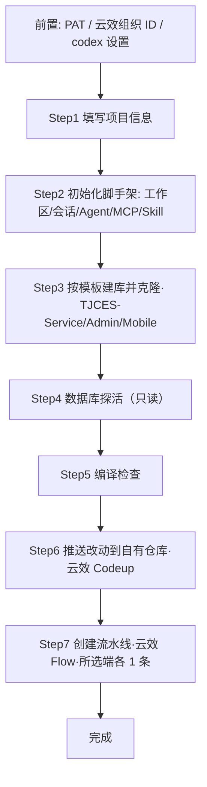
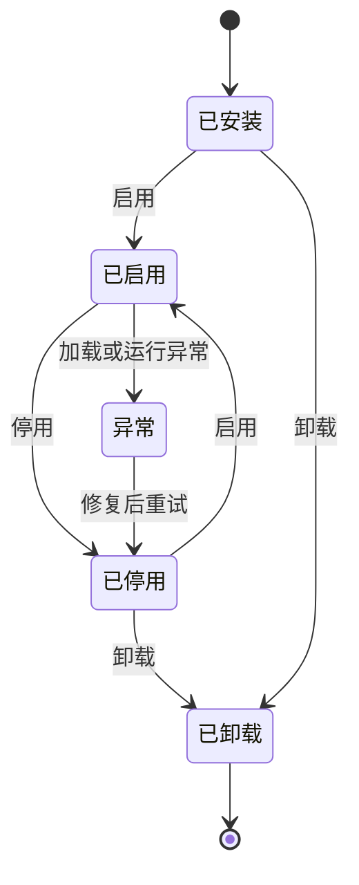

# PRD：luban-agent 插件体系设计与「新建项目」插件需求

- **版本**：v0.31（**Step 7 YAML 可手工微调**：预览从「只能看」升级为「可改再提交」——独立弹窗编辑器（`Ui/PipelineYamlEditorWindow`）+ 按端**会话内**保留 + 「重置为模板」；`PreviewPipelines` / `CreatePipelinesAsync` / `AppendDeployStagesAsync` 统一收按端 `yamlOverrides`，提交内容与界面原文一致；提交前只做**最小校验**（非空 / 无 Tab / 有顶层 `stages:` / `name:` 与模板名一致），其余语法交给云效原样透出（`1209300`）；「一键补齐部署阶段」在微调文本末尾**追加**部署阶段（已自写 `VMDockerDeploy` 则不重复追加）。业务口径（三端各 1 条、部署阶段默认禁用、重跑按名幂等）不变；§4.3 Step 7 与 §4.8 同步补充）
- **历史版本**：v0.30（**Step 7 实现形态定案**：原「克隆参考流水线」在 API 层面不成立（OpenAPI 无复制接口 + `CreatePipeline` 只收新版 YAML + 组织内 70 条全是 tb 形态），改为「**内嵌新版 YAML 模板 + 占位符渲染 + 创建**」；真机校正「变量与缓存」形态、`runsOn` 默认不写、`OSSUpload` / `OSSDelete` / `VMDockerDeploy` 参数键名；MCP `flow_clone_pipeline` → `flow_create_pipeline`）；v0.22（**Step 4 / Step 5 落地口径**：Step 4 由「配置与建库」改为「**只读探活**」——不建库、不写任何项目文件/配置，只确认「能连上且库存在」，结果**不阻断**；Step 5 编译方式**交助手按工程类型判断**；两步均由项目会话的助手**亲自执行**，插件只固定「边界 + 结论文件契约」并回读判定；§4.3 Step 4/5、§4.5、§4.8 第 19 条、§4.10.2/§4.10.4/§4.10.7 同步改写）
- **日期**：2026-10-21
- **作者**：luban 团队
- **状态**：设计评审中
- **关联仓库**：`luban-agent`（宿主为 `LubanAgentCodex`）
- **修订说明**：v0.2 经多 agent 评审结合**云效 Codeup / Flow** 与 **PAT** 真实能力及现有代码深度修订；v0.3 明确**架构分层**（框架 `LuBan.AIAgent` 定义插件/生命周期/管理/基础插件，解决方案实现具体插件，宿主 `LubanAgentCodex` 操作）；v0.4 补充两点业务与体验约束：①新项目**必须含后端与管理后台，移动端按需可选**（端选择由 Step1 决定、贯穿克隆/建库/编译/建流水线）；②向导界面在表单/进度基础上**实时展示 Agent 操作记录**，让用户直观感知过程并据结果就地调整重试；v0.5 新增**插件专属 Skill 设计（§4.10）**：框架契约支持插件贡献 Skill（`IPlugin.ContributeSkills()` / `IPluginHost.RegisterSkill()` / `SkillDefinition`），「新建项目」插件提供主 skill `newproject-create` + 4 个原子 skill，与向导共享 `INewProjectService` 后端，既可由左侧栏向导触发、也可由 Agent 在聊天以自然语言触发；v0.6 新增**云效连接器与专属 MCP 设计（§3.10 / §4.11）**：框架层新增 `Connectors/AliyunDevOps`（YunxiaoConnector/CodeupClient/FlowClient + PAT 取用），并用进程内 `YunxiaoMCPClient : IMCPClient` 包装暴露 8 个 `mcp_yunxiao_*` 工具；插件 `INewProjectService` 直连连接器（C#），`newproject-*` skill 云效步骤委托 MCP 工具；`plugin.json` 增 `mcpServers` 字段使 MCP 生命周期随插件启停；M1/M4 增连接器与 MCP、新增 M6 联调。
- **修订说明（v0.7）**：①新增**初始化阶段（§4.3 Step 2）**——用户填完 Step 1（含新增字段「项目介绍」「本地目录」）并点「下一步」后，自动初始化 **工作区 / 会话（SessionContext）/ 项目级 Agent / `yunxiao` MCP 客户端 / `newproject-*` Skill**（经新增的 `SkillRegistry.RegisterPluginSkill` 与 `MCPRegistry.RegisterPluginClient`，随 M1 落地），再进入克隆；向导由 5 步扩展为 **6 步**，同步刷新流程图、ProjectSpec、步骤条、验收与里程碑。②修订深度评审发现的 P0/P1：补全动态注册 API（`SkillRegistry`/`MCPRegistry` 当前为静态只读，需扩展）、统一生命周期为 4 态（移除 §2.5 多余的 `Running`）、修正 skill 云效路径表述（§4.10.3 与 §4.10.7/§4.11.4 矛盾）、明确克隆归属（§3.10 复用 `GitToolPlugin`，§4.11.2 由 `CodeupClient.CopyToLocalAsync` 内部复用）、补定义 `PluginCommandDescriptor`、统一 `PluginRegistry`→`PluginManager` 与 `Scan`→`ScanAsync` 命名。③澄清「建库」语义（§1.4 指目标数据库构建，见 Step 4；新建项目推送至云效代码仓库为可选写路径，见 §4.4）。
- **修订说明（v0.8）**：**依据阿里云云效官方 OpenAPI 文档（服务接入点 / 个人访问令牌 / 错误码中心 / Codeup 仓库 4 篇 / Flow 流水线 6 篇，共 12 篇）核对并订正 API 事实错误**：①**统一接入点与鉴权**——云效 OpenAPI 接入点为 `openapi-rdc.aliyuncs.com`（中心版）/ Region版实例域名，路径 `oapi/v1/codeup/...` 与 `oapi/v1/flow/...`，鉴权统一用请求头 **`x-yunxiao-token: <PAT>`**（**弃用原假设的 `devops 2021-06-25` 产品版本与 `Private-Token` 头**）；Git 克隆/推送仍用 `https://oauth2:<PAT>@codeup.aliyun.com/...`。②**中心版 / Region版差异**——`organizationId` **仅中心版**路径必填，Region版不传；`region` 不作为参数，而是编码在接入点域中（原 §4.3 Step6「需传 ORGANIZATION_ID 与 region」表述错误，已订正）。③**订正 Codeup / Flow 各 API 路径与参数**（CreateRepository 增 `path`/`templateProject`、ListRepositories 的 `search`/`perPage`、CreatePipeline 请求体 `{name,content}` 等）。④**订正 MCP 工具入参命名**（`keyword`→`search`、`pageSize`→`perPage`、`nameKeyword`→`pipelineName`、增 `repositoryId`/中心版 `organizationId` 等），并补充 `flow_run_pipeline` 实为 **ExecutePipelineJobRun（运行单次运行实例中的单个任务，需 `pipelineRunId`+`jobId`）**，整条流水线触发 run 的创建 API 标注为待确认。⑤补充错误码映射（401/403/429/500 等）。
- **修订说明（v0.9）**：**确认本企业使用云效「中心版」**（用户决策，落地 §6 开放问题 #7）。据此：①接入点固定 `openapi-rdc.aliyuncs.com`，所有 OpenAPI 路径统一带 `/organizations/{organizationId}`；②`ProjectSpec.organizationId` 由「可选」升为**必填**，并从 codex 设置中的云效连接配置读取；③`flowRegion` 在中心版下无意义（region 已隐含于中心版统一接入点），数据模型中标注为「中心版不使用，仅 Region版 预留」，无需用户填写；④§4.3 前置条件将 `organizationId` 列为必配项（缺失时阻断 Step 3/Step 6）；⑤§6 开放问题 #7 标记为已解决。
- **修订说明（v0.10）**：**深度审查「创建流水线」步骤，对齐真实工程实践**（用户领域输入：三端通常各对应一条流水线，先据企服版 TJCES 的 3 条参考流水线定义克隆为本项目流水线，并替换名称/端口/Codeup 仓库地址/流水线参数）。据此重写 §4.3 **Step 6**：由「生成单条 YAML」改为「**每端一条、共 3 条**（mobile 仅当选），按 `GetPipeline` 拉取 TJCES 参考 YAML → 按 `ProjectSpec` 替换 → `CreatePipeline` 逐端创建」的**克隆-替换-创建**流程，并明确 4 类替换点与「流水线源仓库须指向本项目自有 Codeup 仓库」的依赖（推荐默认建新仓库并推送）。同步：§4.5 `ProjectSpec` 增 `referencePipelines`（TJCES 三端参考流水线 ID）；§4.11.2 `FlowClient` 增 `GetPipelineAsync`+`ClonePipelinesFromTemplateAsync`；§4.11.3 `flow_clone_pipeline` 工具明确「读取源 YAML→替换→创建」语义与 4 类替换；§4.10.4 / §4.10.7 的 `newproject-create-pipeline` 改为按端 ×3 克隆 TJCES 参考；§4.8 验收 #2 改为「（三端）共 3 条流水线创建成功」。
- **修订说明（v0.11）**：①**「推送到新代码仓库」升级为正式步骤**——因 Step 7 流水线源仓库必须指向本项目自有仓库（v0.10 已确认为强依赖），原「可选写路径」不足以支撑 CI，故正式新增 **Step 6 · 推送到新代码仓库**（创建本项目专属 Codeup 仓库 + 推送代码），向导由 6 步扩展为 **7 步**（原 Step 6 建流水线顺延为 **Step 7**），并同步数据模型、`INewProjectService`、原子 Skill、验收、流程图、步骤条与里程碑。②**新增「逐步界面草图」（§4.6）**——为全部 7 步各绘制一张中文界面草图（左向导区 / 右 Agent 操作记录区），并把界面相关信息集中到该节，便于产品与非技术同事评审。③**去代码化**——移除全文的代码片段（C# / TypeScript / JSON / 类图 / 时序图 / 加载伪代码），一律改用**表格与中文说明**表达，使非开发人员也能读懂；数据模型改为字段表，服务接口改为能力表，插件清单字段改为清单表。
- **阅读说明**：本文档面向**产品、项目管理与非技术评审者**，正文不含代码；实现相关细节（类型、接口、端点）以表格或名词表形式给出。顶部「修订说明」是**版本变更记录**（面向开发，为便于追溯保留了少量类型/接口名），评审时可直接跳过；**§3.9 代码挂载点索引**与 **§4.11.3 MCP 工具表**属**开发实现附录**，同样可跳过。
- **修订说明（v0.12）**：**明确新项目代码仓库的创建方式**（用户领域输入：应以 `TJCES-Admin` / `TJCES-Service` / `TJCES-Mobile` 三端模板仓为模板创建，可见性为**组织可见**，再用 Git 工具按仓库 HTTPS 地址克隆到本地）。据此调整：①**Step 3 由「直接克隆模板仓库到本地」改为「以对应模板仓为模板创建本项目各端专属仓库（可见性固定＝组织内公开）→ 取其 HTTPS 地址用 Git 克隆到本地」**，并给出三端模板对照表（后端←`TJCES-Service`、管理端←`TJCES-Admin`、移动端←`TJCES-Mobile`，默认仓库名 `{缩写}-Service/-Admin/-Mobile`）；②**Step 6 相应由「创建仓库并推送」调整为「把本地已改造并通过编译的最终改动提交并推送回各端自有仓库」**；③Step 7 每条流水线各自绑定**本端对应的仓库**（而非单一仓库）；④同步流程图节点、每步云效能力表、数据模型（模板对照 + 按端目标仓库）、共享能力层、原子 Skill 与 MCP 映射、`codeup_create_repo` 工具入参与注③、§4.4 集成表，并重绘第 3、6、7 步界面草图。
- **修订说明（v0.13）**：**保留建库的「用户确认界面」**。因 v0.12 已把建库前置到 Step 3，确认界面随之**移至 Step 3**（而非留在 Step 6）：执行前展示并允许用户调整①**各端新仓库名称**（可逐端修改，默认 `{缩写}-Service/-Admin/-Mobile`）②**可见性**（默认且推荐「组织内公开＝组织可见」，可改「私有」＝仅项目成员可见）③**归属组织**（默认取自云效连接配置），需勾选「我已确认」后才开始创建与克隆；Step 6 维持纯粹的「提交 + 推送」界面。第 3 步草图已重绘为「确认区 + 执行进度」形态。
- **修订说明（v0.14）**：**全文正确性与一致性审查**（三路并行评审：内部一致性 / 云效 API 事实 / 草图与可读性）。①**修正一处功能性缺陷**——「创建仓库」接口返回**不含 HTTPS 克隆地址**，原文档直接拿返回值克隆会失败；现明确需**再调「查询单个仓库」取 `httpUrlToRepo`** 后再用 Git 克隆，并同步订正 `codeup_create_repo` / `codeup_search_repos` 工具出参说明与注③。②**修正草图自相矛盾**——示例项目 JNMS 在第 1 步**未勾选移动端**，第 7 步却画了 3 条流水线；现改为**所选端各 1 条（本例 2 条）**并显式标出「移动端已跳过（第 1 步未勾选）」，第 3/5/6/7 步口径统一；第 5 步「下一步」改为**编译通过后才可用**（对齐「编译失败阻断后续步骤」）；第 6 步左右栏进度状态对齐并补齐「提交管理端改动」记录；步骤条 `3 模板`→`3 建库`、`6 仓库`→`6 推送`；第 3 步主按钮改为「确认并创建」；补第 2 步「全部成功后自动进入第 3 步」说明。③**订正 API 事实**——建库增 `createParentPath`（含多级分组时自动建父路径）；`flow_update_pipeline` 的 `name` 为**必填**且出参为布尔；流水线 YAML 取自 `pipelineConfig.flow` 字段；403 错误码补全为 `Forbidden.InvalidUser.UserNotInCurrentOrganization` / `Forbidden.InvalidOrganizationMember`；新增注⑥说明运行日志接口 `GetPipelineJobRunLog` 与 `UpdatePipeline` 中心版路径待联调确认。④**可读性**——§1.1 新增**名词速查表**（插件 / Skill / MCP / 连接器 / ALC / PAT / Codeup / Flow / 组织可见 等 14 条）；§4.9.1 明确 Git 鉴权的**方式 A（默认 `oauth2:<PAT>@`）与方式 B（HTTPS 克隆账号）**；英文缩写命名规范改为白话；§4.11.3 与 §3.9 标注为「开发实现附录 / 可跳过」；移除残余代码片段（`alc.Unload()`、`services.AddSingleton<...>`、`mcpServers` JSON）。⑤**口径统一**——「端 ×3」一律改为「所选端各 1 条，最多 3 条」（§4.8 验收 #2、§4.10.2、§4.10.4、§4.10.7）；全文术语「代码库」统一为「代码仓库」。
- **修订说明（v0.19）：M4-P3 真机验收通过后的落地回写**——按 Step 3 / Step 6 真机跑通的**实际实现**订正设计（并已被真机取证）。①**Step 3**：新增「**只读预检**」子步——执行前把目标代码组、模板库命中项、pin 解析结果、逐端仓库名与落地目录摆给用户核对，**不创建任何云效资源**；**模板 pin 改为运行期解析**（`templates[].branch` 由「必填固定值」调整为**可选覆盖**：登记了就必须真实存在、不存在即阻断；留空则在模板仓现有分支中按 `develop → master → main → 模板默认分支` 取第一个存在的，并把「取到了哪个、依据是什么」回显在预检里）；**项目代码组改为自动创建**（`groupNameFormat` 默认 `{CODE}`、`groupParentId` 留空＝组织根，**先查后建、同名复用不重复建**，可见性默认 `internal`）；建库参数明确为 `namespaceId`＝代码组 ID + `templateProject{ templateProjectId, templateType=1, syncAllBranches=true }`；**建库后须轮询等 pin 分支就绪**（`syncAllBranches` 为服务端异步，真机实测建库后 10–17s 才补齐模板分支，上限 120s / 间隔 3s）；**克隆失败必须清理本次新建的目录**并把 git 原始报错摘要（已脱敏）带进失败文案；**「复用已克隆」增加健康校验**（工作树与 `.git/refs/heads/<pin>` 均可用才复用），`cloned` 语义收紧为「本地确已就绪」。②**Step 6**：目标分支由「统一推 `main`」订正为「**配置 `pushBranch` 优先、默认 `main`**；留空才退回该仓库默认分支」（**v0.28 起该默认值改为 `develop`**，见 v0.28 修订说明与 §6 #17）。③**权限**：`git` 能力白名单由扁平操作名扩为**三能力组**（`clone_push` / `commit` / `inspect`），并把门禁收敛到**唯一出口**（按 git 子命令名判定，判定前跳过 `-c` / `-C` / `--git-dir` 等前置全局选项）。④**MCP 工具由 8 个扩为 10 个**（新增 `codeup_list_branches` 查分支、`codeup_create_group` 建代码组，供聊天路径即席排障；向导路径仍直连连接器，二者共用同一实现）。⑤§4.5 补「项目代码组 / 推送目标分支 / `cloned` 语义」并把远端产物细化为三类；§6 修订 #5 / #17、新增 #23 / #24 / #25。
- **修订说明（v0.18）：grill 第二轮，11 项决策全部按建议定案并回写正文**（三项只读代码/文档探查支撑）。①**【P0】第 7 步流水线会继承企服版部署目标**——云效 OpenAPI **无「复制/克隆流水线」接口**（复制仅控制台功能），本步实为自实现的 YAML 文本复制；而 `serviceConnection` / `machineGroup` / `runsOn` / 制品仓库 ID 在 YAML 中是字面量，照抄会导致首次 push 即部署到企服版环境。定案：替换点 4 项扩为 5 项、**部署阶段默认关闭**、展示「待人工绑定清单」、界面文案同步改写（§4.3 Step 7 / §4.6 草图 / §4.8 #13 / §6 #14）。②**远端产物孤儿与重跑幂等**——§4.7 原回滚三件套全是本地动作、零远端动作；定案为「本地自动回收、远端一律不自动删、只列清单」，并重跑时先检索同名复用（§4.3 Step 3 / Step 7、§4.5 新增「远端产物清单」、§4.7、§4.8 #14、§6 #15）。③**重跑会话策略**——`SwitchWorkspaceAsync`（`WorkspaceManager.cs:337-356`）会恢复旧会话，与 Step 2「必须新建会话」冲突；定案为区分首次/重跑，重跑复用工作区后**显式再建新会话**（§4.3 Step 2 陷阱③、§6 #16）。④**分支策略**——模板 pin 的是版本，克隆必须带 `-b`；定案 Step 3 扩展 `GitCloneAsync` 的 `-b/--branch`、Step 6 统一推 `main`、不设分支保护规则（§4.3、§6 #17）。⑤**PAT 归属**——用个人 PAT、不引入服务账号，并显式写明「云效资源归属于 PAT 持有者」（§4.9.3、§6 #18）。⑥**中断恢复**——不做断点续跑，改为残留检测 + 用户选择；向导单实例（§4.3 Step 2、§4.8 #15、§6 #19）。⑦**插件崩溃隔离**——ALC 隔离程序集不隔离线程；宿主在每个插件入口 try/catch 后置 `Error`，不做进程级隔离（§3.4、§4.8 #16、§6 #20）。⑧**版本升级热替换**——`Upgrade` 复用完整 6 步卸载流程，卸载验证未通过则**中止安装**（§3.5、§6 #21）。⑨**面板占位**——核查发现 `MainWindow.axaml` 中 `Grid.Column="1"` 的内层 Grid 是**匿名的**、且无字段持有其引用，挂载前必须先命名并加字段保存（§3.9）。⑩**UI 投递令牌**——`Dispatcher.UIThread.Post` 投递无撤销机制，定案由 `PluginBase.PostToUi` 提供卸载即失效的令牌、禁止插件直接裸投递（§3.4、§3.12、§6 #22）。⑪**§3.12 禁止项 #2 措辞订正**——真正阻止 ALC 回收的是「插件订阅宿主/单例 publisher」（host→plugin），而非宿主订阅插件控件事件。
- **修订说明（v0.17）：决策——采用可回收 ALC 实现程序集级热卸载（不采用「停用后重启生效」的简化方案）**。据此：①**§1.4 第 2 条由「不做」改为「要做」**，撤销 v0.15 的限定语；②**§3.5「禁用 / 卸载」给出严格卸载顺序**（关闭 → 注销 UI 与事件 → 注销 Skill/MCP → 删除工作区文件 → 卸载 ALC → GC 验证）；③**新增 §3.12「ALC 热卸载设计约束」**，列出宿主侧禁止项（注册表长寿命强引用、Avalonia 全局样式与静态缓存、事件订阅、`Dispatcher.UIThread` 延续）与「卸载失败降级为提示重启」的兜底口径；④**§3.11 补充**：文件式 Skill 对 ALC 友好（不产生程序集引用），而进程内 `YunxiaoMCPClient` 实例是**唯一会阻止卸载的强引用**，必须靠注册口在卸载第一步注销；⑤§4.8 第 4 条与 §6 #8 同步更新为「真卸载 + 卸载失败降级」的双重判定。
- **修订说明（v0.16）：§6 风险与开放问题共 13 项已逐条决策并回写正文**。①**错误提示措辞定案**——PAT 失效统一报「**个人令牌无效**」；权限类失败统一提示「**缺少 XX 权限，请到云效个人令牌页面设置**」（§4.7）。②**凭据安全按「不用太严格」放宽**——不强求 Windows 凭据管理器 / DPAPI 加密，**沿用宿主现有配置存储方式**（与现有 API Key 同基线）即可，但**日志、会话消息、操作记录中仍不得出现明文 PAT**（§4.9.3、§4.8 #6/#7/#11）。③**仅支持中心版**——移除 Region 版预留与「未来切换」表述（§4.4、§4.5、§4.3 前置）。④**模板版本 pin**——不跟随模板升级，找不到即报错阻断（§4.3 Step 3、§6 #5）。⑤**ALC 卸载增设专项测试**（§4.8 #4、M5）。⑥**插件目录固定** `luban-agent-codex/plugins/`，用户级覆盖暂不考虑（§3.3、§6 #9）。⑦**模板占位符规范不与维护方对齐**——改为「按约定扫描替换 + 第 5 步编译验证兜底」，残余风险显式记录在 §6 #10。⑧**ListPipelines 字段不足**——改用 `GetPipeline`（查询流水线详情）补充创建人与状态（§4.11.3、§6 #13）。⑨同步更正工作区根 `AGENTS.md` 中与代码相反的依赖表述。
- **修订说明（v0.15）：对照更新后的代码重新审查**（三路并行事实核查：框架侧能力 / 宿主挂载点与重载机制 / PRD 逐条验真）。**纠正 4 处会导致实现失败的事实错误**：①**依赖方式写反**——§3.0 原写「已通过 ProjectReference…发布期按 AGENTS.md 改为 NuGet」，实际当前**就是** `ProjectReference`（`LubanAgentCore.csproj:9-11` 注释 `TEMP-LOCAL-VERIFY` 明示「开发期一律走项目引用…验收后统一发最终版本包并还原为 PackageReference」），`LuBan.*` 的 `PackageReference` 数为 0。②**Step 2「复用宿主会话」不可行**——`SessionRuntimeManager.cs:83-88` 在 runtime 创建时一次性写入 `SessionId/WorkspaceId/WorkspaceRoot/AllowedRoots`，Codex UI 路径此后无追加入口，旧会话看不到新 `localPath`，所有文件工具被 `IsWithinEffectiveRoot` 拒绝；改为「必须新建会话」并给出正确顺序。③**技能命名全部非法**——框架 `SkillManageToolGroup.cs:26` 校验正则 `^[a-z0-9][a-z0-9_-]{0,63}$` **不含点号**，`newproject-create` 等被硬拒；全套改为中划线（如 `newproject-create`）。④**UI 模板是死代码**——`SkillManageWindow`/`MCPManageWindow`/`RuleManageWindow` 零引用、已被 `SettingsWindow` 取代（`MainWindowViewModel.cs:721/729/737`）。**复用框架新增能力**：⑤`SkillRegistry`/`MCPRegistry` 实为**带读写锁的实例类**（非 PRD 原说的静态只读），且框架已提供「写文件 → `LoadFromWorkspace()` → `RequestReload()`」三件套（`SkillManage`/`McpManage` 工具组）与 `IAgentReloadTrigger` + `PendingReload` 延迟重载链，M1 由「新增三个注册 API」降为「复用三件套 + 补一个进程内客户端注册口」。⑥补订义**卸载语义**（工作区文件式 Skill/MCP 不随插件卸载消失，须显式删除）。⑦订正 MainWindow 挂载点位置（包 `ContentRoot` 外会连带包进侧栏，应包 `Grid.Column="1"` 内层 Grid）。⑧补 PAT 明文弹窗泄漏面与 DI 硬约束 `ValidateScopes/ValidateOnBuild`。
- **修订说明（v0.21）：依赖方式收尾——项目引用还原为 NuGet 包引用**。三阶段验收后按 P2 计划 Phase N 执行：①框架侧发布 `LuBan.*` 闭包 7 包（`AIAgent` / `Common` / `DI` / `Threading` / `Logging` / `Orm` / `Linq`）`2026.10.20.1` 至私有源 `nexus3`（`https://nexus.tjingcai.com/repository/nuget-hosted/index.json`）；②`LubanAgentCore` / `LubanAgentA2A` / `LubanAgent.Connectors.AliyunDevOps` / `LubanAgent.Plugin.NewProject` 四个产品工程的 `ProjectReference` 全部改为 `PackageReference`，`TEMP-LOCAL-VERIFY` 注释清除；③**smoke 4 个工程有意保留**项目引用（开发验证台，不在 `LubanAgent.slnx` 内，详见 `smoke/plugin-system/README.md`）；④框架同轮把 `Microsoft.Extensions.*` 升到 `10.0.13`、`Microsoft.Extensions.AI`/`AI.OpenAI` 升到 `10.11.0`，产品侧同名低版本直接引用触发 **NU1605 包降级（NuGet 默认即 error）**，按「删直接引用、交由 `LuBan.*` 传递提供」口径收敛，仅保留 `OpenAI 2.14.0`（钉住 2.13.0 流式工具调用破坏性变更的下限）等确需显式声明的包；⑤由此**改 framework 源码不再即时生效**，需重新发包并提升产品侧版本号。验收：`dotnet build LubanAgent.slnx` 0 错误、`LubanAgent.Tests` 33/33、插件铺装 `lib/` 仍仅 `dll`+`deps.json` 2 个文件（ALC 回落路径不变，deps.json 中 `LuBan.*` 条目由 `type=project` 变为 `type=package`）。
- **修订说明（v0.22）：M4-P4 落地回写——Step 4 / Step 5 由「插件代劳」改为「助手亲自执行」**。评审与 spike 后定案技术路线 **②（插件驱动宿主会话助手跑提示词）**：插件把本步参数与硬边界拼成一轮提示词下发到**项目会话**，助手用既有脚本/文件工具自己干活，并把结论写进**约定文件**，插件回读该文件做机器判定（不解析对话正文）。据此：①**Step 4 语义收窄**——原「生成/修改 `appsettings.json` + 执行建库脚本」全部移除（PRD §4.3 Step 4 改「**只读探活**」），判定只看「能连上且库存在」，**不建库、不执行任何 SQL、不写任何项目文件**（唯一例外＝结论文件），结果**不阻断**后续步骤；②**Step 5 编译方式不预设**——原「统一 `dotnet build`」改为「**助手按工程类型自行判断**」（真机管理端为 Vite/Vue、无 `.sln`），失败仍**阻断** Step 6，但只编译不修复；③**结论文件契约**——路径 `{本地目录}\.luban-agent\plugin-newproject\results\step{4,5}-<时间戳>.json`（与各端 git 仓库同级、不在任何仓库内，Step 6 推送不会带上），schema `{step, ok, checks[{name, ok, detail, command?}], message}`；判定四环齐才算通过（文件存在 + 可解析 + `ok` 为真 + 事件流无错误事件）；Step 5 的 `checks[].name` **固定用端标识**（`Service`/`Admin`/`Mobile`），**漏端即判失败**；④**助手工具权限白名单**（不用 `BypassPermissions`）——只放行「只读工具 + `RunPythonAsync` + 白名单命令的 `RunShellAsync` + 工作区内写入」，`runlua` / 删除类 / 技能写删类 / 越界写入一律拒；命令白名单含 `dotnet`/`git`/`node`/`npm`/`npx`/`pnpm`/`yarn`/`python`/`pip` 等，复合命令**逐段判定**；⑤**口令按方案 A 明文内联进本轮提示词**（用户裁决，D5 修订）——口令不落 `spec.json`、不写日志、操作记录一律 `***`；**已知残余风险**：口令会随框架会话历史落进 `luban-ai-agent.db`，并在该会话后续轮回灌模型上下文（记入 §4.8 第 19 条）；⑥**共同硬边界**写进两条提示词与三个 skill 正文——只做本步该做的事、**禁止回头调用 `newproject-*` 技能与插件服务**（本轮提示词由插件在**同一会话**发起，回头调用插件服务会形成「同会话回合串行」自等死锁）、正文只回一行结论；⑦**Step 4 界面默认值**从克隆下来的 `WebHost/appsettings.json` 连接串预填（`DbConnectionOptions:ConnectionConfigs[0]:ConnectionString`，容错注释与尾随逗号），口令用 `PasswordChar` 遮蔽且**永不回填**，非敏感参数（服务器/端口/库名/账号）落 `spec.json` 回写；⑧技能更名与描述同步——`newproject-setup-db` 由「配置与建库」改为「**数据库探活**」。⑨**越级临时入口收口为正式入口**——向导没有「返回上一步」的导航，原先放在 Step 7 占位区的「跳过 Step 7，直接再执行一次 Step 6（临时入口）」语义不实（P5 未实现前它并不是「跳过」而是「重跑」），故移到常驻「档案与维护」卡，更名「**重新推送（重跑 Step 6）**」，**至少一端已克隆**才显示（Step 6 幂等，重跑安全，PRD §4.8 第 18 条⑥）。实现侧新增纯函数层（提示词构造 / 结论解析 / 归并判定 / 参数校验 / 默认值装配 / 结论文件路径）并全部有单测锁定；`LubanAgent.Tests` 124/124 通过。
- **修订说明（v0.23）：P4 真机冒烟缺陷修复 + 步骤条回退导航落地**。真机冒烟出现「**5 编译 未开始 / 6 推送 已完成**」的自相矛盾状态，根因是**三因叠加**：①推送成功后无条件把档案推进到 Step 7；②Step 5 的操作区只在「当前步＝编译」时渲染，而向导**没有任何回退入口**（步骤条不可点、无「上一步」）；③v0.22 新加的常驻「重新推送（重跑 Step 6）」按「至少一端已克隆」判定可见性，Step 3 一完成即可点，于是 Step 6 在 Step 5 之前被执行——「编译失败阻断 Step 6」实际只剩界面顺序，**能力层没有任何校验**。据此收口：①**回退导航落地**（§4.6）——步骤条每行可点击 + 显式「上一步」按钮，可回到**任一「已到达」步骤**查看或重跑；回退**只移动面板的视图游标**（不落档案、不自动触发动作），档案 `CurrentStep` 语义收紧为「**已到达的最大步**」（`ProjectSpec.AdvanceTo` 单调只前进），故「回到 Step 5 重编译成功」不再把已到达 Step 7 的档案拉回 Step 6；②**新增推送闸门**（§4.7）——纯函数 `StepGate.CanPush(spec)`＝「`StepStates["Build"] == Succeeded` ∧ `BuildResults` 非空 ∧ 逐端全 `Ok`」，缺一即拒（尤其**从未跑过 Step 5**、档案里根本没有 `Build` 键），向导与聊天两条入口同受保护；③**收紧常驻入口可见性**——「重新推送（重跑 Step 6）」改为「推进指针 ≥ Step 6」才显示（§4.8 第 18 条⑥ 口径随之改写）；④**Step 1 重提加保护**——已建档案后从步骤条回到 Step 1 再点「下一步」＝**清空档案并从 Step 2 重来**（破坏性），改为**卡内先行确认**，顺带绕开原「已存在同名工作区」唯一性口径①的死胡同；⑤新增单测 `NewProjectStepGateUnitTest`（推进单调性 + 闸门判据，含「冒烟档案形态」回归锁定），`LubanAgent.Tests` 132/132 通过。

- **修订说明（v0.24）：云效连接器程序集并入 `LubanAgentCore`**。①原独立产品程序集 `luban-agent/LubanAgent.Connectors.AliyunDevOps/`（14 个源文件，含 `Mcp/`）整体移入 `luban-agent/LubanAgentCore/Connectors/AliyunDevOps/`，命名空间由 `LubanAgent.Connectors.AliyunDevOps[.Mcp]` 改为 **`LubanAgentCore.Connectors.AliyunDevOps[.Mcp]`**；②删除该独立 csproj 与 `LubanAgent.slnx` 中的条目，`LubanAgentCodex` / `LubanAgent.Plugin.NewProject` / `LubanAgent.Tests` 对其的 `ProjectReference` 一并删除（三者本已引用 `LubanAgentCore`，编译期可见性不变）；③**ALC 语义不变**——`LubanAgentCore.dll` 本就是宿主程序集、不进插件包 `lib/`（`StagePluginPackage` 只铺插件自身 `dll`+`deps.json`），插件 ALC 仍按「文件缺失 → 回落默认 ALC」得到同一份类型，无第二份 `Type` 副本风险；④`LubanAgentCli` / `LubanAgentCodex` 的 `appsettings.json` 中 `LuBanAgent:Plugins:AssemblySharing:AdditionalPrefixes = ["LubanAgent.Connectors."]` 因该程序集不复存在而成为死配置，随之删除；⑤本文 §3.10 / §4.11.1 / §4.11.3 及 §5 M1 注中「云效连接器为产品侧**独立程序集**」的表述，其**归属与位置以本条为准**（能力、注册方式 `AddAliyunDevOpsConnector`、工具数与行为均无变化）。验收：`dotnet build LubanAgent.slnx` 0 错误、`LubanAgent.Tests` 全绿。

- **修订说明（v0.31）：Step 7 的 YAML 从「只能看」升级为「可手工微调再提交」**（用户提出的真机诉求：模板渲染结果不可能覆盖所有环境差异，预览必须可改）。①**编辑形态**：主界面预览框保持只读，另给「**编辑 YAML…**」→ 独立弹窗 `Ui/PipelineYamlEditorWindow`（等宽字体、双向滚动条、「恢复模板」重置本文、「取消 / Esc」丢弃本次编辑）；保存后主界面回显微调原文并标「已手工微调」，另给「重置为模板」丢弃该端微调。②**保留范围**：微调按端存面板内存字典，**会话内**保留（切端不丢）；提交成功后**实际提交的原文**落 `PipelineResults[].Yaml`；**重开面板不回填**——避免旧微调在 Step 1 改名 / 仓库名调整后悄悄覆盖新渲染结果。③**覆盖语义**：`PreviewPipelines` / `CreatePipelinesAsync` / `AppendDeployStagesAsync` 统一收按端 `yamlOverrides`（`null` 或空＝全部走模板），命中即以微调文本替换模板渲染结果；**流水线名与待人工绑定清单仍按模板口径**（同名幂等检索与 `UpdatePipeline` 回传现名都依赖名称一致）。④**校验边界**（`PipelineYamlOverride.Validate`，弹窗与执行体共用同一函数）：非空 / 不含 Tab / 有顶层 `stages:` / `name:` 与模板名一致；不通过则**不发任何请求**并给可读文案。**不引入 YAML 解析库**：其余语法错误由云效原样透出（`1209300`）。⑤**补齐与微调叠加**：微调只作用构建段；「一键补齐部署阶段」时由 `PipelineYamlOverride.Compose` 把部署阶段片段追加到微调文本末尾，若文本里已自写 `VMDockerDeploy`（用户自备部署阶段）则**不重复追加**。⑥**实现侧**：新增 `Services/PipelineTemplates.cs` 的 `PipelineYamlOverride`（`Compose` / `Validate` / `ReadName` 三个纯函数）、`Abstractions/PipelinePreview.Edited`、`Ui/PipelineYamlEditorWindow`；`INewProjectService` 三个 Step 7 方法加可选参 `yamlOverrides`。⑦**顺带修正 v0.30 的部署阶段缩进（潜在结构错误）**：部署阶段片段在模板常量里是顶格写的，直接拼进完整 YAML 会变成**顶层 `deploy:` 键**（不在 `stages:` 之下）——v0.30 的「一键补齐」从未真机跑过，故未被发现；v0.31 起由 `PipelineRenderer` 统一按 stage 缩进 **2 空格**（注释块同步缩进，解除注释即可直接提交），并加单测护栏（禁止出现顶格 `deploy:`）；同时 `Compose` 的「不重复追加」判据扩为「已含 `VMDockerDeploy` **或** 已存在 `deploy` 阶段（换了组件也算）」——同 id 阶段追加两次会拼出重复键、云效校验必失败。**验收**：`dotnet build LubanAgent.slnx` 0 错误、`LubanAgent.Tests` **192/192** 通过（`NewProjectPipelineTemplateUnitTest` 新增 9 例：`Compose` 五态 + `Validate` 六态 + 部署片段展开与缩进护栏）；真机步骤见插件 README「P5 增补 · v0.31」62–66。
- **修订说明（v0.30）：Step 7 由「克隆参考流水线」改为「内嵌新版 YAML 模板渲染 + 创建」（真机取证后的实现定案 · 不改业务口径）**。8 轮 `ZZPROBE-*` 写探针（建后即删）+ 官方组件文档取证后，确认原「克隆」口径在 API 层面**不成立**：①云效 OpenAPI **没有「复制流水线」接口**；②`CreatePipeline` / `UpdatePipeline` **只收**顶层 `stages:` 的**新版 YAML**，把控制台 tb 形态的 `flow` 原文原样提交必报 `400 1209300 yaml校验失败…至少要包含一个stage`；③全组织 **70 条流水线全部是 `schema: tb`**，组织内取不到可提交范本。据此把 Step 7 的实现形态改为「**按 tb 语义翻译成新版 YAML 模板（内嵌程序集，随包分发、可单测）→ 本地渲染 → 提交创建**」，**业务口径（三端各 1 条、部署阶段默认禁用 + 待人工绑定清单 + 重跑按名幂等）一字未改**。真机校正清单（已回写 §4.3 Step 7 与 §4.11.3 注⑤/注⑤-1/注⑦、§6 #13/#14/#15）：①顶层 `variables:` 只写 `key` / `value`（可选 `secret: true`），**写 `type:` 报 `Not supported variable type`**；②`cache:`＝`cacheDirs` + `cacheMode`（`private*` 集群 → `local`，否则 `remote`）；③`runsOn` 标量 / 容器 / VM 三种写法均 200，但**私有集群任何写法全 400**，故**默认不写**（走云效公共北京集群），私有集群值只能人工回填 `pipelineDefaults[].buildCluster`；④`Command` / `NodeBuild` 的 `with.run` 必填，`NodeBuild` 用 `versionType: custom` + `customNodeVersion`（`lts/gallium`）；⑤`OSSUpload` 用 `sourceFilePath` / `targetFilePath`（不是 `localPath`），`OSSDelete` 用 `prefix`，两者均需 `region`；⑥`with` 里的**未知键被静默忽略**（历史错键不报错、只是不生效——「提交成功却不生效」的坑源）；⑦`VMDockerDeploy.machineGroup` **必须是主机组 uuid**（tb 数字 id 会被拒：`该机器组uuid[226948]不存在`）；⑧列表接口**有** `createAccountId`（创建人）、**无**运行状态，`/flow/**` 与 `/codeup/**` 成功响应一律**不套 `{"result":...}` 外壳**（裸数组 / 裸对象 / 裸 id / 裸 `true`，只有失败才带 `errorCode` 字符串包裹）。实现侧：MCP `flow_clone_pipeline` → **`flow_create_pipeline`**（`name` + `content` + `organizationId`）；新增 `Services/PipelineTemplates.cs`（`PipelineTemplateLibrary` + `PipelineRenderer`）与 `YunxiaoResponseParser`（`FlowClient` / `CodeupClient` 共用解析器，客户端 HTTP 层对齐 `CodeupClient` 的 `SendRawAsync`）；`pipelineReferences` 降为**溯源标注**（Step 7 不再读它的 YAML）。**验收**：`dotnet build LubanAgent.slnx` 0 错误、`LubanAgent.Tests` **183/183** 通过（新增 `NewProjectPipelineTemplateUnitTest` 16 例 / `YunxiaoResponseParserUnitTest` 15 例 / `YunxiaoPipelineModelUnitTest` 3 例）；**真机验收按 4B 裁决排在 Step 6 复跑通过之后**，步骤见插件 README「P4 复审增补 · v0.30」55–61。
- **修订说明（v0.29）：Step 6 推送「云效限流」被误判为权限问题 + 无退避重试（真机根因闭环）**。真机 Step 6 逐端串行推送，时间线取证：17:44:34 后端 `push origin develop` 失败 1.4s → `remote: 请求过于频繁，请稍后重试!`；**17:44:45 后端重推成功（2.3s）**；17:44:48 管理端紧接推送（距上次成功 3s）同样被限流、失败 350ms。也就是说**同一条 PAT、同一个 `develop` 分支在 11 秒前的重试里推成功了**——失败与 PAT 写权限、分支保护**无关**，是云效服务端的**限流**。据此修三处：①**零退避重试**——能力层原先 `codeup.PushAsync` 一次失败即 `return StepResult.Fail` 并中止整步（后端失败时管理端根本没被推进），只能靠用户手点「重新推送」、重试间隔由人拍脑袋（11s 过、3s 不过）。现按「临时 / 永久」分流：判定下沉为 **`GitCommandResult.IsRateLimited`**（读 git 原始报错全文，特征 `请求过于频繁` / `请稍后重试` / `服务繁忙` / `too many requests` / `rate limit` / HTTP `429`），命中则经新增纯函数层 **`PushRetryPolicy`** 退避 **10s → 20s → 30s、最多 3 次重试**（单端最坏多等 60s，取值即真机读数）；**非快进 / 401 / 权限不足一律不重试**（重试解决不了，只会拖长等待并掩盖真因）。②**失败文案误归因**——原实现把 `（请确认 PAT 具备该仓库写权限，且目标分支未被保护）` 无差别拼在**任何**失败后面，限流也不例外，把用户引向错误方向。现按限流分流：限流分支改说「云效服务端限流：本轮已自动退避重试 N 次仍未成功，建议等约 1 分钟后点『重新推送』；已推送端的产物不受影响」**且不再提 PAT / 分支保护**，非限流分支保留排查提示但措辞改为「若持续失败…」；聊天路径的 `mcp_yunxiao_codeup_push` 同步补限流提示（同一缺陷的另一个出口）。③**等待可见**——退避期间把同一条「进行中」记录原地改写为「云效服务端限流（原文）：20s 后重试（第 2/3 次）」（新增 `UpdateRunningOperation`，不把重试摊成多条记录），重试成功则记「云效限流后，第 N 次重试成功」。**顺带修正一处文案重字**：服务层 5 处 + UI 4 处 `$"{EndLabel(end)}端"` 产出「后端端」「管理端端」「移动端端」（含 Step 3 表单字段名、端分组标题、目录冲突横幅），并被拼进 Step 6 提交信息（真机提交 `chore: 初始化 测试项目一（管理端端）——由「新建项目」向导按模板 TJCES-Admin 生成`）；现一律直接用 `EndLabel(...)`（已自带「端」字，`NewProjectService.EndLabel` 与 `WizardPanel.EndLabel` 均加注释禁止再拼）。**验收**：`dotnet build LubanAgent.slnx` 0 错误、`LubanAgent.Tests` **148/148** 通过（新增 `NewProjectPushRetryUnitTest` 10 例：限流判定真/假样本、`stdout` 落 429、退避序列 10/20/30 与越界抛错、等待文案、限流文案不得提 PAT、非限流文案保留排查方向）；回归点 = 插件 README 冒烟项 51–54 与 Step 6 时序第 4 条。
- **修订说明（v0.28）：Step 5「管理端构建姿势」与边界放宽（真机根因闭环）**。真机连续两轮管理端编译失败，本轮把根因**定位到行并实测闭环**：管理端 `@vue-office/{docx,excel,pdf}` 的 `package.json` 里 `main = lib/index.js`，而 `lib/index.js` **不随包发布**——由包自身 `postinstall`（`lib/script/postinstall.js` → `utils.js` 的 `switchVersion(3)`：把 `lib/v3/index.js` 复制成 `lib/index.js`，`index.css` 同理）生成。pnpm v10 默认**跳过依赖的构建脚本** → 入口缺失 → `vite build` 报 `Failed to resolve entry for package "X"`。v0.27 曾判定「属仓库基线、正解是在仓库侧 `pnpm approve-builds`（改 `pnpm-workspace.yaml`）→ 不该让助手动」；v0.28 复核后**改判**：这条路**根本不需要 pnpm**——该仓库用 **npm 系**（`npm install` 默认执行依赖的构建脚本）× **Node 16** 就是本组织的既有姿势，所以它属**助手可自修的依赖树问题**，不该甩给用户。据此落地三件事：①**口径放宽（§4.8 第 29 条）**——Step 5 边界由「只编译、**不修复**」改为「只编译、**不改业务**」：允许装依赖 / 用 `fnm` 切 Node 版本 / `npm rebuild X` 补跑依赖自身的构建脚本 / 必要时重建 `node_modules`；仍**禁止改业务源码与工程配置**（业务代码、`package.json`、`vite.config`、`.csproj` / `.sln` 一律不改；锁文件不得手工编辑，包管理器装依赖时自动更新属正常副作用）。②**提示词新增【本组织已知构建姿势】**（Step 5 提示词与 `newproject-build` 技能正文同步）：管理端 = 分支 `develop` + `fnm exec --using=16 -- npm.cmd <子命令>`（**Windows 下必须写 `npm.cmd`**，`fnm` 直接 spawn `npm` 报 `program not found`）+ `npm install --registry=https://registry.npmmirror.com`（或 `cnpm`）+ **`npm run build:dev`（不是 `npm run build`：该仓库的构建脚本叫 `build:dev`）**；若报入口缺失则 `fnm exec --using=16 -- npm.cmd rebuild X` 补跑后重试一次。③**白名单新增 `fnm` / `cnpm`**——二者都只是「版本管理器 / 包管理器客户端」，不引入新的越界面；`fnm env --use-on-cd | Out-String | Invoke-Expression` 那类管道 + 求值写法**仍被拒**（管道分段后 `Out-String` / `Invoke-Expression` 不是白名单首词，且 `Invoke-Expression` 等同任意求值），故提示词改用免管道的 `fnm exec` 形态。**验收（本机实测，只动依赖树、未碰业务源码）**：`fnm exec --using=16 -- npm.cmd install --registry=https://registry.npmmirror.com` → exit 0 / 81s（三个 `@vue-office/*` 的 `lib/index.js` 由 `postinstall` 正常生成）→ `fnm exec --using=16 -- npm.cmd run build:dev` → **exit 0 / 89s，`dist` 正常产出**；`npm.cmd rebuild @vue-office/pdf`（先删入口）可重新生成入口；`dotnet build LubanAgent.slnx` 0 错误、`LubanAgent.Tests` 通过（新增 `fnm` / `cnpm` 白名单与提示词断言）；回归点 = 插件 README 冒烟项 47–49。④**推送分支口径对齐（配置改值，无代码改动）**：包内 `newproject.settings.json` 的 `pushBranch` 由 `main` 改为 **`develop`**（§6 #17 改口径）。原因是 Step 3 的模板 pin 为**运行期择优**（`PreferredPins = { develop, master, main }`，见 `NewProjectService.cs:64`），本组织各端仓库实际都克隆在 `develop`（真机取证：`csxmy-Admin` 与 `csxmy-Service` 均为 `## develop...origin/develop`，且两仓 `develop`/`master`/`main` 分支齐全），若 Step 6 仍推 `main` 就成了「在 `develop` 编译、推 `main`」；该值同时用作云效建仓的 `DefaultBranch`，故 Step 3 与 Step 6 两处一致。配置留空时仍退回该端仓库默认分支的兜底逻辑不变。（代码内兜底默认 `NewProjectSettings.PushBranch` 亦随之改为 `develop`，与包内配置一致——它只在包内配置缺失/损坏时生效。）
- **修订说明（v0.27）：真机冒烟暴露的两处助手守卫缺陷（口径不变，只修实现）**。真机 Step 5 管理端编译失败，逐层排查后确认**根因不在插件**（管理端仓库走 pnpm，其 `@vue-office/docx` 的构建脚本被 pnpm 跳过 → 包入口 `dist` 缺失 → `vite build` 报 `Failed to resolve entry`；正解是在**管理端仓库侧**执行 `pnpm approve-builds`，而该命令会把策略写进 `pnpm-workspace.yaml`＝**改项目配置**，按既有边界助手不得动手；且不带参数的 `pnpm approve-builds` 是**交互式**的，助手在无 TTY 的 Shell 里也跑不动）。但同一现场暴露两处**守卫自身**的真缺陷，本轮一并修掉：①**Shell 逐段判定不认引号（真机复现）**——`AssistantToolPolicy.IsAllowedShellCommand` 原先直接按字面量 `Regex.Split(command, @"\|\||&&|[;|\r\n]")` 切段，于是 `node -e "const m = require('x'); console.log(m)"` 被从引号内的 `;` 切成两段、后半截 `console.log(m)"` 被当成可执行文件 → **白名单内的合法命令被整条拒绝**（助手连自查依赖入口的常用手段都做不了）。改为写一个识别成对引号的切段器 `SplitSegments`（引号规则对齐 pwsh：单引号内除 `''` 外不转义、双引号内反引号转义；未闭合引号按「到末尾都在引号内」处理，单个 `&` 仍不切段）。②**守卫拒绝被计成「本轮错误事件」**——`HostAssistantBridge` 把宿主对「被拒绝 / 被取消」的中性文案也塞进 `Errors`，而四环判据含「本轮事件流无错误事件」，后果是**助手只要试错一次（被守卫拒一次）就被判成整步失败**，即便逐端编译全部通过；这也与桥接层既有设计注释「被拒的调用不取消本轮、只记 `Denials`」直接矛盾（真机两轮均因此被判失败）。现改为：该文案的失败读数**不计入** `Errors`，拒绝依据仍全量保留在操作记录「被拒明细」里（`AssistantToolPolicy.IsGuardDenial` + 常量 `DeniedOrCancelledMessage`，与框架 `AgentHostService` 的字面量对齐）。**本轮不放开的口径**：Step 5 仍是「**只编译、不修复**」，提示词与 §4.8 第 19③ 条不变——编译失败**先查工程 / 仓库基线**，不指望助手改代码或改项目配置。**残余风险（如实记录）**：去掉「守卫拒绝＝错误」后，理论上存在「助手所有工具调用全被拒、却仍写出 `ok:true` 结论文件」被放过的窗口；缓解是拒绝明细全量进操作记录可复核，若需收紧可后续补「本轮工具调用全部被拒即判失败」（本轮不引入，避免与「试错一次不算失败」的修复口径打架）。验收：`dotnet build LubanAgent.slnx` 0 错误、`LubanAgent.Tests` **137/137** 通过（新增 2 例：引号内分隔符不切段 / 拒绝文案判定），回归点写入插件 README 冒烟项 45–46。
- **修订说明（v0.26）：v0.25 复审的阻断级收口（落库顺序）与四处口径补齐**。对 v0.23 / v0.25 落地结果再逐行审查，收口 5 处：①**【P0 · 阻断级】落库顺序**——`SetupDatabaseAsync`（Step 4）与 `BuildAsync`（Step 5）原先「**先 `SaveSpec` 后 `EndOperation`**」，而终态快照 `StepStates` 由 `SaveSpec → SnapshotStepStates` 按内存操作记录回放生成、且**只回放终态记录**；顺序反了时本轮记录仍是「进行中」被跳过，于是**档案里根本没有 `Build` 键**——闸门 `CanPush` 恒判否，**编译全部通过也推不动**（步骤条却显示「已完成」，因为那是内存记录而非档案快照）。已改为「**先记终态、再落库**」（与 Step 3 / Step 6 同型），Step 4 一并纠正（否则 Step 4 终态同样要等下一次落库才进档案，重启后退回「未开始」）。口径落 §4.8 第 27 条：**闸门读哪个键，产生它的那一步就必须在保存前写成终态**。②**同目录判据与唯一性①同源**——`SameLocalPath` 原用自写归一化（`GetFullPath` + 忽略大小写），**不解析符号链接 / junction**；档案路径是 junction、用户填真实目标时会被误判为「不同目录」，弹了破坏性确认后照样撞唯一性①红字（死胡同）。改用服务端同一把尺子 `WorkspaceIdGenerator.Normalize`（解析 junction、去尾分隔符、Windows 统一大写，与 `FindWorkspaceByPathAsync` 派生的 `WorkspaceId` 同源）。③**灰化与可点解耦**——步骤行不透明度原先跟着「能不能点」，忙碌期间连当前步与已完成步一起变淡，看起来像进度丢了；改为只随「是否已到达」。④**同目录黄字去残留**——该分支原先直接 `return`、不清上一轮红字，黄字会与红字并排显示。⑤**同目录黄字补出口**——补「想要一份全新档案请点『中止并清理』」（注销工作区后回本步重新提交），使拦截自带全部可执行的下一步。验收：`dotnet build LubanAgent.slnx` 0 错误、`LubanAgent.Tests` 135/135 通过（本轮为顺序 / 判据 / 展示层改动，无可新增的纯函数单测；回归点写入插件 README 冒烟项 40–44）。
- **修订说明（v0.25）：v0.23 回退导航与推送闸门的审查收口（发现 1–5）**。对 v0.23 落地结果逐行审查，发现 5 处并全部收口；均不改 §4.7 / §4.8 既有口径，只让实现与口径严格对齐：①**发现 1（真逻辑缺陷）**——已建档案后回 Step 1 点「下一步」的破坏性确认，在**本地目录与档案相同**时是半死胡同：该目录已被宿主登记为工作区，重提必被唯一性口径①拦下，且「复用该工作区继续」按钮在有档案时按设计隐藏，确认了只会撞一条指不到出路的红字。**改为按路径分两分支**：同目录 → 不弹破坏性横幅，黄字指路维护卡「重跑 Step 2」（沿用同一工作区、进度不丢）；改填其他目录 → 才弹原确认横幅并按新目录从 Step 2 重走。②**发现 2**——步骤条行内 `TextBlock` 均显式设了前景色，主题「禁用前景色」覆盖不到，未到达行**视觉上与可点行无差别**；改为**显式降整行不透明度**（0.45）。③**发现 3**——Step 5 操作区本就没有「下一步」按钮，原文档口径与 Step 5 结论区都缺「怎么去 Step 6」这一句；补导航提示。④**发现 4**——闸门拒绝原按 `Failed` 记入操作记录，`SnapshotStepStates` 回放会把档案里**早已成功**的 `Push` 状态改写成失败；改为**拒绝不写终态**（提示走 `StepResult.Message`），并把闸门**前置**到「档案为空」判定之后（顺序约束比参数齐备更根本，报错先给最该修的那条）。⑤**发现 5**——`StepStates["Build"]` 会跨代码变更保留，重跑 Step 3 拿到新代码后旧 `Build = Succeeded` 仍能放行推送；新增 **`StepGate.InvalidateBuild(spec)`**（清逐端结论 + 移除 `Build` 终态键）与「作废与判定成对」的类注释，由 Step 3 成功收尾调用，并同步清掉本进程内存里遗留的 `Build` 操作记录，避免快照回放把键「复活」；顺带给「重新推送」按钮补 hover 反馈。验收：`dotnet build LubanAgent.slnx` 0 错误、`LubanAgent.Tests` **135/135** 通过（新增 `InvalidateBuild` 3 例）。

---

## 1. 背景与目标

### 1.1 现状

`luban-agent` 当前已具备两类扩展能力：

| 能力 | 机制 | 适用场景 | 局限 |
|------|------|----------|------|
| Skills | `.luban-agent/skills/*/SKILL.md`（frontmatter + 提示词） | 让 LLM 执行某类任务 | 纯提示词，无 UI、无代码执行 |
| Commands | `LubanAgentCore/Commands/`（斜杠命令） | 快捷文本指令 | 文本交互，无持久 UI 面板 |

两者都不能以「代码 + UI 面板 + 外部系统集成」的方式扩展宿主。桌面端 `LubanAgentCodex`（Avalonia，.NET 10）有完整的「侧栏 + 内容区」外壳，却没有任何承载第三方面板的扩展点。

> **术语与集成边界（本次修订补充）**
> 本 PRD 中「新建项目」插件对接的外部系统是**云效**（阿里云一站式 DevOps 平台）。云效包含多个子服务，本项目仅集成其中两个：
> - **云效 Codeup**：代码管理子服务（代码仓库、分支、标签、提交、Webhook），访问域名 `codeup.aliyun.com`。本项目的企服版模板仓库按端分别为 `TJCES-Service`（后端）、`TJCES-Admin`（管理端）、`TJCES-Mobile`（移动端），新项目的代码仓库以它们为模板创建。
> - **云效 Flow**：流水线 / CI-CD 子服务（YAML 化流水线定义与运行），Web 控制台域名 `flow.aliyun.com`，本项目参考页为 `flow.aliyun.com/all`（企服版流水线定义）。
> 二者均为云效平台子服务，鉴权统一使用**云效个人访问令牌（PAT）**；Codeup 同时支持 Git over HTTPS 与 REST API 两种调用方式，Flow 通过云效**新版 OpenAPI** 创建流水线（接入点 `openapi-rdc.aliyuncs.com`，路径 `/oapi/v1/flow/...`，鉴权请求头 `x-yunxiao-token`）。

> **名词速查（非技术评审者读这一张表就够）**

| 名词 | 一句话解释 |
|------|------------|
| **插件（Plugin）** | 一段可安装/卸载的扩展程序，能给左侧栏加入口、加面板，还能调用外部系统。本文档的「新建项目」就是这样一个插件。 |
| **Skill（技能）** | 交给 AI 助手的一段「做事说明」。装配后助手就懂怎么做某类事，用户用自然语言即可触发。 |
| **MCP** | 一种把外部系统能力包装成「助手可调用的工具」的标准方式。本文档用它把云效操作变成 10 个工具。 |
| **连接器（Connector）** | 封装某个外部平台（这里是云效）的鉴权与接口，供插件和 MCP 共用的内部代码库，避免重复实现。 |
| **ALC（加载上下文）** | 插件的「独立沙箱」。每个插件一份，停用后可整体卸载回收（受 §3.12 约束：需先注销 Skill / MCP 等强引用，且失败时降级为提示重启）。 |
| **PAT（个人访问令牌）** | 云效给个人发的「专用密码」，代替账号密码调用接口与 Git；只在创建时显示一次，存于本机安全凭据区。 |
| **Codeup** | 云效的代码管理（代码仓库、分支、提交）。 |
| **Flow** | 云效的流水线 / CI-CD（代码提交后自动构建部署）。 |
| **流水线** | 一条「代码提交 → 编译 → 部署」的自动化流程定义，本文每个端各一条。 |
| **CI/CD** | 持续集成 / 持续部署，即代码提交后自动构建、自动发布。 |
| **SDLC** | 软件全生命周期（需求→开发→构建→测试→发布→运维），本文向导覆盖其中的「新建项目」这一段。 |
| **组织可见 / 组织内公开** | 代码仓库的一种可见性：本企业（云效组织）成员都能看到，外部看不到。另一种「私有」则仅项目成员可见。 |
| **工作区 / 会话** | 工作区＝本项目在本机的专属目录与上下文；会话＝助手与用户围绕本项目的一段连续对话。 |
| **占位符替换** | 把模板里的示例项目名、缩写、端口等，批量换成新项目的真实值。 |

### 1.2 痛点

用户（后端/全栈开发）需要**向导式工程工具**来完成重复性搭建，例如「新建项目」：从企服版模板复制代码、调配置、建库、编译、建流水线。新项目**必须包含后端与管理后台，移动端按需可选**。这类工具需要：
- 可视化向导面板（多步表单 + 进度 + 日志 + **Agent 操作记录**）；
- 后端逻辑（文件操作、git、编译、数据库、外部 API）；
- 对宿主生命周期的依赖（安装/启用/停用/卸载）。

现有 skill / command 均无法支撑。

### 1.3 目标

1. 抽象一套**通用插件设计原则**（与具体宿主解耦）。
2. 在 `luban-agent-codex` 落地为**富插件体系**：manifest + 生命周期 + 代码执行 + UI 贡献，支持安装/启用/停用/卸载。插件核心（契约/生命周期/管理/基础插件）定义于框架 `LuBan.AIAgent`，具体插件在 `LubanAgent` 解决方案实现（见 §3.0）。
3. 以「**新建项目**」插件作为首个落地验证，跑通整套体系，并打通与**云效 Codeup / 云效 Flow** 的集成（模板克隆 + 流水线创建）。
4. **（v0.17 由「非目标」升为「目标」）做程序集级热卸载**：采用**可回收 `AssemblyLoadContext`**，停用 / 卸载插件时**不重启宿主**即可释放其程序集（详见 §3.12）。
   > **两层重载的边界（务必区分）**：
   > - **配置级**（`IAgentReloadTrigger` + `PendingReload`，见 §3.11）：Skill / MCP 的文本配置变更，重建会话 Agent 即生效，**不触碰程序集**。
   > - **程序集级**（可回收 ALC，见 §3.12）：插件 DLL 的加载与卸载，`Reset(sessionId)` **做不到**这一层——它只清空会话缓存的 Agent 实例，卸不掉已加载的程序集。两者互补，不可互相替代。
   > - **已知现实**：.NET 的 collectible ALC 卸载是**协作式、不保证成功**的（任何残留强引用都会导致卸载失败）。因此 §3.12 定义了「卸载验证未通过 → 降级为提示重启」的兜底，而不是把它当成硬失败。

### 1.4 非目标（明确不做）

- 不做插件市场 / 远端分发（首版仅本地目录）。
- ~~不做程序集级运行时热重载~~ → **v0.17 已升为目标**，见 §1.3 第 4 条与 §3.12。
- **（v0.18）不做向导断点续跑**：宿主重启 / 崩溃后不自动接续中间态，改为「残留检测 + 用户选择清理或继续」（见 §4.3 Step 2 陷阱③、§6 #19）。
- **（v0.18）不做进程级插件隔离**：不引入子进程 / 沙箱；插件异常由宿主在插件入口捕获并降级（见 §3.4、§6 #20）。
- **（v0.18）不自动删除远端产物**：云效上的仓库 / 分支 / 流水线一律不自动删除，只列孤儿清单交用户处理（见 §4.7、§6 #15）。
- **（v0.18）不设置分支保护规则**：需管理员权限、超出 PAT 能力范围（见 §6 #17）。
- 不替代 skills / commands（三者边界见 §3.8）。
- 首版不实现插件间依赖图的自动解析与安装（仅声明 `dependencies` 并由宿主做存在性校验）。
- 首版不实现与云效的**深度双向同步**（如流水线状态回写、仓库 Webhook 自动注册、分支保护策略下发等），仅完成单向的「**按模板创建代码仓库并克隆 → 数据库探活 → 编译 → 推送改动到自有仓库 → 创建流水线**」。其中 Step 4 在 v0.22 起收窄为**只读探活**（仅确认目标库连通且已存在，**不建库、不写配置**；库本身由用户/运维预先建好）；而创建云效代码仓库（Step 3）与推送改动（Step 6）均为**必经步骤**，非可选项（见 §4.3 / §4.4 / §4.9.2）。
- 首版不托管云效凭据的**生命周期管理**（令牌生成、到期轮换由用户在云效控制台与 codex 设置中操作，插件仅负责安全存储与取用）。

---

## 2. 通用插件设计原则（抽象层）

> 本层与具体宿主无关，定义「插件」应有的契约与行为规范，供任意 .NET 宿主复用。

### 2.1 插件定义
可独立部署、通过稳定契约与宿主交互的扩展单元。一个插件 = 一份清单（manifest）+ 一组程序集（含 UI 与逻辑）。

### 2.2 分层
- **宿主（Host）**：提供外壳、加载器、生命周期管理与 UI 容器。
- **契约（Contracts）**：宿主与插件共享的接口/数据模型程序集，版本稳定。
- **插件（Plugin）**：实现契约的具体扩展，独立部署。
- **参考实现位置**：插件核心（契约 `IPlugin`、生命周期、管理 `PluginManager`、基础插件 `PluginBase`）位于框架 `luban-framework/LuBan.AIAgent/Plugins/`，随 `LuBan.AIAgent` NuGet 包发布；具体插件项目在 `luban-agent` 解决方案内（见 §3.0）。

### 2.3 契约优先（Contract-First）
宿主只依赖契约程序集，绝不直接依赖插件内部类型。插件升级不破坏宿主，宿主升级通过 `minHostVersion` 约束。

### 2.4 隔离（Isolation）
每个插件在独立的 `AssemblyLoadContext`（ALC）中加载，互不共享类型与静态状态，单个插件崩溃不影响宿主与其他插件，且可被单独卸载。

### 2.5 生命周期
`安装(Installed) → 启用(Enabled) → 禁用(Disabled) → 卸载(Uninstalled)`，异常时进入 `Error`。状态需可持久化，重启后恢复（详见 §3.5 与附录状态机）。

### 2.6 安全（最小权限）
插件在 manifest 中**声明**所需权限（文件、网络、git、数据库、进程执行、凭据）。默认拒绝，未声明即不可用；加载前静态校验，不合规直接置为 `Disabled` 并提示。

### 2.7 发现与注册
通过目录扫描 + manifest 自动发现，亦支持显式注册。宿主维护已发现插件注册表。

### 2.8 UI 贡献模型
插件声明「侧栏条目」（`uiContributions`），宿主在侧栏渲染入口；点击后在内容区加载插件提供的面板（如 Avalonia `UserControl`）。

---

## 3. luban-agent 插件体系落地设计

### 3.0 三层职责划分（框架 / 解决方案 / 宿主）

本插件体系跨 `luban-framework` 与 `luban-agent` 两个仓库，职责按层划分，避免把框架能力下沉到应用层：

| 层 | 仓库 / 工程 | 职责 | 关键产物 |
|----|-------------|------|----------|
| **框架层** | `luban-framework/LuBan.AIAgent`（PackageId = `LuBan.AIAgent`） | **定义插件与连接器抽象**：插件契约 `IPlugin`、插件**生命周期**状态机、**插件管理** `PluginManager` / `PluginLoader`、**基础插件**抽象 `PluginBase` 与 `BuiltinPluginCatalog`；**连接器抽象 + 连接器管理**（`IConnector` / `ConnectorBase` / `ConnectorRegistry` / `ConnectorFactoryRegistry` / `ConnectorManageToolGroup`）与**通用外部 MCP**（`url` / `headers` / `environment` + `$credential:` 凭据引用）。**框架不含任何厂商实现**（不出现 `Yunxiao` / `Codeup` / `AliyunDevOps` 等字样），详见 §3.10 | `LuBan.AIAgent/Plugins/*` 与 `LuBan.AIAgent/Connectors/*`（随框架 `GeneratePackageOnBuild` 生成 NuGet 包，供下游引用） |
| **解决方案层** | `luban-agent`（解决方案 `LubanAgent.slnx`） | **实现具体插件与厂商连接器**：如「新建项目」插件项目 `LubanAgent.Plugin.NewProject`；**云效连接器实现**（v0.24 起并入宿主程序集 `LubanAgentCore` 的 `Connectors/AliyunDevOps/`，封装云效 Codeup 代码管理 / Flow 流水线，PAT 鉴权，见 §4.11）。二者均引用 `LuBan.AIAgent`，实现 `IPlugin` / 继承 `PluginBase`、`ConnectorBase`，并提供 `plugin.json` | 插件程序集 + 清单（部署到宿主 `plugins/<id>/`）；连接器随宿主程序集分发，**不进**插件包 `lib/` |
| **宿主 / 操作层** | `luban-agent/LubanAgentCodex`（Avalonia 桌面端） | **操作插件**：加载（ALC）、管理（安装 / 启用 / 停用 / 卸载）、渲染 UI 贡献（侧栏条目 + 面板）、提供 `PluginManageWindow` | 运行时宿主，消费框架 `PluginManager` |

- 框架 `LuBan.AIAgent` 已有同构模块（`Skills/`、`Rules/`、`MCP/`），插件模块 `Plugins/` 沿用同一模式：`IPlugin` / `PluginBase` 类比 `ISkill` / `SkillBase`；`PluginManager`（含插件注册表）类比 `SkillRegistry`（`LuBan.AIAgent/Skills/SkillRegistry.cs`）。
- **依赖方式（v0.21 定案）**：产品工程通过 **`PackageReference`** 引用 `LuBan.*` 框架包，版本统一 **`2026.10.20.1`**，来自私有源 `nexus3`（凭据在用户级 NuGet.Config）。`LubanAgentCore` 声明 `LuBan.AIAgent` / `LuBan.Common` / `LuBan.Logging` / `LuBan.Orm`，其余闭包包（`DI` / `Threading` / `Linq`）经传递引用进入；`LubanAgentA2A`、`LubanAgent.Plugin.NewProject` 各声明 `LuBan.AIAgent`（云效连接器 v0.24 起并入 `LubanAgentCore`，不再单独声明）。**历史**：P0/P1/P2 开发期曾用 `TEMP-LOCAL-VERIFY` 项目引用以便框架改动即时生效，三阶段验收后（v0.21）还原为包引用；**smoke 4 个开发验证台工程有意保留项目引用**。**代价**：改 framework 源码不再即时生效，需重新发包并提升版本号。具体插件项目同样以 `PackageReference` 引用 `LuBan.AIAgent` 以获得契约与 `PluginBase`（且插件包 `lib/` 不得含框架程序集）。
- （v0.15 时）框架**尚无** `Plugins/` 目录，本次为新增模块；该模块现已落地（`LuBan.AIAgent/Plugins/*`，含契约、生命周期、`PluginManager`/`PluginLoader`/`ManifestValidator`、`PluginBase`/`BuiltinPluginCatalog` 与安全子系统）。

### 3.1 宿主定位
- **宿主**：`LubanAgentCodex`（Avalonia 桌面端，.NET 10）。
- **选择理由**：具备完整 UI 外壳（侧栏 `Sidebar` + 内容区 `MainWindow` 的 `ContentRoot`），适合承载插件面板与管理器。`LubanAgentCli` 为 TUI、`LubanAgentCore` 为类库，均不适合做 UI 宿主。
- **复用与服务桥**：宿主核心服务经 `LubanAgentCore.Hosting.AgentHostBuilder.BuildServiceProvider` 构建，封装为 `AgentHostServices`（持有根容器与进程常驻用户作用域）。插件**不直接引用**核心内部类型，而是通过 `IPluginHost.Services`（`IServiceProvider`）获取 `IWorkspaceManager`、`ConfigManager`、`ICommandCatalog` 等——即「契约优先 + DI 桥接」。

### 3.2 插件清单 `plugin.json`

| 字段 | 类型 | 说明 |
|------|------|------|
| `id` | string | 全局唯一，建议反向域名，如 `com.tjc.newproject` |
| `name` | string | 展示名，如「新建项目」 |
| `version` | string | 语义化版本 |
| `author` | string | 作者/团队 |
| `description` | string | 简介 |
| `entryAssembly` | string | 入口程序集文件名（含 `IPlugin` 实现） |
| `targetApp` | string | 宿主标识，如 `LubanAgentCodex` |
| `minHostVersion` | string | 最低宿主版本 |
| `uiContributions` | array | 侧栏条目：`{ id, label, icon, panelType }`（`panelType` 对应契约 `IPluginPanel` 实现） |
| `skills` | array | 插件贡献的专属 Skill 定义（见 §4.10）：`{ id, name, description, entry }`，加载时由 `PluginManager` 注册进 `SkillRegistry`，使插件既可由向导触发、也可由 Agent 在聊天中以自然语言触发 |
| `mcpServers` | array | 声明插件启用的 MCP 服务器（如 `["yunxiao"]`）：`{ name, transport, enabled }`。进程内实例由**连接器的 MCP 暴露面**按名解析（见 §4.11），插件 **Disabled/Uninstalled** 时随之消失，使 MCP 生命周期跟随插件 |
| `connectors` | array | **（v0.20 新增，可选）** 插件**贡献**的连接器提供方：`{ providerKey, displayName }` 或字符串简写 `"myVendor"`；插件在 `InitializeAsync` 里经 `IPluginHost.RegisterConnector(...)` 注册工厂，卸载时框架在 ALC 卸载前自动反注册。`providerKey` 必须被 `permissions.connectors` 覆盖且落在宿主 `ConnectorWhitelist` 内（见 §3.10.3）。宿主已有的连接器（如 `yunxiao`）无需在此声明 |
| `permissions` | array | 权限声明（**v0.20 起为 7 个维度**）：`filesystem`/`network`/`git`/`database`/`process`/`credential`/`connectors` 及范围 |
| `dependencies` | array | 依赖插件 id 列表（仅校验存在性） |

**「新建项目」插件的清单内容举例（用表格表达，不含代码）：**

| 清单项 | 取值 |
|--------|------|
| 插件标识 | `com.tjc.newproject` |
| 名称 | 新建项目 |
| 版本 / 作者 | 1.0.0 / luban-team |
| 说明 | 向导式生成后端与管理后台（移动端可选）项目代码、配置、数据库与流水线，并实时展示 Agent 操作记录 |
| 入口程序集 | `LubanAgent.Plugin.NewProject.dll` |
| 适用宿主 | LubanAgentCodex（最低版本 2026.10.0） |
| 界面贡献 | 侧栏条目「新建项目」（图标 project，面板类型 向导面板） |
| 贡献的技能 | `newproject-create`（新建项目）等，指向包内说明文件 |
| 启用的 MCP | `yunxiao`（进程内） |
| 声明的权限 | 文件系统（工作区）、网络（云效域名）、Git（克隆与推送）、数据库（执行）、进程（dotnet / git）、凭据（云效 PAT） |
| 依赖插件 | 无 |

### 3.3 目录约定

> **（v0.16 定案）插件目录固定为宿主目录下的 `plugins/<插件标识>/`（首版即 `luban-agent-codex/plugins/`）。用户级（`~/.luban-agent/plugins/`）覆盖机制**本期不实现**，不在设计范围内（见 §6 #9）。
- **应用内置目录**：`<AppContext.BaseDirectory>/plugins/<plugin-id>/`，结构：`plugin.json` + `lib/`（程序集，含 `entryAssembly` 及其依赖）+ `assets/`（图标/模板）。
- **用户级覆盖（开发/调试优先）**：对齐现有记忆库约定 `Environment.GetFolderPath(SpecialFolder.LocalApplicationData)/LuBan/AIAgent/plugins/<plugin-id>/`；原 `~/.luban-agent/plugins/` 可并存作为备选。解析顺序：用户级优先，未命中回退应用内置。建议新增 `PluginLocation.ResolveDirectories()` 统一返回有序目录列表。
- **契约与插件核心（来自框架）**：`IPlugin` / `PluginBase` / `PluginManager` / `BuiltinPluginCatalog` 定义于框架 `luban-framework/LuBan.AIAgent/Plugins/`，随 NuGet 包 `LuBan.AIAgent` 发布；宿主与具体插件项目均以 `PackageReference` 引用该包（v0.21 起已统一为包引用 `2026.10.20.1`），**不单独新建 agent 侧契约工程**。插件工程引用时契约程序集置于默认 ALC，不随插件包分发。

### 3.4 加载与隔离（方案 B：ALC + `IPlugin`）—— 已确认落地

> 方案 B 在 .NET 10 / Avalonia 完全可行：`AssemblyLoadContext` 支持 `isCollectible:true`，配合 `AssemblyDependencyResolver` 实现按插件隔离的依赖解析；UI 控件（`UserControl`）在独立 ALC 中实例化后由宿主内容区挂载。

**契约与插件核心（框架 `LuBan.AIAgent/Plugins/` 模块，参照 `Skills/` 同构）：**
**核心约定与角色（框架层定义，以下用表格表达）：**

| 约定 / 角色 | 职责 | 关键能力 |
|-------------|------|----------|
| 插件主程序 | 每个插件的入口 | 提供插件标识、初始化、关闭、声明要贡献的技能 |
| 宿主能力接口 | 宿主提供给插件的「手」 | 写日志、访问宿主核心服务（工作区/配置等）、读取配置、注册面板、注册侧栏条目、注册命令、注册技能 |
| 面板约定 | 插件提供的界面 | 标题；在卸载前由宿主调用以释放界面订阅与定时器 |
| 侧栏条目 | 左侧栏显示的一项 | 贡献标识、标题、图标、点击后要打开的面板 |
| 命令描述 | 插件贡献的命令 | 命令名、说明、参数列表、处理入口 |
| 技能定义 | 插件贡献的技能描述 | 标识、名称、说明、包内说明文件路径、所需权限（默认继承插件权限） |
| 插件清单 | 与 `plugin.json` 一一对应 | 见 §3.2 清单字段表 |
| 生命周期状态 | 插件处于哪一档 | 已安装 / 已启用 / 已禁用 / 异常 |
| 插件基类 | 框架的复用样板 | 提供初始化与关闭的默认实现，具体插件继承即可 |
| 内置插件目录 | 框架自带的「基础插件」 | 登记随框架发布的内建插件清单 |

**加载器（`LuBan.AIAgent.Plugins.PluginManager` / `PluginLoader`，位于框架，宿主无关）：**
**加载流程（按顺序执行）：**
1. 扫描插件目录，逐个读取清单文件；
2. **静态校验**：清单是否合法、权限声明、最低宿主版本、依赖插件是否存在、凭据权限是否齐备；
3. 为每个插件创建**独立且可回收的加载上下文**，并用依赖解析器加载 `lib/` 下的依赖；
4. 加载入口程序集并创建插件主程序实例；
5. 调用插件初始化：注册侧栏条目与面板工厂；
6. 遍历插件声明的技能，逐个注册到宿主的技能表中；
7. 遍历插件声明的 MCP 服务，逐个注册到宿主的 MCP 注册表中。
> 说明：第 6、7 步依赖新增的注册能力（M1 落地）；当前技能表与 MCP 注册表为只读结构，需先扩展才支持插件作用域的注册与注销（见 §4.10.1 / §4.11.3）。
**ALC 关键实现要点（避免类型/资源冲突）：**
- `PluginLoadContext` 重写 `Load(AssemblyName)`：当 `name` 属于**共享框架集**（`LuBan.AIAgent`、`LuBan.AIAgent.Plugins`、`Avalonia`、`Avalonia.Controls` 等）时，直接返回默认 ALC 中已加载的同名程序集（`Assembly.Load(name)`），**禁止插件自带副本**；其余依赖走 `AssemblyDependencyResolver` 的 `Resolve` 路径。
- 卸载：`Disabled`/`Uninstalled` 时先 `plugin.ShutdownAsync()` 释放 UI 订阅/文件句柄/定时器，再 `alc.Unload()`。Collectible ALC 无文件锁，但需确保无对插件类型的强引用（含事件订阅、静态缓存）方可 GC。**（v0.17）完整顺序以 §3.5「禁用」6 步为准，约束与验证见 §3.12**——本条只说明机制，不构成可执行的卸载流程。
- 隔离收益：插件版本冲突、异常、资源泄漏被限制在自身 ALC 内，不污染宿主与其他插件。
- **（v0.18 定案 · §6 #20）崩溃隔离边界**：ALC 隔离的是**程序集**，**不隔离线程**——插件的 `UserControl` 跑在宿主 UI 线程上，一个未捕获异常照样能带崩宿主。故宿主须在**每个插件入口**（初始化、面板渲染、命令执行、Skill / MCP 调用）包 `try/catch`：捕获后置插件为 `Error`、移除其 UI 贡献并展示错误详情，**不让宿主崩溃**。**不做**进程级隔离（子进程 / 沙箱在 .NET 10 不现实）。**限制（须显式声明）**：插件自行启动的后台线程不在保护范围内，由插件自行兜底。
- **（v0.18 定案 · §6 #22）插件的 UI 投递必须走令牌**：`Dispatcher.UIThread.Post/InvokeAsync` **投递本身没有撤销机制**（宿主现役代码 `SessionViewModel.cs:131/182/223/254/274/289/315/551/566/585` 等均为裸投递，`InputBox.axaml.cs:163-188` 还是 fire-and-forget）。框架 `PluginBase` 提供 `PostToUi(action)`，内部持一个**卸载即失效**的令牌——卸载后回调直接丢弃；**禁止插件直接调用** `Dispatcher.UIThread.Post`。

**类图说明：**上文「核心约定与角色」表格已完整表达插件各组成部分及其职责，此处不再重复绘制。

**加载时序（按参与方与先后顺序列出）：**

| 顺序 | 谁 | 做什么 |
|------|-----|--------|
| 1 | 宿主启动器 | 构建插件管理器，并把它装配到宿主容器中 |
| 2 | 插件管理器 | 扫描插件目录 → 读取并校验清单（合法性、权限、最低版本、依赖、凭据权限） |
| 3 | 插件加载器 | 为每个插件创建**独立且可回收的加载上下文** |
| 4 | 加载上下文 | 用依赖解析器加载 `lib/` 依赖，再加载入口程序集 |
| 5 | 插件加载器 | 创建插件主程序实例 |
| 6 | 插件主程序 | 初始化：向宿主注册侧栏条目与面板工厂 |
| 7 | 插件管理器 | 把插件声明的技能注册进技能表；把声明的 MCP 服务注册进 MCP 注册表 |
| 8 | 宿主界面 | 侧栏出现插件条目；点击后挂载对应面板 |

### 3.4.1 基础插件（PluginBase / BuiltinPluginCatalog）

- **`PluginBase`**：框架提供的抽象基类（位于 `LuBan.AIAgent/Plugins`），封装 `InitializeAsync` / `ShutdownAsync` 默认实现与 `IPluginHost` 持有逻辑。具体插件（如 `LubanAgent.Plugin.NewProject`）继承后只需关注业务与 UI 贡献，降低样板代码。
- **`BuiltinPluginCatalog`**：框架级「基础插件」目录，用于登记随 `LuBan.AIAgent` 发布的内建插件；宿主启动时可选择性启用。与 `Skills/BuiltinSkillCatalog.cs` 同构。
- **基础插件 vs 解决方案插件**：「基础插件」是框架提供的抽象 / 内建能力（定义于 `LuBan.AIAgent`）；「新建项目」等具体插件在 `LubanAgent` 解决方案内作为独立项目实现，二者通过 `IPlugin` / `PluginBase` 契约衔接。

### 3.5 生命周期管理
- **状态**：`Installed` / `Enabled` / `Disabled` / `Error`。
- **持久化**：状态存入 SQLite（复用 `LubanAgentCore` 现有仓储模式，新增 `PluginStateRepository`），记录 `id / version / state / installedAt / lastError`，重启后恢复。
- **安装**：复制插件包到 `plugins/<id>/`（开发态可直接指向源码 `bin`）。
- **启用**：`PluginManager.Enable` → 建可回收 ALC + `InitializeAsync` + 注册 UI 贡献 + 注册 Skill / MCP + 置 `Enabled`。
- **禁用**（v0.17 严格化，**顺序不可颠倒**）：
  1. 调用插件的关闭方法（`ShutdownAsync`），由插件自行退订全部事件、停止定时器、释放文件句柄；
  2. 注销 UI 贡献（移除侧栏条目、把内容区还原为聊天 Grid）；
  3. 注销 Skill / MCP——**必须先于 ALC 卸载执行**，否则注册表里的实例会成为残留强引用、导致卸载必然失败；
  4. 显式删除工作区文件式 Skill / MCP（见下方「卸载语义」）；
  5. 卸载该插件的可回收 ALC；
  6. 执行卸载验证（多轮 `GC.Collect` + 弱引用存活断言）。
  - **验证通过**：置 `Disabled`，保留文件。
  - **验证未通过**：**降级而非硬失败**——仍置 `Disabled` 并释放所有显式持有的引用，但提示用户「该插件的程序集未能完全释放，建议重启应用以彻底清理」，同时把失败的引用链路记入诊断日志（见 §3.12）。
  > **v0.15 明确「卸载语义」**：按 §3.11 采用**文件式**（`.luban-agent/skills`、`mcps`）注册的 Skill / MCP **不会**随插件禁用 / 卸载而消失——它们已落在本机文件里，会被宿主的 `LoadFromWorkspace()` 重新加载。故在转入 `Disabled` / `Uninstalled` 时，必须显式调用 `DeleteSkillAsync` / `DeleteMcpServerAsync`（§3.11 三件套）删除这些文件，否则会出现「插件已卸载、技能仍可用」的幽灵状态，并直接违反 §4.8 验收第 11 条。
- **卸载**：禁用 → 删除目录 → 清理状态。
- **版本升级 / 热替换**（v0.18 定案，见 §6 #21）：`PluginManager.Upgrade` = 对旧版本执行上述**完整 6 步禁用流程** → **卸载验证通过**才复制新包并重新启用；**验证未通过则中止安装**，提示「旧版本程序集未能完全释放，请重启应用后再安装新版本」。**不允许在降级态下继续加载新版本**——否则每升级一次就多泄漏一份程序集。

### 3.6 插件管理器 UI（codex 内）
- **参照模板**：`SkillManageWindow` / `MCPManageWindow` / `RuleManageWindow`（`LubanAgentCodex/Views/`）的独立 `Window` + `ListBox` + 带参构造函数 `(IServiceProvider, WorkspaceInfo)` + `LoadXxx()` 模式。插件管理涉及安装/启停/卸载等重操作，**采用独立 `PluginManageWindow`**（而非 `SettingsWindow` 的页签模式）。
- **列表视图**：名称、版本、状态徽标、启用开关、操作（安装 / 启用 / 停用 / 卸载 / 查看明细）。
- **明细视图**：manifest 全量信息、权限清单、依赖、最近错误堆栈。
- **安装入口**：从本地目录选择插件包，或拖入 `.zip` 自动解压到 `plugins/`。

### 3.7 权限与安全（落到云效集成）
- **权限维度与范围（v0.20 起为 7 个维度）**：
  - `filesystem`：允许路径范围（如 `workspace`）。
  - `network`：**域名白名单**（`codeup.aliyun.com`、`flow.aliyun.com`、`*.aliyuncs.com`）；宿主在网络出口处校验，越界访问被拦截并记录（对应 §4.8 验收第 5 条）。**（v0.20）** 框架侧白名单**默认空**（默认拒绝），上述云效域名由**产品** `appsettings.json` 的 `LuBanAgent:Plugins:Security:NetworkWhitelist` 补齐。
  - `git`：能力组——`clone_push`（覆盖 `clone` / `push`，远端读写）、`commit`（覆盖 `add` / `commit`，本地暂存与提交）、`inspect`（覆盖 `rev-parse` / `status` / `diff` / `branch` / `config` / `checkout`，本地只读检查与切分支）；插件须声明到组或具体操作名。
  - `database`：建库/执行脚本。
  - `process`：允许执行的命令（如 `dotnet`、`git`）；宿主以 `System.Diagnostics.Process` 启动前校验命令名白名单。
  - `credential`：声明插件可访问的凭据存储；规范键为 `connector:yunxiao:token`（旧拼写 `yunxiao_pat` / `codeup:pat` 由产品侧别名表 `AliyunCredentialKeyAliases` 归一化）；未声明则无法读取云效 PAT（对应 §4 的 PAT 取用）。
  - `connectors`：**（v0.20 新增第 7 维度）** 插件可**贡献**的连接器提供方（如 `myVendor`）；清单 `connectors[].providerKey` 必须被本维度覆盖，且具体范围须落在宿主 `ConnectorWhitelist` 内（框架默认空 = 默认拒绝，见 §3.10.3）。
- **默认拒绝**；manifest 未声明即不可用。
- **加载前静态校验**权限（含 `connectors`）、`credential` 声明与 `minHostVersion`，不合规直接 `Disabled` 并提示用户。
- **凭据（云效 PAT）安全存储**：
  - **绝不入 DB 明文**。
  - **优先** Windows Credential Manager（`Windows.Security.Credentials.PasswordVault`，桌面 .NET 可用），以 `Resource="luban-agent/codeup"`、`UserName="pat"` 写入；
  - **兜底** DPAPI（`System.Security.Cryptography.ProtectedData`）将 PAT 加密后存于 `LocalApplicationData/LuBan/AIAgent/credentials/codeup.bin`（用户/机器作用域，非明文文件）；
  - 环境变量 `LUBAN_YUNXIAO_PAT` / `LUBAN_YUNXIAO_ORGANIZATION_ID` 作为三级兜底（CI/临时场景；由产品侧别名表提供的回退环境变量名）。
  - 仅在插件运行时**按需取用**，用完即释放引用。
- **PAT 取用时序（云效集成，逐步说明）：**

| 顺序 | 谁 | 做什么 |
|------|-----|--------|
| 1 | 插件 | 向凭据服务索取令牌，传入凭据键名（规范键 `connector:yunxiao:token`，旧拼写 `yunxiao_pat` 由产品侧别名表归一化） |
| 2 | 凭据服务 | 向操作系统凭据区读取（优先 Windows 凭据管理器，兜底 DPAPI 加密文件，再次环境变量） |
| 3 | 操作系统凭据区 | 返回令牌明文（**仅驻留内存，不落盘、不入库**） |
| 4 | 插件 | 用令牌执行 Git 克隆（`https://oauth2:<令牌>@codeup.aliyun.com/...`） |
| 5 | 云效 | 校验通过后返回仓库数据 |
| 6 | 插件 | **立即释放令牌引用**，内存中不再保留 |
| — | 补充说明 | 云效 OpenAPI 统一接入点为 `openapi-rdc.aliyuncs.com`；REST 调用用请求头 `x-yunxiao-token`；Git 克隆用 `oauth2:<令牌>@codeup.aliyun.com/...`；中心版路径带 `/organizations/{组织ID}` |

### 3.8 与 skills / commands / rules 的关系（共存边界）
| 扩展点 | 机制（真实类型） | 适用场景 | 与插件边界 |
|--------|------------------|----------|------------|
| **Skills** | `.luban-agent/skills/*/SKILL.md` + `SkillRegistry`(`LuBan.AIAgent.Skills`) | 让 LLM 执行某类提示词任务 | 纯提示词，无 UI、无代码执行 |
| **Commands** | 斜杠命令：`ICommandCatalog`/`CommandCatalog`/`SlashCommandDefinition`(`LubanAgentCore.Commands`) | 快捷文本指令 | 文本交互，无持久 UI 面板 |
| **Rules** | `.luban-agent` 规则 + `RuleEngine`(`LuBan.AIAgent.Rules`) | 约束 Agent 行为 | 配置型，无 UI 面板 |
| **Plugins** | 宿主扩展：`IPlugin` + `IPluginPanel` + ALC | 工具型/向导型（UI + 代码 + 外部集成） | 三者不取代，插件可**调用** skills、可**贡献** skills 与 commands（详见 §4.10） |

- **不变原则**：插件不取代 skills/commands/rules（见 §1.4 非目标）。
- **开放扩展点**：插件在 `InitializeAsync` 中可调用 `IPluginHost.RegisterSkill(...)` 向 `SkillRegistry` 贡献专属 Skill（如 `newproject-create`，见 §4.10）；命令/技能元数据仍由宿主对应 catalog 统一分发与路由。
  > **v0.15 事实更正 · 命令扩展本期不做**：原写「可调用 `IPluginHost.RegisterCommand(...)` 向 `ICommandCatalog` 贡献斜杠命令」。核查：`ICommandCatalog` 声明在 **`luban-agent/LubanAgentCore/Commands/ICommandCatalog.cs`**（注意**不在框架**），实现 `CommandCatalog.cs:27` 为 `sealed class`、`:30` `All => DefaultCommands` 为 `static readonly` 字段（`:36-41` 静态构造）——运行时**无写入口、无重置入口**，且该集合（约 38 条默认命令）为单一不可变引用。要支持须把它改为实例字段并注入 `IEnumerable<SlashCommandDefinition>`。**本期不解决**：斜杠命令语义改由 Skill 的 `TriggerKeywords` + 自然语言触发承载，详情移入 §6 开放问题。
- **调用方向**：插件面板内可触发 Agent 执行 skill；插件后端逻辑可复用 `IWorkspaceManager`/`ConfigManager` 等核心服务。

### 3.9 代码挂载点索引（基于现有真实文件）
| 挂载点 | 真实文件 | 改动说明 |
|--------|----------|----------|
| **插件引导入口** | `LubanAgentCodex/App.axaml.cs` | 在 `OnFrameworkInitializationCompleted` 中，`_services = AgentHostBuilder.BuildServiceProvider(...)` 之后、`mainWindow.Show()` 之前，从服务容器取出「插件管理器」并调用其「加载全部插件」方法（传入插件目录列表）；并在服务注册回调中把「插件宿主接口」与「插件管理器」绑定为同一个单例。闪屏步骤追加 `SetStatus("加载插件…")`。 |
| **DI 注册** | `LubanAgentCore/Hosting/AgentHostBuilder.cs`（框架 `LuBan.AIAgent.Plugins.PluginManager` 经此处注入为单例） | 或经 App 的 `configureServices` 注入；宿主通过 `PluginManager`（来自框架）管理生命周期，`CredentialStore` 作为单例注册，保证 `Sidebar`/`MainWindow` 可解析。**⚠️ 硬约束（v0.15 补充）**：`AgentHostBuilder.cs:147-151` 设置了 `ValidateScopes = true` 与 `ValidateOnBuild = true`——①所有插件服务**必须**在 `configureServices` 回调（`AgentHostBuilder.cs:145`）执行前注册完毕，否则 `BuildServiceProvider` 直接抛异常、宿主启动进 catch（`App.axaml.cs:177-184`）白屏；②`PluginManager` / `CredentialStore` 若注册为**单例**，其构造依赖链中**不得出现任何 Scoped 服务**（`SkillRegistry`、`MCPRegistry`、`IAgentReloadTrigger`、`ISessionContext`、`IWorkspaceContext`、`IUserContext` 等），否则运行时抛 `InvalidOperationException`；只能注入 `IServiceProvider` 延迟解析。 |
| **侧栏插件入口渲染** | `LubanAgentCodex/Views/Controls/Sidebar.axaml` + `.cs` | 新增一行放置 `PluginsListBox`；`Sidebar.cs` 仿 `LoadLlmWikiItems()` 新增 `LoadPluginEntries()`，读取 `IPluginHost` 已注册条目；新增事件 `PluginPanelRequested`（类比 `SettingsRequested`/`LlmWikiInitRequested`/`AgentsMdInitRequested`）。`SetServiceProvider` 内追加 `LoadPluginEntries()`。**⚠️ v0.15 补充**：①`Sidebar.axaml:9` 的 `RowDefinitions="*,Auto,Auto,Auto,Auto"` 需同步扩为 6+ 行并调整全部 `Grid.Row` 索引；②`SetServiceProvider` 会被 `MainWindow.axaml.cs:199/569/608/735/805` **反复调用**，`LoadPluginEntries()` 必须**幂等**，否则条目重复叠加；③现有 Load 方法为 `async void`（`LoadWorkspaces()` :214），插件条目加载不要照抄该线程模型。 |
| **插件面板挂载（内容区）** | `LubanAgentCodex/Views/MainWindow.axaml` + `.cs` | `MainWindow.cs` 订阅 `Sidebar.PluginPanelRequested`，在 UI 线程切换 `PluginHost.Content = host.GetPanel(id)`；关闭插件时还原聊天 Grid。**⚠️ v0.15 位置订正**：原写「`ContentRoot` 现有 `Grid(MessageStream+InputBox)` 外包一层 `ContentControl`」是错的——`ContentRoot`（`MainWindow.axaml:19`）是 **280,\* 的两列 Grid**，`Sidebar` 占 `Grid.Column="0"`、`MessageStream+InputBox` 的内层 Grid 占 `Grid.Column="1"`（`:24`）。若把 `ContentControl` 包在 `ContentRoot` **外面**，会连带把侧栏一起包进去，插件面板将覆盖侧栏。**正确做法是包在 `Grid.Column="1"` 的那个内层 Grid 上**。另注意 `UpdateBusyOverlay()`（`MainWindow.axaml.cs:302-311`）会执行 `_contentRoot.IsEnabled = !busy`，面板若置于 `ContentRoot` 内会被忙碌遮罩一并禁用；还原时应保留原 Grid 引用而非重建，否则 `MessageStream` 的 `SetMessages` 绑定（`:224`）会丢失。**⚠️ v0.18 实现阻塞点（代码核查新发现）**：`MainWindow.axaml:16-40` 中 `Grid.Column="1"` 的那个内层 Grid 是**匿名的**，且 `MainWindow.axaml.cs:45-51 / :66-71` 的字段只有 `_contentRoot` / `_messageStream` / `_inputBox`，**没有任何字段持有该 Grid 的引用**，导致「卸载后还原聊天区」无从下手。**挂载前必须先改造**：①给该 Grid 命名（如 `ChatArea`）；②在 `MainWindow.axaml.cs` 增加对应字段并在初始化时保存引用；③挂载时 `ContentRoot.Children.Remove(chatArea)` → 插件视图设 `Grid.Column="1"` 后 `Add`；④卸载时反向操作，把保存的 `chatArea` 原样 `Add` 回去。**直接替换 `ContentRoot` 会连侧栏一起移除；直接 `Add` 会与聊天区重叠。** |
| **插件管理器 UI 模板** | **首选**：`Views/SettingsWindow.axaml.cs`（1739 行，三栏 IDE 风，**真正的 CRUD** 读写 `.luban-agent`）、`Views/WorkManageWindow.axaml.cs`（197 行，含 增删/授权/切换）、`Views/NewWorkspaceDialog.axaml.cs`（121 行，**自带目录选择器**，直接供 §4.3 Step 1「本地目录」复用） | **⚠️ v0.15 重大更正**：原写以 `SkillManageWindow`/`MCPManageWindow`/`RuleManageWindow` 为模板。核查结果：这三个窗口**已零引用、被 `SettingsWindow` 取代**——`MainWindowViewModel.cs:721/729/737` 注释明写「打开工作区设置中心并定位到「技能/规则/MCP」页签（**替代旧的 SkillManageWindow / RuleManageWindow / MCPManageWindow**）」，实际入口是 `OpenSettings(SettingsTabKind)`（`:748-757`）+ `MainWindow.axaml.cs:801`。它们且**只读**（无增删改）。**不要继承其只读语义**；`SettingsWindow` 的第二构造参数为 `WorkspaceInfo?`（**可空**），更适合插件这种「可能不绑定工作区」的场景。`PluginManageWindow` 关闭后需参照 `MainWindow.axaml.cs:805` 调 `_sidebar?.SetServiceProvider(services)` 刷新侧栏。 |
| **核心服务桥（被插件使用）** | `LubanAgentCore/Hosting/AgentHostServices.cs`、`Context/SessionContext.cs` 等 | 插件经 `IPluginHost.Services` 解析；`SessionContext`/`WorkspaceContext`/`UserContext` 提供作用域只读视图，可在 `InitializeAsync` 时由宿主传入快照。 |
| **Skill / MCP 动态注册与延迟重载（v0.15 关键依托）** | ①`LuBan.AIAgent/Tools/SkillManage/SkillManageToolGroup.cs`（`WriteSkillAsync` :76 / `DeleteSkillAsync` :121）；②`LuBan.AIAgent/Tools/McpManage/McpManageToolGroup.cs`（`WriteMcpServerAsync` :56 / `DeleteMcpServerAsync` :96）；③`LuBan.AIAgent/Skills/SkillRegistry.cs`（`LoadFromWorkspace` :52 / `Reload` :126）；④`LuBan.AIAgent/MCP/MCPRegistry.cs`（`LoadFromWorkspace` :53 / `Reload` :202）；⑤`LuBan.AIAgent/Abstractions/IAgentReloadTrigger.cs`；⑥`luban-agent/LubanAgentCore/Services/SessionRuntimeReloadTrigger.cs`；⑦`luban-agent/LubanAgentCore/Services/AgentHostService.cs`（回合 `finally` :322-326 消费 `PendingReload` → `Reset(sessionId)`） | **已有能力，直接复用**：「写文件到 `.luban-agent/skills` / `mcps` → 对应注册表 `LoadFromWorkspace()` → `RequestReload()`」三件套已跑通（详见 §3.11）。M1 只需在此基础上复用三件套。（**v0.20 落地更正**）原计划「补一个**进程内 `IMCPClient` 实例注册口**（`MCPRegistry.RegisterPluginClient`）」已被取代：连接器体系的 `ConnectorRegistry` 会按名从**连接器的 MCP 暴露面**派生进程内客户端，无需在 `MCPRegistry` 上新增实例口；同时新增**连接器管理三件套**（`ConnectorManageToolGroup` 的 `ListConnectors` / `WriteConnectorAsync` / `DeleteConnectorAsync`，写 `.luban-agent/connectors/`）与**插件贡献连接器**（`IPluginHost.RegisterConnector` / `UnregisterConnector`）。详见 §3.10、§4.11.3。 |
| **具体插件项目（解决方案层）** | `LubanAgent.Plugin.NewProject/`（luban-agent 解决方案**新增**项目） | 继承框架 `PluginBase`、实现 `IPlugin`，提供 `plugin.json` 与向导面板 `WizardPanel`；构建产物部署到宿主 `plugins/<id>/`。 |
| **命令扩展（本期不做）** | `LubanAgentCore/Commands/ICommandCatalog.cs`、`CommandCatalog.cs` | **v0.15 降级**：`CommandCatalog` 为 `sealed` + `static readonly All`（:27/:30），运行时无写入口，且声明在 **luban-agent 而非框架**（跨仓库且不可扩展）。本期改用 Skill 的 `TriggerKeywords` + 自然语言触发（`/newproject` 语义由 `newproject-create` 技能承载）；如需真斜杠命令，见 §6 开放问题。 |

---

### 3.10 连接器（Connectors）—— 外部系统集成库

> 与 `Skills/` `Rules/` `MCP/` 同构，Connector 是**可复用集成库**：封装第三方平台（如阿里云云效）的鉴权与 API，向宿主/插件暴露**强类型 C# 方法**。它不直接面向 LLM，而是被两层消费：① 插件后端（`INewProjectService` 等）**直接 C# 调用**以获得确定性、低开销；② 进程内 **MCP 服务器**（`YunxiaoMCPClient : IMCPClient`）**包装**它，把操作暴露为 Agent 工具（`mcp_yunxiao_*`）；二者共用唯一实现，无逻辑分叉。

**职责分界（v0.20 落地 · 厂商剥离）**

| 归属 | 内容 |
|------|------|
| **框架 `LuBan.AIAgent`** | **只含抽象与连接器管理**：`IConnector` 契约、`ConnectorBase` 抽象基类（厂商无关的幂等初始化 / 释放骨架）、`ConnectorFactoryRegistry`（工厂表，线程安全，支持插件运行期增删）、`ConnectorRegistry`（会话级解析：声明 / 启用 / 四态目录 / MCP 派生）、`ConnectorWorkspaceEntry` + `IConnectorConfigWriter`（配置驱动落盘）、`ConnectorSettingsSecurityValidator`（明文凭据门禁）、`ConnectorManageToolGroup`（对话式管理），以及**通用外部 MCP**（`McpServerConfig.Url/Headers/Environment` + `$credential:<键>` 引用）。框架内**不出现任何厂商名** |
| **产品 `luban-agent`** | **厂商连接器实现**（v0.24 起并入宿主程序集 `LubanAgentCore`，路径 `LubanAgentCore/Connectors/AliyunDevOps/`，命名空间 `LubanAgentCore.Connectors.AliyunDevOps[.Mcp]`）：`YunxiaoConnector` / `CodeupClient` / `FlowClient` / `YunxiaoMCPClient` 等云效实现，由宿主在 `AgentHostBuilder` 中**显式注册**（`AddAliyunDevOpsConnector(configuration)`）。框架的 `AddBuiltinConnectors` 只注册连接器基础设施，**不再内置厂商项** |

- **与 Plugin 关系**：连接器由宿主 DI 持有（宿主级单例），插件通过普通代码引用使用。插件**也可贡献连接器工厂**（见 §3.10.3）。
- **与 MCP 关系**：MCP 服务器是 Connector 的「Agent 暴露面」，1:1 包装；MCP 不重写云效逻辑（见 §4.11）。
- **与 Skill 关系**：Skill 经 MCP 工具间接使用 Connector 的云效操作；本地步骤仍走插件后端服务（§4.10.7）。
- **设计选择说明**：框架已有 `ILuBanToolPlugin`（如 `GitToolPlugin`，`GroupName="git"`）可作为原生工具面；但用户明确要求「专门的 MCP」，故云效操作走**独立 MCP 服务器**（`IMCPClient`）而非 `ILuBanToolPlugin`，工具以 `mcp_yunxiao_*` 暴露，任何对话中 Agent 均可即席调用（查库/查流水线），而不仅限于新建项目流程。
- **结构（厂商侧，已并入 `LubanAgentCore` 的 `luban-agent/LubanAgentCore/Connectors/AliyunDevOps/`）**：`YunxiaoConnector`（门面，聚合 Codeup+Flow、统一 PAT 取用/重试；继承 `ConnectorBase`，`ProviderKey = "aliyunDevOps"`、默认实例名 `yunxiao`）→ `CodeupClient`（Git over HTTPS：`oauth2:<PAT>@` 克隆/推送；REST 走 `oapi/v1/codeup/...` + 请求头 `x-yunxiao-token`：搜索/查库/建库/更新）+ `FlowClient`（REST 走 `oapi/v1/flow/...` + 请求头 `x-yunxiao-token`：列表/查详情/建/更新/运行流水线）→ `Auth/PatCredential` + `IYunxiaoCredentialProvider`（从宿主 `CredentialStore` 按需取用，§3.7）→ `Mcp/YunxiaoMCPClient` + `Mcp/YunxiaoToolDefinitions`（包装上述客户端为 **10 个** MCP 工具：Codeup 侧 `search_repos` / `clone` / `create_repo` / `push` / `list_branches` / `create_group`，Flow 侧 `list_pipelines` / `create_pipeline` / `update_pipeline` / `run_pipeline`；**v0.30：`clone_pipeline` 更名为 `create_pipeline`**）。另有 `YunxiaoResponseParser`（**v0.30**：`CodeupClient` / `FlowClient` 共用的裸体反序列化 + 业务错误识别解析器）。中心版路径含 `/organizations/{organizationId}`，Region版不含。
- **复用现有能力**：克隆/推送复用框架 `Tools/Git/GitToolPlugin`（`GitCloneAsync`/`GitPushAsync`），连接器仅负责拼出带 `oauth2:<PAT>@` 的 clone/push URL，避免重复实现 Git 协议细节。

**3.10.1 可用性三级（配置驱动）**

| 级别 | 来源 | 作用 |
|------|------|------|
| **声明** | `config.json:connectors` + 工作区完整声明 | 该提供方是否**可用**（未声明 / 未注册 = `Unavailable`，只告警跳过，不 fail-fast） |
| **启用** | `.luban-agent/connectors/<name>.json` | 该连接器在本**工作区**是否启用；文件可只写 `enabled`，也可自带 `provider` / `settings` 作**完整声明**（工作区覆盖 `config.json`，`settings` 逐键合并） |
| **暴露** | 插件清单 `mcpServers: ["<name>"]` / 插件贡献的连接器 | 按名解析连接器的 MCP 暴露面，注入插件权限环境 |

**3.10.2 外部 MCP 路线（通用能力 · v0.20 新增）**

「带凭据地连接外部系统」除了写连接器程序集，还有一条**零代码**路线：直接声明一个**外部 MCP 服务器**，让 Agent 即席调用远端工具。

| 项 | 说明 |
|----|------|
| 配置载体 | `.luban-agent/mcps/<name>.json`（工作区级），由对话式工具 `WriteMcpServerAsync` 或手工创建 |
| 传输 | `sse`（SSE 事件流 + `/message`）与 `http`（**Streamable HTTP**，直连 `url`）；`stdio` 走本地子进程 |
| 凭据注入 | `url` / `headers` / `environment` / `args` 里可写 `$credential:<键>`，装配时由值解析器**内联替换**为 `ICredentialStore` 中的凭据；**PAT 绝不落盘明文** |
| 安全门禁 | 写配置前经 `McpConfigSecurityValidator` 校验，疑似令牌必须走 `$credential:` 引用 |
| 与连接器关系 | 互补：外部 MCP 直接暴露远端工具；连接器把外部系统读写收敛为宿主内可配置单元（供插件后端确定性调用） |

> 云效官方已提供托管 **Streamable HTTP MCP**（接入点 `https://openapi-rdc.aliyuncs.com/ai/mcp`，`Authorization: Bearer <PAT>` 或 `X-Yunxiao-Token`）；其工具集**不含** `create_repository` / 代码组管理 / 本地 git clone/push，故新建项目向导的核心步骤仍走连接器（§4.11）。示例配置见 `luban-agent/docs/EXTERNAL-MCP.md` 与 `docs/examples/mcps/`。

**3.10.3 插件贡献连接器（v0.20 新增）**

插件除了「使用」宿主连接器，还可以「贡献」自己的连接器工厂：

| 环节 | 机制 |
|------|------|
| 清单声明 | `plugin.json` 增可选字段 `connectors[]`（`{ providerKey, displayName }` 或字符串简写），`providerKey` 必填且不得重复 |
| 运行期注册 | 插件在 `InitializeAsync` 里经 `IPluginHost.RegisterConnector(...)` 把工厂登记进 `ConnectorFactoryRegistry`；宿主卸载插件时在 ALC `Unload()` **之前**自动 `UnregisterConnector`，避免工厂委托钉住插件 ALC |
| 权限口径 | 新增**第 7 个权限维度 `connectors`**，与 `credential` 同口径：清单项必须被 `permissions.connectors` 覆盖，且具体范围须落在宿主 `PluginSecurityOptions.ConnectorWhitelist` 内（默认空 = 默认拒绝，由宿主 appsettings 补齐） |
| 与共享集关系 | 贡献连接器**不**要求把连接器程序集加入 ALC 共享集——工厂随插件 ALC 加载、随卸载反注册即可 |

**3.10.4 对话生成连接器（配置产生 · v0.20 新增）**

自定义连接器的两种产生方式：**硬编码**（写程序集并注册工厂）与**配置产生**（与 Agent 对话后由配置生成）。后者由框架的 `ConnectorManageToolGroup` 承担，与 `SkillManage` / `McpManage` 同构：

| 工具 | 作用 | 落点 |
|------|------|------|
| `ListConnectors` | 列出已声明连接器的提供方与「可用 / 启用 / 未声明」状态 | 只读 |
| `WriteConnectorAsync` | 创建或覆盖工作区级连接器声明（提供方必须已注册） | `<workspace>/.luban-agent/connectors/<name>.json` |
| `DeleteConnectorAsync` | 删除工作区级连接器声明 | 同上 |

- **落盘格式**：`{ name, provider, settings, enabled }`（兼容旧的 `{ enabled }` 单字段格式）；框架只读 `IAppConfigReader` 得到宿主声明基，再与工作区文件合并。
- **写入门禁**：`ConnectorSettingsSecurityValidator` 拒收明文凭据，疑似令牌字段必须写 `$credential:<键>`。
- **写入实现可替换**：框架提供 `IConnectorConfigWriter` 抽象与默认实现 `WorkspaceConnectorConfigWriter`；产品侧 `ConfigManager` 也实现该接口（负责缓存失效与通知链路），在 `AgentHostBuilder` 中覆盖注册。
- **不动用户 `config.json`**：对话生成只写工作区连接器文件，宿主级 `config.json:connectors` 仍由宿主 / 产品维护。

---

### 3.11 Skill / MCP 动态注册与延迟重载（v0.15 新增 · 复用框架现有能力）

> 本节是 v0.15 重新审查后的**关键依托**。框架在 v0.14 之后新增的能力，已经把 PRD 原计划的「补全三条动态注册 API」大部分实现了。M1 的工作方式应据此从「造新轮子」改为「复用 + 补一个口」。

**已具备的能力清单（均在框架 `LuBan.AIAgent` 中，已跑通）：**

| 能力 | 位置 | 说明 |
|------|------|------|
| 写技能文件 | `Tools/SkillManage/SkillManageToolGroup.cs`（`WriteSkillAsync` :76） | 把技能定义写入 `.luban-agent/skills`，内含 Id 合法性校验与越权审查 |
| 删技能文件 | 同上（`DeleteSkillAsync` :121） | 卸载时必须调用，否则出现「插件已卸载、技能仍在」的幽灵状态 |
| 写 MCP 配置 | `Tools/McpManage/McpManageToolGroup.cs`（`WriteMcpServerAsync` :56） | 写入 `.luban-agent/mcps`（v0.20 起支持 `url` / `headers` / `environment` 与 `$credential:` 引用，明文凭据被拒收） |
| 删 MCP 配置 | 同上（`DeleteMcpServerAsync` :96） | 同上 |
| 写连接器配置 | `Tools/ConnectorManage/ConnectorManageToolGroup.cs`（`WriteConnectorAsync`） | 写入 `.luban-agent/connectors/<name>.json`（`{ name, provider, settings, enabled }`），明文凭据被拒收（**v0.20 新增**） |
| 删连接器配置 | 同上（`DeleteConnectorAsync`） | 同上 |
| 工作区热重载 | `Skills/SkillRegistry.cs`（`LoadFromWorkspace` :52 / `Reload` :126）；`MCP/MCPRegistry.cs`（`LoadFromWorkspace` :53 / `Reload` :202） | 文件变更后重新合并三级字典，**无需重启宿主** |
| 延迟重载触发 | `Abstractions/IAgentReloadTrigger.cs` → `luban-agent/LubanAgentCore/Services/SessionRuntimeReloadTrigger.cs` → `Services/AgentHostService.cs`（回合 `finally` :322-326 消费 `PendingReload` → `Reset(sessionId)`） | 会话缓存的 Agent 软重建，使新技能在下一次对话生效 |
| 原生实例注册通道 | `ToolPluginRegistry.AddRange(IEnumerable<ILuBanToolPlugin>)`（`:83`）；`IPluginHost.RegisterConnector` / `UnregisterConnector`（`ConnectorFactoryRegistry`，**v0.20 新增**） | 冷启动期全量扫描后追加；插件晚于此时加载则需注册口——连接器工厂即通过 `IPluginHost` 注册口在运行期增删（见 §3.10.3） |

**推荐做法（三件套）：** `WriteSkillAsync/WriteMcpServerAsync` 写文件 → 对应注册表 `LoadFromWorkspace()` → `IAgentReloadTrigger.RequestReload()`。**由此获得的额外收益**：技能持久化、可被 AI 自行修正、天然受宿主越权审查约束。

**⚠️ 三个必须写进实现的坑（v0.15 补充）：**

1. **`RequestReload()` 在「用户作用域」下会静默失效。** `SessionRuntimeReloadTrigger.cs:47-51` 先取 `_sessionContext.SessionId`，为空则**直接 return**，且**无日志、无异常**；`SessionRuntimeManager` 中查不到 runtime 时同样静默返回。而插件面板 / `PluginManageWindow` / `MainWindowViewModel` 拿到的是**用户作用域**的 `IServiceProvider`（`SessionId` 默认值 `null`，见 `Context/SessionContextState.cs:20`，只有会话 scope 创建后才在 `SessionRuntimeManager.cs:84` 填充）。
   → **禁止**在用户作用域解析并调用 `IAgentReloadTrigger`。应改用 `AgentHostService.Reset(sessionId)`（`Services/AgentHostService.cs:78-89`，**即时生效**，与「切换模型」走的是同一条路，见 `MainWindowViewModel.cs:591`），或经根单例 `SessionRuntimeManager` + `ISessionManager.CurrentSession.SessionId` 定位后再触发。
2. **空闲期调用会延迟一个回合。** `PendingReload` 是普通 `bool`（`SessionRuntime.cs:51-57`，无 `volatile`、无锁），消费点在回合 `finally` 里。若会话空闲（没有回合在跑）时请求重载，标记会一直挂着，**直到下一个回合结束才被消费**——即第 N+1 回合仍用旧 Agent，N+2 才生效。而「安装插件/改配置」恰恰通常发生在空闲期。**这也是上面推荐使用即时 `Reset` 而非延迟 `PendingReload` 的原因。**
3. **不能在 User/Enterprise 作用域写入。** 写技能/配置时若把作用域指定为用户级或企业级，会被宿主越权审查拦下——本场景必须显式指定**工作区（Workspace）**作用域。

**仍未闭环的一处（v0.15 曾计划 · v0.20 已改路线）：** 当时认为文件式通道只能描述「外部进程 MCP」（`McpServerConfig.Command` 必填），描述不了**进程内**实例 `YunxiaoMCPClient`，故需在 `MCPRegistry` 上新增实例注册/注销口。**（v0.20 落地更正）** 该实例口**已不再需要**：进程内 MCP 客户端改由**连接器的 MCP 暴露面**（`ConnectorRegistry` 按名解析 + `ConnectorMcpExposure.CreateClient`）派生，连接器本身是宿主 DI 的宿主级单例，生命周期与 ALC 无关；同时框架的**连接器管理三件套**（`ConnectorManageToolGroup`）提供了与 Skill/MCP 同构的「配置驱动生成」入口（§3.10.4）。

> **⚠️ v0.17 补充 · 从 ALC 热卸载视角看这两条通道**（决定卸载能否成功）：
> - **文件式 Skill**（`.luban-agent/skills` 的 markdown）**对 ALC 友好**——它们不引用插件程序集，不会阻止卸载；但正因如此，它们也不会随卸载消失，必须显式 `DeleteSkillAsync`（见 §3.5「卸载语义」）。
> - ~~进程内 `YunxiaoMCPClient` 实例是唯一会阻止 ALC 卸载的强引用~~ **（v0.20 更正）**：连接器的 MCP 暴露面不再把插件程序集实例登记进注册表，故此风险主要落在**插件自己注册的实例**上——插件经 `IPluginHost.RegisterConnector` 贡献的连接器工厂，由 `PluginManager` 在 ALC 卸载前自动 `UnregisterConnector`（§3.10.3）。载体仍是「文件式通道 + 运行期注册口」，卸载顺序仍是硬约束。
> - 结论：选用文件式通道承载 `newproject-*` 技能、用实例注册口承载 `yunxiao`，在 ALC 前提下依然成立，只是**卸载顺序变成了硬约束**。
> - **（v0.20 补充）** 原「否决 stdio 子进程」的理由是 PAT 必须明文写进 `.luban-agent/mcps/<名称>.json`；v0.20 框架已支持 **`$credential:<键>` 引用**（`url` / `headers` / `environment` 内联替换 + `McpConfigSecurityValidator` 拒收明文），该冲突**已不存在**，stdio / Streamable HTTP 外部 MCP 路线**技术上可行**。但**本期仍以连接器为主**：云效托管 MCP（Streamable HTTP）的工具集不含建库 / 代码组管理 / 本地 clone-push，而向导核心步骤依赖这些能力（详见 §4.11 与 §3.10.2）。

---

### 3.12 ALC 热卸载设计约束（v0.17 新增 · 决策落地）

> **决策**：采用**可回收 `AssemblyLoadContext`（collectible ALC）**实现程序集级热卸载。停用 / 卸载插件**不需要重启宿主**。
> **同时接受一个现实**：.NET 的 collectible ALC 卸载是**协作式的，不保证成功**——任何一处残留强引用都会让卸载静默失败。因此本节的约束是**强制性的**，第 5 条的降级是**允许的兜底**。

**1. 卸载目标与判定**

| 项 | 要求 |
|----|------|
| 卸载粒度 | 每个插件**一个独立的**可回收 ALC，互不影响 |
| 成功判定 | 多轮 `GC.Collect()` + `GC.WaitForPendingFinalizers()` 后，对程序集的 **弱引用已死亡**（`WeakReference.IsAlive == false`） |
| 失败处理 | **降级**——仍置 `Disabled`、释放所有显式引用，提示用户「建议重启以彻底清理」，并把失败链路写入诊断日志。不算硬失败，但**必须可观测** |

**2. 宿主侧禁止项（任一条都会导致卸载失败）**

| # | 禁止项 | 说明与缓解 |
|---|--------|-----------|
| 1 | **注册表持有插件实例** | `SkillRegistry` / `MCPRegistry` 不得长期持有插件程序集里的对象。进程内 `YunxiaoMCPClient` 必须在卸载流程第 3 步先注销 |
| 2 | **跨 ALC 的长寿命引用未成对释放**（v0.18 措辞订正） | **引用方向是关键**：宿主 handler 订阅插件控件事件时，委托存在于**插件控件（publisher）**上，形成 plugin→host，**并不会**让宿主持有插件；真正阻止回收的是①宿主持有控件 / 订阅令牌不放，②**插件 handler 订阅宿主、单例或静态 publisher**（host→plugin）。宿主现役危险范式：`MainWindow.axaml.cs:193-194` 单例 `_knowledgeTasks.Updated += OnKnowledgeTaskUpdated`、`MainWindowViewModel.cs:281-285` 把捕获 VM 的 lambda 写进长寿命 `IOptions.Value.OnApiRetry`——插件**不得照抄**。卸载第 1 步必须显式退订并释放订阅令牌 |
| 3 | **Avalonia 全局静态污染** | 禁止向 `Application.Current.Styles` / `Resources` 合并字典、`AvaloniaLocator` 注册服务；插件自带的 XamlIl 编译绑定会生成类型解析缓存，需评估是否随 ALC 释放 |
| 4 | **`Dispatcher.UIThread` 上的定时器 / 延续** | `Task.Delay` 延续、`DispatcherTimer` 未停止会让插件实例被 UI 线程栈持有 |
| 5 | **静态缓存 / 单例** | 插件不得把自身类型写进任何静态字段或跨 ALC 共享的单例 |
| 6 | **未完成的异步操作** | 卸载前必须取消并等待插件发起的后台任务结束 |

**3. 卸载顺序（硬性，不可颠倒）**

```
① 插件 ShutdownAsync（退订事件 / 停定时器 / 关句柄 / 取消后台任务）
② 注销 UI 贡献（侧栏条目移除、内容区还原）
③ 注销 Skill / MCP（★ 必须早于 ALC 卸载）
④ 删除工作区文件式 Skill / MCP 文件（★ 否则重启后复活）
⑤ ALC.Unload()
⑥ 多轮 GC + 弱引用断言验证
⑦ 通过 → Disabled；未通过 → Disabled + 提示重启 + 记诊断日志
```

**4. 与 §3.11 的关系（不要混淆）**

- `IAgentReloadTrigger` / `PendingReload` / `AgentHostService.Reset(sessionId)` 处理的是**配置级**变更（Skill / MCP 文本），**不能**卸载程序集。
- ALC 处理的是**程序集级**卸载，两者是互补的两层，实现时不要把 `Reset` 当成热卸载的替代品。

**5. 测试要求（对应 §4.8 第 4 条、§6 #8）**

- 正向：启用 → 停用 → 验证程序集弱引用死亡、侧栏入口消失、工具表中 `mcp_yunxiao_*` 消失。
- 反向（更重要）：**故意制造残留引用**（如注册后不注销、订阅后不退订），验证卸载能被检出失败并正确降级，而不是静默通过。
- 重启验证：卸载后重启应用，确认工作区 `.luban-agent/skills|mcps` 中已无 `newproject-*` 与 `yunxiao`（验证 §3.5「卸载语义」生效）。
- **（v0.18）UI 投递令牌**：插件经 `PostToUi` 排入一个延迟回调 → 立即触发卸载 → 断言该回调**不再执行**（令牌失效被丢弃），且不抛出「访问已卸载类型」的异常。

---

## 4. 「新建项目」插件需求 PRD

### 4.1 概述
一个**向导式插件**，帮用户从企服版模板快速搭建新项目（**后端与管理后台为必选，移动端按需可选**），并完成配置、建库、编译、流水线。入口：`codex` 左侧栏「插件」→「新建项目」，右侧渲染向导面板。向导界面**在表单/进度的基础上，实时展示 Agent 操作记录**，让用户直观感知执行过程并据结果即时调整。外部系统为**云效 Codeup**（以企服版模板仓 `TJCES-Service` / `TJCES-Admin` / `TJCES-Mobile` **为模板创建本项目各端专属仓库**，可见性为组织内公开（即组织可见），再克隆到本地）与**云效 Flow**（参照 `flow.aliyun.com/all` 创建本项目各端流水线）。

### 4.2 用户故事
> 作为**后端开发**，我希望通过向导生成**后端与管理后台**（移动端按需）代码骨架并自动完成配置、建库、编译与流水线创建，从而把重复劳动降到最低，并避免手工出错。

> 作为**团队负责人**，我希望新项目都基于统一的企服版模板与流水线规范创建，从而保证技术栈、目录结构、CI 流程的一致性，降低后续维护成本。

> 作为**首次使用云效的新人**，我希望向导能明确告知如何获取并配置个人访问令牌（PAT）及其所需权限，从而顺利跑通克隆与建流水线，而不必自行摸索鉴权。

### 4.3 功能需求（7 步向导）

**前置条件 · 凭据与云效组织（中心版）**
- **PAT 预配置**：用户需在 codex 设置中预先录入**云效个人访问令牌（PAT）**（详见 §4.9）。插件运行时从宿主安全凭据区按需取用，不落库明文、不回显日志。
- **云效组织（中心版必填）**：`ProjectSpec.organizationId`（云效企业/组织 ID）取自 codex 设置中的云效连接配置（见 §4.5、§6 开放问题 #7，已确认本企业用**中心版**）；中心版所有 OpenAPI 路径均带 `/organizations/{organizationId}`，接入点固定 `openapi-rdc.aliyuncs.com`。`flowRegion` 在中心版下无需填写（region 已隐含于统一接入点，详见 §4.5）。当前以 PAT 为统一鉴权假设，AK/SK 方案待定（见 §6 #6）。
- 若 PAT 未配置/已过期，或 `organizationId` 缺失，应在 Step 3 / Step 6 / Step 7 前阻断并给出明确引导（见 §4.7）。

**Step 1 · 填写项目信息**
- 必填：项目名称、英文缩写（唯一性校验；命名规范：**只能小写字母开头，后面可跟小写字母或数字**，不能有空格、中文或符号）、**项目介绍**（一句话描述项目用途，写入 `ProjectSpec.projectIntro`，并用于初始化项目级 Agent 上下文与生成 README 占位）、**本地目录**（`localPath`，通过目录选择器指定，作为 Step 2 工作区根目录，需做可写校验）。
- 端选择：**后端、管理端为必选**；**移动端为可选**（按需勾选）。向导据此决定后续克隆、建库、编译与建流水线的范围。
- 调用的云效能力：**无**（纯本地表单）。
- 产出：`ProjectSpec`（含 `projectName` / `abbreviation` / `projectIntro` / `ends` / `localPath`）。
- 操作：点击「下一步」后**自动进入 Step 2 初始化项目脚手架**（见下），再由 Step 3 起执行实际创建。

**Step 2 · 初始化项目脚手架（agent / mcp / skill / 工作区 / 会话）**
- **触发**：用户在 Step 1 点击「下一步」后**立即自动执行**，无需额外操作；全过程实时呈现在右侧 **Agent 操作记录区**（§4.6），每条初始化动作作为首批评次记录（进行中 → 成功/失败）。
- **依次初始化**（全部就绪后才会进入 Step 3）：
  1. **工作区（Workspace）**：经宿主 `IWorkspaceManager.CreateWorkspaceAsync(localPath)` 创建本项目工作区，写入 `ProjectSpec` 快照（`projectName` / `abbreviation` / `projectIntro` / `ends` / `localPath`），随后 `EnsureAuthorizedAsync(ws)` 完成授权落库，最后 `SetCurrentAsync(ws.WorkspaceId)` 切换为当前工作区。后续步骤均在该工作区作用域内执行。
  2. **会话（Session）—— 必须「新建」而非「复用」**：由 `SwitchWorkspaceAsync`（经 `SetCurrentAsync` 内部触发）为该工作区**新建一个会话**（全新工作区无历史会话时自动 `CreateSessionAsync("新会话", workspaceId)`），作为本次新建项目任务的执行载体与 **Agent 操作记录区的数据源**；会话与向导生命周期绑定，向导关闭/中止时一并释放。
  3. **Skill 注册**：将插件贡献的 `newproject-*` 系列技能（主技能 + 5 个单步技能，见 §4.10）按 §3.11 的三件套写入本工作区，使其在该项目的对话中可用（详见 §4.10 / §3.11）。
  4. **MCP 客户端注册**：把 `yunxiao` 客户端注册进 `MCPRegistry`（M1 落地，形态定案详见 §4.11.3），使 `mcp_yunxiao_*` 工具在后续步骤与聊天中可用。
  5. **项目级 Agent**（实为「绑定本项目工作区的新会话 Agent」）：首次向该会话发消息时由 `EnsureRuntimeAsync` 惰性创建 `SessionRuntime` 与 Agent，承载后续各步的执行与操作记录采集；向导后端 `INewProjectService` 同样在该上下文中解析（见 §4.10.2）。

> **⚠️ P0 · v0.15 设计纠错：本步原写的「复用宿主会话」不可行**
> `SessionRuntimeManager.cs:83-88` 的 `CreateRuntime` 在**会话 runtime 创建的那一刻一次性写入** `SessionId` / `WorkspaceId` / `WorkspaceRoot` / `AllowedRoots.Add(workspaceRoot)`，此后**没有任何追加入口**（全仓 `AllowedRoots` 写入点仅此处与 CLI 的 `StartupWorkspaceResolver.cs:216-218`，Codex UI 路径只有前者）。因此若沿用旧会话，新建项目的 `localPath` 不在其 `AllowedRoots` 内，`SessionContext.IsWithinEffectiveRoot`（`Context/SessionContext.cs:39-46`）会把**所有文件/目录/分析类工具**全部拒掉。
> **正确顺序（缺一不可）**：`CreateWorkspaceAsync(localPath)` → `EnsureAuthorizedAsync(ws)` → `SetCurrentAsync(ws.WorkspaceId)`（内部自动建新会话）→ **首次发消息时**才由 `EnsureRuntimeAsync` 把新根写入 `AllowedRoots`。桌面端已把 `AuthorizationPrompt` 置为恒 `true`（`App.axaml.cs:119-124`），故无需弹授权框，但仍**必须显式调用** `EnsureAuthorizedAsync` 以落库 `IsAuthorized=true`。

- 调用的云效能力：**无**（纯本地初始化，不触网）。
- 产出：初始化完成的 `ProjectSpec` + 就绪的 **工作区 / 新会话 / 会话 Agent / `yunxiao` MCP 客户端 / `newproject-*` Skill** 上下文。
- 失败处理：任一项初始化失败（如 `localPath` 不可写、会话创建异常）立即阻断并提示，仅回滚本步；用户修正后**仅重跑本步**。

> **⚠️ 两处重试陷阱（v0.15 补充，原 PRD 未覆盖）**
> ① **工作区重跑会抛异常**：`WorkspaceId` 由路径派生（`WorkspaceManager.cs:315` `WorkspaceIdGenerator.Compute(fullPath)`），同路径再次 `CreateWorkspaceAsync` 会命中 `:306-309` 的「工作区已存在」并抛 `InvalidOperationException`。**向导重跑同目录必须走「复用已有工作区」分支**，不能无条件新建。
> ② **回滚不能删目录**：`CreateWorkspaceAsync` 只在数据库登记并创建 `.luban-agent` 配置目录（`WorkspaceManager.cs:330`），**不创建业务目录**。回滚应调用 `DeleteWorkspaceAsync`（`WorkspaceManager.cs:470`）而非删除 `localPath` 目录——后者可能删掉用户已有文件。
>
> **⚠️ 第三处陷阱（v0.18 补充）：复用工作区会「恢复旧会话」，与「必须新建会话」直接冲突**
> `SwitchWorkspaceAsync`（`WorkspaceManager.cs:337-356`）在存在历史会话时会**恢复最近会话**；> 而本步第 2 项要求「必须新建而非复用」（原因见上文 P0 纠错：`AllowedRoots` 在 runtime 创建时一次性写入）。两者在**重跑路径**上打架。
> **定案（§6 #16）——区分首次与重跑**：
> - **首次**：工作区不存在 → `CreateWorkspaceAsync` → `SetCurrentAsync`（内部自动建新会话）；
> - **重跑**：先探测工作区是否已存在；已存在则走「复用」分支（**禁止**再次 `CreateWorkspaceAsync`，见陷阱①），`SwitchWorkspaceAsync` 之后**显式再调 `CreateSessionAsync` 新建会话**，**不使用**它恢复的旧会话（旧会话的 `AllowedRoots` / 上下文可能停留在上次失败时的状态）。
> - **残留检测（§6 #19）**：重开向导时若探测到同名工作区或同名云效资源，弹「检测到上次未完成的残留：**清理后重来** / **保留并继续**」，**不允许静默覆盖**。本期**不做断点续跑**（不持久化中间态以自动接续）。

**Step 3 · 创建代码仓库并克隆到本地（云效 Codeup）**
- **做法**：**不直接克隆企服版模板仓库**来改，而是先在云效 Codeup **以企服版对应模板仓「为模板」创建新项目的专属仓库**，再把**新仓库**克隆到本地。这样企业 SDLC 从第一步起就落在项目自己的仓库上。
- **模板对照（三端各有自己的模板仓与自建仓库）**：

  | 端 | 以哪个模板仓为模板 | 新建的本项目仓库（默认名） |
  |----|--------------------|----------------------------|
  | 后端（必选） | `TJCES-Service` | `{英文缩写}-Service` |
  | 管理端（必选） | `TJCES-Admin` | `{英文缩写}-Admin` |
  | 移动端（可选） | `TJCES-Mobile` | `{英文缩写}-Mobile` |

  > 仅创建第 1 步所选的端对应的仓库；未勾选的端跳过。默认名取自项目英文缩写。
- **用户确认界面（保留）**：执行前弹出确认区，用户可**逐端修改仓库名称**，并选择**可见性**（默认且推荐**「组织内公开」＝组织可见**，也可改为「私有」＝仅项目成员可见），以及确认**归属组织**（默认取自云效连接配置）；勾选「我已确认」后才开始创建与克隆。
- **可见性**：默认**「组织内公开」（即组织可见）**，如用户在确认界面改为「私有」则从之；归属组织取自云效连接配置。
- **（v0.16 定案）模板版本采用 pin 策略**：三端模板仓与三条参考流水线均**按插件配置中登记的版本/ID 定位，不跟随企服版升级**。**定位不到即报错阻断该步**（提示措辞见 §4.7），不自动改用最新版本、不跳过、不猜测。理由：新建项目必须可复现，同一批次项目应基于同一版模板；模板升级由维护方显式更新插件配置并发版，而不是让运行中的向导静默漂移。
- **（v0.19 落地）pin 由「固定登记」改为「登记可选覆盖 + 运行期实时解析」**：`templates[].branch` 留空即视为「运行期解析」——在**模板库命中项**的分支列表中按 `develop → master → main → 模板默认分支` 取第一个存在的，并把「取到了哪个、依据是什么」写入档案 `repositories[].templateBranch`（**不落固定值**）；登记了值则必须真实存在，否则 Step 3 预检直接阻断，**不静默回退**。
- **克隆到本地**：先调用「查询单个仓库」接口取新建仓库的 **HTTPS 克隆地址**（**创建仓库接口的返回中不含该字段，必须补查**），再用 **Git 工具**克隆到 Step 2 初始化的工作区（`localPath`）下；鉴权用 `https://oauth2:<PAT>@<仓库地址>`（Git over HTTPS；若该形式在本企业实例不可用，回退为「HTTPS 克隆账号名 + PAT 作为密码」，见 §4.9.1）。
- **随后**自动替换占位符：命名空间、项目名、缩写（保证后续编译通过）。
- 调用的云效能力：**Codeup 以模板创建仓库 + Git 克隆**（创建需 代码管理·读写，克隆需 读）。
- 产出：本项目各端**专属 Codeup 仓库**（含 HTTPS 地址）+ 已克隆到本地的所选端代码目录。
- **（v0.18 定案 · v0.19 落地 · §6 #17）必须克隆指定分支**：模板 pin 的是**版本**而非「默认分支」，故克隆必须带 `-b` / `--branch` 指向解析后的 pin 分支。**已落地**：框架 `CodeupClient.CloneToLocalAsync` 支持 `branch` 参数并返回 `GitCommandResult`（失败时给出 git 原始报错摘要，取代原先只回 `bool` 的做法）。
- **（v0.18 定案 · §6 #15）重跑幂等**：①建库前先按仓库名检索，同名已存在则**跳过创建、直接取其 HTTPS 地址复用**；②克隆前判断目标目录，非空时给用户「**复用已克隆** / **清空后重克隆** / **中止**」三选一，不静默覆盖、也不直接失败；③各端已建仓库的 ID 与地址即时写入 `ProjectSpec` 的「远端产物清单」（§4.5）。
- **（v0.19 落地）Step 3 实现细则（真机验证）**：
  1. **只读预检先行**：预检把「即将使用的参数」摊开供用户核对——目标代码组（**只查不建**，报告「已存在将复用（含 ID）」或「不存在将新建（上级＝组织根）」）、逐端模板库命中项（`templateProjectId` / 全路径）、模板仓现有分支与 pin 解析结论、仓库名与落地目录。预检**不创建任何云效资源**，其读数与随后执行所用参数一致。
  2. **模板定位走「模板库」而非普通仓库搜索**：按「查询模板代码库列表」（`templateType=1`）按名 / 按 ID 命中；配置里 `templates[].projectId` 可精确指定。**未登记为模板的仓库不得用作模板**（否则要到建库时才失败）。
  3. **自动建项目代码组**：按 `groupNameFormat`（默认 `{CODE}`，如 `csxmy` → `CSXMY`）在组织内**先查后建**——同名即复用（不重复建、不报重名错），未命中才创建；父级取 `groupParentId`，留空＝建在组织根下；可见性沿用 `defaultVisibility`（默认 `internal`＝组织内公开）。
  4. **建库参数**：`namespaceId`＝代码组 ID、`templateProject{ templateProjectId, templateType=1, syncAllBranches=true }`、`path`＝`repositoryNameFormat` 展开值（默认 `{code}-{end}`，如 `csxmy-Service`）；建库返回**不含 HTTPS 克隆地址**，须补查仓库详情取 `httpUrlToRepo`。
  5. **等模板分支就绪再克隆**：`syncAllBranches` 为服务端异步（真机实测建库后 10–17s 才补齐模板分支），故建库后**轮询分支列表等 pin 分支出现**（上限 120s / 间隔 3s）；超时即失败并提示「模板分支未就绪」，**不盲目 clone**（否则必失败且留残骸）。
  6. **克隆失败清理残骸**：只清理**本次新建**的目录——`git` 失败会在目标目录留下 `.git/HEAD = ref: refs/heads/.invalid` 的空工作树，若不清理，重跑会被误判为「已克隆」而假成功；git 原始报错摘要（含 URL 内嵌凭据，已脱敏）带进失败文案。
  7. **复用前健康校验 + `cloned` 语义收紧**：判定「复用已克隆」时必须校验工作树与 `.git/refs/heads/<pin>` 可用，通过才算复用；**`cloned` 仅在「真克隆成功」或「经健康校验的复用」时置真**（不再无条件置真）。

**Step 4 · 数据库探活（只读 · v0.22 收窄）**
- **只做一件事**：确认「能连上目标数据库、且该库已存在」。参数（服务器 / 端口 / 库名 / 账号 / 口令）在向导界面填写，默认值从克隆下来的后端 `WebHost/appsettings.json` 连接串预填（口令须用户重填）。
- **明确不做**：**不建库**、不执行任何 SQL（`CREATE`/`DROP`/`ALTER`/`INSERT`/`UPDATE`/`DELETE` 全禁）、**不生成或修改任何项目文件与配置**（`appsettings*.json` 等一律不动）。
- **执行形态**：由项目会话的助手**亲自执行**（插件下发提示词 + 参数 + 硬边界，助手用脚本工具直连探活），并把结论写进约定文件；插件回读结论文件给出可展示判定（详见 §4.10.7）。
- **判定与阻断**：判定只看「能连上且库存在」；**未通过不阻断**——照常进入 Step 5（库不存在时给出可操作提示，如 `1049 Unknown database`：「请先在数据库里手工建库，再回到本步重跑」）。
- **口令**：不落档案、不写日志、操作记录一律 `***`（明文内联进本轮提示词的残余风险见 §4.8 第 19 条）。
- 调用的云效能力：**无**（本地数据库连接）。
- 产出：数据库可连通性的明确结论 + 可展示的原因（通过 / 未通过）。

**Step 5 · 编译检查**
- 对 Step 1 所选的**每个端**逐一编译，汇总结果；**编译方式由助手按工程类型判断**（后端 `.sln`→`dotnet build`；管理端 Vite/Vue→按【本组织已知构建姿势】：`fnm exec --using=16 -- npm.cmd install` + `npm run build:dev`；移动端按工程类型），插件**不预设命令**、只约定边界与结论文件；**本组织既有做法写进提示词**（与助手默认判断冲突时以提示词为准，见 §4.8 第 29 条）。
- **执行形态**：同 Step 4，由项目会话的助手亲自执行（命令受白名单约束：`dotnet`/`git`/`node`/`npm`/`npx`/`pnpm`/`yarn`/`fnm`/`cnpm`/`python`/`pip` 等，复合命令逐段判定）。
- 只编译、**不改业务**（v0.28 放宽）：**允许修依赖树与环境**（装依赖、`fnm` 切 Node 版本、`npm rebuild X` 补跑依赖自身的构建脚本、必要时重建 `node_modules`），但**不改业务源码与工程配置**；源码级错误（文件/行号/错误码摘要）如实上报，用户修完再重跑本步。
- 失败可定位到工程与错误行，**阻断**后续步骤但保留已完成产物（不回滚、不清理编译产物）。
- 逐端结论齐全才算通过：结论文件里**漏写某个端即判该端未通过**。
- 调用的云效能力：**无**（本地编译）。

**Step 6 · 推送改动到自有代码仓库（云效 Codeup）**
- **为什么必须有这一步**：Step 3 之后，第 4、5 步在本地做了配置改写、占位符替换与编译验证；这些**改动必须提交回本项目自己的仓库**，Step 7 的流水线才能基于本项目真实代码自动构建。
- **做什么**：对第 1 步所选的**每一个端**逐一执行「**提交 + 推送**」，推到 Step 3 为该端创建的专属仓库：
  - 后端 → `{英文缩写}-Service` 仓库；管理端 → `{英文缩写}-Admin` 仓库；移动端 → `{英文缩写}-Mobile` 仓库（未勾选则跳过）。
- 推送内容为本地工作区中已通过编译验证的最终代码。
- **（v0.18 定案 · v0.19 修订 · v0.28 改口径 · §6 #17）目标分支**：目标分支取插件配置 `pushBranch`（**v0.28 起默认 `develop`**，此前为 `main`——对齐 Step 3 克隆 pin 的择优结果，避免「在 develop 编译、推 main」）；配置留空时才退回该端仓库的**默认分支**，仓库仍为空则回退 `main`。该值同时用作云效建仓的默认分支（`DefaultBranch`）。**不设置分支保护规则**——需管理员权限、超出 PAT 能力范围（见 §1.4 非目标）。
- **（v0.19 落地）提交身份与权限门禁**：提交作者**优先读本机 `git config user.name/user.email`**，缺失才用插件配置 `commitAuthorName` / `commitAuthorEmail` 兜底；Step 6 的每次 git 调用都过宿主权限门禁——插件须在 `plugin.json` 显式声明 `git:commit`（本地暂存与提交）与 `git:inspect`（本地只读检查与切分支），**越界由宿主拦截并记录**（§3.7、§4.8 #5）。
- **（v0.29）推送失败按「临时 / 永久」分流——限流自动退避重试，其余一律不重试**：云效对短时间内的连续 push 会返回服务端限流（`remote: 请求过于频繁，请稍后重试!`，对应错误码 `429 TooManyRequests`，见 §4.11.3 注④）。该失败**与 PAT 权限、分支保护无关**（真机证据：同一条 PAT、同一个 `develop` 分支在 11 秒前的重试里推成功），故：判定取 `GitCommandResult.IsRateLimited`（读 git 原始报错全文），命中则按 **10s → 20s → 30s 退避、最多 3 次重试**（策略集中在纯函数 `PushRetryPolicy`，含判定 / 退避序列 / 等待与失败文案，供能力层与单测共用）；**非快进、401 令牌失效、权限不足等永久失败绝不自动重试**。等待期间操作记录原地改写为「云效服务端限流（…）：Ns 后重试（第 k/3 次）」，用户看得见在等什么；最终失败文案**按限流分流**——限流分支只给出「稍等约 1 分钟后点『重新推送』」并声明已推送端产物不受影响，**不再出现 PAT / 分支保护字样**（§4.8 第 30 条）。
- 调用的云效能力：**Git 推送**（需 代码管理·读写 权限）。
- 产出：各端专属仓库均已包含本项目改造后的代码 —— **供 Step 7 流水线用作代码来源**。

**Step 7 · 创建流水线（云效 Flow，所选端各 1 条，最多 3 条）**
- **（v0.30 改口径 · 根因）为什么不再「克隆参考流水线」**：原口径是「`GetPipeline` 拉企服版 tb 形态 `flow` 原文 → 替换 → `CreatePipeline`」，**真机取证（2026-10-22）证明这在 API 层面不成立**：
  1. 云效 OpenAPI **没有「复制流水线」接口**（官方仅 Create / Get / List / Update / Delete，复制只是控制台功能）；
  2. `CreatePipeline` / `UpdatePipeline` **只收顶层 `stages:` 的新版 YAML**——把 tb 形态 `flow` 原文原样提交必报 `400 1209300 yaml校验失败…至少要包含一个stage`；
  3. 全组织 **70 条流水线全部是 `schema: tb`，0 条新版 YAML**，组织内取不到任何可提交的范本。
  故 Step 7 改为：**按企服版参考流水线的 tb 语义「翻译」成新版 YAML 模板（内嵌在插件程序集里，随包分发、可单测），本地渲染后提交创建**；**变量与缓存由模板直接生成 / 改写**（这是本步的核心交付，属「云效流水线 · 变量和缓存」机制研究的落地）。
- **数量与来源**：三端通常各对应一条流水线（backend / admin / mobile），**三端全选时共 3 条**；mobile 流水线仅在 Step 1 勾选移动端时创建（**未勾选的端不建流水线**）。模板按端区分（`PipelineTemplateLibrary.BuildStageYaml`）：**后端**＝`Command` 步骤（`docker login` + `docker build/push`，变量含 `DOCKER_IMAGE_NAME` / `APP_PORT` / `DOCKER_CONTAINER_NAME` / `HARBOR_*`）；**前端**＝`NodeBuild`（`versionType: custom` + `customNodeVersion: lts/gallium`）+ `OSSDelete`（`prefix`）+ `OSSUpload`（`sourceFilePath` / `targetFilePath`，构建产物上传 OSS 即发布，无独立部署阶段）。企服版参考流水线标识（`ProjectSpec.referencePipelines`，§4.5）**仅作溯源标注**，不再读它的 YAML。
- **执行流程**（对 Step 1 所选的每一个端执行，能力层 `INewProjectService.CreatePipelinesAsync`）：
  1. **渲染**：`PipelineRenderer.Render(spec, repository, settings)` → 流水线名（`pipelineNameFormat`，默认 `{CODE}_DEV_Deploy_{repository}`）+ 新版 YAML + 该端「待人工绑定清单」；
  2. **幂等检索**：`flow_list_pipelines`（`pipelineName=` 服务端过滤可用）按名**精确匹配**，命中即**复用**（不重复建，§6 #15），未命中才创建；
  3. **创建**：`flow_create_pipeline`（中心版 `POST /oapi/v1/flow/organizations/{organizationId}/pipelines`，请求体 `name` + `content`；**注意真机字段名是 `name` 而不是 `pipelineName`**，成功 `result` 是**裸整数 id**）；
  4. **回填**：流水线 id / 名称 / 控制台链接（`https://flow.aliyun.com/pipelines/{id}/detail`）写入 `ProjectSpec.PipelineResults`，并登记远端产物（`RemoteArtifactKind.Pipeline`）。
- **模板内容（含「变量和缓存」）**：新版 YAML 顶层依次为 `name` / `sources` / `variables` / `cache` / `stages`：
  - **`sources.<id>`**：`{type: codeup, name: <本项目该端仓库名>, endpoint: <https 克隆地址>, branch: <与 Step 6 同口径>, triggerEvents: [], certificate: {type: serviceConnection, serviceConnection: <codeup 连接 uuid>}}`。`triggerEvents: []` ＝**不自动触发**（建完不运行，见 §6 #14 / §4.11.3 注⑥）；**每条流水线各自绑定本端专属仓库**（后端→`-Service`，管理端→`-Admin`，移动端→`-Mobile`）。
  - **`variables`（后端）**：`DOCKER_IMAGE_NAME` / `DOCKER_IMAGE_TAG` / `DOCKER_IMAGE_BASE_VERSION` / `DOCKER_IMAGE_LOCAL_TAG` / `DOCKER_REPO_NAME`（默认＝分支名）/ `DOCKER_CONTAINER_NAME` / `APP_PORT`（**默认 7000**，裁决 3A）/ `APP_ENTRY` / `SOLUTION_PATH` / `HARBOR_HOST` / `HARBOR_USER` / `HARBOR_PASSWORD`（后两者**出厂为空**，列入待绑定清单）；前端不写后端变量。
  - **`cache`**：`cacheDirs` + `cacheMode`。后端 `cacheDirs`＝企服版取证值（`/root/.m2`、`/root/.gradle/caches`、`/root/.npm`、`/root/.yarn`、`/go/pkg/mod`、`/root/.cache`）；前端＝`/root/.npm`、`/root/.cache`。**`cacheMode` 由构建集群推导**：配置了私有集群 → `local`；留空（走云效公共北京集群）→ `remote`（公共集群**只支持** `remote`）。
  - **`runsOn`**：**默认不写**（＝走云效默认的**北京公共集群**）。真机取证的硬约束：OpenAPI 校验对**私有集群任何写法一律 400**（「runsOn {…} 不存在」），故企服版那个私有集群值（`PM-SielV3Iovlo4Au4J`，需构建机自带 docker daemon）**只能人工回填** `pipelineDefaults[].buildCluster`（**整串照写**，不自动拼 `private/` 前缀）；`cacheMode` 随之推导（`private*` → `local`，否则 `remote`）。
  - **按端默认值**（裁决 3A）：包内 `newproject.settings.json` 的 `pipelineDefaults` 按端给默认（端口 / 容器名 / 镜像名 / Harbor 域名 / 集群 / 服务连接 / OSS bucket·前缀·上传目录 / 主机组），**界面只读回显**，支持 `{code}` / `{CODE}` / `{branch}` 等令牌。
- **⚠️（v0.18 定案 · §6 #14 沿用）部署目标等资源 ID 不会自动重绑，新流水线默认禁用部署阶段**
  云效 OpenAPI 不做任何资源重绑定，而 YAML 里 `certificate.serviceConnection`（服务连接 ID）、`VMDockerDeploy.with.machineGroup`（**主机组 uuid**）、`jobs.<id>.runsOn`（构建集群）等是**字面量**。
  **定案（v0.30 未变，仅落地形态调整）**：
  1. 逐项枚举「服务连接 ID / 主机组 ID / 构建集群 / 制品仓库 / 环境变量组」，并标注**哪些可自动替换、哪些必须人工到云效控制台重绑**；
  2. **首次创建只写入构建阶段**，部署阶段以**注释块**附在 YAML 末尾（供用户对照人工补齐），界面同时给出**「待人工绑定清单」+ 流水线链接**；
  3. 界面提供**「一键补齐部署阶段」**（`INewProjectService.AppendDeployStagesAsync`）：用户确认资源已绑定后，把部署阶段并入该端已有流水线（`flow_update_pipeline` 整体覆盖，**会一并覆盖名称**，故回传现名）；部署组件用官方 **`VMDockerDeploy`**（`with: { machineGroup, executeUser: root, run }`），**`machineGroup` 必须是主机组 uuid**（tb 的数字 id 会被拒：`该机器组uuid[226948]不存在`）；`deployMachineGroup` 为空时**前置守卫直接给可读失败、不发请求**；**仅后端有独立部署阶段**，前端「上传 OSS 即发布」，按端跳过并如实说明；该操作是破坏性更新（控制台上的人工改动会被抹掉），采用**卡内先勾选再执行**，不弹模态框；
  4. 界面提示为「**流水线已创建（只含构建阶段），部署阶段需先在云效确认绑定清单后再启用**」。
- **（v0.18 定案 · §6 #15）重跑幂等**：创建前先按流水线名检索去重，同名已存在则**复用**（不重复创建，也不做覆盖更新——不覆盖已有人工改动），并把流水线 ID 写入 `ProjectSpec`；**「一键补齐部署阶段」是唯一走 `UpdatePipeline` 的路径**（`includeDeployStage=true`，整体覆盖构建+部署阶段并回传现名）；未命中同名时才 `CreatePipeline`。
- **（v0.31 新增）YAML 可手工微调（预览 → 编辑 → 提交）**：`PreviewPipelines(yamlOverrides)` / `CreatePipelinesAsync(yamlOverrides)` / `AppendDeployStagesAsync(yamlOverrides)` 收同一张**按端**微调表（`null` 或空＝全部走模板）。界面在预览区给「**编辑 YAML…**」：**独立窗口**（`Ui/PipelineYamlEditorWindow`）编辑选中端的提交原文，等宽字体、可滚动，「恢复模板」重置本文；主界面只读框回显微调后的文本并标「已手工微调」，另有「**重置为模板**」丢弃该端微调。
  - **保留范围**：微调按端存在面板内存字典，**会话内**保留（切端不丢）；提交成功后**实际提交的原文**落 `PipelineResults[].Yaml`；重开面板**不回填**——避免旧微调在 Step 1 改名 / 仓库名调整后悄悄覆盖新渲染结果。
  - **覆盖语义**：命中即以微调文本替换模板渲染结果；**流水线名与「待人工绑定清单」仍按模板口径**（同名幂等检索与 `UpdatePipeline` 回传现名都依赖名称一致）。
  - **校验边界**（`PipelineYamlOverride.Validate`，弹窗与执行体共用）：非空 / 不含 Tab / 有顶层 `stages:` / `name:` 与模板名一致；不通过则**不发请求**并给可读文案。**不引入 YAML 解析库**，其余语法错误由云效原样透出（`1209300`），不做「猜规则」的修补。
  - **与补齐叠加**：微调只作用构建段；补齐时把部署阶段片段追加到微调文本末尾，若文本里已自写 `VMDockerDeploy`（用户自备部署阶段）则**不重复追加**（纯函数 `PipelineYamlOverride.Compose`，有单测锁定）。
- **（v0.30 新增）YAML 预览**：界面提供 `INewProjectService.PreviewPipelines()`——**纯本地渲染、不调云效、不落档案**，口径与创建同源（同一 `PipelineRenderer.Render`），让用户在建之前就能摊开将提交的原文复核（模板的参数键名与集群 ID 仍需真机校正，见 §6 #14；远端产物不自动删除，预览可省一次远端往返）。v0.31 起该预览**可手工微调**（见上条）。
- **（v0.30）Step 3 重跑联动**：建库并克隆重跑成功会**作废档案里的流水线结论**（`InvalidatePipelineConclusion`：清 `PipelineResults`、清 `StepStates["Pipeline"]`、清流水线类远端产物记录），理由同 Step 5 编译结论——流水线 YAML 写死了代码源地址与分支，仓库改名 / 重建后旧结论是误导。**只清结论，不删云效上的流水线本体**（远端产物一律不自动删除）。
- **（v0.30）前置闸门**：`StepGate.CanCreatePipelines(spec)` 要求 `StepStates["Push"] == Succeeded`，缺一即拒绝并提示回到第 6 步；**向导与聊天两条入口同受保护**（判据一律取档案事实）。
- 调用的云效能力：**Flow `ListPipelines` + `CreatePipeline`**（补齐部署阶段时再用 `UpdatePipeline`）（需 流水线·读写权限）。
- 产出：云效 Flow 中已创建的**本项目各端流水线**（id / 名称 / 链接列表）。

**向导流程图：**


**每步实际调用的云效能力：**

| 步骤 | 调用的云效能力 | 协议 / 接口 | 所需 PAT 权限 |
|------|----------------|-------------|----------------|
| Step 1 | 无 | — | — |
| Step 2 | 无（本地初始化：工作区/会话/Agent/MCP/Skill） | — | — |
| Step 3 | **只读预检** →（必要时）**自动建项目代码组** → 以 TJCES-Service/Admin/Mobile 为模板**创建本项目各端仓库**（可见性＝组织内公开）→ 等模板 pin 分支就绪 → **Git 克隆**新仓库 HTTPS 地址到本地（`-b <pin>`） | OpenAPI：查代码组（`/namespaces`，只读）、建代码组（`/groups`）、查模板库（`/repositories/templates`）、建仓库（`/repositories`，模板导入）、查分支（轮询 `…/repositories/{id}/branches`）、查仓库详情（补 HTTPS 地址）；Git 克隆（`oauth2:<PAT>@`） | 代码管理·读写 |
| Step 4 | 无 | — | — |
| Step 5 | 无 | — | — |
| Step 6 | Git **提交 + 推送**本地改动到各自专属仓库（`-Service` / `-Admin` / `-Mobile`），目标分支＝配置 `pushBranch`（v0.28 起默认 `develop`） | Git：本地 `add` / `commit` + over HTTPS `push`（`oauth2:<PAT>@...`） | 代码管理·读写 |
| Step 7 | 云效 Flow 创建流水线（**所选端各 1 条，最多 3 条**；按内嵌新版 YAML 模板渲染） | OpenAPI `ListPipelines`（按名幂等检索）+ `CreatePipeline`（`POST /oapi/v1/flow/.../pipelines`，`x-yunxiao-token`）；补齐部署阶段时 `UpdatePipeline` | 流水线·读写 |

### 4.4 外部系统集成
| 系统 | 用途 | 鉴权方式（真实 PAT 用法） | 域名 / 端点 |
|------|------|---------------------------|-------------|
| 云效 Codeup（`codeup.aliyun.com`；模板仓 `TJCES-Service` / `TJCES-Admin` / `TJCES-Mobile`） | **以三端模板仓为模板创建本项目各端专属仓库**（可见性＝组织内公开），再按 HTTPS 地址**克隆到本地**；后续本地改动**推送**回各自仓库 | Git：`https://oauth2:<TOKEN>@codeup.aliyun.com/...`（Git over HTTPS）；REST OpenAPI：请求头 `x-yunxiao-token: <TOKEN>`，域 `openapi-rdc.aliyuncs.com`（`oapi/v1/codeup/...`） | `codeup.aliyun.com`（Git / Web）、`openapi-rdc.aliyuncs.com`（OpenAPI 接入点；Region版为实例域名） |
| 云效 Flow（`flow.aliyun.com/all` 参考页） | 按企服版流水线的 tb 语义翻译为**新版 YAML 模板**（内嵌插件程序集）；调用 OpenAPI 创建/查/更新/运行本项目流水线 | 请求头 `x-yunxiao-token: <TOKEN>`，域 `openapi-rdc.aliyuncs.com`（`oapi/v1/flow/...`）；**中心版**路径含 `/organizations/{organizationId}`（**本期仅中心版，不支持 Region 版**） | Web 参考：`flow.aliyun.com`；OpenAPI 接入点：`openapi-rdc.aliyuncs.com`（中心版）或 Region版实例域名 |

- PAT 由用户在 codex 设置中配置，插件按权限白名单取用，不落库明文，存于宿主安全凭据区。
- **本设计仅支持云效「中心版」**（v0.16 定案）：接入点固定 `openapi-rdc.aliyuncs.com`，所有 OpenAPI 路径带 `/organizations/{organizationId}`，`organizationId` 取自 codex 云效连接配置（必填）。**Region 版不在本期范围内**，实现上无需保留 Region 版分支。

### 4.5 数据模型

新建项目全过程围绕一份「**项目档案**」推进，下表是这份档案的主要信息（去除了实现细节，只保留业务含义）：

| 信息项 | 说明 | 来源 / 约束 |
|--------|------|-------------|
| 项目名称 | 项目的中文名称 | Step 1 用户填写 |
| 英文缩写 | 项目代号，用于目录、仓库名、流水线名；需唯一 | Step 1 用户填写（命名规范：小写字母开头，可含数字） |
| 项目介绍 | 一句话描述项目用途 | Step 1 用户填写；用于初始化项目助手与 README 占位 |
| 端选择 | 后端、管理端**必选**；移动端可选 | Step 1 用户勾选，决定后续各步范围 |
| 本地目录 | 代码落到本机的位置 | Step 1 用户选择；即工作区根目录 |
| 模板对照 | 后端←`TJCES-Service`、管理端←`TJCES-Admin`、移动端←`TJCES-Mobile` | 固定，插件配置 |
| **目标代码仓库（按端）** | 每个所选端各自的**专属仓库**：模板来源、仓库名（默认 `{英文缩写}-Service` / `-Admin` / `-Mobile`，可改）、可见性**默认＝组织内公开（组织可见）**，可在 Step 3 确认界面改为「私有」、创建后的 HTTPS 地址 | Step 3 创建并克隆；Step 6 推送改动；**各端仓库地址是 Step 7 对应流水线的代码来源** |
| **项目代码组（v0.19 新增）** | 各端仓库归属的**代码组（命名空间）**：名字由 `groupNameFormat` 展开（默认 `{CODE}`，如 `csxmy` → `CSXMY`），父级取 `groupParentId`（留空＝组织根） | Step 3 预检**只读探测**、执行时**先查后建**（同名即复用，不重复建）；可见性沿用 `defaultVisibility`（默认组织内公开） |
| **推送目标分支（v0.19 新增）** | Step 6 推送的目标分支，**v0.28 起默认 `develop`**（此前 `main`） | 插件配置 `pushBranch`；留空才退回该端仓库默认分支，仓库为空时回退 `main` |
| **本地就绪标记 `cloned`（v0.19 语义收紧）** | 该端是否「本地确已就绪」：**仅在真克隆成功、或经健康校验通过而复用时**置真 | 由 Step 3 维护；用于重跑时判定是否给出三选一（未就绪目录不被当作已克隆复用） |
| 数据库探活参数（v0.22 收窄） | 服务器 / 端口 / 库名 / 账号（落档回写）；**口令不落档、不回填、不写日志** | Step 4 界面填写（默认值取自克隆下来的后端 `WebHost/appsettings.json` 连接串，口令须重填） |
| 探活结论（v0.22 新增） | 「能连上且库存在」的布尔结论 + 可展示原因（如 `1049 Unknown database`）；**不建库、不写配置** | Step 4 结束时写入档案与操作记录；**未通过不阻断** |
| 逐端编译结论（v0.22 新增） | 各端（`Service`/`Admin`/`Mobile`）是否编译通过 + 错误摘要 + 实际执行的命令 | Step 5 结束时写入档案；**未通过阻断 Step 6** |
| 流水线参考 | 企服版流水线参考页 | 固定；**v0.30 起仅作「变量与缓存 / 步骤语义」的参考来源**（Step 7 不再读其 YAML，模板已内嵌插件程序集） |
| 参考流水线清单 | 企服版三端各自的参考流水线标识（后端/管理端/移动端） | 来自插件配置，Step 2 载入；**v0.30 起降为「溯源标注」**（便于人工对照，不作创建输入） |
| 凭据引用 | 云效 PAT 在安全凭据区中的键名（**不含令牌明文**） | 由 codex 设置录入 |
| 组织 ID | 云效企业/组织 ID | 中心版必填，取自 codex 云效连接配置 |
| 地域（region） | **本期不支持**（仅中心版，region 已隐含于统一接入点域） | 无需用户填写，数据模型中不再保留该字段 |
| 创建时间 | 项目创建时间 | 自动生成 |
| **远端产物清单（v0.18 新增 · v0.19 细化为三类）** | 已在云效上创建、本地删除撤不掉的产物，按三类记账：①**代码组**（名称 + ID）；②**代码仓库**（端 + 名称 + ID + HTTPS 地址）；③**分支**（端 + 分支名，如 Step 6 的 `main`）；另含各端 Flow 流水线（ID + 名称 + 链接） | Step 3 / 6 / 7 创建成功即写入；用于**重跑复用**与**孤儿清单**展示（见 §4.7、§6 #15） |

- 插件运行状态（当前步、日志、错误）另行存于宿主的插件状态记录中，便于中断后恢复。
- 安全要点：**令牌明文不进入项目档案与任何数据库**，仅保存凭据区的键名。

### 4.6 界面（codex）

> **UI 设计原则（向导 + Agent 操作记录）**：面板采用「向导区」与「Agent 操作记录区」双栏布局。向导区负责结构化采集用户输入与推进步骤；Agent 操作记录区以**时间线**形式实时呈现 Agent 已执行 / 正在执行 / 已失败的动作（克隆、占位符替换、建库、编译、建流水线等），每条记录含动作名、输入参数、输出/结果摘要、耗时与状态。用户可据此**直观感知执行过程**，并在出错的步骤上**就地调整参数后重试**，而不必从头再来。

- **左侧栏**：插件条目「新建项目」（安装启用后由 `uiContributions` 渲染）。
- **右侧内容区（双栏）**：
  - **左栏 · 向导区**：步骤条（1–7）指示进度；当前步表单 / 进度条；操作按钮：上一步 / 下一步 / 完成 / 取消。
    - **（v0.23 落地）回退导航**：「上一步」按钮与**可点击的步骤条行**双入口，可回到**任一「已到达」步骤**（推进指针以内的步骤；未到达的步骤行灰化，必须按顺序执行）。回退**只切视图**：不改档案的推进指针、不自动重跑任何动作（重跑由该步操作区的按钮显式触发）；步骤条状态仍取档案终态快照 ⊕ 本次记录，回看时不会把「已完成」显示成「未开始」。视图游标不落档案——重启后回到档案的「已到达最大步」。
  - **右栏 · Agent 操作记录区**（核心交互区）：
    - 时间线式流式记录，随向导执行**实时追加**；
    - 每条记录：动作图标 + 动作名 + 状态徽标（进行中 / 成功 / 失败 / 跳过）+ 输入参数摘要 + 结果/输出（可折叠展开）+ 发生时间；
    - **不回显 PAT 明文**（凭据仅显示 `***`），与日志区同源脱敏；
    - 失败记录提供「查看详情 / 重试 / 调整参数」入口：用户可修改当前步相关输入（如英文缩写、模板路径、连接串、端选择）后**仅重跑该步**，已成功步骤的产物予以保留；
    - 顶部提供「清空 / 导出记录」与按状态、按步骤的过滤。
- **设置项（前置）**：codex 设置中提供「云效 PAT」录入入口（仅写入宿主安全凭据区），并在向导 Step 3/6/7 前提示是否已配置。

#### 4.6.1 七步界面草图

下面 7 张草图按步骤顺序展示界面形态：**左边是向导区**（做什么、填什么），**右边是 Agent 操作记录区**（正在做什么、成功还是失败）。草图仅为示意，用于对齐产品理解，不代表最终视觉稿。

**第 1 步 · 填写项目信息** —— 用户填写项目基本资料并选择要创建哪些端，填完点「下一步」触发后续自动化。

```
┌───── 新建项目向导 ───────────────────────────────────────────────────────────────────┐
│ ● 1 信息 ─ 2 初始化 ─ 3 建库 ─ 4 数据库 ─ 5 编译 ─ 6 推送 ─ 7 流水线                    │
├──────────────────────────────────────────┼────────────────────────────────┤
│ 第 1 步 · 填写项目信息                    │ Agent 操作记录                 │
│                                          │ ────────────────────────────── │
│                                          │ ● 等待填写表单      [进行中] —  │
│ 项目名称 *     [ 智慧门禁管理系统                   ] │ ○ 校验项目名称      [待执行] —  │
│ 英文缩写 *     [ JNMS                               ] │ ○ 校验英文缩写      [待执行] —  │
│ 项目介绍 *     [ 面向园区的一体化门禁               ] │ ○ 检查本地目录      [待执行] —  │
│                 [ 与访客管理平台（多端协同）         ] │                                │
│ 本地目录 *     [ D:\WorkBench\JNMS          ] [浏览] │                                │
│                                          │                                │
│ 需要创建哪些端？                           │                                │
│  [✓] 后端（必选，默认勾选，不可取消）       │                                │
│  [✓] 管理端（必选，默认勾选，不可取消）     │                                │
│  [ ] 移动端（可选，勾选后才会创建）         │                                │
│                                          │                                │
│ 提示：带 * 为必填，端选择决定后面几步做什么。│                                │
├──────────────────────────────────────────┴────────────────────────────────┤
│  [取消]                    [下一步 ▶]                │  第 1 步 / 共 7 步  │
└──────────────────────────────────────────┴────────────────────────────────┘
```

**第 2 步 · 初始化项目脚手架** —— 用户只需等待，助手自动完成环境准备；右栏实时滚动每条动作的状态与耗时。

```
┌───── 新建项目向导 ───────────────────────────────────────────────────────────────────┐
│ ✓ 1 信息 ─ ● 2 初始化 ─ 3 建库 ─ 4 数据库 ─ 5 编译 ─ 6 推送 ─ 7 流水线                  │
├──────────────────────────────────────────┼────────────────────────────────┤
│ 第 2 步 · 初始化项目脚手架                │ Agent 操作记录                 │
│                                          │ ────────────────────────────── │
│ 正在为项目准备专属环境，无需操作，请稍候…  │ ✓ 准备工作区        [成功] 3秒  │
│ 总体进度  ████████░░░░  4 / 5             │ ✓ 建立项目会话      [成功] 2秒  │
│                                          │ ✓ 装配项目技能      [成功] 5秒  │
│ ✓ 准备工作区      3 秒    已完成          │ ✓ 接通云效连接器    [成功] 4秒  │
│    └ 已建好项目专属目录，用于存放本项目文件 │ ● 生成项目专用助手  [进行中] —  │
│ ✓ 建立项目会话    2 秒    已完成          │    └ 最后一步，完成后自动继续   │
│    └ 后面每一步都会在这个会话里进行       │                                │
│ ✓ 装配项目技能    5 秒    已完成          │                                │
│ ✓ 接通云效连接器  4 秒    已完成          │                                │
│ ● 生成项目专用助手 —      进行中          │                                │
│    └ 正在生成一个懂这个项目的专属助手     │                                │
│                                          │                                │
│ 提示：本步无需任何输入，全部由助手自动完成。│ 已完成 4 项 · 进行中 1 项       │
├──────────────────────────────────────────┴────────────────────────────────┤
│  [上一步]                [下一步 ▶]                 │  第 2 步 / 共 7 步  │
└──────────────────────────────────────────┴────────────────────────────────┘
```

> 说明：第 2 步的 5 项动作**全部成功后会自动进入第 3 步**，无需再点「下一步」；若其中某项失败则停留在本步并给出「重试」。

**第 3 步 · 创建代码仓库并克隆到本地** —— 用户先确认每个端「以哪个模板仓为模板、建成哪个本项目仓库」（名称可改）以及**可见性**（默认组织内公开）与归属组织，确认后自动创建并按新仓库地址克隆到本地。

```
┌───── 新建项目向导 ───────────────────────────────────────────────────────────────────┐
│ ✓ 1 信息 ─ ✓ 2 初始化 ─ ● 3 建库 ─ 4 数据库 ─ 5 编译 ─ 6 推送 ─ 7 流水线                │
├──────────────────────────────────────────┼────────────────────────────────┤
│ 第 3 步 · 创建代码仓库并克隆到本地          │ Agent 操作记录                 │
│ 确认各端新仓库的名称与可见性，再执行       │ ────────────────────────────── │
│                                          │ ● 等待确认建库信息  [进行中] —  │
│ 建库对照（模板 → 新仓库名，名称可改）      │    └ 用户确认后自动开始         │
│  后端   TJCES-Service → [ JNMS-Service ] │ ○ 建后端仓库(模板)  [待执行] —  │
│  管理端 TJCES-Admin   → [ JNMS-Admin   ] │ ○ 建管理端仓库(模板)[待执行] —  │
│  移动端 TJCES-Mobile  → [ JNMS-Mobile  ] │ ○ 建移动端仓库(模板)[跳过] —    │
│                          （未勾选，置灰） │    └ 第 1 步未勾选移动端        │
│                                          │ ○ 克隆后端仓库      [待执行] —  │
│ 可见性 *  (•) 组织内公开（推荐，组织可见） │ ○ 克隆管理端仓库    [待执行] —  │
│           ( ) 私有（仅项目成员可见）      │ ○ 替换项目名与缩写  [待执行] —  │
│ 归属组织 *[ 企服研发组织                  ] │                                │
│ 落地位置  D:\WorkBench\JNMS               │                                │
│                                          │                                │
│ [✓] 我已确认仓库名称与可见性，开始创建并克隆                                          │
│                                          │                                │
│ 提示：以企服版模板仓为模板创建；创建成功后 │                                │
│ 需再补查一次仓库信息拿到 HTTPS 地址，      │                                │
│ 再用 Git 克隆到本地。                     │                                │
├──────────────────────────────────────────┴────────────────────────────────┤
│  [上一步]          [确认并创建 ▶（勾选后可用）]         │  第 3 步 / 共 7 步  │
└──────────────────────────────────────────┴────────────────────────────────┘
```

**第 4 步 · 数据库探活（只读 · v0.22）** —— 用户填写数据库连接信息（默认值从后端配置预填），助手**只**试连一次，确认「能连上且库存在」。**不建库、不执行任何 SQL、不写任何配置文件**；探活未通过**不阻断**，可以直接继续第 5 步。

```
┌───── 新建项目向导 ───────────────────────────────────────────────────────────────────┐
│ ✓ 1 信息 ─ ✓ 2 初始化 ─ ✓ 3 建库 ─ ● 4 数据库 ─ 5 编译 ─ 6 推送 ─ 7 流水线            │
├──────────────────────────────────────────┼────────────────────────────────┤
│ 第 4 步 · 数据库探活（只读）              │ Agent 操作记录                 │
│ 默认值取自后端配置，请核对并填写口令      │ ────────────────────────────── │
│                                          │ ● 连接数据库        [进行中] — │
│ 主机地址 *     [ 10.10.0.214            ] │    └ 用你填的信息试连一次     │
│ 端口 *         [ 3306                   ] │      （只读：不入库、不改文件）│
│ 数据库名 *     [ tjc_dev_csxmy          ] │ ○ 记录探活结论      [待执行] — │
│ 用户名 *       [ testuser               ] │                                │
│ 口令 *         [ ********               ] │                                │
│                                          │                                │
│  [ 开始探活（只读，不建库） ]             │                                │
│                                          │                                │
│ 最近一次探活（未通过）                     │                                │
│ ✗ 库不存在：1049 Unknown database        │                                │
│    └ 请先在数据库里手工建库，再回到本步；  │                                │
│      不影响继续下一步。                   │                                │
│                                          │                                │
│ 提示：本步只探活——不建库、不改配置文件；   │                                │
│ 口令不落档、不写日志，重跑需重新输入。     │                                │
├──────────────────────────────────────────┴────────────────────────────────┤
│  [上一步]      [下一步 ▶（探活失败也可继续）]       │  第 4 步 / 共 7 步  │
└──────────────────────────────────────────┴────────────────────────────────┘
```

**第 5 步 · 编译检查** —— 用户看到各端编译结果与失败定位（哪个工程、哪一行、什么原因），可查看完整错误、修好后重试。**编译方式由助手按工程类型判断**（后端 `dotnet build`、管理端 Vite/Vue 按**本组织既有姿势**（`fnm exec --using=16 -- npm.cmd run build:dev`）、移动端按工程类型），界面上会附上「实际执行的命令」以便复核。

```
┌───── 新建项目向导 ───────────────────────────────────────────────────────────────────┐
│ ✓ 1 信息 ─ ✓ 2 初始化 ─ ✓ 3 建库 ─ ✓ 4 数据库 ─ ● 5 编译 ─ 6 推送 ─ 7 流水线          │
├──────────────────────────────────────────┼────────────────────────────────┤
│ 第 5 步 · 逐端编译检查                    │ Agent 操作记录                 │
│ 正在逐端编译代码，确认代码能正常构建       │ ────────────────────────────── │
│                                          │ ✓ 编译后端          [成功] 48秒 │
│ ✓ 后端            48 秒   成功            │    └ dotnet build …            │
│ ✓ 管理端          32 秒   失败            │ ✗ 编译管理端        [失败] 32秒 │
│ ⊘ 移动端          —       已跳过          │    └ 1 个端失败，阻断下一步     │
│    └ 第 1 步没有勾选移动端                │                                │
│                                          │                                │
│ 失败详情（管理端）                        │                                │
│ ┌────────────────────────────────────────────┐                             │
│ │ 命令：npm run build:dev                     │                             │
│ │ 错误位置：第 132 行附近                    │                             │
│ │ 原因：少了一个必填的配置项                 │                             │
│ └────────────────────────────────────────────┘                             │
│                                          │                                │
│  [ 开始编译（逐端） ]                                                        │
│                                          │                                │
│ 失败时本步不通过，「下一步」保持不可用；    │                                │
│ 本步只编译不修复，修好错误后再点一次即可。  │                                │
├──────────────────────────────────────────┴────────────────────────────────┤
│  [上一步]      [下一步 ▶（编译通过后可用）]       │  第 5 步 / 共 7 步  │
└──────────────────────────────────────────┴────────────────────────────────┘
```

> 注（v0.28）：Step 5 的界面文案「只编译不修复」已按新口径落为「**只编译、不改业务**」——**允许修依赖树与环境**
> （装依赖 / `fnm` 切 Node / `npm rebuild X` 补跑依赖构建脚本 / 必要时重建 `node_modules`），
> 仍**禁止改业务源码与工程配置**（业务代码、`package.json`、`vite.config`、`.csproj` / `.sln`；锁文件不得手工编辑）。
> 上图内的文案为 v0.22 版示意，落地文案见插件 README「Step 5」节。

**第 6 步 · 推送改动到自有代码仓库** —— 把本地已完成改造并通过编译的最终代码提交并推送到各端自己的仓库（仓库在第 3 步已按模板建好），推送后流水线才基于本项目真实代码构建。

```
┌───── 新建项目向导 ───────────────────────────────────────────────────────────────────┐
│ ✓ 1 信息 ─ ✓ 2 初始化 ─ ✓ 3 建库 ─ ✓ 4 数据库 ─ ✓ 5 编译 ─ ● 6 推送 ─ 7 流水线          │
├──────────────────────────────────────────┼────────────────────────────────┤
│ 第 6 步 · 推送改动到自有代码仓库            │ Agent 操作记录                 │
│ 把本地已改造并通过编译的代码提交并推送     │ ────────────────────────────── │
│                                          │ ✓ 汇总本地改动      [成功] 3秒  │
│ 提交说明  [ 初始化 JNMS 项目：            │    └ 后端 12 个文件·管理端 8 个 │
│            替换项目名/缩写、写入配置   ]   │ ● 提交并推送后端    [进行中] —  │
│                                          │ ○ 提交并推送管理端  [待执行] —  │
│ 推送目标（第 3 步已建好的仓库）            │ ⊘ 提交并推送移动端  [跳过] —    │
│  后端   → JNMS-Service                    │    └ 第 1 步未勾选移动端        │
│  管理端 → JNMS-Admin                      │ ○ 核对远端仓库      [待执行] —  │
│  移动端 → JNMS-Mobile（未勾选，跳过）      │    └ 确认推送到了本项目仓库     │
│                                          │                                │
│ 推送进度                                   │                                │
│ ● 后端   提交并推送       进行中           │                                │
│ ○ 管理端 提交并推送       待执行           │                                │
│ ⊘ 移动端 —                已跳过           │                                │
│                                          │                                │
│ 提示：推送后，流水线才会基于本项目真实代码   │                                │
│ 自动构建；未勾选的端不会推送也不会建流水线。│                                │
├──────────────────────────────────────────┴────────────────────────────────┤
│  [上一步]                [下一步 ▶]                 │  第 6 步 / 共 7 步  │
└──────────────────────────────────────────┴────────────────────────────────┘
```

**第 7 步 · 创建流水线** —— 用户看到**所选端各建 1 条流水线**（最多 3 条；本例 JNMS 未勾选移动端，故为 2 条）、每条的名称 / 关键变量（端口、容器名）与**待人工绑定清单**，还能**在建之前**摊开将提交的**新版 YAML 原文**复核（只读预览，不调云效）。创建完成后可点「一键补齐部署阶段」（仅后端有独立部署阶段），全部成功后点「完成」结束向导。

```
┌───── 新建项目向导 ───────────────────────────────────────────────────────────────────┐
│ ✓ 1 信息 ─ ✓ 2 初始化 ─ ✓ 3 建库 ─ ✓ 4 数据库 ─ ✓ 5 编译 ─ ✓ 6 推送 ─ ● 7 流水线        │
├──────────────────────────────────────────┼────────────────────────────────┤
│ 第 7 步 · 创建流水线                      │ Agent 操作记录                 │
│ 按企服版语义翻译的**新版 YAML 模板**逐端  │ ────────────────────────────── │
│ 创建（云效只收顶层 stages: 的新版 YAML，  │ ✓ 创建云效流水线（后端）[成]8秒 │
│ 无「复制流水线」接口）。模板已内嵌变量与  │    └ 已创建（5 项待人工绑定）   │
│ 缓存；建完不自动运行。                    │ ● 创建云效流水线（管理端）[进行]│
│                                          │ ⊘ 移动端流水线        [跳过] —  │
│ ✓ 后端  已创建｜JNMS_DEV_Deploy_…｜       │    └ 第 1 步未勾选移动端        │
│         id 3481236｜部署阶段未并入        │                                │
│ ● 管理端 未创建｜将创建 JNMS_DEV_Deploy_… │                                │
│ ⊘ 移动端 未创建（第 1 步未勾选）          │                                │
│                                          │                                │
│ 待人工绑定清单（云效不做资源重绑定）：    │                                │
│  · 后端服务连接（代码源 codeup）…         │                                │
│  · 后端 Harbor 凭据 变量 HARBOR_USER /    │                                │
│    HARBOR_PASSWORD 出厂为空 → 请补齐      │                                │
│  · 管理端服务连接（OSS）…                 │                                │
│ ──────────────────────────────────────── │                                │
│ YAML 预览： [后端 ▾]                      │                                │
│ 后端将提交的流水线名 …（新建）。下方为原文│                                │
│ 预览，与提交内容完全一致：                │                                │
│ ┌──────────────────────────────────────┐ │                                │
│ │ name: JNMS_DEV_Deploy_jnms-Service   │ │                                │
│ │ sources: … variables: … cache: …     │ │                                │
│ │ stages: build: … # deploy: （注释）  │ │                                │
│ └──────────────────────────────────────┘ │                                │
│ ☐ 我已确认：一键补齐部署阶段会整体覆盖…   │                                │
│ [创建流水线（逐端）] [一键补齐部署阶段]   │                                │
│                                          │                                │
│ ⚠ 流水线只含构建阶段；部署阶段需先在云效确认绑定清单后再启用。              │
│ 所选端的流水线都成功后，点「完成」即可结束向导。                           │
├──────────────────────────────────────────┴────────────────────────────────┤
│  [上一步]                  [完成]                   │  第 7 步 / 共 7 步  │
└──────────────────────────────────────────┴────────────────────────────────┘
```

> 说明：第 1 步未勾选的端，第 3 步不建库、第 5 步不编译、第 6 步不推送、第 7 步也不建流水线（图中标记为「已跳过」）。三端全选时本步为 3 条流水线。后端端口默认 **7000**（企服版取证值，界面只读回显，`pipelineDefaults[].appPort` 可覆盖）；前端无端口概念，其「发布」＝构建产物上传 OSS。

### 4.7 异常处理与回滚
- 每步可独立失败并提示，不影响已成功步骤的产物。
- 提供「中止并清理」：调用 `DeleteWorkspaceAsync` 注销本项目工作区（**不要删除 `localPath` 目录**，见 §4.3 Step 2 的重试陷阱②）、显式删除已写入的 `newproject-*` Skill 与 `yunxiao` MCP 文件（见 §3.5「卸载语义」）、标记 `ProjectSpec` 为未完成。
- **（v0.22）阻断口径**：Step 5 编译失败阻断后续步骤（已生成代码保留供排查）；**Step 4 数据库探活未通过不阻断**（只提示，照常进 Step 5），**不建库、不写配置**，故不产生需要回滚的产物。
- **（v0.23）阻断必须落在能力层，不能只靠界面顺序**：P4 冒烟里 Step 6 被越级执行（Step 5 一次都没跑），说明「按步骤顺序禁按钮」只是界面约束——常驻入口、步骤条回退、聊天入口都能绕开。故推送前置由纯函数闸门 `StepGate.CanPush(spec)` 复核：`StepStates["Build"] == Succeeded` ∧ `BuildResults` 非空 ∧ 逐端全 `Ok`，缺一即拒绝并提示「请回到「编译」步逐端编译」，**向导与聊天两条入口同受保护**；判据一律取档案事实（终态快照 + 逐端结论，跨重启保留），不取界面状态或内存记录。
- **（v0.18 新增 · P0）本地产物与远端产物必须分开处理**：

  | 类别 | 包含 | 回滚能力 | 规则 |
  |------|------|----------|------|
  | **本地产物** | 工作区、`.luban-agent` 配置、`newproject-*` Skill 文件、`yunxiao` MCP 文件、本地代码目录 | **可自动回收** | 「中止并清理」时自动执行；**不删 `localPath` 目录**（见 Step 2 陷阱②） |
  | **远端产物** | 云效 Codeup 仓库、已推送分支、云效 Flow 流水线 | **一律不自动删除** | 只列出**孤儿清单**（名称 + 云效链接），由用户到云效控制台手动确认删除 |

  > 理由：删除远端仓库 / 流水线是**不可逆**操作，不应由插件代劳。代价是可能留下孤儿，故必须**可观测**——`ProjectSpec` 持久化「远端产物清单」（§4.5），向导与插件管理界面均可查看。
- **重跑幂等（v0.18 定案）**：重跑任一步前先检索远端同名资源，存在则**复用**（不重复创建）；本地目录非空时不静默覆盖，交由用户选择（详见 Step 3）。
- **远端重名冲突（v0.18）**：创建仓库 / 流水线时若返回冲突类错误，按「已存在 → 复用」处理并明确提示用户，不再作为未知错误向上抛（§6 #15）。
- 网络/鉴权失败给出明确引导：
  - **PAT 未配置 / 已过期（措辞定案）**：统一提示 **「个人令牌无效」**，并在其下给出操作引导——「请到云效 **个人设置 → 个人访问令牌** 页面重新生成令牌，并在 codex 设置中更新」。保留已完成产物，不静默失败。
    - 触发面：Step 3 克隆、Step 6 推送、Step 7 建流水线（三者均依赖 PAT）。
    - （可选）到期前提醒：PAT 创建时记录了到期时间，可在到期前 7 天于插件入口处提示，本期作为增强项不强制。
  - **权限不足（措辞定案）**：统一提示 **「缺少 XX 权限，请到云效个人令牌页面设置」**（XX 代入具体权限名，如 `代码管理·读写`、`流水线·读写`）。保留已完成产物。
  - **模板仓库无访问权限（措辞定案）**：同样归入权限类，提示 **「缺少 `TJCES-Service` / `TJCES-Admin` / `TJCES-Mobile` 模板仓库读权限，请到云效个人令牌页面设置」**（若为企业私有仓需管理员授权，则在提示后追加一句「如需管理员授权，请联系企服版管理员」）。
  - **模板 / 参考流水线不存在（v0.16 新增，对应 §6 #5「不升级、找不到就报错」）**：按 pin 版本定位不到模板仓库或参考流水线时，**直接报错阻断**，不做任何回退（不自动改用最新版、不跳过、不猜测）。提示形如「未找到已登记版本的代码仓库『{模板仓名}』/ 参考流水线『{名称或 ID}』，请检查插件配置中的登记信息」。

### 4.8 验收标准
1. 插件安装并启用后，codex 左侧栏出现「新建项目」入口，点击右侧显示向导面板。
2. 完整走完 7 步（含 Step 2 初始化项目脚手架）可：生成**后端与管理后台代码（移动端按需）**、**数据库探活通过（能连上且库存在）**、**各端编译通过**、**已按模板创建本项目各端 Codeup 仓库（可见性＝组织内公开）并克隆到本地**、**本地改动已推送回各端自有仓库**、**云效 Flow 流水线创建成功（所选端各一条；三端全选时共 3 条，mobile 仅当选时）**，且每条流水线的代码来源指向**本端对应的自有仓库**、名称/端口已按本项目替换。**（v0.22）** Step 4 只读探活（未通过**不阻断**）、Step 5 逐端编译（任一端未通过**阻断** Step 6）。
3. 任一外部系统不可用（如 **PAT 失效 / 权限不足 / 网络不通**）时，给出明确错误与修复指引，不静默失败。
4. 停用 / 卸载后：UI 入口消失、ALC 卸载、无文件/进程残留、状态表清理。**（v0.17 定案）ALC 热卸载须有专项测试覆盖**（设计约束见 §3.12）：事件订阅退订、文件句柄释放、定时器停止、`Dispatcher.UIThread` 上的延续清理，并以「多轮 `GC.Collect` + 弱引用存活断言」验证程序集确实被回收。**判定口径为双重**：①**卸载成功**——弱引用死亡；②**卸载未成功但正确降级**——释放全部显式引用、置 `Disabled`、提示用户重启并记入诊断日志，也算通过（因为 .NET 的 collectible ALC 卸载本身不保证成功，**静默失败才算不通过**）。同时验证 §3.5「卸载语义」——工作区文件式 `newproject-*` Skill 与 `yunxiao` MCP 已被显式删除，重启后不复活。
5. 权限越界操作（如访问白名单外域名）被宿主拦截并记录。
6. 未配置 PAT 或 PAT 权限不足时，向导能在 Step 3 / Step 6 / Step 7 前给出明确拦截与修复指引（措辞见 §4.7）；**PAT 不出现在日志、会话消息与 Agent 操作记录中**（按 §4.9.3 的放宽基线，允许存放在宿主配置文件中）。
7. 向导在执行过程中**实时展示 Agent 操作记录**（时间线、状态、输入参数与结果摘要），用户可在失败步骤就地调整参数并重试；PAT 明文不出现于操作记录中。
8. 插件启用后，除左侧栏向导入口外，聊天中输入自然语言（如「新建项目，缩写 demo，后端+管理后台」）可由 Agent 调用 `newproject-create` 完成同等七步流程（含初始化脚手架）；`newproject-*` 系列 skill 经 `SkillRegistry.RegisterPluginSkill` 注册后可见、可触发、卸载时经 `UnregisterPluginSkill` 注销。
9. 向导与 `newproject-*` skill 共享同一 `INewProjectService`，改动后端逻辑对两条入口同时生效，无逻辑分叉。
10. 云效连接器 `YunxiaoConnector`（v0.24 起随宿主程序集 `LubanAgentCore` 分发）的各操作有单元/集成测试覆盖（PAT 取用、Codeup 仓库读写与模板库 / 分支 / 代码组、Flow 调用、错误映射）；连接器不缓存 PAT 明文、不回显日志。**（v0.19）** MCP 工具定义另有单测覆盖（工具数量、命名无二次前缀、schema 可解析与必填项）。
11. 启用插件后，Agent 工具表出现 `mcp_yunxiao_codeup_*` / `mcp_yunxiao_flow_*` **共 10 个**工具（v0.19 起含 `codeup_list_branches`（查分支）与 `codeup_create_group`（建代码组）），可在任意对话即席调用（查库/查分支/查流水线）并受 `IToolConfirmationService` 规划/确认；`newproject-*` skill 的云效步骤经这些工具执行且 PAT 不回显；**停用/卸载插件后 `yunxiao` MCP 客户端从 `MCPRegistry` 移除、工具消失**。
12. Step 1 点击「下一步」后**自动执行 Step 2 初始化脚手架**：向导右侧 Agent 操作记录区实时出现「创建工作区 / 创建会话 / 注册 Skill / 注册 MCP 客户端 / 启动项目级 Agent」五条记录；完成后 `IWorkspaceManager` 中可见本项目工作区、`SkillRegistry`（**工作区**作用域）含 `newproject-*` 技能、`MCPRegistry`（**工作区**作用域）含 `yunxiao` 客户端；任一项失败仅回滚本步并重试，已成功步骤产物保留。
13. **（v0.18）流水线部署目标不继承企服版**：Step 7 创建的每条流水线，其 YAML 中的服务连接 ID、主机组 ID、构建集群、制品仓库等资源 ID **不被静默沿用企服版值**——未能自动重绑的部署阶段**默认关闭**；向导展示「待人工绑定清单」；界面文案已改为需先在云效确认部署目标后再启用（§4.3 Step 7、§4.6 草图）。
14. **（v0.18）重跑不死锁、远端不静默留孤儿**：①Step 2 重跑走「复用工作区 + 显式新建会话」分支，不触发 `WorkspaceManager.cs:306-309` 的「工作区已存在」异常；②Step 3 / 7 重跑时先检索同名远端资源并复用，不重复创建、不因重名失败；③克隆目标目录非空时给出三选一而非直接失败；④主动「中止并清理」后，本地产物已被回收，远端产物**以清单形式列出**（含链接），且插件**未调用任何删除远端资源的接口**。
15. **（v0.18）向导单实例**：向导进行中再点侧栏「新建项目」入口时，入口置灰或提示「已有向导进行中」，不允许同时开两个向导（§6 #19）。
16. **（v0.18）插件崩溃不带崩宿主**：在插件初始化或面板渲染中故意抛异常，宿主捕获后置插件为 `Error`、移除其 UI 贡献、展示错误详情，**主窗口不崩溃**（§3.4、§6 #20）。
17. **（v0.19）Step 3 预检只读、读数与执行一致**：点击「开始创建」前的预检**不产生任何云效写操作**；预检读数（代码组「已存在将复用（含 ID）」或「不存在将新建」、模板库命中项、pin 解析结论、逐端仓库名与落地目录）与实际执行所用参数一致；模板定位只认**模板库**条目。
18. **（v0.19）重跑幂等与「假成功」防护**：①建库后**等 pin 分支就绪**再克隆（超时即失败，不盲目 clone）；②克隆失败**清掉本次新建目录**，不留 `.git/HEAD = ref: refs/heads/.invalid` 残骸；③选「复用已克隆」须**经健康校验**（工作树 + `.git/refs/heads/<pin>` 可用）方算复用；④`cloned` 不再无条件置真；⑤重跑不重复建代码组 / 建仓库（同名复用）；⑥Step 6 目标分支＝配置 `pushBranch`（默认 `main`，**v0.28 起改为 `develop`**——Step 3 克隆 pin 按 `develop → master → main` 择优，本组织各端仓库实际都落在 `develop`，推送分支随之对齐），重复执行时「无改动则跳过提交」但推送仍成功收尾。
19. **（v0.22）Step 4 只探活、Step 5 只编译，判定一律以结论文件为准**：①两步的结论都落在 `{本地目录}\.luban-agent\plugin-newproject\results\step{4,5}-<时间戳>.json`，**判定四环齐才算通过**（文件存在 + schema 可解析 + `ok` 为真 + 本轮事件流无错误事件），**不解析对话正文**；②Step 4 **只确认「能连上且库存在」**：不建库、不执行任何 SQL、不生成或修改任何项目文件/配置（唯一写入＝结论文件），**未通过不阻断**（照常进 Step 5）并给出可操作原因（如 `1049 Unknown database`）；③Step 5 **编译方式由助手按工程类型判断**，`checks[].name` 固定用端标识（`Service`/`Admin`/`Mobile`）且**逐端齐全**，**漏端即判失败**，失败**阻断 Step 6**，且只编译、不清理编译产物（**边界后被 v0.28 放宽为「只编译、不改业务」——允许修依赖树与环境，见第 29 条**）；④**已知残余风险（口令明文内联，方案 A）**：为让助手能自行连库，口令以明文内联进本轮提示词——口令不落 `spec.json`、不写日志、操作记录一律 `***`（非敏感参数才回写档案），但**口令仍会随框架会话历史落进 `luban-ai-agent.db`，并在该会话后续轮回灌模型上下文**；缓解口径＝探活用完即弃、界面清空输入框且永不回填、建议使用仅授权目标库的专用账号。
20. **（v0.22）执行步的助手权限受白名单约束，不越权**：Step 4 / Step 5 不给助手开 `BypassPermissions`，改为按白名单过滤——只放行「只读工具 + `RunPythonAsync` + 命令在白名单内的 `RunShellAsync` + 工作区内写入」；`RunLuaAsync`、删除类工具（`DeleteFileAsync` / `DeleteDirectoryAsync`）、技能与 MCP 写删类工具、**越出工作区的写入**一律拒绝；Shell 命令按 `&&` / `||` / `;` / `|` / 换行**逐段判定首词**（白名单：`dotnet` / `git` / `node` / `npm` / `npx` / `pnpm` / `yarn` / `python` / `pip` 等；**v0.28 新增 `fnm` / `cnpm`**——本组织管理端需 `fnm` 切 Node 16、`cnpm` 走内网镜像，见第 29 条），越界段整条拒绝并记入操作记录；助手**不得回调 `newproject-*` 技能或插件服务**（同会话回合自等死锁）。
21. **（v0.23）步骤条回退导航可用且不越界**：①「上一步」按钮与步骤条行**双入口**都可切换步骤，且**只放开「推进指针以内」的步骤**（未到达的步骤行灰化、必须按顺序执行）；②切换**只改面板视图游标**——不写档案、不自动重跑任何动作（重跑由该步操作区的按钮显式触发）；③档案 `CurrentStep` 恒为「已到达的最大步」（`AdvanceTo` 单调只前进，回看早期步骤并重跑成功**不会**让进度倒退）；④步骤状态仍取自「档案终态快照 ⊕ 本次记录」，回看已完成步骤仍显示「已完成」，不会退回「未开始」；⑤重启后视图回到档案的「已到达最大步」（游标不落档案）；⑥已建档案后从步骤条回到 Step 1 再点「下一步」＝**清空档案并重走 Step 2**（破坏性），**必须先经卡内确认**（不静默覆盖档案）；**（v0.25）本地目录与档案相同时不属此列**——那不是「另建项目」而是「沿用同一工作区」，改为非阻断指路「重跑 Step 2」，见第 23 条。
22. **（v0.23）编译未通过时推送被能力层拒绝**：①Step 5 **一次都没跑过**（档案 `StepStates` 里没有 `Build` 键）时执行 Step 6（向导按钮 / 常驻「重新推送」/ 聊天入口）一律被拒并给出「编译（Step 5）尚未全部通过，已拒绝推送：请到步骤条的「编译」步逐端编译，全部通过后本步才可执行（编译结论见 Step 5 的逐端状态行与右侧操作记录）。」；**（v0.25）拒绝不写本步终态、闸门前置**，见第 24 条；②Step 5 失败过、逐端结论含失败、或逐端结论为空，同样被拒；③仅当「`Build = Succeeded` ∧ `BuildResults` 非空 ∧ 逐端全 `Ok`」才放行；④常驻「重新推送（重跑 Step 6）」仅在推进指针 ≥ Step 6 时出现在「档案与维护」卡（不再用「至少一端已克隆」判定，避免 Step 3 一完成就给出编译前的越级通道）。
23. **（v0.25）Step 1 重提按路径分两分支，同目录不给破坏性确认**：①已建档案后从步骤条回到 Step 1，**表单本地目录与档案 `LocalPath` 相同**（判据 `WorkspaceIdGenerator.Normalize`，与服务端唯一性口径①**同源**：解析符号链接 / junction、去尾分隔符、Windows 统一大写；**v0.26** 起不再自写一套归一化，避免 junction 别名被误判成「不同目录」）时点「下一步」→ **不出现**破坏性确认横幅、**不清档案**，改为非阻断提示：沿用请点「档案与维护」卡的「重跑 Step 2」、**想要全新档案请点「中止并清理」**、另建项目请改填其他目录；提示出现前先清掉上一轮残留红字（**v0.26**）；②**改填其他目录**时点「下一步」→ 才出现「清空档案并按当前本地目录从 Step 2 重走」的卡内确认（确认 / 取消），取消无任何副作用；③「重新推送（重跑 Step 6）」按钮鼠标悬停有底色反馈（可点性可见）。
24. **（v0.25）推送闸门的位置与「拒绝不写终态」**：①`StepGate.CanPush(spec)` 的复核**前移到「档案为空」判定之后**，先于 PAT / 连接器 / 克隆等前置检查——顺序约束比参数齐备更根本，被拒时应报「尚未全部通过」而不是参数类错误；②闸门**拒绝时不写本步终态**（不记 `Failed` 操作记录）：一次「未执行的拒绝」不是 Step 6 的终态，若落了记录，`SnapshotStepStates` 回放会把档案里早已成功的 `Push` 状态改写成失败（步骤条显示随之中招）；提示由 `StepResult.Message` 承载，向导与聊天两条入口同受保护且行为一致。
25. **（v0.25）Step 3 重跑作废旧编译结论**：Step 3（建库并克隆）**成功收尾时**调用 `StepGate.InvalidateBuild(spec)`——清空逐端结论 `BuildResults` 并移除终态快照的 `Build` 键，同时清掉本进程内存里遗留的 `Build` 操作记录（否则 `SnapshotStepStates` 回放会把刚清掉的键「复活」）。语义：本地代码可能已随模板 / pin / 占位符替换而变，旧编译结论不再代表当前工作树，**必须重新编译才能推送**（不作废则出现「改完代码不重编也能推」，闸门按档案事实判定会误放行）。`CanPush` 与 `InvalidateBuild` 成对置于 `StepGate`（作废与判定同源，避免口径漂移）。
26. **（v0.25）Step 5 结论区给出到 Step 6 的导航提示**：Step 5 操作区只有「开始编译（逐端）」、**没有「下一步」按钮**，故编译**全部通过**后结论区文案追加「可在上方步骤条点『6 推送』继续推送（该步执行前仍会复核本结论）」——修复「回看档案编译通过后视图停在 Step 5、用户不知道下一步点哪里」。未到达的步骤行**显式降不透明度**（0.45）以免与可点行肉眼无异；**（v0.26）灰化只随「是否已到达」、与「能不能点」解耦**——忙碌期间当前步与已完成步不再一起变淡。
27. **（v0.26）终态快照的产出顺序（闸门判据的供给方）**：`StepStates` 由 `SaveSpec → SnapshotStepStates` 按**内存操作记录回放**生成，且**只回放终态记录**（成功 / 失败 / 已跳过，「进行中」不落档案）。故任何一步都必须在**保存档案之前**把自己那条记录置为终态：`SaveSpec` 与 `EndOperation` 顺序反了，本步终态就进不了档案——Step 4 / Step 5 原先如此，直接后果是 `StepStates` 里没有 `Build` 键、`CanPush` 恒判否，**编译通过也推不动**。口径：**闸门读哪个键，产生它的那一步就必须在保存前写成终态**。
28. **（v0.27）助手守卫的两条硬口径（拒绝 ≠ 失败；引号内的分隔符不是分隔符）**：①**守卫拒绝 / 用户取消不得计入「本轮错误」**——四环判据的第四环是「本轮事件流无错误事件」，若把守卫自己驳回的调用（宿主中性文案「工具调用被拒绝或已取消」）也计进去，助手**试错一次（换写法 / 换命令）就被判整步失败**，即便逐端结论全部通过（真机两轮均如此，且与桥接层既有设计注释「被拒的调用不取消本轮、只记 `Denials`」矛盾）。拒绝依据全量保留在操作记录「被拒明细」里，信息不丢。②**Shell 逐段判定必须识别成对引号**——引号内的 `;` / `|` / `&&` / 换行是**参数文本**而非命令分隔符（`node -e "…;…"`、`git commit -m "a;b"`），按字面量切段会把后半截当成可执行文件从而**把白名单内的合法命令整条拒掉**；切段规则对齐 pwsh（单引号内除 `''` 外不转义、双引号内反引号转义、未闭合引号视为「到末尾都在引号内」），且**引号外的分隔符照旧逐段从严**（`dotnet build A.sln && "rm -rf /"` 仍在第二段被拒）。同时重申：Step 5 仍旧**只编译、不修复**，编译失败先查工程 / 仓库基线（如 pnpm 的构建脚本审批属仓库配置，不在助手可动范围）。
29. **（v0.28）Step 5 的边界＝「只编译、**不改业务**」（依赖树 / 环境可修），且提示词须给出**本组织已知构建姿势**：①**边界放宽**——「装依赖 / 用 `fnm` 切 Node 版本 / `npm rebuild X` 补跑依赖自身的构建脚本 / 必要时重建 `node_modules`」都属**依赖树与环境**修复，允许做；**业务源码与工程配置不得改**（业务代码、`package.json`、`vite.config`、`.csproj` / `.sln`），锁文件不得手工编辑（包管理器装依赖时自动更新属正常副作用）。这条放宽的直接依据是真机根因：`@vue-office/*` 的包入口 `lib/index.js` **由包自身 `postinstall` 生成**（`switchVersion(3)` 把 `lib/v3/index.js` 复制成 `lib/index.js`），pnpm v10 默认跳过依赖构建脚本 → 入口缺失 → `vite build` 报 `Failed to resolve entry for package "X"`；而本组织管理端仓库的既有姿势是 **npm 系 × Node 16**（`npm install` 默认执行依赖构建脚本），故该问题在助手白名单内即可闭环，不需要改仓库配置、也不需要用户手工 `pnpm approve-builds`。②**提示词写死既有姿势**——管理端：分支 `develop`；命令一律用 `fnm exec --using=16 -- npm.cmd <子命令>`（**Windows 下必须 `npm.cmd`**，`fnm` 直接 spawn `npm` 报 `program not found`）；装依赖 `npm install --registry=https://registry.npmmirror.com`（或 `cnpm`）；构建 **`npm run build:dev`（不是 `npm run build`）**；报入口缺失时 `npm.cmd rebuild X` 补跑后重试一次。「本组织既有做法」与助手默认判断冲突时，**以提示词为准**（否则助手会继续用 `pnpm install && pnpm run build` 的通用姿势）。③**白名单同步新增 `fnm` / `cnpm`**（版本管理器 / 包管理器客户端，不引入新越界面）；`fnm env … | Out-String | Invoke-Expression` 那类**管道 + 求值**写法仍在拒绝之列（`Invoke-Expression` 等同任意求值），提示词给出免管道的 `fnm exec` 等价形态。

30. **（v0.29）Step 6 推送：服务端限流必须退避重试，且不得当成权限问题**：真机 Step 6 逐端串行推送取证——后端首次 `push origin develop` 撞云效限流（`remote: 请求过于频繁，请稍后重试!`）后**隔 11 秒重推即成功**，管理端紧随其后（距上次成功 3 秒）又被限流；原实现一次失败即整步失败，且把限流原文拼进「请确认 PAT 具备该仓库写权限，且目标分支未被保护」的文案里。口径：①**只有限流重试**——判定取 `GitCommandResult.IsRateLimited`（读 git 原始报错全文：`请求过于频繁` / `请稍后重试` / `服务繁忙` / `too many requests` / `rate limit` / HTTP `429`），退避 **10s → 20s → 30s、最多 3 次**（纯函数层 `PushRetryPolicy` 给出判定、退避序列与文案，单测锁定）；**非快进 / 401 / 权限不足不重试**（重试解决不了，只会拖长等待并掩盖真因）。②**文案按归因分流**——限流分支只给「稍等约 1 分钟后点『重新推送』」+「已推送端产物不受影响」，**禁止**再提 PAT / 分支保护；非限流分支保留排查方向但措辞改为「若持续失败…」。③**等待可见**——退避期间原地改写同一条「进行中」记录为「云效服务端限流（原文）：20s 后重试（第 2/3 次）」，重试成功则记明「云效限流后，第 N 次重试成功」；一次推送仍是一条记录，重试不摊成多条。④**同一口径覆盖聊天出口**——`mcp_yunxiao_codeup_push` 的失败文案同步补限流提示（与 §4.11.3 注④ 的 `429 TooManyRequests → 退避重试` 口径一致）。⑤**顺带修正重字文案**——服务层 5 处 + UI 4 处 `$"{EndLabel(end)}端"` 产出「后端端 / 管理端端 / 移动端端」（含 Step 3 表单字段名、端分组标题、目录冲突横幅）并进入 Step 6 提交信息（真机提交 `chore: 初始化 测试项目一（管理端端）——…`），一律改用 `EndLabel(...)` 并双端加注释禁止再拼「端」。

31. **（v0.31）Step 7 的 YAML 可手工微调，且提交内容与界面原文一致**：①Step 7 预览区提供「编辑 YAML…」→ **独立弹窗**编辑选中端的提交原文（等宽字体、可滚动），「恢复模板」重置本文、「取消 / Esc」丢弃本次编辑；主界面只读框回显**微调后的原文**并标「已手工微调」，另给「重置为模板」。②**按端、会话内**保留（切端不丢）；提交成功后**实际提交的原文**落档案 `PipelineResults[].Yaml`；重开面板**不回填**（避免旧微调在 Step 1 改名 / 仓库名调整后悄悄覆盖新渲染结果）。③**提交即微调内容**：`PreviewPipelines` / `CreatePipelinesAsync` / `AppendDeployStagesAsync` 收同一张按端 `yamlOverrides`，命中即以微调文本替换模板渲染结果（流水线名与待绑定清单仍按模板口径）；核对口径＝云效控制台里该流水线实际生效（如改 `APP_PORT` 后「变量和缓存」为改后值）。④**最小校验拦截且不发请求**：`PipelineYamlOverride.Validate` 只挡「非空 / 含 Tab / 缺顶层 `stages:` / `name:` 与模板名不一致」四类（弹窗保存时即时拦、执行体提交前再拦），不通过即给可读文案且**不产生任何云端请求**；其余语法错误由云效原样透出（`1209300`），不做「猜规则」的修补（**不引入 YAML 解析库**）。⑤**补齐与微调叠加**：补齐时把部署阶段片段追加到微调文本末尾，微调文本里已自写 `VMDockerDeploy`（用户自备部署阶段）则**不重复追加**（纯函数 `PipelineYamlOverride.Compose`，单测锁定四态）。

### 4.9 个人访问令牌（PAT）规范（新增）

**4.9.1 获取步骤**
1. 登录**云效工作台**，右上角账户头像 → **个人设置**。
2. 左侧导航 → **个人访问令牌** → **新建访问令牌**。
3. 填写令牌名称、到期时间，按最小授权原则勾选权限范围（见 §4.9.2），确认创建。
4. **令牌仅在创建时显示一次**，复制并立即在 codex 设置中录入；云效对令牌加密存储，后续不可再次查看。
5. （可选）查看 HTTPS 克隆账号名：个人设置 → **HTTPS 密码**。Git 克隆/推送有两种写法，本插件**默认用方式 A**：
   - **方式 A（默认）**：`https://oauth2:<PAT>@codeup.aliyun.com/...`，用户名固定 `oauth2`、密码就是 PAT，无需额外设置。
   - **方式 B（备用）**：`https://<克隆账号>:<PAT>@codeup.aliyun.com/...`，用户名是上一步查到的 HTTPS 克隆账号。

**4.9.2 建议权限范围**
- **代码管理（Codeup）**：需 **代码仓库 读写** —— 以模板创建本项目各端仓库（CreateRepository）、Git 克隆与推送均需写权限；仅查询场景（查询/查看仓库）只需只读。最小可用集：**读写**（Step 3 建库 + 克隆、Step 6 推送均需要）。
- **流水线（Flow）**：流水线 **读写**（CreatePipeline / UpdatePipeline / 运行等 OpenAPI 权限）。
- **鉴权方式（统一）**：云效 OpenAPI 一律通过请求头 **`x-yunxiao-token: <PAT>`** 鉴权（非 `Private-Token`、非 AK/SK 签名），接入点域见 §4.4；Git 操作用 `https://oauth2:<PAT>@codeup.aliyun.com/...`。
- 遵循**最小授权原则**，不使用永久令牌，按项目周期设置合理到期时间。

**4.9.3 安全存储与轮换要求**
- **（v0.16 定案·放宽）不强求加密存储**：**沿用宿主现有的配置存储方式**即可（与现有 LLM `ApiKey` 同基线，见 `LubanAgentCore/Configuration/ConfigManager.cs:174`），**不强制** Windows 凭据管理器 / DPAPI / 环境变量三级方案。
- **不硬编码**：PAT 不得写进源码、插件包或 `plugin.json`。
- 插件运行时按需取用，日志、会话消息、Agent 操作记录与报错中**均不回显明文令牌**（这一条是硬要求，不随放宽而取消）。
- **（v0.18 定案 · §6 #18）云效资源归属**：本期**使用使用者个人 PAT**，沿用 codex 现有云效连接配置，**不引入服务账号 / 机器人账号**。由此产生的归属语义必须写明、并在向导前置提示中告知用户：**新建的云效仓库与流水线归属于当前 PAT 持有者**；人员离职、调岗或令牌删除时，这些资源的归属与维护需另行交接。不引入服务账号的理由：涉及组织治理与额外凭据托管，与 §6 #3「凭据安全不用太严格」的定案自相矛盾。
- **⚠️ v0.15 补充：明文泄漏面不止日志，还有「确认弹窗」与「会话记录」两条（现成代码路径，必须显式封堵）**
  - `LuBan.AIAgent/Tools/Git/GitToolPlugin.cs:598` 会把**包含 PAT 的完整 URL**（`https://oauth2:<PAT>@codeup.aliyun.com/...`）原样放进确认服务的参数字典；
  - 该字典经 `ToolConfirmationService.FormatArguments`（`:781-799`）渲染时**只做长度截断、不做敏感字段遮蔽** → 用户点「允许」时**弹窗上就是明文 PAT**；
  - 同一 URL 还会进入 `ToolResult` 的 `commandLine` 字段（`GitToolPlugin.cs:238` / `:250`）→ 随工具结果**写入会话消息记录**。
  - **结论**：凭证的安全存储（Windows 凭据管理器 / DPAPI）做得再好，也会在这两处漏光。M1 必须在 `GitCloneAsync` / `GitPushAsync` 的 URL 传递链路统一脱敏（复用 `LubanAgentCore/Utils/SecretMasker.cs:29` 的现有掩码能力），并在 MCP 工具的 `arguments` 出参侧同样处理。
  - **附带**：`GitCloneAsync`（`GitToolPlugin.cs:588`）的参数仅有 `url` / `directory` / `workingDirectory` / `timeoutMs`，**不支持 `-b/--branch`**，因此 §4.3 Step 3「克隆指定分支」当前做不到，需在 M1 一并扩展（否则 Step 3 只能克隆默认分支）。
- 定期轮换；发现泄露第一时间在云效控制台**删除令牌**并重新生成。

---

### 4.10 插件专属 Skill 设计（新增）

> 设计目标：让「新建项目」插件**既可由左侧栏向导触发，也可由 Agent 在聊天中以自然语言触发**，且两类入口共享同一套后端逻辑，避免重复实现。插件通过框架新增的「贡献 Skill」能力，把自身能力登记进宿主 `SkillRegistry`（`LuBan.AIAgent.Skills`）。

**4.10.1 契约层支持（框架 `LuBan.AIAgent/Plugins/`）**
- 插件契约新增「声明本插件要贡献哪些技能」的能力；宿主的插件接口新增「登记一项技能」的方法（见 §3.4）。
- 新增 `SkillDefinition`（见 §3.4）：含 `Id` / `Name` / `Description` / `Entry`（插件包内 SKILL.md 相对路径）/ `Permissions`（默认继承插件 `permissions`）。
- `PluginManager.LoadAllAsync` 在加载插件后，遍历 `ContributeSkills()`，调用 **`SkillRegistry.RegisterPluginSkill(def)`** 完成注册；卸载时调用 `SkillRegistry.UnregisterPluginSkill(id)` 反向注销。
  > **实现注意 · v0.15 事实更正与方案调整（原标 P0，现已降级）**
> **① 订正对现状的描述**：`LuBan.AIAgent.Skills.SkillRegistry` **并非静态只读**——它是普通实例类（`SkillRegistry.cs:26`），持有 `ReaderWriterLockSlim`（`:28`）与三级字典 `_hardcoded` / `_workspace` / `_config`（`:29-31`），**运行时本就可增删**（增删的是 `_workspace` 层）。真正缺的只是「注册**单个**技能」的公开方法：现有 API 仅有 `LoadFromWorkspace`(52) / `LoadFromConfig`(91) / `Reload`(126) / `GetAll`(137) / `Get`(155) / `Contains`(173) / `GetByCategory`(191) / `Search`(209) / `DetectSkills`(234) / `BuildCatalogPrompt`(275) / `IsBuiltin`(312)；且 `IncrementalSourceWatcher.cs:29-37` 已支持 `Added/Modified/Removed` 热更新回调。
> **② 由「造新轮子」改为「复用现成三件套」**：M1 不必再造 `RegisterPluginSkill` / `UnregisterPluginSkill`。框架新增的 `SkillManageToolGroup`（`WriteSkillAsync` :76 / `DeleteSkillAsync` :121）已实现「**把技能定义写成文件到 `.luban-agent/skills` → 触发 `LoadFromWorkspace()` → 调 `IAgentReloadTrigger.RequestReload()`**」的完整闭环（详见 §3.11）。`newproject-*` 系列只需借此写入即可，同时天然获得「持久化 + 复用宿主既有习惯 + AI 自更新」三项能力。
> **③ 命名硬约束**：`SkillManageToolGroup.cs:26` 的校验正则为 `^[a-z0-9][a-z0-9_-]{0,63}$`——**不含点号**。原 PRD 的 `newproject.create` 等命名会被**直接拒绝**（v0.15 已统一改为中划线形式）。写入时还须显式指定工作区作用域，写入用户级 / 企业级作用域会因越权审查失败。

**4.10.2 共享后端服务（关键）**
插件对外提供一套「**共享能力层**」，封装七步流程中的六项后端能力（第 1 步表单采集不在此层）。**向导面板与聊天入口都调用这一层**，因此不存在两套实现、也不会逻辑分叉：

| 能力 | 对应步骤 | 做什么 |
|------|----------|--------|
| 初始化项目环境 | Step 2 | 建工作区、建会话、装配技能、接通云效、生成项目助手 |
| 按模板建库并克隆 | Step 3 | 以对应 TJCES 模板仓为模板创建本项目各端仓库（可见性＝组织内公开），再按 HTTPS 地址克隆到本地并替换占位符 |
| **数据库探活**（v0.22 改名） | Step 4 | **只读探活**：确认「能连上且库存在」；不建库、不写任何文件（**不阻断**） |
| **编译检查** | Step 5 | 逐端编译并汇总结果；**编译方式按工程类型判断**（失败**阻断** Step 6） |
| **推送改动到自有仓库** | **Step 6** | **把本地最终改动提交并推送到各端专属仓库** |
| 创建流水线 | Step 7 | 逐端按内嵌新版 YAML 模板渲染并创建（含变量与缓存；**所选端各 1 条，最多 3 条**） |

> 该能力层在插件初始化时注册到宿主容器；向导与聊天取得的是**同一个实例**，改动对两条入口同时生效。

> **（v0.22）Step 4 / Step 5 的例外**：这两步的**动作不由能力层执行**，而是按技术路线 ② —— 能力层只负责「采集参数 + 构造提示词 + 下发到项目会话 + 回读结论文件 + 给出阻断/放行」，真正的探活与编译由**项目会话里的助手亲自执行**（用既有脚本/文件工具，受白名单约束）。能力层仍然是**两条入口共用的同一实现**（同一套提示词、同一套结论契约），因此「零逻辑分叉」不变。

**4.10.3 主 Skill：`newproject-create`**
- **触发方式**：聊天输入「新建一个项目，缩写 xxx，要后端和管理后台」等自然语言，Agent 解析后调用该 skill。
- **SKILL.md 要点**：引导 Agent 收集项目名称 / 英文缩写 / 项目介绍 / 端选择（后端、管理端必选，移动端可选）/ 本地目录；**初始化**直接调用共享能力层；**数据库探活、编译**由 Agent **亲自执行**（技能正文即执行口径，见 §4.10.7）；**云效步骤**（按模板建库并克隆、推送改动、建流水线）编排 `mcp_yunxiao_*` 工具；必要时唤起向导面板由用户补填。
- **输入**：`ProjectSpec`（含端选择约束）；**输出**：新建项目本地路径、数据库状态、流水线 ID 列表。
- **与向导关系**：主 skill 是向导的「对话式入口」；二者最终都落到 `INewProjectService`，结果一致。

**4.10.4 原子 Skill（可选，供编排 / 单步调用）**
| Skill Id | 对应步骤 | 能力 | 典型调用场景 |
|----------|----------|------|--------------|
| `newproject-clone-template` | Step 3 | 按 TJCES 模板创建各端仓库并克隆到本地 | 单独补建/补克隆某端 |
| `newproject-setup-db` | Step 4 | **数据库探活（只读）**：确认「能连上且库存在」，不建库、不写文件 | 仅重新探活（改库名 / 手工建库后复验） |
| `newproject-build` | Step 5 | 编译检查（**编译方式按工程类型判断**） | 仅重新编译 |
| `newproject-push-repo` | Step 6 | 提交并推送改动到各端专属仓库 | 重新推送 / 补推某端 |
| `newproject-create-pipeline` | Step 7 | 按内嵌新版 YAML 模板渲染并创建（含变量与缓存；**所选端各 1 条，最多 3 条**）；后端可补「一键补齐部署阶段」 | 仅补建某端流水线 / 补齐部署阶段 |

> 原子 skill 与「Agent 操作记录区」（§4.6）天然契合：每一步执行都在操作记录区留下时间线条目，用户可就单步失败就地调整重试。

**4.10.5 清单与注册示例（见 §3.2 `skills` 字段）**
- 插件清单中的「技能」项指向包内的说明文件，声明技能的**标识、名称与说明文件路径**（如：标识 `newproject-create`、名称「新建项目」、说明文件 `skills/newproject-create.md`）。
- 加载时由插件管理器注册进宿主的技能表；用户在聊天中即可自然语言触发，左侧栏向导入口仍保留。

**4.10.6 验收补充**
见 §4.8 第 8、9、12 条：聊天自然语言可触发 `newproject-create` 完成同等七步（含初始化脚手架）、卸载时注销；向导与 skill 共享 `INewProjectService` 无逻辑分叉。

**4.10.7 云效步骤委托 MCP 工具与非云效步骤的执行口径（与 §4.11 对齐 · v0.22 补充）**
`newproject-create` 与 5 个原子 skill 的**云效相关步骤不再自行实现**，改为编排 `mcp_yunxiao_*` 工具；**非云效步骤（Step 4 / Step 5）由助手亲自执行**（v0.22）：
- `newproject-clone-template` → `mcp_yunxiao_codeup_search_repos`（定位 `TJCES-Service/Admin/Mobile` 模板仓）+ `mcp_yunxiao_codeup_create_repo`（**以该模板仓为模板**创建本项目仓库，可见性＝组织内公开）+ `mcp_yunxiao_codeup_clone`（按新建仓库的 HTTPS 地址克隆到本地）；
  > **（v0.19）两条入口的分工**：向导路径的「建项目代码组 / 查模板仓分支 / 等 pin 分支就绪」由 `INewProjectService` **直连连接器**完成（确定性流程、零序列化开销）；聊天路径可即席调用新增的 `mcp_yunxiao_codeup_list_branches`（查分支）/ `mcp_yunxiao_codeup_create_group`（建代码组）完成同类操作——**建代码组工具不做重名查重**，「先查后建」由编排者（或向导后端）负责。
- `newproject-push-repo` → `mcp_yunxiao_codeup_push`（把本地改动推送到各端专属仓库，目标分支＝配置 `pushBranch`，**v0.28 起默认 `develop`**）；
- `newproject-create-pipeline` → `mcp_yunxiao_flow_list_pipelines`（按名检索，命中即复用）→ `mcp_yunxiao_flow_create_pipeline`（按端渲染内嵌新版 YAML 模板后创建；**所选端各 1 条，最多 3 条**；**v0.30 取代 `flow_clone_pipeline`**）→ 需要补齐部署阶段时用 `mcp_yunxiao_flow_update_pipeline`（仅后端，整体覆盖并回传现名；参考页 `flow.aliyun.com/all`）；
- **非云效步骤（Step 4 / Step 5）由助手亲自执行，插件不代劳**：`newproject-setup-db` / `newproject-build` **不再调用 `INewProjectService`** 去「建库 / 编译」，而是由本轮会话的助手用既有工具自己做：
  - 插件侧（向导路径）把参数与硬边界拼成提示词下发到项目会话，并**回读结论文件**做机器判定——结论文件路径 `{本地目录}\.luban-agent\plugin-newproject\results\step{4,5}-<时间戳>.json`，schema `{step, ok, checks[{name, ok, detail, command?}], message}`；判定四环齐才算通过（文件存在 + 可解析 + `ok` 为真 + 事件流无错误事件），Step 5 的 `checks[].name` 固定用端标识（`Service`/`Admin`/`Mobile`）且**漏端即判失败**；
  - 助手侧受**工具白名单**约束（只读工具 + `RunPythonAsync` + 白名单命令的 `RunShellAsync` + 工作区内写入；`runlua` / 删除类 / 越界写入一律拒，复合命令逐段判定）；
  - **禁止助手回头调用 `newproject-*` 技能或插件服务**：该提示词由插件在**同一会话**发起，回头调用插件服务会形成「同会话回合串行」的自等死锁；
  - 技能正文（`skills/newproject-setup-db.md` / `newproject-build.md`）写的是**同一条口径的自然语言版**，供用户在会话里手工驱动时使用。
如此 Skill 与向导共享同一 `INewProjectService`、同一连接器与同一套 Step 4/5 结论契约，逻辑零分叉（满足 §4.8 第 9、11 条；Step 4/5 的判定口径见 §4.8 第 19、20 条）。

---

### 4.11 云效连接器与 MCP 设计

**4.11.1 复用云效连接器（不重复实现 · v0.20 归属调整 · v0.24 并入 Core）**
「新建项目」插件**不**在插件内直接拼 REST/OpenAPI，而是复用**产品侧**连接器实现（v0.24 起随宿主程序集 `LubanAgentCore` 分发，路径 `LubanAgentCore/Connectors/AliyunDevOps/`）：
- **归属变更（v0.20 → v0.24）**：该实现**原在框架 `LuBan.AIAgent/Connectors/AliyunDevOps/`，v0.20 迁出为产品侧独立程序集 `LubanAgent.Connectors.AliyunDevOps`，v0.24 起并入宿主程序集 `LubanAgentCore`**（命名空间 `LubanAgentCore.Connectors.AliyunDevOps[.Mcp]`）；框架只保留连接器抽象与连接器管理（§3.10）。宿主 `LubanAgentCodex` 在 `AgentHostBuilder` 中**显式注册**（`AddAliyunDevOpsConnector(configuration)`），并由宿主配置的 `connectors[]`（`provider = "aliyunDevOps"`、实例名 `yunxiao`）声明为可用。
- `YunxiaoConnector`（门面，继承框架 `ConnectorBase`，`ProviderKey = "aliyunDevOps"`）→ `CodeupClient`（Git over HTTPS：`oauth2:<PAT>@` 克隆/推送；REST 走 `oapi/v1/codeup/...` + 请求头 `x-yunxiao-token`）、`FlowClient`（REST 走 `oapi/v1/flow/...` + 请求头 `x-yunxiao-token`）。
- PAT 经 `IYunxiaoCredentialProvider` 由宿主 `CredentialStore` 按需取用（§3.7），规范凭据键为 `connector:yunxiao:token`，旧键 `yunxiao_pat` 由产品侧别名表 `AliyunCredentialKeyAliases`（实现框架 `ICredentialKeyAliases`）归一化兼容；连接器不缓存明文、不回显日志。

**4.11.2 插件后端直连连接器（推荐）**
向导的云效步骤**直接调用连接器的能力方法**（不走 MCP）：Step 3 创建代码仓库并克隆→「以模板创建仓库」+「克隆到本地」能力（连接器内部复用框架的 Git 能力，拼 `oauth2:<PAT>@` 地址）；**Step 6 推送改动到自有代码仓库→「提交」+「推送」能力（不含建库）**；Step 7 创建流水线→「**渲染内嵌新版 YAML 模板并创建**」能力（内部：按端取 `PipelineTemplateLibrary` 模板 → `PipelineRenderer` 展开项目档案与按端默认值（含变量与缓存）→ 幂等检索 → 逐端创建；后端可再「一键补齐部署阶段」）。理由：向导为确定性流程，直连避免序列化与工具确认开销，且连接器为单一实现、零分叉。

**4.11.3 云效专属 MCP 服务器（Agent 暴露面）**

> **阅读提示**：本节是**开发实现附录**。产品与非技术评审者只需知道一句话——插件启用后，助手会多出 **10 个**云效操作能力（查仓库、建仓库、克隆、推送、**查分支**、**建代码组**、查流水线、**建流水线**、改流水线、跑任务），且停用插件后这些能力会随之消失。下面的参数表供开发实现与联调使用，可直接跳过。

**产品侧**进程内 MCP 客户端 `YunxiaoMCPClient : IMCPClient`（client 名 `yunxiao`，随宿主程序集 `LubanAgentCore`（`Connectors/AliyunDevOps/`）；**v0.20 起从框架迁出、v0.24 起并入 Core**），作为 `YunxiaoConnector` 的 **MCP 暴露面**（`ConnectorMcpExposure`）包装出 **10 个**工具（v0.19 起在原 8 个基础上新增 `codeup_list_branches` / `codeup_create_group`），对 Agent 名为 `mcp_yunxiao_*`，经 `MCPToolPlugin` 并入工具表并受 `IToolConfirmationService` 规划/确认：

| Tool（base） | 对应操作 | 入参（草拟，REST 均带 `x-yunxiao-token` 头） | 出参（草拟） |
|--------------|----------|--------------|--------------|
| `codeup_search_repos` | 查找代码仓库（ListRepositories） | `search?`（模糊匹配路径）, `page?`, `perPage?`, `orderBy?`, `sort?`, `archived?`，**中心版必带** `organizationId` | `repos:[{id, name, path, pathWithNamespace, visibility, webUrl}]`（**HTTPS 地址与默认分支需再调「查询单个仓库」获取**） |
| `codeup_clone` | 复制代码到本地（Git） | `repoId` 或 URL 编码全路径 / `httpsUrl`（取自 GetRepository `httpUrlToRepo`）, `localPath`, `branch?`（鉴权 `oauth2:<PAT>@`） | `localPath`, `commitId` |
| `codeup_create_repo` | 创建新代码仓库（**以指定模板仓为模板**） | `name`(必), `path`(必), `templateProject`{`templateProjectId`(模板仓 ID，对应 TJCES-Service/Admin/Mobile), `templateType`(1 自定义模板 / 2 系统预置模板), `syncAllBranches`(**建议 true**，否则新仓可能无分支)}, `visibility`(**默认 internal＝组织内公开**，可选 `private`＝私有), `namespaceId?`(组织下的分组/命名空间 ID——**v0.19：由 `groupNameFormat` 在组织内「先查后建」得到，见 §4.5**；不传则建在组织根下), `createParentPath?`(`path` 含多级分组时是否自动创建父路径，建议 `true`), `description?`, **中心版必带** `organizationId` | `id`, `path`, `pathWithNamespace`, `webUrl`（**注意：返回不含 HTTPS 克隆地址，需再调「查询单个仓库」取 `httpUrlToRepo`**） |
| `codeup_push` | 上传代码到新代码仓库（Git push） | `localPath`, `remoteUrl`/`repoId`, `branch`, `force?`（鉴权 `oauth2:<PAT>@`） | `pushedCommit`, `remoteUrl` |
| `codeup_list_branches` | 查询分支列表（ListBranches，**v0.19 新增**） | `repositoryId`(必，整数), `page?`(默认 1), `perPage?`(默认 100), `sort?`, `search?`，**中心版必带** `organizationId` | `branches:[{name, defaultBranch, protected, webUrl, commit}]`（**返回裸数组**，总数在响应头 `x-total`） |
| `codeup_create_group` | 创建代码组 / 命名空间（CreateNamespace，**v0.19 新增**） | `name`(必), `path`(必，通常与 `name` 相同，勿含 `/`), `parentId?`(整数，**留空＝建在组织根下**), `visibility?`(默认 `internal`), `description?`，**中心版必带** `organizationId` | `id`, `name`, `path`, `pathWithNamespace`（**本工具直接创建、不做重名查重**，见注⑧） |
| `flow_list_pipelines` | 查找流水线（ListPipelines） | `pipelineName?`, `page?`, `perPage?`, `statusList?`, **中心版必带** `organizationId` | `pipelines:[{pipelineId, pipelineName, createTime, **createAccountId**}]`（**v0.30 真机校正：返回体含创建人、不含运行状态**，Step 7 界面需要运行状态时须**再调 `GetPipeline`（查询流水线详情）逐条补充**，见注⑦） |
| `flow_create_pipeline` | 创建流水线（CreatePipeline，**v0.30 取代 `flow_clone_pipeline`**） | `name`(流水线名，**必**——真机字段名是 `name` 而非 `pipelineName`), `content`(顶层含 `stages:` 的**新版 YAML**，必), **中心版必带** `organizationId` | `result`＝**裸整数 id**（真机口径） |
| `flow_update_pipeline` | 编辑流水线（UpdatePipeline） | `pipelineId`(必), `name`(**必填**——更新会一并覆盖流水线名称，须回传现有名称以免被改名), `content`(YAML，必), **中心版必带** `organizationId` | `success: bool` |
| `flow_run_pipeline` | 运行流水线任务（ExecutePipelineJobRun，见注②） | `pipelineId`, `pipelineRunId`, `jobId`，**中心版必带** `organizationId` | `success: bool` |

> **注① 鉴权与接入点**：所有 OpenAPI 统一用请求头 `x-yunxiao-token: <PAT>`；**本期仅支持中心版**，路径恒含 `/organizations/{organizationId}`，接入点域固定 `openapi-rdc.aliyuncs.com`（见 §4.4）。`codeup_clone` / `codeup_push` 为 **Git 操作**（非 REST），用 `https://oauth2:<PAT>@codeup.aliyun.com/...`。
> **注② `flow_run_pipeline` 语义校正**：文档 `ExecutePipelineJobRun` 仅运行**某次运行实例（`pipelineRunId`）中的单个任务（`jobId`）**，需先经 ListPipelineRuns / GetPipelineRun 取得 `pipelineRunId`+`jobId`，并非「一键触发整条流水线」。官方另有 `CreatePipelineRun`（中心版 `POST /oapi/v1/flow/organizations/{organizationId}/pipelines/{pipelineId}/runs`，提交分支与环境变量等参数，返回运行实例标识）可**触发整条流水线运行**；本插件 Step 7 建完流水线通常无需立即运行，故该工具主要供 Agent 即席排障。
> **注③ 模板建库（本项目采用）**：新建项目的代码仓库**一律以企服版对应模板仓为模板创建**——后端用 `TJCES-Service`、管理端用 `TJCES-Admin`、移动端用 `TJCES-Mobile`——对应创建仓库接口的模板导入参数；**可见性统一设为「组织内公开」（组织可见）**。创建成功后**还需调用「查询单个仓库」接口取其 HTTPS 克隆地址**（创建接口返回不含该字段），再用 Git 工具克隆到本地（即 Step 3），后续本地改动在 Step 6 推送回去。
> **注④ 错误码映射**（见官方错误码中心，统一在连接器层捕获并转译为友好提示）：`401 ExpiredTokenError/InvalidTokenError`→引导重配 PAT；`403 Forbidden.InvalidUser.UserNotInCurrentOrganization`（令牌所属用户不在当前组织）/ `Forbidden.InvalidOrganizationMember`（非该组织成员）→提示无组织/资源权限；`429 TooManyRequests`→退避重试；`400 UnsupportedCurrentTokenType`→提示当前令牌类型不支持该 API；`500 InternalServerError`→联系云效支持。
> **注⑤ 流水线「翻译-渲染-创建」（`flow_create_pipeline` 核心语义，v0.30 改口径）**：本项目 Step 7 **不再克隆参考流水线的 YAML 原文**——真机取证证明该路在 API 层面不成立（①无「复制流水线」接口；②`CreatePipeline` / `UpdatePipeline` 只收顶层 `stages:` 的新版 YAML，喂 tb 形态 `flow` 原文必报 `400 1209300 yaml校验失败…至少要包含一个stage`；③全组织 70 条流水线全是 `schema: tb`，取不到可提交范本）。改为：**按企服版 tb 语义把三端流水线「翻译」成新版 YAML 模板，内嵌于插件程序集**（`PipelineTemplateLibrary`，随包分发、不依赖铺包路径、可单测），由 `PipelineRenderer` 展开项目档案与按端默认值后**直接提交创建**。`flow_create_pipeline` 只做「按 `name` + `content` 提交」这一件事，**不做任何替换**（替换在本地的渲染器里完成，零远程往返）。三端各一条模板，故对 Step 1 所选的**每个端各调用一次**（mobile 仅当选），共约 3 条。企服版参考流水线 ID 固化在插件配置 `pipelineReferences`，**仅作溯源标注**。
> **注⑤-1 变量与缓存由模板生成（「云效流水线 · 变量和缓存」机制）**：新版 YAML 顶层支持 `variables:`（**`- key` + `- value`，可选 `secret: true`；真机口径：`type` 字段不被支持**，写了报 `Not supported variable type`）与 `cache:`（`cacheDirs` + `cacheMode: remote|local`），二者**随 `content` 一并提交**，无需再调别的接口。旧 tb 形态把同类信息放在 `pipelineConfig.settings`（`globalParams` / `caches` / `runnerCacheMode`）里，**该处只读、无写接口**，故真机取证后按语义映射到新版 YAML 顶层（对应关系：`globalParams` → `variables`；`caches` + `runnerCacheMode` → `cache.cacheDirs` + `cache.cacheMode`）。`cacheMode` 由构建集群推导：私有集群 → `local`，公共集群 → `remote`（公共集群只支持 `remote`）。
> **注⑤-2 部署阶段与资源重绑定**：`UpdatePipeline` 会**整体覆盖** YAML 并**一并覆盖名称**（故须回传现名），据此实现「一键补齐部署阶段」；但云效**不做任何资源重绑定**（`serviceConnection` / `machineGroup` / `runsOn` 均为字面量），故部署阶段默认不写入，仅以注释块附末尾 + 界面「待人工绑定清单」（§6 #14）。

> **注⑦ 列表字段不足的补偿（v0.16 定案 · v0.30 事实校正）**：`ListPipelines` 的返回体是 `pipelineId` / `pipelineName` / `createTime` / **`createAccountId`（创建人）**，**没有运行状态**（v0.30 真机校正：早先「创建人与状态都没有」的表述不准）。第 7 步界面若需展示这两项，采用「先 `ListPipelines` 拿到 ID 列表 → 对每个 ID 调 `GetPipeline`（查询流水线详情）」的方式补充（官方文档：https://help.aliyun.com/zh/yunxiao/developer-reference/getpipeline-get-pipeline-details ）。代价是 N+1 次调用，需注意频率与超时；若列表较长，改为**仅在用户展开某条流水线时再查详情**的懒加载方式。
> **注⑥ 运行与日志**：`flow_run_pipeline` 只运行**单个任务**；如需排查运行结果，可经「查询流水线运行实例」与「查询任务运行日志」（官方 `GetPipelineJobRunLog`）取日志。本插件建完流水线后**不自动运行**，该能力仅留给助手即席排障。另：`UpdatePipeline` 的中心版完整路径建议在 M6 联调时用实机请求确认一次（其余接口均已按中心版 `/oapi/v1/flow/organizations/{organizationId}/...` 校验）。
> **注⑧ 新增两工具的定位与边界（v0.19）**：`codeup_list_branches` / `codeup_create_group` 直连连接器的 `ListBranchesAsync` / `CreateNamespaceAsync`，与向导路径**共用同一实现**。**边界**：①`codeup_create_group` **只创建、不做重名查重**——「先查后建」由调用方负责（向导后端 `INewProjectService` 会先查 `ListNamespacesAsync` 再决定复用/创建；聊天路径由编排方自行先查）；②`codeup_list_branches` 用于「确认模板仓可用分支」「核对新仓 pin 分支是否已同步」等排障场景，真机曾用它确认 `syncAllBranches` 的服务端异步延迟（10–17s）；③两工具均为**只读/低危写**，其中创建类操作仍受 `IToolConfirmationService` 规划/确认。
> 插件 `plugin.json` 通过「MCP 服务」字段声明启用（服务名 `yunxiao`，进程内传输方式）；宿主按名经 **`ConnectorRegistry`** 解析出连接器暴露的 MCP 客户端并注入插件权限环境。**（v0.20 更正）** 不再需要 `MCPRegistry.RegisterPluginClient(...)` 这类「实例注册口」——进程内 MCP 客户端由**连接器的 MCP 暴露面**（`ConnectorMcpExposure.CreateClient`）按需派生，连接器本身由宿主 DI 持仓（宿主级单例），故也不再有「MCP 注册表持有插件程序集实例」的 ALC 隐患（§3.2、§3.10）。
> **实现注意 · v0.15 事实更正与形态定案（原标 P0）**
> **① 订正对现状的描述**：`LuBan.AIAgent.MCP.MCPRegistry` 同样是**实例类**（`MCPRegistry.cs:22`），持有 `ReaderWriterLockSlim`（`:24`）与 `_workspace` / `_config` 两级字典（`:25-27`），支持运行时增删；缺少的只是「注册单个客户端」的公开方法。优先级规则：`_workspace` 层优先于 `_config` 层。
> **② 形态冲突与定案**：现有两条通道**都接纳不了** `YunxiaoMCPClient`——外部进程通道要求 `McpServerConfig.Command`（**必填**，见 `IMCPFactory.cs` / `MCPServerEntry.cs` 的 `[RequiredIf]` 校验），而 `YunxiaoMCPClient` 是**进程内**实例；原生工具面（`ILuBanToolPlugin`）的注册是冷启动期全量扫描，插件要在之后追加实例，只能新开一个注册口。**本报告定案：保留进程内形态。** 当时否定了「改成外部进程 stdio MCP」这条看似零成本的替代方案——那条路会把 PAT 以明文写进 `.luban-agent/mcps/<名称>.json` 的 `Args` 字段，与 §4.9.3「PAT 不落磁盘明文」直接冲突。**（v0.20 落地更正）** 该否决理由**已失效**：框架新增 `$credential:<键>` 引用（`url`/`headers`/`environment` 内联替换 + 明文门禁），外部 MCP 路线技术上可行（见 §3.10.2）；但**本期仍保留进程内连接器形态**（云效托管 MCP 工具集不含建库 / 代码组 / 本地 clone-push），实现上由**连接器的 MCP 暴露面**承载，无需在 `MCPRegistry` 上新增实例注册口。
> **③ 卸载别忘了删文件**：文件式 Skill / MCP 在插件卸载后仍会被 `LoadFromWorkspace()` 重新加载，必须在 `Disabled` / `Uninstalled` 时显式 `DeleteMcpServerAsync`（见 §3.5「卸载语义」）。

**4.11.4 分层调用关系**
- 向导（UI）→ `INewProjectService` → 连接器（C# 直连）。
- `newproject-*` Skill（LLM）→ 编排：云效步骤委托 `mcp_yunxiao_*` 工具，本地步骤（占位符替换/配置/建库/编译）调用 `INewProjectService`。
- 任意对话中 Agent 亦可即席调用 `mcp_yunxiao_*` 做查库 / 查分支 / 查流水线等操作。
- 三者最终都收敛于同一个连接器与同一个 `INewProjectService`，云效逻辑零分叉（满足 §4.8 第 9、11 条）。

---

## 5. 里程碑概览（仅规划，不在本文档实现）

| 里程碑 | 内容 | 关键交付物 / 对应文件 |
|--------|------|----------------------|
| **M1** | 框架层插件模块 + `plugin.json` schema + **云效连接器与 MCP** | 在 `luban-framework/LuBan.AIAgent` **新增 `Plugins/` 模块**：契约 `IPlugin`/`IPluginHost`/`IPluginPanel`/`PluginCommandDescriptor`、生命周期枚举 `PluginState`、管理 `PluginManager`/`PluginLoader`/`PluginLoadContext(collectible)`/`ManifestValidator`（**v0.17：热卸载为必做项**，须实现 §3.12 的 7 步卸载顺序、6 条禁止项检查与「GC + 弱引用断言」验证，以及卸载失败降级路径）、基础插件 `PluginBase`/`BuiltinPluginCatalog`，以及**贡献 Skill 能力**（`SkillDefinition` + `IPlugin.ContributeSkills()` + `IPluginHost.RegisterSkill()`）；**v0.15 方案调整：不再从零造注册 API，改为复用 §3.11 三件套**——①Skill 侧直接复用 `SkillManageToolGroup.WriteSkillAsync`/`DeleteSkillAsync`（写 `.luban-agent/skills` → `SkillRegistry.LoadFromWorkspace()` → 即时 `AgentHostService.Reset(sessionId)`），**不再新增 `RegisterPluginSkill`/`UnregisterPluginSkill`**；②MCP 侧因文件式通道描述不了进程内 `YunxiaoMCPClient`，仍需补一个实例注册口 `MCPRegistry.RegisterPluginClient(...)`/`UnregisterPluginClient(name)`（**两者都是实例类而非静态只读**，新增方法而非推翻结构）；③注意 `IAgentReloadTrigger.RequestReload()` 在用户作用域会静默失效，UI/插件侧须走 `Reset` 或经 `SessionRuntimeManager` 定位（见 §3.11 坑①②③）；**（v0.18 追加）`PluginBase` 需提供带失效令牌的 `PostToUi`（§6 #22）；`FlowClient` 创建的流水线需默认禁用部署阶段并产出「待人工绑定清单」（§6 #14）**；**（v0.19 落地）带分支的克隆与结果对象由框架 `CodeupClient.CloneToLocalAsync` / `PushAsync` 提供（`GitCommandResult`，不再扩展 `GitToolPlugin.GitCloneAsync`）**；加载时由 `PluginManager` 调用完成注册/反注册；新增 **`Connectors/AliyunDevOps/`**（YunxiaoConnector/CodeupClient/FlowClient/PatCredential/IYunxiaoCredentialProvider）与进程内 **`YunxiaoMCPClient : IMCPClient`（10 tools，v0.19 起）**；`plugin.json` schema 增加 `mcpServers` 字段。随 `LuBan.AIAgent` NuGet 发布。`AgentHostBuilder` 注入 `PluginManager` 骨架。 |
| **M2** | codex 插件管理器与侧栏 | `PluginManageWindow`（参照 `SkillManageWindow` 模式：列表/明细/安装/启停/卸载）；`Sidebar` 新增插件条目区 + `PluginPanelRequested` 事件；`MainWindow` 内容区 `PluginHost` 挂载点 + 面板切换。 |
| **M3** | 权限 / 凭据安全 | 网络白名单（`codeup.aliyun.com`/`flow.aliyun.com`/`*.aliyuncs.com`）与进程白名单（`dotnet`/`git`）静态校验；`CredentialStore`（Windows Credential Manager / DPAPI，绝不入 DB）；PAT 取用时序落地（§3.7）。 |
| **M4** | 「新建项目」插件（LubanAgent 解决方案项目，复用产品侧云效连接器） | 在 `luban-agent` 解决方案**新增项目 `LubanAgent.Plugin.NewProject`**（引用框架 `LuBan.AIAgent`，继承 `PluginBase`）；向导面板 `WizardPanel : UserControl, IPluginPanel`；对外提供 §4.10.2 的**共享能力层**（初始化 / 克隆 / 配置建库 / 编译 / 推送代码仓库 / 建流水线）作为向导与聊天入口的同一后端，**云效步骤直连产品侧 `YunxiaoConnector`**（不自带 REST/OpenAPI 客户端）；`plugin.json` 声明 `mcpServers:["yunxiao"]`；贡献专属技能 `newproject-create` 及 5 个单步技能（§4.10），云效步骤委托 `mcp_yunxiao_*`（§4.10.7/§4.11）。完整 7 步向导（§4.3，含 Step 2 初始化项目脚手架与 Step 6 推送到新代码仓库）。 |
| **M5** | 联调与验收 | 按 §4.8 验收标准逐项验证：侧栏入口、7 步全流程（含 Step 2 初始化脚手架、Step 3 按模板建库并克隆、Step 6 推送改动）、Token 失效明确报错、停用/卸载无残留、越权访问被拦截。 |
| **M6** | 云效连接器与 MCP 联调 | 验证 `YunxiaoConnector` 各项操作（单测/集成：Codeup 仓库读写、**模板库 / 分支 / 代码组**、Flow 调用、错误映射与脱敏）；Agent 可自然语言调用 `mcp_yunxiao_*`（**10 个**）即席查库 / 查分支 / 查流水线并受确认；插件停用后 `yunxiao` MCP 从 `MCPRegistry` 反注册、工具消失；`newproject-*` skill 云效步骤经 MCP 执行且 PAT 不回显。 |

> **（v0.20 归属调整）** 上表 M1 原列的「框架新增 `Connectors/AliyunDevOps/`」已**改为产品程序集**：框架 `LuBan.AIAgent` 只保留连接器抽象与管理，云效实现（`YunxiaoConnector` / `CodeupClient` / `FlowClient` / `YunxiaoMCPClient` 等）落 `luban-agent/LubanAgent.Connectors.AliyunDevOps`（**v0.24 起进一步并入宿主程序集 `LubanAgentCore/Connectors/AliyunDevOps/`**），由宿主 `AgentHostBuilder` 显式注册。M4「复用框架云效连接器」相应改为「复用产品侧云效连接器」（详见 §3.10 与 §4.11.1）。

---

## 6. 风险与开放问题

1. **【已定案】PAT 过期导致克隆 / 流水线失败**：过期后 Step 3 / Step 6 / Step 7 失败。**错误统一报「个人令牌无效」**，并在其下给出「到云效 个人设置 → 个人访问令牌 页面重新生成并在 codex 设置中更新」的引导；保留已完成产物。**到期前提醒作为增强项，本期不强制。**（措辞已落地 §4.7）
2. **【已定案】权限不足**：权限清单见 §4.9.2（代码管理·读写、流水线·读写）。**失败提示统一为「缺少 XX 权限，请到云效个人令牌页面设置」**（措辞已落地 §4.7）。
3. **【已定案·放宽】凭据安全**：按「不用太严格」处理——**不强求加密存储，沿用宿主现有配置存储方式**（与现有 LLM `ApiKey` 同基线）即可；**不硬编码**；**禁止在日志 / 会话消息 / Agent 操作记录 / 工具确认弹窗中回显明文**；定期轮换、泄露即删。（已落地 §4.9.3 与 §4.8 #6/#7/#11）
4. **【已定案】模板仓库访问权限**：归入权限类失败，**提示「缺少 `TJCES-Service` / `TJCES-Admin` / `TJCES-Mobile` 模板仓库读权限，请到云效个人令牌页面设置」**；企业私有仓需管理员授权时追加一句联系管理员。（措辞已落地 §4.7）
5. **【已定案·pin 版本】多端模板版本同步**：**不跟随企服版模板升级**。三端模板仓与三条参考流水线一律**按插件配置中登记的标识 / ID 定位**，**找不到就报错阻断**，不自动改用最新版、不跳过、不猜测。模板升级由维护方显式更新插件配置并发版。（已落地 §4.3 Step 3 与 §4.7 的「模板 / 参考流水线不存在」分支）
    **（v0.19 落地修订）分支 pin 改为「登记可选覆盖 + 运行期解析」**：`templates[].branch` 为**可选**——登记了值就必须真实存在、否则预检直接阻断；**留空**则在模板仓现有分支中按 `develop → master → main → 模板默认分支` 取第一个存在的，解析结论（取到哪个 + 依据）写入档案 `repositories[].templateBranch` 并在预检中回显。理由：真机上模板仓分支命名并不统一（如只有 `develop`/`release/1`），把 pin 固化为单一字面量会让配置无法跨模板仓复用。
6. **【已定案·统一 PAT】Flow OpenAPI 鉴权凭据类型**：经核对官方 OpenAPI 文档，`oapi/v1/codeup` 与 `oapi/v1/flow` 的统一鉴权方式为请求头 `x-yunxiao-token`（PAT），文档未给出 AK/SK 用法（AK/SK 多见于旧版 `devops` 接口，非本次采用的新版 OpenAPI）。**建议统一采用 PAT**，不引入 AK/SK 复杂度（与 §4.9 一致）。仅当企业合规强制 AK/SK 时，才需另行评估旧版接口并单列风险。
7. **【已定案·仅中心版】Flow OpenAPI 区域与组织**：已确认本企业使用**中心版**。`region` 编码于统一接入点域 `openapi-rdc.aliyuncs.com`，不作为参数；`organizationId` **必填**且所有 OpenAPI 路径带 `/organizations/{organizationId}`；`flowRegion` 无需填写（见 §4.5）。`ProjectSpec.organizationId` 必收集（取自 codex 云效连接配置），§4.3 前置条件已据此更新。**本期仅支持中心版，Region 版不在范围内**，实现上无需保留 Region 版分支（§4.4 / §4.5 / §4.11.3 注① 已同步移除相关表述）。
8. **【已定案·做真热卸载 + 卸载失败降级】ALC 卸载资源释放**：采用**可回收 ALC 实现程序集级热卸载，停用 / 卸载不重启宿主**（不采用「重启生效」简化方案）。配套：①§1.4 相应条目由「不做」改为「要做」；②§3.5 给出不可颠倒的 6 步卸载顺序（§3.12 含验证与降级共 7 步）；③§3.12 列出 6 条宿主侧禁止项与测试要求（含**故意制造残留引用**的反向用例）；④**卸载失败降级而非硬失败**——释放显式引用后置 `Disabled` 并提示重启、记诊断日志，**静默失败才算不通过**。
9. **【已定案·暂不考虑】插件目录位置**：固定为宿主目录下的 `plugins/<插件标识>/`（首版 `luban-agent-codex/plugins/`）。**用户级（`~/.luban-agent/plugins/`）覆盖机制本期不实现**。（已落地 §3.3）
10. **【已定案·暂不与维护方对齐，改为工程兜底】模板占位符规范**：本期**不等待**与模板维护方约定命名规范，改用**工程兜底策略**——①首次接入时对 `TJCES-Service` / `TJCES-Admin` / `TJCES-Mobile` 做一次「占位符扫描」（grep `TJCES` / `tjces` 的全部出现位置与文件类型），据此生成替换规则表并**固化进插件配置**；②第 3 步按规则表替换；③**第 5 步编译检查作为兜底闸门**——替换后编译不通过即阻断并给出失败定位，由人工介入修正规则表。
     **残余风险（显式接受）**：若模板命名散乱、无稳定规律，规则表维护成本会较高，且「自动替换后一定能编译通过」这一承诺可能不成立。届时退化为「替换 + 人工复核编译」，并把第 5 步从「自动通过」调整为「辅助定位」。
11. **【已定案·本期不做】斜杠命令扩展**：`ICommandCatalog` 声明在 `luban-agent/LubanAgentCore/Commands/`（注意**不在框架**），实现 `CommandCatalog.cs:27` 为 `sealed class`、`:30` `All` 为 `static readonly` 字段（`:36-41` 静态构造），运行时无写入口、无重置入口。若确需插件贡献 `/newproject` 这类命令，须先把它改为实例字段并注入 `IEnumerable<SlashCommandDefinition>`。本期改用 Skill 的 `TriggerKeywords` + 自然语言触发替代。**【已定案】维持本期不做。**
12. **【已定案·已修复】仓库 `AGENTS.md` 的依赖表述与代码相反**：AGENTS.md 称「luban-agent 只通过 NuGet 包依赖 framework，无 ProjectReference」，实际 `LubanAgentCore.csproj:11` 就是 `ProjectReference`，且 csproj 第 9–10 行注释（`TEMP-LOCAL-VERIFY`）明示「开发期一律走项目引用…验收后统一发最终版本包并还原为 PackageReference」；`LuBan.*` 的 `PackageReference` 当前为 **0** 条。**【已定案·已修复】** 工作区根 `AGENTS.md` 已按实际情况更正为「当前为项目引用、改 framework 即时生效、验收后统一还原为 PackageReference」。
13. **【已定案 · v0.30 事实校正】ListPipelines 返回字段**：真机确认返回体为 `pipelineId` / `pipelineName` / `createTime` / **`createAccountId`（创建人）**，**不含运行状态**（早先「创建人与状态都没有」的表述已订正）。运行状态改用 **`GetPipeline`（查询流水线详情）逐条补充**（官方文档：https://help.aliyun.com/zh/yunxiao/developer-reference/getpipeline-get-pipeline-details ）。为控制调用量，采用**懒加载**——仅在用户展开某条流水线时再查详情。（已落地 §4.11.3 注⑦）
    **（v0.30 落地注记）** 解析层面顺带把两个接口的**字段拼写差异**也锁住：列表＝`pipelineId` / `pipelineName`、详情＝`id` / `name`，且 id **都是 JSON 数字**（模型里必须用 `long?` 承载——`JsonSerializerDefaults.Web` 虽带 `NumberHandling.AllowReadingFromString`，但那只管「字符串 → 数字」，不管「数字 → 字符串」），取用一律走 `DisplayName` / `DisplayId`；回归护栏 `YunxiaoPipelineModelUnitTest`（3 例）。
14. **【已定案·P0·v0.18 新增】流水线会继承企服版的部署目标**：云效 OpenAPI **没有「复制 / 克隆流水线」接口**（官方仅 Create / Get / List / Update / Delete 等，复制只是控制台功能），第 7 步的「克隆」实为自实现的 YAML 文本复制，官方不做任何资源重绑定；而 `serviceConnection`（服务连接 ID）、`machineGroup`（主机组 ID）、`runsOn`（构建集群）、制品仓库 `repo` 在 Flow YAML 中是**字面量**。**定案**：①替换点由 4 项扩为 5 项并显式枚举资源 ID；②新流水线**创建后默认禁用部署阶段**（构建阶段保留）；③向导展示「待人工绑定清单」+ 链接；④界面文案改为「部署阶段默认关闭，请先在云效确认部署目标后再启用」。**不自动重绑**（官方未提供把部署目标声明为变量的标准做法）。（已落地 §4.3 Step 7、§4.6 草图、§4.8 #13）
    **（v0.30 落地注记）** ①原表述里的「第 7 步的『克隆』实为自实现的 YAML 文本复制」**已作废**——真机证明连「文本复制」都不成立（tb 形态 `flow` 原文不可提交、OpenAPI 无复制接口），改为「按 tb 语义翻译成**新版 YAML 模板**后渲染创建」；「待人工绑定清单 + 部署阶段默认禁用」的业务口径**不变**，清单按真机重写为：**Service 私有构建集群**（`runsOn` 值需按控制台实际填）、**主机组 uuid**（`VMDockerDeploy.machineGroup`）、**Harbor DockerLogin 服务连接**、出厂为空的 **`HARBOR_USER` / `HARBOR_PASSWORD`**、**代码源服务连接**（前端模板也需）。②部署组件名从占位口径的 `VMDeploy` 明确为官方 **`VMDockerDeploy`**。③新增**一键补齐**入口仅对后端有效（前端 OSS 上传即发布，无独立部署阶段）。
15. **【已定案·v0.18 新增】远端产物孤儿与重跑幂等**：原 §4.7 回滚三件套全是**本地动作、零远端动作**，存在「回滚不对称」与「重试死锁」。**定案**：①**本地产物自动回收**、**远端产物一律不自动删除**（删远端仓库不可逆，不应由插件代劳），只列**孤儿清单**交用户手动处理；②重跑幂等——建库 / 建流水线前先按名称检索，同名**复用**；克隆目标目录非空时给「复用 / 清空重克隆 / 中止」三选一；③`ProjectSpec` 持久化**远端产物清单**，保证孤儿可观测。（已落地 §4.3 Step 3 / Step 7、§4.5、§4.7、§4.8 #14）
    **（v0.30 落地注记）** 「重跑幂等」的实现路径在 v0.30 收敛为两条：**普通重跑＝按名检索命中即复用**（不调 `UpdatePipeline`，避免覆盖控制台上的人工改动）；**「一键补齐部署阶段」＝唯一走 `UpdatePipeline` 的路径**（整体覆盖构建 + 部署阶段，`UpdatePipeline` 会一并覆盖名称故必须回传现名）。二者共用同一渲染器，故补齐后的 YAML 与预览一致。
16. **【已定案·v0.18 新增】重跑时的会话策略**：`SwitchWorkspaceAsync`（`WorkspaceManager.cs:337-356`）会**恢复最近会话**，与 Step 2「必须新建会话」冲突。**定案**：区分首次 / 重跑——重跑时复用工作区后**显式再 `CreateSessionAsync` 新建会话**，不使用恢复出来的旧会话（其 `AllowedRoots` 可能停留在上次失败时的状态）。（已落地 §4.3 Step 2 陷阱③）
17. **【已定案·v0.18 新增 · v0.19 落地修订 · v0.28 改口径】分支策略**：①Step 3 **必须按解析后的 pin 分支克隆**——**已落地**：框架 `CodeupClient.CloneToLocalAsync` 支持 `branch` 参数（`git clone -b <pin>`）并返回 `GitCommandResult`，不再需要扩展 `GitToolPlugin.GitCloneAsync`；且因 `syncAllBranches` 为服务端异步，克隆前须**轮询等 pin 分支就绪**（上限 120s / 间隔 3s）；②Step 6 目标分支＝配置 `pushBranch`（**v0.28 起默认 `develop`**，此前为 `main`），留空才退回该端仓库默认分支；仓库仍为空时以 `main` 为默认分支创建并推送；③**不设置分支保护规则**（需管理员权限、超出 PAT 能力范围）。（已落地 §4.3 Step 3 / Step 6、§1.4）
    - **v0.28 补记（为什么把默认改成 develop）**：Step 3 的 pin 是**运行期择优**的（`NewProjectService.PreferredPins = { develop, master, main }`），若模板仓有 `develop`，克隆出来的工作树就在 `develop` 上；而 Step 6 若仍按 `main` 推送，就形成「在 develop 编译、推 main」的口径错位（本轮真机叙事里管理端与后端两端的实际分支均为 `develop`）。故把包内默认值对齐为 `develop`，并让该值同时用于云效建仓的 `DefaultBranch`，使 Step 3 与 Step 6 一致。配置留空时仍退回该端仓库默认分支的兜底逻辑不变。
18. **【已定案·v0.18 新增】PAT 归属与交接**：**使用使用者个人 PAT**，**不引入服务账号 / 机器人账号**。文档与向导前置提示须写明「新建的云效资源归属于当前 PAT 持有者」。不引入服务账号的理由：涉及组织治理与额外凭据托管，与 #3 的放宽定案冲突。（已落地 §4.9.3）
19. **【已定案·v0.18 新增】中断恢复与向导单实例**：**不做断点续跑**（不持久化中间态以自动接续），改为**残留检测**——重开向导时探测到同名工作区 / 同名云效资源，弹「清理后重来 / 保留并继续」，**不允许静默覆盖**。同时**向导单实例**：进行中再点入口则置灰或提示，不允许同时开两个。（已落地 §1.4、§4.3 Step 2 陷阱③、§4.8 #15）
20. **【已定案·v0.18 新增】插件崩溃隔离边界**：ALC 隔离**程序集**、不隔离**线程**。**定案**：宿主在每个插件入口（初始化 / 面板渲染 / 命令执行 / Skill / MCP 调用）包 `try/catch`，捕获后置 `Error`、移除 UI 贡献、展示错误详情，**不让宿主崩溃**；**不做进程级隔离**。**限制**：插件自启的后台线程不在保护范围内。（已落地 §3.4、§4.8 #16）
21. **【已定案·v0.18 新增】插件版本升级要不要热替换**：**支持热替换**——`Upgrade` = 对旧版执行 §3.5 完整 6 步卸载 → **验证通过**才装新版；**验证未通过则中止安装**并提示重启后再装。**不允许在降级态下继续加载新版本**（否则每次升级多泄漏一份程序集）。（已落地 §3.5）
22. **【已定案·v0.18 新增】面板占位与插件 UI 投递令牌**：①`MainWindow.axaml:16-40` 中 `Grid.Column="1"` 的内层 Grid 是**匿名的**、且 `MainWindow.axaml.cs:45-51/:66-71` **无字段持有其引用**——挂载前必须先命名并加字段保存，卸载时原样还原；**直接替换 `ContentRoot` 会连侧栏一起移除、直接 `Add` 会与聊天区重叠**。②`Dispatcher.UIThread.Post` 投递**无撤销机制**，定案由 `PluginBase.PostToUi` 提供**卸载即失效**的令牌、禁止插件裸投递。（已落地 §3.9、§3.4、§3.12）
23. **【已定案·v0.19 新增】Step 3 「只读预检 → 建组 → 建库 → 等分支就绪 → 克隆 → 健康校验」时序**：真机首轮跑出四类连锁坑，逐一固化为实现约束——①**模板分支尚未同步**（建库 API 返回 ≠ 模板分支已就绪，`syncAllBranches` 服务端异步，实测 10–17s）→ **轮询等 pin 分支出现再克隆**，超时即失败、不盲目 clone；②**git 报错被丢弃**（原实现只回 `bool`）→ 克隆/推送改返回 `GitCommandResult`，失败摘要带进文案；③**失败留下非空残骸**（`.git/HEAD = ref: refs/heads/.invalid` 空工作树）→ **只清理本次新建目录**，否则重跑会被误判「已克隆」；④**「复用已克隆」无条件置真**（假成功）→ 复用前**健康校验**（工作树 + `.git/refs/heads/<pin>` 可用），`cloned` 仅在真克隆或经校验复用时置位。另：**预检子步不创建任何云效资源**，只把参数摊开给用户核对。（已落地 §4.3 Step 3、§4.5、§4.8 #17/#18）
24. **【已定案·v0.19 新增】项目代码组自动创建（先查后建）**：Step 3 在组织内按 **`groupNameFormat`（默认 `{CODE}`，如 `csxmy` → `CSXMY`）先查后建**代码组：命中即复用（**不重复建**）、未命中才创建；父级取 `groupParentId`（**留空＝建在组织根下**），可见性沿用 `defaultVisibility`（默认 `internal`）。代码组名与 ID 记入「远端产物清单」。（已落地 §4.3 Step 3、§4.5、§4.8 #18）
25. **【已定案·v0.19 新增】Git 权限收敛为「三能力组 + 唯一门禁出口」**：原 `GitWhitelist` 以**扁平操作名**逐条白名单，导致插件为实现「提交并推送」要声明一长串子命令，既难读又易误放。**定案**：`git` 能力改为**三组语义**——`clone_push`（`clone` / `push`）、`commit`（`add` / `commit`）、`inspect`（`rev-parse` / `status` / `diff` / `branch` / `config` / `checkout`）；插件按组声明；并把原本散落各处的 ad-hoc 判定**收敛到唯一出口**（按 git 子命令名判定，判定前先跳过 `-c` / `-C` / `--git-dir` / `--work-tree` / `--namespace` / `--config-env` / `--super-prefix` 等前置全局选项及其取值，避免 `-c` 开头的调用绕过门禁）。同时**框架默认白名单三组齐备**，宿主绑定 `LuBanAgent:Plugins:Security` 未显式配置时按默认放行。**否决策略**：乙＝维持扁平操作名（易漏、难读）；丙＝放宽 `clone_push` 覆盖提交（越权）；丁＝由宿主配置覆盖白名单（把安全责任外推给用户）。（已落地框架 `PluginSecurityOptions.GitWhitelist` + `PluginPermissionEvaluator`；插件 `plugin.json` 声明 `git:clone_push` / `git:commit` / `git:inspect`；§3.7 已同步三组语义）

---

## 7. 附录：插件生命周期状态机



**状态含义一览：**

| 状态 | 含义 | 常见进入原因 |
|------|------|--------------|
| 已安装 | 插件包已就位但未启用 | 刚放进插件目录 |
| 已启用 | 正在生效，侧栏可见 | 用户在插件管理中启用 |
| 已停用 | 暂时关闭，界面入口消失 | 用户主动停用，或异常后修复前的中间态 |
| 异常 | 加载或运行出错 | 依赖缺失、兼容版本不符、运行时报错 |
| 已卸载 | 已移除 | 用户在插件管理中卸载 |
